# 기하공차

> [!summary] 핵심 요약
> - 기하 공차는 **모양, 자세, 위치, 흔들림**의 허용 범위. 치수 공차만으로는 잡을 수 없는 휨·기울어짐·어긋남을 규제한다.
> - **모양 공차**(진직도, 평면도, 진원도, 원통도, 선·면의 윤곽도)는 **데이텀이 필요 없다** (윤곽도는 경우에 따라 사용).
> - **자세**(평행도, 직각도, 경사도), **위치**(위치도, 동심도, 대칭도), **흔들림**(원주, 온) 공차는 **데이텀이 필요**하다.
> - 공차 기입 틀: `[기호 | 공차값 | 데이텀]`. 공차값 앞 **φ**는 공차역이 원통이라는 뜻.

> [!warning] 자주 틀리는 포인트
> - **진원도**는 단면의 원 모양만, **원통도**는 원통 전체(진원도 + 진직도 + 평행도 종합).
> - **원주 흔들림**은 한 단면에서 1회전, **온 흔들림**은 전체 길이에 걸쳐 측정.
> - **최대 실체 조건(MMC, Ⓜ)**: 재료가 가장 많은 상태 → 축은 **최대 치수**, 구멍은 **최소 치수**.
> - MMC를 적용하면 실제 치수가 MMC에서 벗어난 만큼 **기하 공차를 추가로 허용(보너스 공차)**.
> - **흔들림 공차**는 공차역이 원통이 아니므로 공차값 앞에 **φ를 붙이지 않는다**. 데이텀은 반드시 필요하다.
> - 기하 공차를 쓰는 이유는 **호환성·기능 보증·생산성(최대 공차)** 이다. "직각 좌표 치수 방식을 바꿔 간단히 표시하려고"는 이유가 아니다.
> - 부가 기호 혼동: Ⓜ 최대 실체, Ⓛ 최소 실체, **Ⓡ 상호 요구사항**(Ⓜ·Ⓛ 뒤에 붙임), **Ⓟ 돌출 공차역**, Ⓕ 자유 상태, Ⓔ 포락의 조건.
> - 기입 틀에 `0.05` 아래 `0.005/100` 처럼 두 줄이면 **위는 전체 길이**, 아래는 **지정 길이 100 mm당** 공차다.
> - 데이텀 표기: **A-B**(하이픈) = 두 데이텀을 묶은 **공통 데이텀**. 칸을 나눠 A │ B │ C로 쓰면 **왼쪽일수록 우선순위가 높다**. 우선순위가 없으면 한 칸에 나란히 쓴다 (교재 CH03 07절).
> - 단독 형체끼리 묶인 보기 = **평면도·진원도·원통도**. 동축도·대칭도·경사도가 섞이면 관련 형체다 (교재 CH03 7-4). 위치 공차는 **위치도·동축도·대칭도**뿐이고 직각도는 자세 공차 (교재 7-5).
> - 최대 실체 크기(MMS)는 "**재료 부피가 가장 커지는 쪽**". 기둥(축)은 큰 쪽 한계(50.2), 구멍·공간은 작은 쪽 한계(49.8) (교재 8-1).
> - 나사에 기하 공차를 줄 때 기준 지름 부가 기호: **[PD] 유효 지름**, **[MD] 바깥지름**, **[LD] 골지름**.

## 학습 목표

이 단원을 마치면 다음을 할 수 있어야 한다.

1. 기하 공차 14종의 기호를 그리고 모양·자세·위치·흔들림으로 분류한다.
2. 데이텀이 필요 없는 단독 형체 공차와 데이텀이 필요한 관련 형체 공차를 구분한다.
3. 진직도·평면도·진원도·원통도·평행도·직각도의 공차역 모양을 그림으로 설명한다.
4. 데이텀 삼각형의 위치(면/축선), 공통 데이텀 A-B, 데이텀 표적의 점·선·영역 표시를 읽는다.
5. 공차 기입 틀(전체 길이·지정 길이 두 줄 포함)과 Ⓜ Ⓛ Ⓡ Ⓟ Ⓕ Ⓔ 부가 기호를 해석한다.
6. 최대 실체 크기(MMS)·가상 크기(MMVS)와 보너스 공차를 계산하고, 공차별 측정 방법을 고른다.

## 한눈에 보기

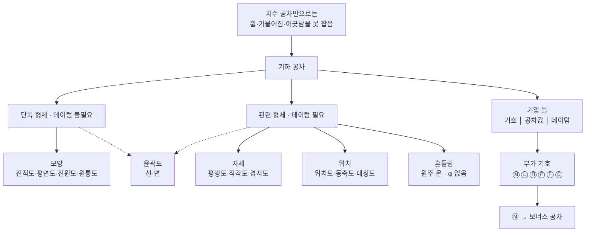

## 1. 왜 기하 공차가 필요한가

지름이 φ20 ± 0.01로 아주 정확한 축이라도 바나나처럼 휘어 있으면 베어링 두 개에 끼워지지 않는다. 치수 공차는 "**크기**"만 재기 때문에 이런 **휨·기울어짐·어긋남**을 잡지 못한다. 그래서 크기와 별도로 "얼마나 곧은가, 얼마나 직각인가, 중심이 얼마나 맞는가"를 허용 범위로 적는 것이 기하 공차다.

- 목적 세 가지: **호환성**(누가 만들어도 조립됨) · **기능 보증**(회전·밀봉 등 성능 확보) · **생산성**(기능에 필요한 만큼만 규제해 최대 공차를 줌).
- 기하 공차는 모양·위치 오차와 끼워맞춤 **호환성**을 보증한다. "직각 좌표 치수 방식을 바꿔 간단히 표시하려고"는 목적이 아니다.

> [!question] 시험에서는
> "기하 공차를 쓰는 이유가 **아닌** 것"을 묻는다(2016-3, 2017-2). 정답은 직각 좌표 치수 방식을 간단히 표시하려는 것.

## 2. 기하 공차 14종 기호

기호는 모양을 그대로 닮았다. 진원도는 원(○), 평행도는 평행선(//), 직각도는 직각(⊥), 흔들림은 다이얼 게이지 바늘이 튀는 화살표(↗)다. 먼저 **4개 무리**로 나누고, 무리마다 데이텀이 필요한지를 함께 외우면 된다.

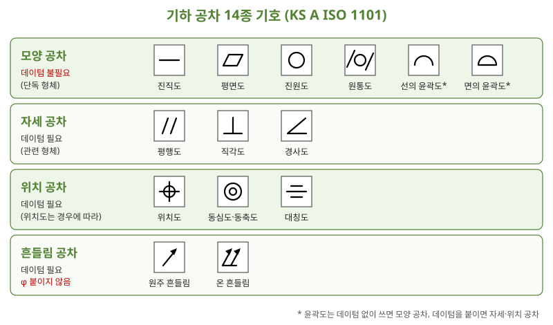

*첫 줄 모양 공차만 **데이텀 불필요**(단독 형체)다. 윤곽도 두 개는 데이텀 없이 쓰면 모양, 데이텀을 붙이면 자세·위치 공차가 된다. 흔들림 두 개는 화살표 1개(원주)와 2개(온)로 구분하고, 공차값 앞에 φ를 쓰지 않는다.*

### 기하 공차 기호 정리표

| 분류 | 공차 | 기호 | 데이텀 |
| --- | --- | :-: | :-: |
| 모양 | 진직도 | — | 불필요 |
| 모양 | 평면도 | ▱ | 불필요 |
| 모양 | 진원도 | ○ | 불필요 |
| 모양 | 원통도 | ⌭ | 불필요 |
| 모양 (또는 자세·위치) | 선의 윤곽도 | ⌒ | 필요 시 |
| 모양 (또는 자세·위치) | 면의 윤곽도 | ⌓ | 필요 시 |
| 자세 | 평행도 | // | 필요 |
| 자세 | 직각도 | ⊥ | 필요 |
| 자세 | 경사도 | ∠ | 필요 |
| 위치 | 위치도 | ⌖ | 필요 (경우에 따라) |
| 위치 | 동심도·동축도 | ◎ | 필요 |
| 위치 | 대칭도 | ⌯ | 필요 |
| 흔들림 | 원주 흔들림 | ↗ | 필요 |
| 흔들림 | 온 흔들림 | ⌰ | 필요 |

- 교재 분류: 모양(진직도·평면도·진원도·원통도)은 **단독 형체**, 윤곽도(선·면)는 **단독 또는 관련 형체**, 자세·위치·흔들림은 **관련 형체**라서 데이텀이 있어야 한다. 기하 공차는 모양·위치 오차와 끼워맞춤 **호환성**을 보증한다.

> [!tip] 감 잡기
> "나 혼자 곧으면 되나(모양), 남(데이텀)과 비교해야 하나(자세·위치·흔들림)?"로 나누면 데이텀 필요 여부가 바로 나온다. 평행·직각은 **무엇에 대해**가 있어야 말이 된다.

> [!question] 시험에서는
> 단독 형체끼리 묶인 보기(평면도·진원도·원통도)를 고르거나(2016-1), 위치 공차가 **아닌** 기호(직각도)를 고르게 한다.

## 3. 공차역 — 각 공차가 허용하는 영역

**공차역**은 실제 형체가 들어가야 하는 "울타리"다. 공차값 t는 울타리의 폭이고, 실제 표면이나 축선이 울타리 안에만 있으면 합격이다. 울타리가 평행선이냐, 동심원이냐, 원통이냐가 공차 종류를 가른다.

### 3-1. 모양 공차의 공차역

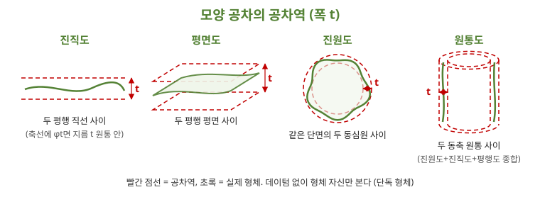

*빨간 점선이 공차역, 초록이 실제 형체다. 진원도는 **한 단면**의 두 동심원 사이만 보고, 원통도는 **원통 전체**를 두 동축 원통 사이에 가둔다. 그래서 원통도 하나가 진원도·진직도·평행도를 한꺼번에 규제한다.*

### 3-2. 자세 공차의 공차역

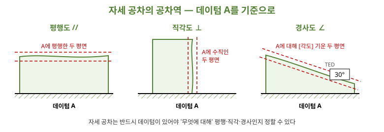

*세 그림 모두 아래 해칭면이 데이텀 A다. 공차역(빨간 점선)은 A에 평행하거나, 수직이거나, 이론적으로 정확한 각도 [30°]만큼 기울어져 있다. 경사도의 각도는 공차가 없는 TED로 준다.*

### 공차역 정리표

| 공차 | 공차역 |
| --- | --- |
| 진직도 | 두 평행 직선 사이 (축선이면 φ 원통 안) |
| 평면도 | 두 평행 평면 사이 |
| 진원도 | 같은 단면의 두 동심원 사이 |
| 원통도 | 두 동축 원통 사이 |
| 평행도 | 데이텀에 평행한 두 평면(직선) 사이 |
| 직각도 | 데이텀에 수직인 두 평면 사이 |
| 위치도 | 이론적으로 정확한 위치를 중심으로 한 영역 |
| 동심도 | 데이텀 축선을 중심으로 한 φ 원통 |
| 원주 흔들림 | 데이텀 축 기준 1회전 시 다이얼 게이지 흔들림 |

## 4. 데이텀

데이텀은 측정할 때 부품을 "**올려놓는 기준**"이다. 평행도를 재려면 부품의 아랫면을 정반 위에 올려놓고 윗면을 다이얼 게이지로 훑는데, 이때 정반에 닿은 아랫면이 데이텀 A가 된다.

- 기하 공차의 **기준**이 되는 점·선·면.
- 표시: 데이텀 문자(A, B, C)를 네모에 넣고 **삼각형 기호**로 형체에 연결.
- 우선순위: 기입 틀에 적힌 순서대로 1차, 2차, 3차 데이텀.
- 축선이 데이텀이면 삼각형을 **치수선 연장선 위**에 둔다. 표면이면 치수선과 어긋나게.

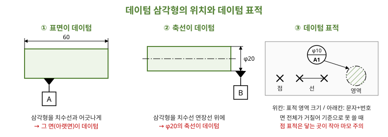

*① 삼각형이 치수선 60과 떨어져 있으면 그 **면**이 데이텀. ② 삼각형이 φ20 치수선 화살표와 일직선이면 그 원통의 **축선**이 데이텀. ③ 데이텀 표적은 점(×), 선(× 두 개를 가는 실선으로 연결), 영역(2점 쇄선 + 해칭)으로 표시하고, 원을 가로로 나눈 표적 기호에 영역 크기(φ10)와 문자·번호(A1)를 적는다.*

- 데이텀 표기: **A-B**(하이픈)는 두 데이텀을 묶은 **공통 데이텀**이다. 칸을 나눠 A │ B │ C로 쓰면 왼쪽일수록 우선순위가 높고, 우선순위가 없으면 한 칸에 나란히 쓴다.

### 4-1. 데이텀 표적

- 면 전체가 아니라 일부 점·선·영역만 데이텀으로 쓸 때.
- **점**: × 표시. **선**: 두 × 를 가는 실선으로 연결. **영역**: 가는 2점 쇄선으로 둘러싸고 해칭.
- 데이텀 표적 기호(원을 가로로 나눈 틀)의 위칸에 영역 크기, 아래칸에 데이텀 문자와 번호(A1, A2)를 적는다.
- 교재(CH03 07절): 데이텀 표적은 표면이 거칠거나 평평하지 않아 면 전체를 기준으로 쓰기 어려울 때 쓴다. **점 표적**은 닿는 곳이 작아 **마모**에 주의한다.

> [!question] 시험에서는
> 데이텀 표적의 **×** 기호가 무엇인지 묻는다(2018-3) → 데이텀 표적 **점**.

## 5. 공차 기입 틀 읽기

기입 틀은 왼쪽부터 "**무엇을(기호) · 얼마나(공차값) · 무엇에 대해(데이텀)**" 순서로 읽는 한 문장이다. `// │ 0.05 │ A`는 "데이텀 A에 대해 평행도 0.05 이내"라는 뜻이다.

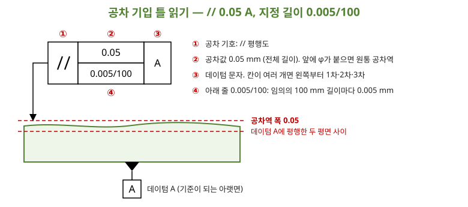

*지시선 화살표가 닿은 윗면이 규제 대상, 아래 삼각형이 붙은 아랫면이 데이텀 A다. 윗면 전체는 A에 평행한 0.05 폭 안에 있어야 하고, 아래 줄 0.005/100 때문에 어느 100 mm 구간을 잘라 봐도 0.005 안에 있어야 한다.*

### 기입 틀 읽기 예

| 기입 틀 | 해석 |
| --- | --- |
| `// │ 0.05 │ A` 와 그 아래 `0.005/100` | 데이텀 A 기준 평행도: 전체 0.05, 임의의 100 mm마다 0.005 |
| `— │ φ0.02` (치수선 연장선에 지시) | 축선의 진직도, 지름 0.02 원통 안. 지시한 치수의 형체(축선)에 적용 |
| `⌰ │ 0.1 │ A-B` | 공통 데이텀 축 A-B 기준 온 흔들림 0.1 (φ 없음) |
| `⌖ │ φ0.1 Ⓜ │ A` | 최대 실체일 때 위치도 φ0.1, 치수가 벗어나면 보너스 |

- 기입 틀 하나에 여러 공차를 위아래로 쌓으면 **모두 적용**된다.

### 5-1. 이론적으로 정확한 치수 (TED)

- 네모 틀 안의 치수 **[ 30 ]** → 공차 없는 이상 치수. 위치도·윤곽도에서 기준 위치를 정한다.

> [!question] 시험에서는
> 지정 길이 평행도 해석(2014-1), 진직도 적용 범위(2015-2), 여러 공차 동시 적용(2019-1), 표기가 맞는 것·틀린 것(2018-2, 2019-3), 온 흔들림 표기(2020-3)가 모두 이 표 한 장으로 풀린다. 흔들림에 φ가 붙어 있거나 데이텀이 빠져 있으면 **틀린 표기**다.

## 6. 부가 기호와 돌출 공차역

공차값 뒤에 붙는 동그라미 문자는 "어떤 조건에서 이 공차를 적용하나"를 바꾸는 스위치다. 가장 자주 나오는 것은 Ⓜ(7절)과 Ⓟ다.

### 부가 기호 정리표

| 기호 | 뜻 |
| :-: | --- |
| Ⓜ | 최대 실체 요구사항 |
| Ⓛ | 최소 실체 요구사항 |
| Ⓡ | 상호 요구사항 (Ⓜ 또는 Ⓛ 다음에 추가) |
| Ⓟ | 돌출 공차역 (볼트가 박히는 구멍처럼 부품 밖으로 연장된 영역) |
| Ⓕ | 자유 상태 (비강성 부품) |
| Ⓔ | 포락의 조건 (치수 공차 뒤에 붙임) |
| [ 30 ] | 이론적으로 정확한 치수 |

### 6-1. 돌출 공차역 Ⓟ

나사 구멍이 판 안에서는 아주 조금 기울었어도, 볼트가 그 위로 상대 부품을 뚫고 나가면 기울기가 길이만큼 커져 상대 부품 구멍에 걸린다. 그래서 공차역을 **부품 밖으로 연장**해 검사한다.

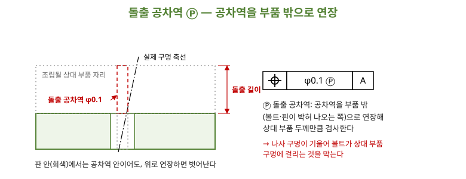

*점선 축선은 판 안(회색 점선)에서는 φ0.1 안에 있지만, 위로 연장한 빨간 돌출 공차역에서는 오른쪽으로 벗어난다. Ⓟ를 붙이면 이 연장 부분까지 합격 여부를 본다.*

> [!question] 시험에서는
> Ⓡ 상호 요구사항(2019-2), Ⓟ 돌출 공차역(2019-3), Ⓜ 최대 실체 요구사항(2020-1)이 각각 나왔다. 기호와 우리말 이름을 짝지어 둔다.

## 7. 실체 조건과 보너스 공차

**"실체"는 재료(살)**다. 축은 굵을수록, 구멍은 좁을수록 재료가 많다. 조립이 가장 빡빡한 순간은 둘 다 재료가 가장 많을 때(MMC)이므로, 그때를 기준으로 위치 공차를 정하고 여유가 생기면 그만큼 더 풀어 주는 것이 Ⓜ의 발상이다.

| 조건 | 기호 | 축 | 구멍 |
| --- | :-: | --- | --- |
| 최대 실체 조건 (MMC) | Ⓜ | 최대 치수 | 최소 치수 |
| 최소 실체 조건 (LMC) | Ⓛ | 최소 치수 | 최대 치수 |

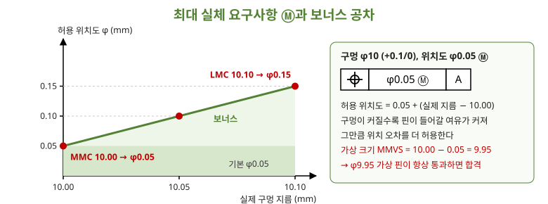

*구멍이 MMC인 10.00일 때는 기본 φ0.05만, 10.05면 φ0.10, LMC인 10.10이면 φ0.15까지 허용된다. 늘어난 부분(연한 초록)이 보너스다. 어느 경우든 가상 크기 MMVS φ9.95 핀은 항상 통과한다.*

$$
\text{허용 위치도} = \text{기본 공차} + \lvert \text{실제 치수} - \text{MMC 치수} \rvert
$$

- **보너스 공차 예**: 구멍 φ10 $^{+0.1}_{\;\;0}$, 위치도 φ0.05 Ⓜ
  - 구멍이 10.00(MMC)이면 위치도 φ0.05
  - 구멍이 10.10(LMC)이면 위치도 $0.05 + 0.10 = $ φ0.15
- 용도: 볼트 구멍처럼 **조립만 되면 되는** 곳. 원가 절감.

**최대 실체 용어 (교재 CH03 08절)**

| 용어 | 뜻 |
| --- | --- |
| MMS (최대 실체 크기) | MMC일 때의 크기, 기호 Ⓜ |
| MMVS (최대 실체 가상 크기) | 형체 크기와 기하 공차가 합쳐져 생기는 가상(실효) 크기 |
| MMR (최대 실체 요구사항) | 실체 **외부**에 MMVS를 넘는 형체가 나오지 않게 제한 |
| RPR (상호 요구사항) | Ⓜ·Ⓛ 뒤에 Ⓡ. 실제 기하 편차가 공차보다 작으면 그만큼 **치수 공차를 늘려 준다** |

- 도입 이유: 치수만으로 규정하면 열을 맞춘 볼트와 구멍이 조립되지 않을 수 있다. 실제 구멍 크기에 따라 위치 공차를 더 허용해 현실적으로 만들 수 있게 한다.
- 예 (교재 8-3): 구멍 $\phi 8^{+0.2}_{+0.1}$, 위치도 φ0.1 Ⓜ → MMS = 8.1, MMVS = 8.1 − 0.1 = **8.0**. 구멍이 8.2(최소 실체)로 커지면 위치도는 0.1보다 크게(0.2까지) 허용된다.

> [!tip] 감 잡기
> 구멍의 MMVS = MMS − 기하 공차, 축의 MMVS = MMS + 기하 공차. "구멍은 좁아지고 축은 굵어지는 쪽"으로 가상 크기를 만든다고 기억한다.

> [!question] 시험에서는
> 기둥 φ50 ± 0.2의 MMS를 물으면 재료가 가장 많은 **50.2**, 구멍이면 **49.8**. "MMR은 내부를 제한한다"는 틀린 보기다(외부 제한).

## 8. 측정 방법

기하 공차는 "데이텀을 정반·V 블록·센터에 맞춰 놓고, 다이얼 게이지로 표면을 훑는" 방식이 기본이다. 위치도처럼 여러 점의 좌표를 계산해야 하면 3차원 측정기를 쓴다.

| V 블록 (원통 공작물을 홈에 올리고 위에서 누름) | 선반 척에 물린 공작물에 다이얼 게이지를 댄 모습 |
| :-: | :-: |
| 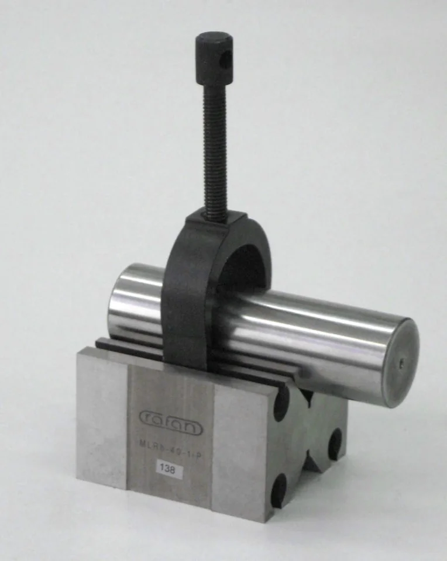 | 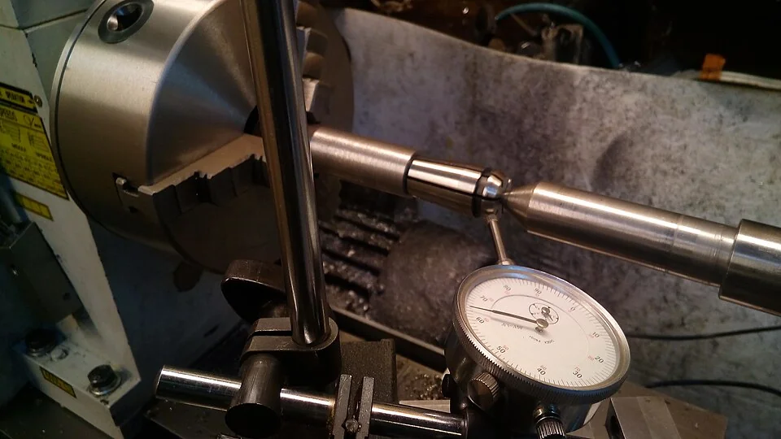 |

*왼쪽: V 홈에 원통을 올리면 축선이 저절로 정해지므로, 축선을 데이텀으로 잡을 때 쓴다. 오른쪽: 선반 척에 물려 돌아가는 공작물 끝에 다이얼 게이지 측정자가 닿아 있다. 돌리는 동안 바늘이 움직인 폭이 흔들림 값이다.*

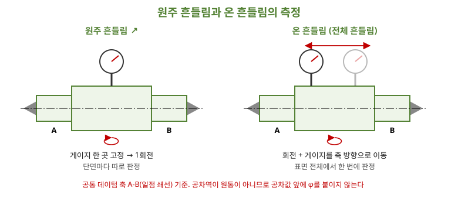

*양 끝 센터로 지지한 축을 공통 데이텀 축 A-B로 삼아 돌린다. **원주 흔들림**은 게이지를 한 곳에 고정하고 단면마다 따로 판정하고, **온 흔들림**은 돌리면서 게이지를 축 방향으로 옮겨 표면 전체를 한 번에 판정한다.*

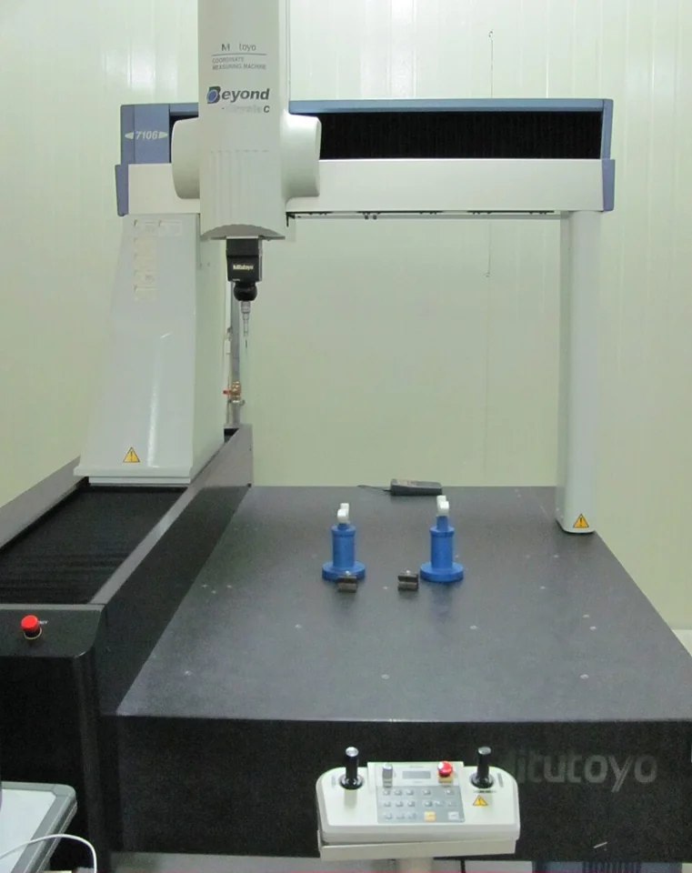

*프로브로 구멍 둘레 여러 점의 좌표를 찍어 중심 위치를 계산하므로, 위치도처럼 "이론적으로 정확한 위치"와 비교해야 하는 공차를 잰다.*

### 측정 방법 정리표

| 공차 | 측정 |
| --- | --- |
| 평면도 | 정반 + 다이얼 게이지, 3차원 측정기 |
| 진원도 | 진원도 측정기 |
| 흔들림 | V블록·센터 지지 후 회전 + 다이얼 게이지 |
| 위치도 | 3차원 측정기 (CMM) |

## 그림

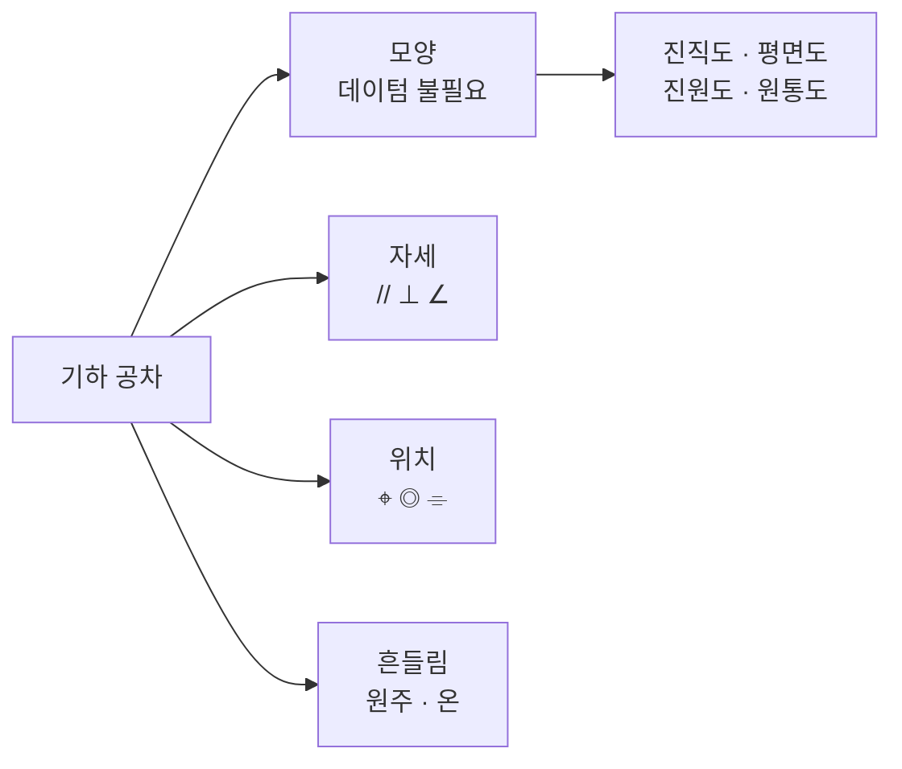

## 기출 포인트

- 기하 공차 기입 틀 해석·표기 — 7회: 지정 길이 평행도 해석 (2014-1), 진직도 적용 범위 (2015-2), 위치도 + 최대 실체 해석 (2016-2), 여러 공차 동시 적용 기입 틀 (2019-1), 표기가 맞는 것·틀린 것 고르기 (2018-2, 2019-3), 온 흔들림 표기 (2020-3)
- 부가 기호 — 3회: Ⓡ 상호 요구사항 (2019-2), Ⓟ 돌출 공차역 (2019-3), Ⓜ 최대 실체 요구사항 (2020-1)
- 기하 공차를 쓰는 이유가 아닌 것 — 2회 (2016-3, 2017-2)
- 단독 형체(데이텀 불필요) 공차만 고르기 — 1회 (2016-1)
- 데이텀 표적 × 기호의 의미 — 1회 (2018-3)
- 합계 **14회** (2014~2020). 2018년 이후에는 거의 매회 1문제.

**교재 예제 유형** (Win-Q 2025 PART 01 CHAPTER 03, 07~08절): '가' 부분 기호(그림, 직각도), 평행도 전체 0.05·100 mm당 0.005 해석(그림), φ20·φ40 축선 진직도 φ0.02 해석(그림, 교재 해설은 "지름 2 mm"로 오기), 단독 형체끼리 묶인 것, 위치 공차가 아닌 기호(그림), 기하 공차를 쓰는 이유가 아닌 것(직각 좌표 치수 방식), Ⓟ 돌출 공차역, 기둥의 MMS(그림, 50.2), 용어 설명 중 틀린 것(MMR은 MMVS 기준·외부 제한), 구멍 4개 위치도 Ⓜ 해석(그림).

## 관련 단원

- [치수공차와 끼워맞춤](치수공차와_끼워맞춤.md)
- [도면 양식과 투상법](도면_양식과_투상법.md)
- [표면거칠기·열처리·가공기호](표면거칠기_열처리_가공기호.md)
- [기계공작과 측정](기계공작과_측정.md) — 다이얼 게이지·3차원 측정기·정반

## 체크리스트

- [ ] 기하 공차 14종 기호를 분류별로 쓴다
- [ ] 데이텀이 필요 없는 공차를 고른다
- [ ] 진원도와 원통도, 원주 흔들림과 온 흔들림을 구분한다
- [ ] 공차 기입 틀을 읽는다
- [ ] MMC의 축·구멍 치수를 안다
- [ ] 보너스 공차를 계산한다
- [ ] Ⓜ Ⓛ Ⓡ Ⓟ Ⓕ Ⓔ 부가 기호의 뜻을 말한다
- [ ] 흔들림 공차에 φ를 붙이지 않는 이유를 안다
- [ ] 전체 길이·지정 길이 공차가 함께 적힌 틀을 읽는다
- [ ] 데이텀 표적의 점·선·영역 표시를 구분한다
- [ ] 기하 공차를 쓰는 목적 3가지를 말한다

## 참고

- [큐넷 자동화설비산업기사 출제기준](https://www.q-net.or.kr/crf005.do?id=crf00503&jmCd=2034)
- KS A ISO 1101 (기하 공차 표시 방식)

### 그림 출처

위키미디어 공용(Wikimedia Commons)과 Openverse에서 가져온 공개 라이선스 자료이고, 노트에 맞게 크기를 줄이고 WebP로 변환했다.

| 그림 | 작성자 | 라이선스 | 출처 |
| --- | --- | --- | --- |
| [V-block steel](https://commons.wikimedia.org/wiki/File:V-block_steel.jpg) | Rrudzik | CC0 | Wikimedia Commons |
| [Dial Indicator in Use](https://commons.wikimedia.org/wiki/File:Dial_Indicator_in_Use.jpg) | David English | [CC BY-SA 4.0](https://creativecommons.org/licenses/by-sa/4.0) | Wikimedia Commons |
| [Beyond CrystaC](https://commons.wikimedia.org/wiki/File:Beyond_CrystaC.jpg) | Blue tooth7 | [CC BY-SA 3.0](https://creativecommons.org/licenses/by-sa/3.0) | Wikimedia Commons |

직접 그린 그림(SVG, 이 볼트용으로 새로 작성): 기하공차 기호, 모양공차 공차역, 자세공차 공차역, 데이텀 표시 표적, 기하공차 기입틀, 돌출공차역, MMC 보너스공차, 흔들림 원주 온.

