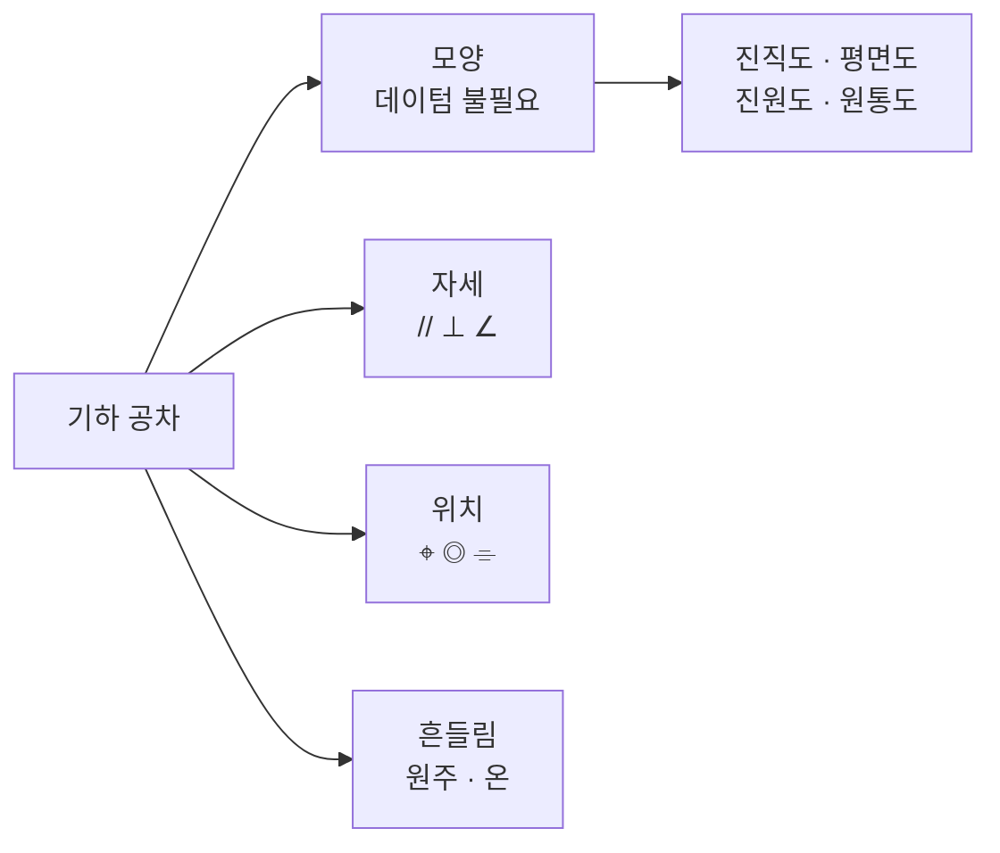

# 기하공차

> [!summary] 핵심 요약
> - 기하 공차는 **모양, 자세, 위치, 흔들림**의 허용 범위. 치수 공차만으로는 잡을 수 없는 휨·기울어짐·어긋남을 규제한다.
> - **모양 공차**(진직도, 평면도, 진원도, 원통도, 선·면의 윤곽도)는 **데이텀이 필요 없다** (윤곽도는 경우에 따라 사용).
> - **자세**(평행도, 직각도, 경사도), **위치**(위치도, 동심도, 대칭도), **흔들림**(원주, 온) 공차는 **데이텀이 필요**하다.
> - 공차 기입 틀: `[기호 | 공차값 | 데이텀]`. 공차값 앞 **φ**는 공차역이 원통이라는 뜻.

> [!warning] 자주 틀리는 포인트
> - **진원도**는 단면의 원 모양만, **원통도**는 원통 전체(진원도 + 진직도 + 평행도 종합).
> - **원주 흔들림**은 한 단면에서 1회전, **온 흔들림**은 전체 길이에 걸쳐 측정.
> - **최대 실체 조건(MMC, Ⓜ)**: 재료가 가장 많은 상태 → 축은 **최대 치수**, 구멍은 **최소 치수**.
> - MMC를 적용하면 실제 치수가 MMC에서 벗어난 만큼 **기하 공차를 추가로 허용(보너스 공차)**.
> - **흔들림 공차**는 공차역이 원통이 아니므로 공차값 앞에 **φ를 붙이지 않는다**. 데이텀은 반드시 필요하다.
> - 기하 공차를 쓰는 이유는 **호환성·기능 보증·생산성(최대 공차)** 이다. "직각 좌표 치수 방식을 바꿔 간단히 표시하려고"는 이유가 아니다.
> - 부가 기호 혼동: Ⓜ 최대 실체, Ⓛ 최소 실체, **Ⓡ 상호 요구사항**(Ⓜ·Ⓛ 뒤에 붙임), **Ⓟ 돌출 공차역**, Ⓕ 자유 상태, Ⓔ 포락의 조건.
> - 기입 틀에 `0.05` 아래 `0.005/100` 처럼 두 줄이면 **위는 전체 길이**, 아래는 **지정 길이 100 mm당** 공차다.

## 개념 정리

### 기하 공차 기호

| 분류 | 공차 | 기호 | 데이텀 |
| --- | --- | :-: | :-: |
| 모양 | 진직도 | — | 불필요 |
| 모양 | 평면도 | ▱ | 불필요 |
| 모양 | 진원도 | ○ | 불필요 |
| 모양 | 원통도 | ⌭ | 불필요 |
| 모양 (또는 자세·위치) | 선의 윤곽도 | ⌒ | 필요 시 |
| 모양 (또는 자세·위치) | 면의 윤곽도 | ⌓ | 필요 시 |
| 자세 | 평행도 | // | 필요 |
| 자세 | 직각도 | ⊥ | 필요 |
| 자세 | 경사도 | ∠ | 필요 |
| 위치 | 위치도 | ⌖ | 필요 (경우에 따라) |
| 위치 | 동심도·동축도 | ◎ | 필요 |
| 위치 | 대칭도 | ⌯ | 필요 |
| 흔들림 | 원주 흔들림 | ↗ | 필요 |
| 흔들림 | 온 흔들림 | ⌰ | 필요 |

### 각 공차의 뜻

| 공차 | 공차역 |
| --- | --- |
| 진직도 | 두 평행 직선 사이 (축선이면 φ 원통 안) |
| 평면도 | 두 평행 평면 사이 |
| 진원도 | 같은 단면의 두 동심원 사이 |
| 원통도 | 두 동축 원통 사이 |
| 평행도 | 데이텀에 평행한 두 평면(직선) 사이 |
| 직각도 | 데이텀에 수직인 두 평면 사이 |
| 위치도 | 이론적으로 정확한 위치를 중심으로 한 영역 |
| 동심도 | 데이텀 축선을 중심으로 한 φ 원통 |
| 원주 흔들림 | 데이텀 축 기준 1회전 시 다이얼 게이지 흔들림 |

### 데이텀

- 기하 공차의 **기준**이 되는 점·선·면.
- 표시: 데이텀 문자(A, B, C)를 네모에 넣고 **삼각형 기호**로 형체에 연결.
- 우선순위: 기입 틀에 적힌 순서대로 1차, 2차, 3차 데이텀.
- 축선이 데이텀이면 삼각형을 **치수선 연장선 위**에 둔다. 표면이면 치수선과 어긋나게.

### 데이텀 표적

- 면 전체가 아니라 일부 점·선·영역만 데이텀으로 쓸 때.
- **점**: × 표시. **선**: 두 × 를 가는 실선으로 연결. **영역**: 가는 2점 쇄선으로 둘러싸고 해칭.
- 데이텀 표적 기호(원을 가로로 나눈 틀)의 위칸에 영역 크기, 아래칸에 데이텀 문자와 번호(A1, A2)를 적는다.

### 부가 기호

| 기호 | 뜻 |
| :-: | --- |
| Ⓜ | 최대 실체 요구사항 |
| Ⓛ | 최소 실체 요구사항 |
| Ⓡ | 상호 요구사항 (Ⓜ 또는 Ⓛ 다음에 추가) |
| Ⓟ | 돌출 공차역 (볼트가 박히는 구멍처럼 부품 밖으로 연장된 영역) |
| Ⓕ | 자유 상태 (비강성 부품) |
| Ⓔ | 포락의 조건 (치수 공차 뒤에 붙임) |
| [ 30 ] | 이론적으로 정확한 치수 |

### 기입 틀 읽기 예

| 기입 틀 | 해석 |
| --- | --- |
| `// │ 0.05 │ A` 와 그 아래 `0.005/100` | 데이텀 A 기준 평행도: 전체 0.05, 임의의 100 mm마다 0.005 |
| `— │ φ0.02` (치수선 연장선에 지시) | 축선의 진직도, 지름 0.02 원통 안. 지시한 치수의 형체(축선)에 적용 |
| `⌰ │ 0.1 │ A-B` | 공통 데이텀 축 A-B 기준 온 흔들림 0.1 (φ 없음) |
| `⌖ │ φ0.1 Ⓜ │ A` | 최대 실체일 때 위치도 φ0.1, 치수가 벗어나면 보너스 |

- 기입 틀 하나에 여러 공차를 위아래로 쌓으면 **모두 적용**된다.

### 이론적으로 정확한 치수 (TED)

- 네모 틀 안의 치수 **[ 30 ]** → 공차 없는 이상 치수. 위치도·윤곽도에서 기준 위치를 정한다.

### 실체 조건

| 조건 | 기호 | 축 | 구멍 |
| --- | :-: | --- | --- |
| 최대 실체 조건 (MMC) | Ⓜ | 최대 치수 | 최소 치수 |
| 최소 실체 조건 (LMC) | Ⓛ | 최소 치수 | 최대 치수 |

- **보너스 공차 예**: 구멍 φ10 $^{+0.1}_{\;\;0}$, 위치도 φ0.05 Ⓜ
  - 구멍이 10.00(MMC)이면 위치도 φ0.05
  - 구멍이 10.10(LMC)이면 위치도 $0.05 + 0.10 = $ φ0.15
- 용도: 볼트 구멍처럼 **조립만 되면 되는** 곳. 원가 절감.

### 측정 방법

| 공차 | 측정 |
| --- | --- |
| 평면도 | 정반 + 다이얼 게이지, 3차원 측정기 |
| 진원도 | 진원도 측정기 |
| 흔들림 | V블록·센터 지지 후 회전 + 다이얼 게이지 |
| 위치도 | 3차원 측정기 (CMM) |

## 그림

## 기출 포인트

- 기하 공차 기입 틀 해석·표기 — 7회: 지정 길이 평행도 해석 (2014-1), 진직도 적용 범위 (2015-2), 위치도 + 최대 실체 해석 (2016-2), 여러 공차 동시 적용 기입 틀 (2019-1), 표기가 맞는 것·틀린 것 고르기 (2018-2, 2019-3), 온 흔들림 표기 (2020-3)
- 부가 기호 — 3회: Ⓡ 상호 요구사항 (2019-2), Ⓟ 돌출 공차역 (2019-3), Ⓜ 최대 실체 요구사항 (2020-1)
- 기하 공차를 쓰는 이유가 아닌 것 — 2회 (2016-3, 2017-2)
- 단독 형체(데이텀 불필요) 공차만 고르기 — 1회 (2016-1)
- 데이텀 표적 × 기호의 의미 — 1회 (2018-3)
- 합계 **14회** (2014~2020). 2018년 이후에는 거의 매회 1문제.

## 관련 단원

- [치수공차와 끼워맞춤](치수공차와_끼워맞춤.md)
- [도면 양식과 투상법](도면_양식과_투상법.md)
- [표면거칠기·열처리·가공기호](표면거칠기_열처리_가공기호.md)

## 체크리스트

- [ ] 기하 공차 14종 기호를 분류별로 쓴다
- [ ] 데이텀이 필요 없는 공차를 고른다
- [ ] 진원도와 원통도, 원주 흔들림과 온 흔들림을 구분한다
- [ ] 공차 기입 틀을 읽는다
- [ ] MMC의 축·구멍 치수를 안다
- [ ] 보너스 공차를 계산한다
- [ ] Ⓜ Ⓛ Ⓡ Ⓟ Ⓕ Ⓔ 부가 기호의 뜻을 말한다
- [ ] 흔들림 공차에 φ를 붙이지 않는 이유를 안다
- [ ] 전체 길이·지정 길이 공차가 함께 적힌 틀을 읽는다
- [ ] 데이텀 표적의 점·선·영역 표시를 구분한다
- [ ] 기하 공차를 쓰는 목적 3가지를 말한다

## 참고

- [큐넷 자동화설비산업기사 출제기준](https://www.q-net.or.kr/crf005.do?id=crf00503&jmCd=2034)
- KS A ISO 1101 (기하 공차 표시 방식)
