# 나사와 볼트

> [!summary] 핵심 요약
> - **리드** $L = n \times p$ (줄 수 × 피치). 한 바퀴 돌릴 때 축 방향으로 움직이는 거리.
> - 체결용은 **삼각나사**(미터·유니파이·관용), 운동·동력 전달용은 **사각·사다리꼴·톱니·볼나사**.
> - **자립 조건**: 마찰각 ≥ 리드각 ($\rho \ge \lambda$). 자립하는 나사의 효율은 **50% 미만**.
> - 축 하중만 받는 볼트 지름: $d = \sqrt{\dfrac{2W}{\sigma_a}}$ (골지름 ≈ 0.8d로 본 근사식).

> [!warning] 자주 틀리는 포인트
> - **M10** = 미터 보통 나사 바깥지름 10 mm. 가는 나사는 **M10×1.25**처럼 피치를 붙인다.
> - 강도 구분 **8.8**: 인장 강도 $8 \times 100 = 800$ MPa, 항복 강도 $800 \times 0.8 = 640$ MPa.
> - **톱니나사**는 한 방향으로만 큰 힘(바이스, 잭). **둥근나사**는 먼지·이물질 많은 곳(전구 소켓).
> - **볼나사**: 효율 90% 이상, 백래시 작음, 하지만 **자립하지 않는다** → 수직축에는 브레이크.
> - 이중 너트(로크 너트)는 **얇은 너트를 먼저(안쪽)** 조인다는 설명이 일반적이다.
> - 나사 표시에서 **오른나사는 표시를 생략**하고 **왼나사만 '왼' 또는 LH**를 붙인다. "오른나사만 RH를 적는다"는 틀린 보기.
> - **미터 가는 나사는 피치를 반드시 적는다** (M10×1.25). 피치를 생략하면 보통 나사로 읽힌다.
> - `왼 2줄 M50×3-6H`: 피치 3, **리드 = 2 × 3 = 6**, 6H는 **암나사** 등급. 대문자 등급(6H)은 암나사, 소문자(6g)는 수나사.
> - **TW**는 **29° 사다리꼴**(인치계) 옛 기호다. 30° 미터 사다리꼴은 **Tr**(옛 기호 TM). **CTG는 후강 전선관 나사**, 자전거 나사는 **BC**다 (KS B 0200, 교재 CH03 13절).
> - **피치는 줄 수와 무관**하게 이웃한 산 사이 거리다. 줄 수가 바뀌는 것은 리드 (교재 CH03 11-1).
> - 나사 머리를 뭉개는 것은 **영구 결합**이라 풀림 방지법이 아니다(그럴 바엔 리벳) (교재 11-3).
> - 나사 도시에서 **완전 나사부와 불완전 나사부의 경계선은 굵은 실선**. 골지름은 가는 실선, 불완전 나사부의 골은 축선에 30° 기울인 가는 실선.

## 학습 목표

이 단원을 마치면 다음을 할 수 있어야 한다.

1. 바깥지름·골지름·유효지름·피치·리드를 그림에서 짚고, 줄 수와 회전수로 이동 거리를 계산한다.
2. 나사산 모양(삼각·사각·사다리꼴·톱니·둥근·볼)과 산 각도를 용도와 연결한다.
3. M, Tr, TW, R, Rc, Rp, G, UNC 같은 기호와 `왼 2줄 M50×3-6H` 같은 표시를 해독한다.
4. 나사 도면에서 산봉우리·골·완전 나사부 경계·불완전 나사부를 그리는 선 종류를 구분한다.
5. 축 하중·조임 토크를 받는 볼트 지름을 계산하고, 강도 구분 8.8·10.9를 읽는다.
6. 나사를 빗면으로 보고 회전력·효율·자립 조건을 설명하며, 풀림 방지법을 5가지 이상 든다.

## 한눈에 보기

```mermaid
flowchart TB
    G[나사 기본량<br/>d · d₁ · d₂ · p] --> L[리드 L = n × p<br/>이동 거리 = L × 회전수]
    G --> K[나사산 모양]
    K --> K1[체결용 삼각나사<br/>미터 · 유니파이 60°, 관용 55°]
    K --> K2[운동용<br/>사각 · 사다리꼴 · 톱니 · 둥근 · 볼]
    K1 --> S[기호 · 표시<br/>왼 2줄 M50×3-6H]
    S --> DR[도시<br/>굵은 실선 · 가는 실선 · 30°]
    K1 --> B[볼트 · 너트 종류<br/>관통 · 탭 · 스터드]
    B --> ST[강도 설계<br/>d = √(2W/σa), 8.8]
    L --> MC[역학: 빗면<br/>P = W tan(λ+ρ), η]
    MC --> SL[자립 λ ≤ ρ<br/>η < 50%]
    SL --> LK[풀림 방지<br/>로크 너트 · 와셔 · 분할 핀]
```

## 1. 나사의 용어와 리드

나사는 **원통에 감아 붙인 빗면**이다. 종이로 만든 직각삼각형을 연필에 감으면 빗변이 나선을 그리며 올라간다. 이 나선을 따라 산을 깎으면 나사가 되고, 나사를 돌리면 빗면을 타고 오르듯 축 방향으로 나아간다. 그래서 나사의 치수는 "산이 얼마나 굵은가(지름)"와 "한 바퀴에 얼마나 오르는가(리드)" 두 가지로 정리된다.

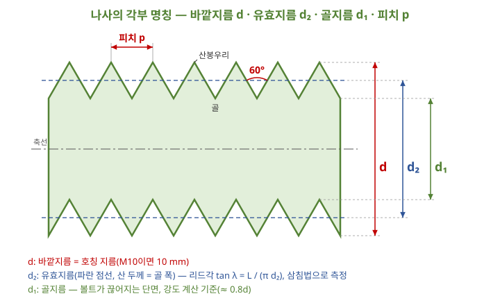

*수나사를 축 방향으로 자른 단면이다. 산봉우리를 잇는 지름이 **바깥지름 d**(호칭 지름), 골 바닥을 잇는 지름이 **골지름 d₁**, 그 사이에서 산 두께와 골 폭이 같아지는 파란 점선이 **유효지름 d₂**다. 이웃한 산봉우리 사이가 **피치 p**, 미터 나사의 산 각은 **60°**. 볼트가 끊어질 때는 가장 가는 골지름 단면에서 끊어지므로 강도 계산은 d₁로 한다.*

### 나사의 용어

| 용어 | 뜻 |
| --- | --- |
| 피치 p | 이웃한 나사산 사이 거리 |
| 리드 L | 1회전에 이동하는 거리 = 줄 수 × 피치 |
| 바깥지름 d | 호칭 지름 (수나사 산봉우리) |
| 골지름 $d_1$ | 수나사 골 부분 지름 (강도 계산 기준) |
| 유효지름 $d_2$ | 산 두께와 골 폭이 같은 가상 원통 지름 |
| 리드각 λ | $\tan\lambda = \dfrac{L}{\pi d_2}$ |

- **오른나사**가 기본. 왼나사는 회전 방향 때문에 풀리면 안 되는 곳(자전거 왼쪽 페달, 그라인더 숫돌).

### 피치와 리드 — 줄 수

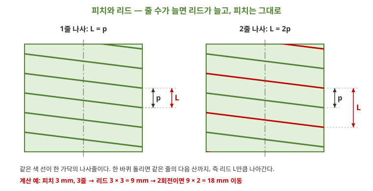

*같은 색 선이 한 가닥의 나사줄이다. 왼쪽 1줄 나사는 이웃한 산이 같은 줄이라 리드 = 피치. 오른쪽 2줄 나사는 초록·빨강 두 줄이 번갈아 감겨 있어서, 이웃한 산 사이(피치 p)는 그대로인데 같은 줄의 다음 산까지(리드 L)는 2p다. 한 바퀴 돌리면 같은 줄을 따라 L만큼 나아간다.*

$$L = n \times p, \qquad \text{이동 거리} = L \times \text{회전수}$$

- **이동 거리 계산 예**: 피치 3 mm, 3줄 나사를 2회전 → 리드 $3 \times 3 = 9$ mm, 이동 $9 \times 2 = 18$ mm.

> [!tip] 감 잡기 — 왜 여러 줄로 만드나
> 피치를 키우면 산이 커져 나사가 굵어져야 한다. 산은 작게 둔 채 빨리 나아가게 하려면 줄 수를 늘린다. 병뚜껑이나 만년필 뚜껑이 반 바퀴만에 열리는 것이 다줄 나사다. 대신 리드각이 커져서 저절로 풀리기 쉽다(7절).

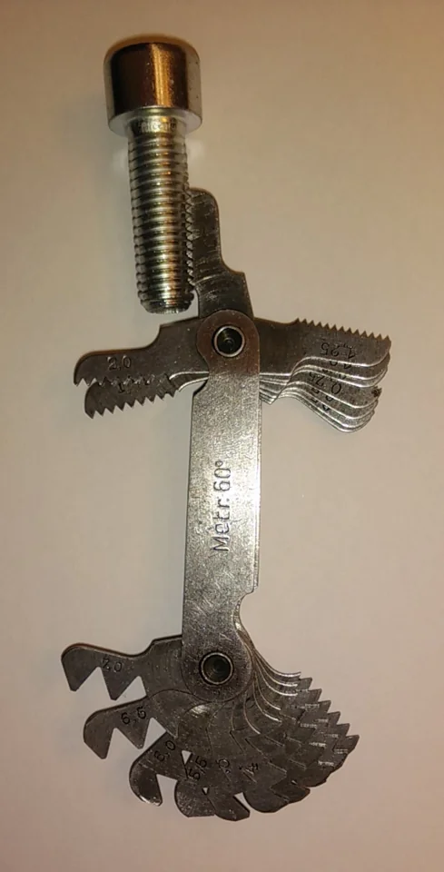

*피치 게이지: 날마다 피치가 새겨져 있어 나사산에 대 보고 빈틈 없이 맞는 날로 피치를 읽는다. 다줄 나사라도 게이지로 읽히는 것은 피치이지 리드가 아니다.*

## 2. 나사의 종류 — 산의 모양이 용도를 정한다

산 모양은 "얼마나 꽉 물려야 하나"와 "얼마나 쉽게 돌아야 하나" 사이의 선택이다. 산이 뾰족한 **삼각나사**는 비스듬한 면이 쐐기처럼 파고들어 마찰이 커서 잘 풀리지 않으므로 **체결용**이다. 산이 각진 **사각·사다리꼴 나사**는 힘을 받는 면이 축에 거의 직각이라 마찰이 작아 **힘과 운동을 전달**하는 데 쓴다.

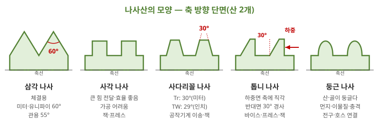

*축을 지나게 자른 나사산 단면 다섯 가지. 삼각 나사는 산 각 60°(관용 55°), 사각 나사는 산이 네모, 사다리꼴 나사는 산 각 30°(인치계 29°)로 사각 나사를 깎기 쉽게 바꾼 것, 톱니 나사는 하중면이 축에 직각이고 반대면만 30° 기울어 한 방향(빨간 화살표) 하중에 강하다. 둥근 나사는 산과 골이 둥글어 먼지가 끼거나 부딪혀도 잘 상하지 않는다.*

### 나사의 종류

| 종류 | 나사산 각 | 용도 |
| --- | --- | --- |
| 미터 나사 | 60° | 체결용 (mm 단위) |
| 유니파이 나사 | 60° | 체결용 (인치 단위, 산 수/inch) |
| 관용 나사 (평행 G, 테이퍼 R) | 55° | 배관 연결, 테이퍼는 기밀 |
| 사각 나사 | – | 큰 힘 전달, 효율 좋음, 가공 어려움 |
| 사다리꼴 나사 | 30° (미터), 29° (인치) | 공작기계 이송, 잭 |
| 톱니 나사 | 한쪽만 경사 | 한 방향 큰 하중 (바이스, 프레스) |
| 둥근 나사 | 둥근 산 | 먼지·충격 (전구, 호스) |
| 볼 나사 | 강구 순환 | 고효율·고정밀 이송 ([볼스크루와 LM 가이드](볼스크루와_LM가이드.md)) |

- 교재(CH03 11절) 보충:
  - 유니파이 나사는 1948년 영국·미국·캐나다 협정으로 만든 인치계 나사(ABC 나사). 인치 나사의 피치 $p = \dfrac{25.4}{n}$ (n: 1인치당 산 수).
  - 관용 나사는 파이프 강도가 떨어지지 않게 **산이 낮다**.
  - 사각 나사는 풀리기 쉽지만 저항이 작아 잭·프레스·선반 이송에 쓴다. 사다리꼴 나사는 사각 나사의 가공 어려움을 보완한 것.
  - 톱니 나사는 힘 받는 면이 축에 **직각**, 반대 면은 **30°** 경사.
  - 볼 나사는 효율 90 % 이상, 구동력은 사각 나사의 약 1/3 이하.

> [!question] 시험에서는
> "체결용 나사" → **삼각 나사**. "한 방향으로만 큰 힘" → **톱니 나사**. "미터 사다리꼴 나사의 산 각" → **30°**(29°는 인치계 TW). 유니파이 3/8-16UNC의 16은 **1인치당 산 수**라서 피치는 $25.4/16 \approx 1.59$ mm다.

## 3. 나사 종류 기호와 표시 방법

도면에서 나사는 그림이 아니라 **글자 한 줄**로 사양이 전달된다. 그 한 줄을 앞에서부터 "어느 쪽으로 감겼나 → 몇 줄인가 → 어떤 나사 몇 mm인가 → 얼마나 정밀한가" 순으로 읽으면 된다. 기본값(오른나사, 1줄, 보통 나사의 피치)은 적지 않는다는 것이 핵심이다.

### 나사 종류 기호

| 기호 | 나사 | 표시 예 |
| :-: | --- | --- |
| M | 미터 보통 나사 / 미터 가는 나사 | M10 / M10×1.25 |
| UNC, UNF | 유니파이 보통 / 가는 나사 | 3/8-16 UNC |
| Tr | 미터 사다리꼴 나사 (30°) | Tr10×2 (호칭 지름 × 피치) |
| TW | 29° 사다리꼴 나사 (옛 기호) | |
| R | 관용 테이퍼 **수나사** | R 1/2 |
| Rc | 관용 테이퍼 **암나사** | Rc 1/2 |
| Rp | 관용 평행 암나사 (테이퍼 수나사와 짝) | Rp 1/2 |
| G | 관용 평행 나사 | G 1/2 A (수나사 등급 A·B) |
| PT, PS, PF | 관용 나사 옛 기호 (테이퍼, 테이퍼용 평행 암나사, 평행) | |
| S | 미니어처 나사 | S 0.5 |
| E | 전구 나사 | |
| BC | 자전거 나사 (일반용·스포크용) | |
| CTG, CTC | 전선관 나사 (후강, 박강) | |
| SM, TV, CTV | 미싱 나사, 자동차 타이어 밸브 나사, 자전거 타이어 밸브 나사 | |

- ISO 표준에 있는 관용 나사 기호는 **R, Rc, Rp, G**. TM·TW·PT·PS·PF는 ISO에 없는 옛 기호다.
- 짝 규칙: **Rp는 R하고만**, **PS는 PT하고만** 짝지어 쓴다. 미터 보통 나사 중 M1.7·M2.3·M2.6은 ISO에 없다. 가는 나사임을 분명히 할 때는 피치 뒤에 "(가는 나사)"를 붙일 수 있다 (교재 CH03 13절 각주).

> [!tip] 감 잡기 — 관용 나사 R·Rc·Rp·G
> **R**은 끝으로 갈수록 가늘어지는 테이퍼 수나사라서, 끝까지 조이면 쐐기처럼 꽉 끼어 **기밀**이 된다. c(cone)가 붙은 **Rc**는 테이퍼 암나사, p(parallel)가 붙은 **Rp**는 평행 암나사다. **G**는 기밀을 패킹·실에 맡기는 평행 나사다.

### 나사 표시 방법 (KS)

`감김 방향` `줄 수` `나사 호칭` − `등급`

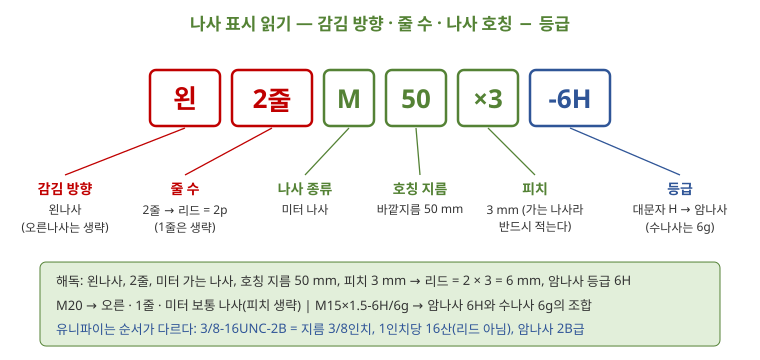

*빨간 칸(감김·줄 수)은 기본값이면 생략하는 부분, 초록 칸은 나사 호칭(종류·지름·피치), 파란 칸은 등급이다. 피치 3과 2줄을 곱한 6 mm가 리드다. 등급이 대문자 H이므로 이 표시는 암나사를 가리킨다.*

| 예 | 해독 |
| --- | --- |
| M20 | 오른, 1줄, 미터 보통 나사 지름 20 |
| M15×1.5-6H/6g | 미터 가는 나사 지름 15, 피치 1.5, 암나사 6H·수나사 6g 끼워맞춤 |
| 왼 2줄 M50×3-6H | 왼나사, 2줄, 피치 3 (리드 6), 암나사 등급 6H |
| Rp 1/2 / R 1/2 | 평행 암나사와 테이퍼 수나사의 조합 |
| No.4-40 UNC-2A | 유니파이 보통 나사 4번, 1인치당 40산, 수나사 2A급 |

- 유니파이 나사 등급은 **1A·2A·3A(수나사), 1B·2B·3B(암나사)** 로 쓴다. 미터 나사식 등급(6H/6g)을 붙인 유니파이 표기는 틀린 것.

**교재(CH03 13절) 표기 규칙**

- 피치를 mm로 쓰는 나사: `종류 기호 지름 × 피치` (피치가 하나뿐인 미터 보통 나사는 생략).
- 산 수로 쓰는 나사(유니파이 제외): `종류 지름 산 산수` (관용 나사처럼 산 수가 하나뿐이면 생략, 혼동 없으면 "산" 대신 "-").
- 유니파이: `지름-산수 종류 등급` (예: 3/8-16UNC-2B).
- 왼나사는 "왼" 또는 L, 여러 줄은 "2줄" 또는 N. 오른나사·1줄은 쓰지 않는다.

| 나사 | 등급 표기 |
| --- | --- |
| 미터 | 암나사 6H, 수나사 6g, 조합 6H/6g |
| 미니어처 | 3G6, 5h3, 조합 3G6/5h3 |
| 미터 사다리꼴 | 7H, 7e |
| 유니파이 | 암나사 2B, 수나사 2A |
| 관용 평행 | 암나사 B, 수나사 A |

> [!question] 시험에서는
> 대문자·소문자 규칙은 [치수공차와 끼워맞춤](치수공차와_끼워맞춤.md)의 구멍(대문자)·축(소문자)과 같다. 암나사는 구멍, 수나사는 축이라고 기억하면 6H/6g, 2B/2A, B/A를 한 번에 정리할 수 있다.

## 4. 나사의 도시

나사산을 도면에 일일이 그리면 시간이 오래 걸리고 알아보기도 어렵다. 그래서 KS는 나사를 **선 두 개**로 줄여 그린다. 원칙은 하나다 — **눈에 보이는 산봉우리는 굵은 실선, 그 안쪽에 숨은 골은 가는 실선**. 수나사는 산봉우리가 바깥에, 암나사는 산봉우리가 안쪽(구멍 벽)에 있으므로 굵은 선과 가는 선의 위치가 서로 바뀐다.

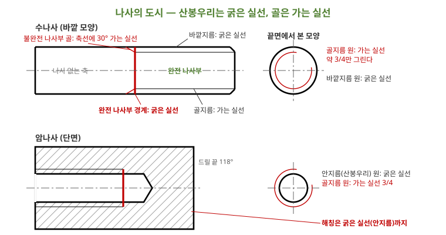

*위: 수나사. 바깥지름은 굵은 실선, 골지름은 가는 실선이다. 완전 나사부가 끝나는 곳에 **굵은 실선(빨강)** 으로 경계를 긋고, 그 바깥쪽 불완전 나사부의 골은 축선에 **30° 기울인 가는 실선**으로 바깥지름 선까지 이어 그린다. 끝면에서 보면 바깥지름은 굵은 원, 골지름은 **가는 실선 원의 약 3/4**만 그린다. 아래: 암나사 단면. 구멍 벽(안지름 = 암나사의 산봉우리)이 굵은 실선, 바깥쪽 골지름이 가는 실선이고, **해칭은 굵은 실선까지** 긋는다. 드릴 구멍 끝은 118° 원뿔로 그린다.*

### 나사의 도시

| 부분 | 선 |
| --- | --- |
| 수나사 바깥지름, 암나사 안지름 (산봉우리) | 굵은 실선 |
| 수나사·암나사 골지름 | 가는 실선 |
| 완전 나사부 경계 | **굵은 실선** |
| 불완전 나사부 골 | 축선에 30° 기울인 가는 실선 |
| 끝면에서 본 골지름 | 가는 실선 원의 약 3/4 |
| 보이지 않는 나사부 | 파선 |

- **완전 나사부**: 나사산이 끝까지 온전한 구간 (유효 나사부). 그 바깥 끝에서 골이 점점 얕아지는 곳이 **불완전 나사부**.
- 암나사 단면에서 **해칭은 산봉우리 선(굵은 실선)까지** 긋는다.

> [!question] 시험에서는
> "완전 나사부와 불완전 나사부의 경계선은 가는 실선" → **틀린 보기**(굵은 실선). 그림 문제에서 완전 나사부는 경계선부터 나사 끝까지, 골지름 가는 실선이 축선과 나란한 구간이다.

## 5. 볼트·너트 종류

볼트를 고르는 기준은 "부품 양쪽에 손이 닿는가", "얼마나 자주 푸는가", "어떤 하중을 받는가"다. 양쪽에서 렌치를 댈 수 있으면 **관통 볼트**, 한쪽이 두꺼운 본체라 너트를 댈 수 없으면 **탭 볼트**, 그런 본체를 자주 열어야 하면 본체 암나사가 닳지 않게 **스터드 볼트**를 박아 둔다.

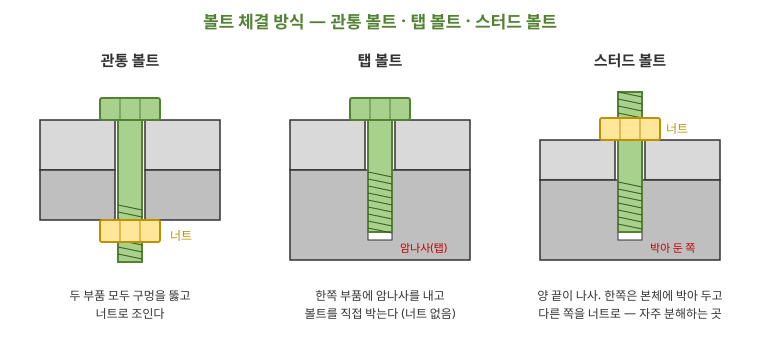

*왼쪽 관통 볼트는 두 판 모두 빈 구멍(나사 없음)이고 아래쪽 너트로 조인다. 가운데 탭 볼트는 아래 부품에 암나사(탭)를 내고 볼트를 직접 박는다. 오른쪽 스터드 볼트는 양 끝이 나사인 막대로, 한쪽을 본체에 박아 두고 위쪽 너트만 풀고 조인다 — 엔진 실린더 헤드처럼 자주 분해하는 곳에 쓴다. 빗금 친 부분이 나사부다.*

### 볼트·너트 종류

| 종류 | 특징 |
| --- | --- |
| 관통 볼트 | 두 부품에 구멍 뚫고 너트로 체결 |
| 탭 볼트 | 한쪽에 암나사 내고 볼트 직접 체결 (너트 없음) |
| 스터드 볼트 | 양 끝 나사, 한쪽은 박아 두고 다른 쪽 너트 (자주 분해) |
| 아이 볼트 | 고리 모양 머리, 무거운 물건 들기 |
| T 볼트 | 공작기계 T 홈 고정 |
| 기초 볼트 | 기계를 콘크리트 기초에 고정 |
| 리머 볼트 | 리머 구멍에 꼭 맞춰 **전단 하중** 지지 |
| 육각 구멍붙이 볼트 | 렌치 볼트, 머리를 묻을 수 있음 |
| 세트 스크루 (멈춤 나사) | 축에 보스 고정, 위치 결정 |

| 아이 볼트 | 세트 스크루 |
| --- | --- |
| 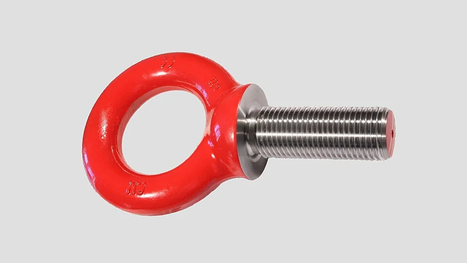 | 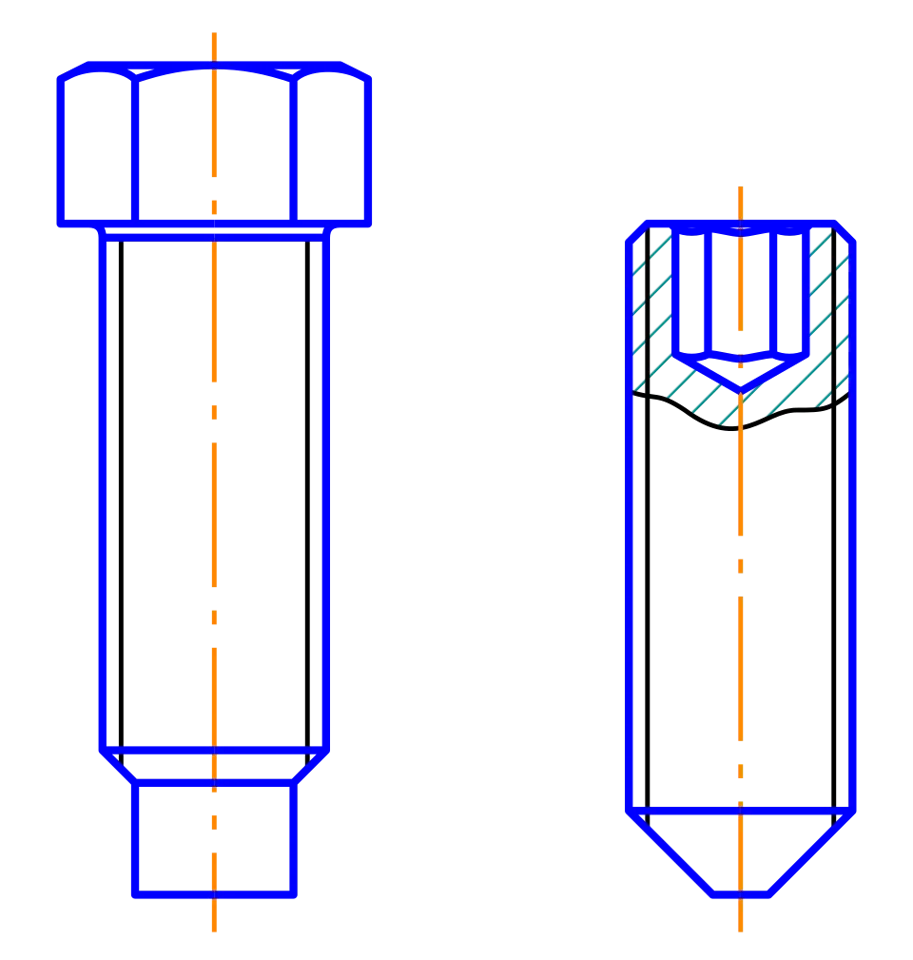 |

*왼쪽: 아이 볼트. 둥근 고리 머리 아래 자리면(칼라)이 있고 그 아래가 수나사다. 기계 윗면 암나사에 끝까지 박아 칼라가 닿게 한 뒤 고리에 훅을 걸어 들어 올린다. 오른쪽: 왼쪽 그림은 육각 머리 볼트, 오른쪽 그림이 **머리 없는 세트 스크루**다. 위쪽에 육각 구멍(렌치 구멍)이 파여 있어 보스 안에 완전히 묻힌 채 돌릴 수 있고, 원뿔 모양 끝이 축 표면을 눌러 보스가 돌거나 미끄러지지 않게 잡는다.*

> [!tip] 감 잡기 — 리머 볼트와 세트 스크루
> 보통 볼트는 구멍보다 가늘어서 옆으로 미는 힘(전단)은 판 사이 **마찰**로 버틴다. 리머 볼트는 구멍을 리머로 다듬고 볼트 몸통을 꼭 맞게 넣어 **몸통 자체로 전단을 받는다**. 세트 스크루는 머리가 없어서 보스 안에 묻히고, 끝이 축을 눌러 미끄럼을 막는다.

## 6. 볼트 강도 설계

볼트를 잡아당기면 가장 가는 **골지름 단면**에서 끊어진다. 골지름은 바깥지름의 약 0.8배이므로, 단면적 $\dfrac{\pi (0.8d)^2}{4} \approx 0.5 d^2$에 허용 응력을 곱한 것이 볼트가 견디는 하중이다. 이것을 $d$에 대해 풀면 시험에 나오는 근사식이 된다.

$$W = \sigma_a \cdot \frac{\pi d_1^2}{4} \approx \sigma_a \cdot \frac{\pi (0.8d)^2}{4} \approx \frac{\sigma_a d^2}{2} \quad\Rightarrow\quad d = \sqrt{\frac{2W}{\sigma_a}}$$

### 볼트 강도 설계

| 하중 조건 | 지름 |
| --- | --- |
| 축 방향 인장만 | $d = \sqrt{\dfrac{2W}{\sigma_a}}$ |
| 인장 + 비틀림 (조이면서 하중) | $d = \sqrt{\dfrac{8W}{3\sigma_a}}$ |
| 전단 | $\tau = \dfrac{W}{\pi d^2/4}$ |

- **계산 예**: 아이 볼트로 $W = 10$ kN, $\sigma_a = 50$ MPa → $d = \sqrt{2 \times 10000 / 50} = 20$ mm → M20 선택.
- 너트 높이: 나사산 수 × 피치. 접촉면 압력 $q = \dfrac{W}{\pi d_2 h z}$로 산 수 z를 정한다 (h는 나사산 접촉 높이).
- 인장 + 비틀림 식은 조일 때 생기는 비틀림을 **축 하중을 4/3배** 한 것으로 보고 위 식에 넣은 결과다: $2 \times \dfrac{4}{3}W = \dfrac{8W}{3}$.

### 강도 구분 읽기

볼트 머리에 찍힌 **8.8, 10.9, 12.9** 같은 숫자가 강도 구분이다. 앞 숫자 × 100이 인장 강도(MPa), 뒤 숫자 × 0.1이 "항복 강도 / 인장 강도" 비율이다.

| 강도 구분 | 인장 강도 | 항복 강도 |
| :-: | :-: | :-: |
| 8.8 | $8 \times 100 = 800$ MPa | $800 \times 0.8 = 640$ MPa |
| 10.9 | $10 \times 100 = 1000$ MPa | $1000 \times 0.9 = 900$ MPa |

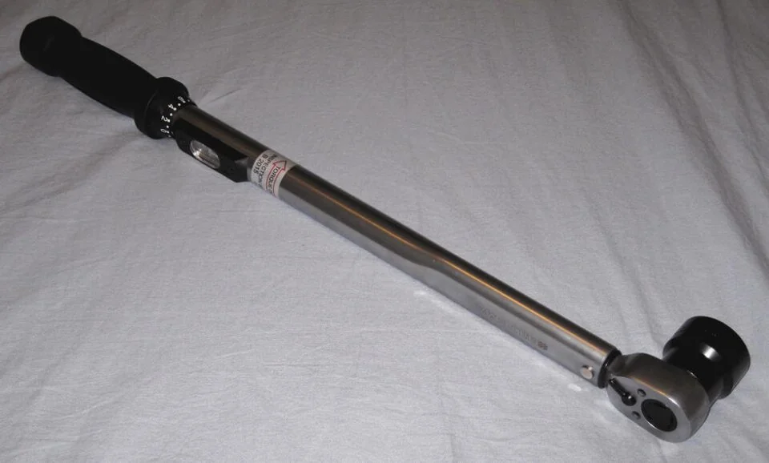

*토크 렌치로 정해진 토크까지 조이면 볼트에 정해진 축력(예압)이 걸린다. 너무 약하면 풀리고, 너무 세면 골지름에서 항복한다 — 강도 구분이 높은 볼트일수록 큰 토크로 조일 수 있다.*

## 7. 나사의 역학 — 빗면으로 풀기

나사를 한 바퀴 펼치면 밑변이 유효지름 둘레 $\pi d_2$, 높이가 리드 $L$인 **빗면**이 된다. 너트를 조이는 일은 무거운 상자(축 하중 W)를 이 빗면 위로 수평으로 밀어 올리는 일과 같다. 빗면이 완만할수록(리드각이 작을수록) 적은 힘으로 밀 수 있지만 그만큼 여러 바퀴 돌려야 한다.

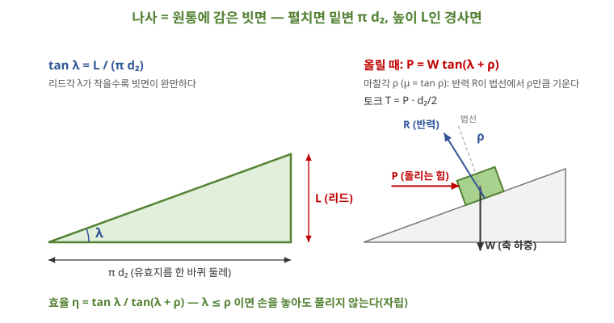

*왼쪽: 나사 한 바퀴를 펼친 직각삼각형. $\tan\lambda = L/(\pi d_2)$. 오른쪽: 빗면 위 물체(너트)에 축 하중 W가 아래로, 돌리는 힘 P가 수평으로 걸린다. 마찰이 있으면 빗면이 주는 반력 R이 법선에서 마찰각 ρ만큼 운동 반대쪽으로 기운다. 세 힘이 평형을 이루는 조건에서 $P = W\tan(\lambda + \rho)$가 나온다.*

### 나사의 역학

- 회전력 $P = W\tan(\lambda + \rho)$ (사각 나사, 조일 때).
- 효율 $\eta = \dfrac{\tan\lambda}{\tan(\lambda + \rho)}$.
- 리드각이 크면 효율은 좋지만 자립이 안 된다. 체결용은 리드각을 작게 해 자립시킨다.
- 교재(CH03 22절)는 사각 나사를 **빗면 위로 물체를 밀어 올리는 것**으로 풀어 설명한다. 마찰 계수를 $\mu = \tan\rho$로 놓으면 덧셈 정리로 $P = Q\tan(\alpha + \rho)$가 바로 나온다 (교재는 리드각을 α로 표기). 들어 올리는 토크 $T = P\dfrac{d_2}{2}$. 효율은 보통 너트 자리면 마찰을 뺀 $\eta = \dfrac{\tan\alpha}{\tan(\alpha + \rho)}$로 계산한다.
- **계산 예 (교재 22절 예제)**: 하중 1,000 kgf, 지름 20 mm, μ = 0.3, α = 20°
  - $\rho = \tan^{-1}0.3 \approx 16.7°$ → $P = 1000 \tan 36.7° \approx 745$ kgf
  - $T = 745 \times 1$ cm $\approx 745$ kgf·cm → 보기 중 **약 750**. 반지름을 cm로 넣어 답 단위(kgf·cm)에 맞춘다.
  - α = 20°는 실제 체결 나사보다 훨씬 큰 값이다. 계산 연습용 숫자로 본다.

### 자립 조건과 효율 50%

풀 때는 힘의 방향이 반대라 $P' = W\tan(\rho - \lambda)$가 된다. 이 값이 0 이상, 즉 **$\rho \ge \lambda$** 이면 손을 놓아도 하중 W 때문에 저절로 풀려 내려가지 않는다. 이것이 **자립**이다.

$$\lambda = \rho \text{ 일 때 } \eta = \frac{\tan\rho}{\tan 2\rho} = \frac{1 - \tan^2\rho}{2} < \frac{1}{2}$$

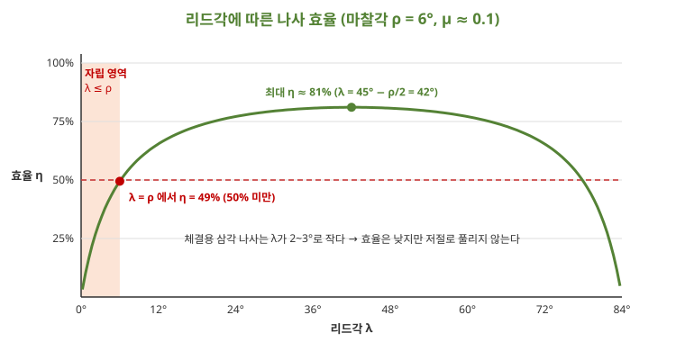

*마찰각 ρ = 6°(μ ≈ 0.1)로 그린 효율 곡선. 리드각이 ρ 이하인 분홍 영역이 자립 영역이고, 그 경계 λ = ρ에서도 효율이 49%로 이미 50%보다 낮다. 그래서 "자립하는 나사의 효율은 50% 미만"이다. 효율은 λ = 45° − ρ/2 근처에서 가장 높고(약 81%), 그보다 커지면 다시 떨어진다.*

> [!question] 시험에서는
> "자립 조건" → **마찰각 ≥ 리드각**. "자립 나사의 효율" → **50% 미만**. 볼나사는 구름 마찰이라 ρ가 매우 작아 효율이 90% 이상인 대신 자립하지 않으므로, 수직축에는 브레이크를 단다.

- **유효지름** 측정: 삼침법이 가장 정밀, 나사 마이크로미터, 광학 투영기 → [기계공작과 측정](기계공작과_측정.md).

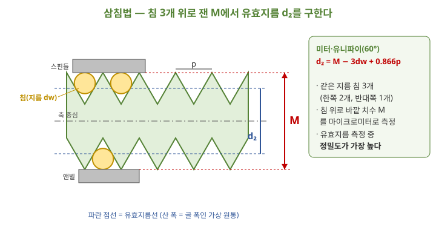

*지름이 같은 침 3개를 나사 골에 넣고 바깥 치수 M을 마이크로미터로 잰다. 침이 산의 비탈면 중간에 닿기 때문에 M에서 유효지름 d₂를 계산할 수 있다(미터 나사: $d_2 = M - 3d_w + 0.866p$).*

## 8. 풀림 방지

체결용 나사는 자립하므로 가만히 두면 풀리지 않는다. 그런데 **진동·충격·온도 변화**가 반복되면 나사면이 순간순간 미끄러지면서 조금씩 풀린다. 풀림 방지법은 크게 세 갈래다 — **마찰을 늘린다**(로크 너트, 스프링 와셔, 나일론 너트), **기계적으로 막는다**(분할 핀, 혀붙이 와셔, 철사), **붙여 버린다**(나사 고정제).

### 풀림 방지

| 방법 | 원리 |
| --- | --- |
| 로크 너트 (이중 너트) | 두 너트가 서로 밀어 마찰 증가 |
| 스프링 와셔 | 탄성력으로 마찰 유지 |
| 톱니붙이 와셔 | 톱니가 파고들어 회전 저지 |
| 혀붙이(탭) 와셔 | 혀를 꺾어 너트 고정 |
| 분할 핀 + 홈붙이 너트 | 핀이 너트 회전을 기계적으로 막음 |
| 나일론 인서트 너트 | 나일론 링 마찰 |
| 철사 (와이어 로킹) | 여러 볼트를 철사로 묶음 |
| 세트 스크루 | 너트 옆에서 눌러 고정 |
| 나사 고정제 (접착제) | 나사산 사이를 굳힘 |

| 로크 너트 (이중 너트) | 스프링 와셔 | 나일론 인서트 너트 |
| --- | --- | --- |
| 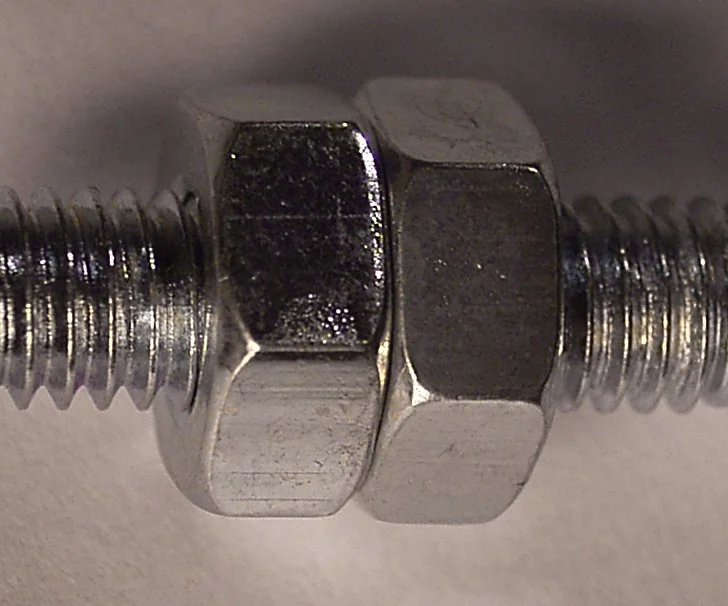 | 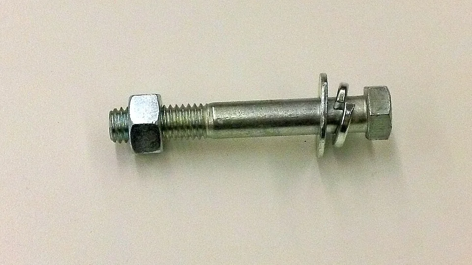 | 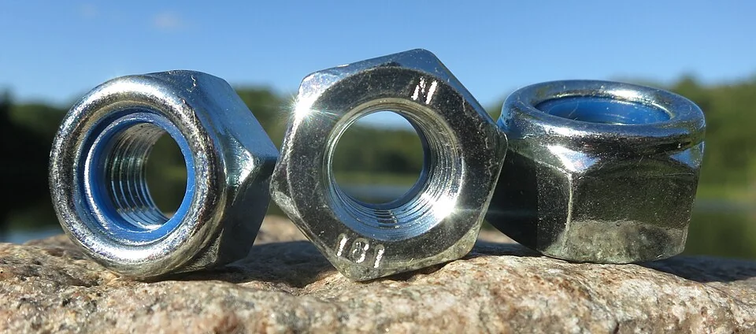 |

*왼쪽: 한 볼트에 너트 두 개를 맞대어 조인 로크 너트. 두 너트가 서로 밀어 나사면 마찰이 커진다. 가운데: 볼트 머리 바로 아래 끊어진 고리 모양의 **스프링 와셔**, 그 옆에 평와셔, 볼트 끝에 너트. 스프링 와셔는 눌려 납작해지면서 탄성력으로 마찰을 유지한다. 오른쪽: 나일론 인서트 너트 세 개. 안쪽 한쪽 끝에 파란 **나일론 링**이 끼워져 있어(가운데는 링이 없는 면) 볼트 나사산이 링을 밀고 들어가며 마찰로 풀림을 막는다.*

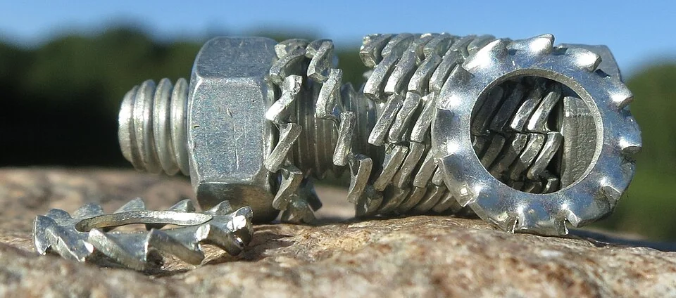

*바깥 톱니붙이 와셔를 볼트에 여러 장 끼워 보관한 모습과 바닥에 놓인 한 장. 바깥 둘레의 톱니가 서로 엇갈리게 비틀려 있어서, 너트를 조이면 톱니 끝이 너트 자리면과 부품 면을 동시에 파고들어 회전을 막는다.*

| 홈붙이 너트 + 분할 핀 | 혀붙이 와셔 |
| --- | --- |
| 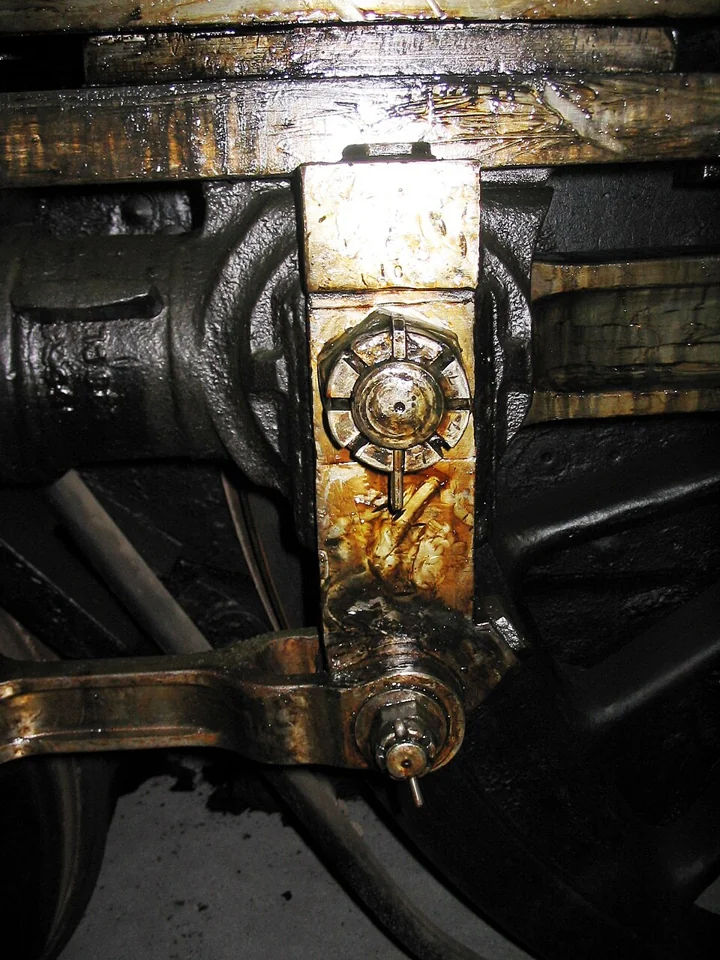 | 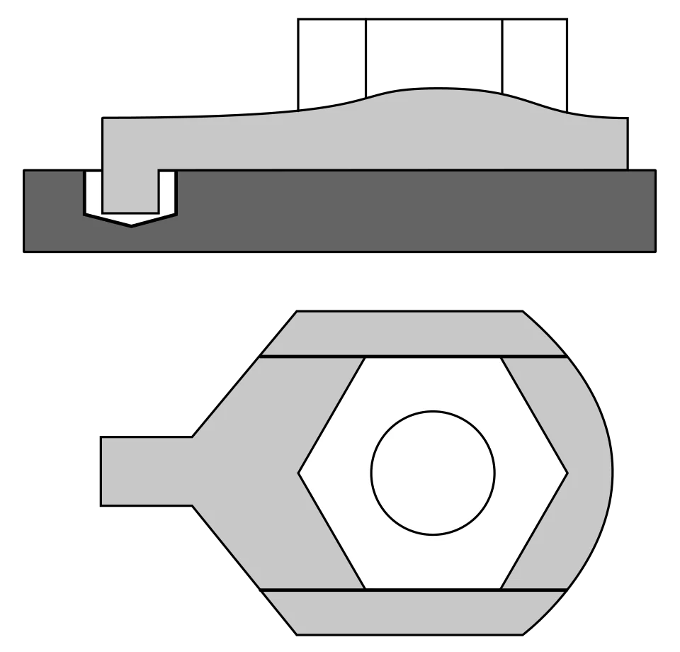 |

*왼쪽: 증기기관차 연결 링크의 핀 끝(사진 아래쪽). 너트 윗면에 홈이 파인 **홈붙이 너트**를 조이고, 홈과 볼트 구멍을 함께 꿰는 **분할 핀**을 꽂아 다리를 벌려 두었다. 너트가 돌려면 핀을 끊어야 하므로 기계적으로 풀림이 막힌다. 오른쪽: 혀붙이 와셔(위: 옆 단면, 아래: 평면). 와셔의 혀 한쪽은 아래로 꺾어 바탕 부품의 구멍에 넣고, 다른 쪽 가장자리는 위로 꺾어 육각 너트 면에 붙여서 너트가 돌지 못하게 한다.*

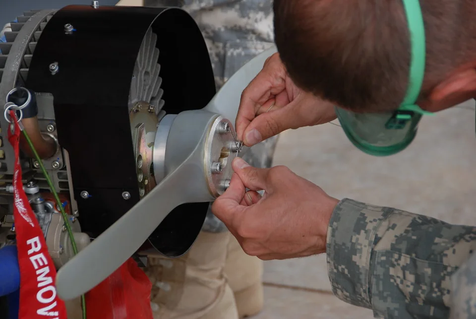

*안전 철사(와이어 로킹) 작업. 프로펠러 허브에 박힌 볼트 머리에는 구멍이 뚫려 있고, 작업자가 가는 철사를 그 구멍들에 차례로 꿰어 이웃 볼트끼리 묶는다. 철사는 볼트가 **풀리는 방향의 반대로** 당겨지도록 감는다 — 한 볼트가 풀리려 하면 철사가 이웃 볼트를 당겨 못 돌게 하므로, 진동이 심한 항공기·엔진에서 쓴다.*

> [!tip] 감 잡기 — 로크 너트를 조이는 순서
> 얇은 너트를 먼저 조이고, 두꺼운 너트를 그 위에 조인 뒤 얇은 너트를 살짝 되돌려 두 너트가 서로 밀게 한다. 그러면 하중은 바깥쪽 두꺼운 너트가 받고, 두 너트 사이에 생긴 반대 방향 마찰이 회전을 막는다.

## 그림

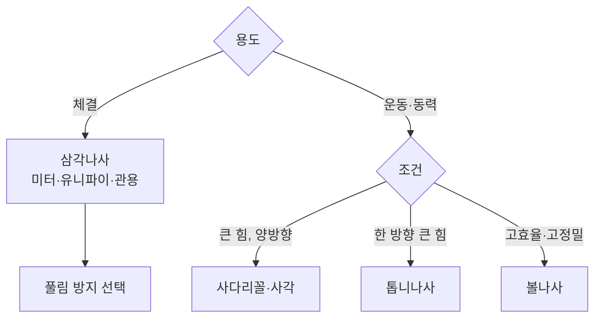

## 기출 포인트

- 나사 종류 기호 — 6회: 관용 나사 기호가 아닌 것 (2014-2), 사다리꼴 나사 Tr (2015-1, 2016-1), TW 짝 틀린 것 (2017-1), G 1/2 관용 평행 (2018-1), 자전거·전선관 나사 기호 (2017-1 4과목)
- 나사 표시 해독 — **5회**: 표시 규칙 설명 (2014-3), 감김·줄 수·등급 해독 (2015-2, 2016-3), 6H/6g가 등급이라는 것 (2017-2), 조합 표시 중 틀린 것 (2020-3)
- 나사 도시 — **4회**: 완전·불완전 나사부 경계선이 굵은 실선 (2016-3, 2019-3), 그림에서 완전 나사부 찾기 (2020-3), 미터 가는 나사 도시 고르기 (2019-1)
- 리드·유효지름·용도 (1·4과목) — 4회: 리드 정의 (2018-3), 다줄 나사 이동 거리 (2016-2), 유효지름 정의 (2017-2), 체결용은 삼각 나사 (2020-1)
- 2과목 나사 문항만 합계 **14회**. 2020-3에는 한 회에 2문제가 나왔다.
- 교재 예제 유형 (Win-Q 2025 PART 01 CHAPTER 03, 11·13절): 2줄 사각 나사 단면의 피치(그림), 미터 사다리꼴 나사 산 각(30°), 풀림 방지가 아닌 것(머리 뭉개기), 왼 2줄 M50×3-6H 해독(리드 6 mm, 암나사 등급), 미터 사다리꼴 기호(Tr), KS 표시 설명 중 옳은 것(산 수 표시 나사는 종류·지름·산·산수 순), 3/8-16UNC-2B의 16(1인치당 산 수, 리드 아님), Tr10×2(호칭 지름 10, 그림), 완전·불완전 나사부 경계(굵은 실선), G 1/2(관용 평행). 13-3 보기 중 "오른나사는 RH"는 본문 규칙(오른나사는 생략)과 맞지 않는 보기다.
- 볼트 강도·풀림 방지 계산은 2014~2020년에 직접 나오지 않았다. 새 출제기준(체결요소 설계: 풀림 방지, 강도)에 들어 있으므로 기본식은 유지한다.

## 관련 단원

- [기계설계 기초와 재료강도](기계설계_기초와_재료강도.md)
- [키·핀·코터·리벳·용접](키_핀_코터_리벳_용접.md)
- [도면 양식과 투상법](도면_양식과_투상법.md)
- [기계공작과 측정](기계공작과_측정.md)
- [볼스크루와 LM 가이드](볼스크루와_LM가이드.md) — 볼 나사, 자립하지 않는 이송 나사
- [치수공차와 끼워맞춤](치수공차와_끼워맞춤.md) — 대문자(구멍)·소문자(축) 등급 표기

## 체크리스트

- [ ] 리드와 피치의 관계를 계산한다
- [ ] 나사 종류별 산 각도와 용도를 구분한다
- [ ] 자립 조건과 효율 50% 관계를 설명한다
- [ ] 아이 볼트 지름을 계산한다
- [ ] 강도 구분 8.8, 10.9의 의미를 안다
- [ ] 풀림 방지 방법 5가지 이상 말한다
- [ ] M, Tr, TW, R, Rc, Rp, G, UNC 기호를 나사 종류와 연결한다
- [ ] `왼 2줄 M50×3-6H` 같은 표시에서 감김·줄 수·피치·리드·등급을 읽는다
- [ ] 암나사(대문자)·수나사(소문자) 등급 표기를 구분한다
- [ ] 완전 나사부 경계선과 골지름 선의 종류를 안다
- [ ] 다줄 나사의 회전수로 이동 거리를 계산한다

## 참고

- [큐넷 자동화설비산업기사 출제기준](https://www.q-net.or.kr/crf005.do?id=crf00503&jmCd=2034)

### 그림 출처

위키미디어 공용(Wikimedia Commons)과 Openverse에서 가져온 공개 라이선스 자료이고, 노트에 맞게 크기를 줄이고 WebP로 변환했다.

| 그림 | 작성자 | 라이선스 | 출처 |
| --- | --- | --- | --- |
| [Gewindeschablone](https://commons.wikimedia.org/wiki/File:Gewindeschablone.jpg) | Jahobr | CC0 | Wikimedia Commons |
| [Screw head - Eye bolt](https://commons.wikimedia.org/wiki/File:Screw_head_-_Eye_bolt.jpg) | Contribus | [CC BY-SA 4.0](https://creativecommons.org/licenses/by-sa/4.0) | Wikimedia Commons |
| [Set screw](https://commons.wikimedia.org/wiki/File:Set_screw.svg) | Yuri Raysper | 퍼블릭 도메인 | Wikimedia Commons |
| [Torque wrench 20-220 Nm](https://commons.wikimedia.org/wiki/File:Torque_wrench_20-220_Nm.jpg) | Lead holder | [CC BY-SA 4.0](https://creativecommons.org/licenses/by-sa/4.0) | Wikimedia Commons |
| [Counter nut](https://commons.wikimedia.org/wiki/File:Counter_nut.jpg) | made by me | [CC BY-SA 3.0](http://creativecommons.org/licenses/by-sa/3.0/) | Wikimedia Commons |
| [Bolt, Plain washer and Spring lock washer](https://commons.wikimedia.org/wiki/File:Bolt,_Plain_washer_and_Spring_lock_washer.jpg) | andersen_mrjh | [CC BY-SA 2.0](https://creativecommons.org/licenses/by-sa/2.0) | Wikimedia Commons |
| [1990s zinc plated M10 Nyloc nuts DIN 982 showing different angles](https://commons.wikimedia.org/wiki/File:1990s_zinc_plated_M10_Nyloc_nuts_DIN_982_showing_different_angles.jpg) | R. Henrik Nilsson | [CC BY 4.0](https://creativecommons.org/licenses/by/4.0) | Wikimedia Commons |
| [1990s external tooth lock washers stored on a machine bolt](https://commons.wikimedia.org/wiki/File:1990s_external_tooth_lock_washers_stored_on_a_machine_bolt.jpg) | R. Henrik Nilsson | [CC BY 4.0](https://creativecommons.org/licenses/by/4.0) | Wikimedia Commons |
| [Castle nut and cotter pin. (55011574)](https://commons.wikimedia.org/wiki/File:Castle_nut_and_cotter_pin._(55011574).jpg) | Robbie Sproule from Montreal, Canada | [CC BY 2.0](https://creativecommons.org/licenses/by/2.0) | Wikimedia Commons |
| [Nut tab washer](https://commons.wikimedia.org/wiki/File:Nut_tab_washer.svg) | Wizard191 | [CC BY-SA 3.0](https://creativecommons.org/licenses/by-sa/3.0) | Wikimedia Commons |
| [Safety Wire](https://www.flickr.com/photos/18218920@N00/4098826781) | gracewanderer | [CC BY 2.0](https://creativecommons.org/licenses/by/2.0/) | Openverse (flickr) |

직접 그린 그림(SVG, 이 볼트용으로 새로 작성): 나사 각부명칭, 나사 리드 피치, 나사산 형태, 나사 표시 해독, 나사 도시, 볼트 체결방식, 나사 빗면 원리, 나사 효율 자립. 삼침법은 [기계공작과 측정](기계공작과_측정.md) 노트에서 그린 것을 다시 썼다.

