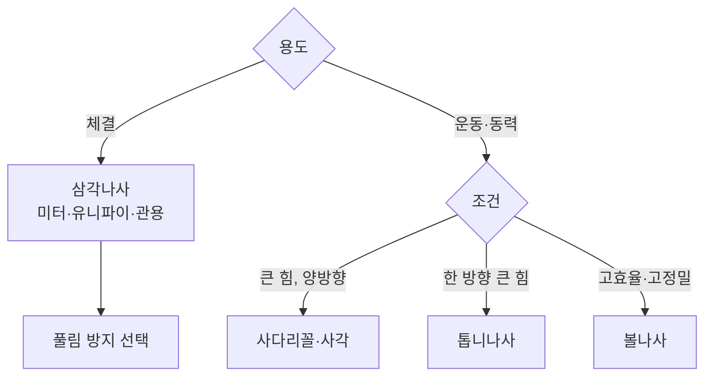

# 나사와 볼트

> [!summary] 핵심 요약
> - **리드** $L = n \times p$ (줄 수 × 피치). 한 바퀴 돌릴 때 축 방향으로 움직이는 거리.
> - 체결용은 **삼각나사**(미터·유니파이·관용), 운동·동력 전달용은 **사각·사다리꼴·톱니·볼나사**.
> - **자립 조건**: 마찰각 ≥ 리드각 ($\rho \ge \lambda$). 자립하는 나사의 효율은 **50% 미만**.
> - 축 하중만 받는 볼트 지름: $d = \sqrt{\dfrac{2W}{\sigma_a}}$ (골지름 ≈ 0.8d로 본 근사식).

> [!warning] 자주 틀리는 포인트
> - **M10** = 미터 보통 나사 바깥지름 10 mm. 가는 나사는 **M10×1.25**처럼 피치를 붙인다.
> - 강도 구분 **8.8**: 인장 강도 $8 \times 100 = 800$ MPa, 항복 강도 $800 \times 0.8 = 640$ MPa.
> - **톱니나사**는 한 방향으로만 큰 힘(바이스, 잭). **둥근나사**는 먼지·이물질 많은 곳(전구 소켓).
> - **볼나사**: 효율 90% 이상, 백래시 작음, 하지만 **자립하지 않는다** → 수직축에는 브레이크.
> - 이중 너트(로크 너트)는 **얇은 너트를 먼저(안쪽)** 조인다는 설명이 일반적이다.
> - 나사 표시에서 **오른나사는 표시를 생략**하고 **왼나사만 '왼' 또는 LH**를 붙인다. "오른나사만 RH를 적는다"는 틀린 보기.
> - **미터 가는 나사는 피치를 반드시 적는다** (M10×1.25). 피치를 생략하면 보통 나사로 읽힌다.
> - `왼 2줄 M50×3-6H`: 피치 3, **리드 = 2 × 3 = 6**, 6H는 **암나사** 등급. 대문자 등급(6H)은 암나사, 소문자(6g)는 수나사.
> - **TW**는 **29° 사다리꼴**(인치계) 옛 기호다. 30° 미터 사다리꼴은 **Tr**(옛 기호 TM). **CTG는 후강 전선관 나사**, 자전거 나사는 **BC**다 (KS B 0200, 교재 CH03 13절).
> - **피치는 줄 수와 무관**하게 이웃한 산 사이 거리다. 줄 수가 바뀌는 것은 리드 (교재 CH03 11-1).
> - 나사 머리를 뭉개는 것은 **영구 결합**이라 풀림 방지법이 아니다(그럴 바엔 리벳) (교재 11-3).
> - 나사 도시에서 **완전 나사부와 불완전 나사부의 경계선은 굵은 실선**. 골지름은 가는 실선, 불완전 나사부의 골은 축선에 30° 기울인 가는 실선.

## 개념 정리

### 나사의 용어

| 용어 | 뜻 |
| --- | --- |
| 피치 p | 이웃한 나사산 사이 거리 |
| 리드 L | 1회전에 이동하는 거리 = 줄 수 × 피치 |
| 바깥지름 d | 호칭 지름 (수나사 산봉우리) |
| 골지름 $d_1$ | 수나사 골 부분 지름 (강도 계산 기준) |
| 유효지름 $d_2$ | 산 두께와 골 폭이 같은 가상 원통 지름 |
| 리드각 λ | $\tan\lambda = \dfrac{L}{\pi d_2}$ |

- **오른나사**가 기본. 왼나사는 회전 방향 때문에 풀리면 안 되는 곳(자전거 왼쪽 페달, 그라인더 숫돌).

### 나사의 종류

| 종류 | 나사산 각 | 용도 |
| --- | --- | --- |
| 미터 나사 | 60° | 체결용 (mm 단위) |
| 유니파이 나사 | 60° | 체결용 (인치 단위, 산 수/inch) |
| 관용 나사 (평행 G, 테이퍼 R) | 55° | 배관 연결, 테이퍼는 기밀 |
| 사각 나사 | – | 큰 힘 전달, 효율 좋음, 가공 어려움 |
| 사다리꼴 나사 | 30° (미터), 29° (인치) | 공작기계 이송, 잭 |
| 톱니 나사 | 한쪽만 경사 | 한 방향 큰 하중 (바이스, 프레스) |
| 둥근 나사 | 둥근 산 | 먼지·충격 (전구, 호스) |
| 볼 나사 | 강구 순환 | 고효율·고정밀 이송 ([볼스크루와 LM 가이드](볼스크루와_LM가이드.md)) |

- 교재(CH03 11절) 보충:
  - 유니파이 나사는 1948년 영국·미국·캐나다 협정으로 만든 인치계 나사(ABC 나사). 인치 나사의 피치 $p = \dfrac{25.4}{n}$ (n: 1인치당 산 수).
  - 관용 나사는 파이프 강도가 떨어지지 않게 **산이 낮다**.
  - 사각 나사는 풀리기 쉽지만 저항이 작아 잭·프레스·선반 이송에 쓴다. 사다리꼴 나사는 사각 나사의 가공 어려움을 보완한 것.
  - 톱니 나사는 힘 받는 면이 축에 **직각**, 반대 면은 **30°** 경사.
  - 볼 나사는 효율 90 % 이상, 구동력은 사각 나사의 약 1/3 이하.
### 나사 종류 기호

| 기호 | 나사 | 표시 예 |
| :-: | --- | --- |
| M | 미터 보통 나사 / 미터 가는 나사 | M10 / M10×1.25 |
| UNC, UNF | 유니파이 보통 / 가는 나사 | 3/8-16 UNC |
| Tr | 미터 사다리꼴 나사 (30°) | Tr10×2 (호칭 지름 × 피치) |
| TW | 29° 사다리꼴 나사 (옛 기호) | |
| R | 관용 테이퍼 **수나사** | R 1/2 |
| Rc | 관용 테이퍼 **암나사** | Rc 1/2 |
| Rp | 관용 평행 암나사 (테이퍼 수나사와 짝) | Rp 1/2 |
| G | 관용 평행 나사 | G 1/2 A (수나사 등급 A·B) |
| PT, PS, PF | 관용 나사 옛 기호 (테이퍼, 테이퍼용 평행 암나사, 평행) | |
| S | 미니어처 나사 | S 0.5 |
| E | 전구 나사 | |
| BC | 자전거 나사 (일반용·스포크용) | |
| CTG, CTC | 전선관 나사 (후강, 박강) | |
| SM, TV, CTV | 미싱 나사, 자동차 타이어 밸브 나사, 자전거 타이어 밸브 나사 | |

- ISO 표준에 있는 관용 나사 기호는 **R, Rc, Rp, G**. TM·TW·PT·PS·PF는 ISO에 없는 옛 기호다.
- 짝 규칙: **Rp는 R하고만**, **PS는 PT하고만** 짝지어 쓴다. 미터 보통 나사 중 M1.7·M2.3·M2.6은 ISO에 없다. 가는 나사임을 분명히 할 때는 피치 뒤에 "(가는 나사)"를 붙일 수 있다 (교재 CH03 13절 각주).

### 나사 표시 방법 (KS)

`감김 방향` `줄 수` `나사 호칭` − `등급`

| 예 | 해독 |
| --- | --- |
| M20 | 오른, 1줄, 미터 보통 나사 지름 20 |
| M15×1.5-6H/6g | 미터 가는 나사 지름 15, 피치 1.5, 암나사 6H·수나사 6g 끼워맞춤 |
| 왼 2줄 M50×3-6H | 왼나사, 2줄, 피치 3 (리드 6), 암나사 등급 6H |
| Rp 1/2 / R 1/2 | 평행 암나사와 테이퍼 수나사의 조합 |
| No.4-40 UNC-2A | 유니파이 보통 나사 4번, 1인치당 40산, 수나사 2A급 |

- 유니파이 나사 등급은 **1A·2A·3A(수나사), 1B·2B·3B(암나사)** 로 쓴다. 미터 나사식 등급(6H/6g)을 붙인 유니파이 표기는 틀린 것.

**교재(CH03 13절) 표기 규칙**

- 피치를 mm로 쓰는 나사: `종류 기호 지름 × 피치` (피치가 하나뿐인 미터 보통 나사는 생략).
- 산 수로 쓰는 나사(유니파이 제외): `종류 지름 산 산수` (관용 나사처럼 산 수가 하나뿐이면 생략, 혼동 없으면 "산" 대신 "-").
- 유니파이: `지름-산수 종류 등급` (예: 3/8-16UNC-2B).
- 왼나사는 "왼" 또는 L, 여러 줄은 "2줄" 또는 N. 오른나사·1줄은 쓰지 않는다.

| 나사 | 등급 표기 |
| --- | --- |
| 미터 | 암나사 6H, 수나사 6g, 조합 6H/6g |
| 미니어처 | 3G6, 5h3, 조합 3G6/5h3 |
| 미터 사다리꼴 | 7H, 7e |
| 유니파이 | 암나사 2B, 수나사 2A |
| 관용 평행 | 암나사 B, 수나사 A |

### 나사의 도시

| 부분 | 선 |
| --- | --- |
| 수나사 바깥지름, 암나사 안지름 (산봉우리) | 굵은 실선 |
| 수나사·암나사 골지름 | 가는 실선 |
| 완전 나사부 경계 | **굵은 실선** |
| 불완전 나사부 골 | 축선에 30° 기울인 가는 실선 |
| 끝면에서 본 골지름 | 가는 실선 원의 약 3/4 |
| 보이지 않는 나사부 | 파선 |

- **완전 나사부**: 나사산이 끝까지 온전한 구간 (유효 나사부). 그 바깥 끝에서 골이 점점 얕아지는 곳이 **불완전 나사부**.
- 암나사 단면에서 **해칭은 산봉우리 선(굵은 실선)까지** 긋는다.

### 볼트·너트 종류

| 종류 | 특징 |
| --- | --- |
| 관통 볼트 | 두 부품에 구멍 뚫고 너트로 체결 |
| 탭 볼트 | 한쪽에 암나사 내고 볼트 직접 체결 (너트 없음) |
| 스터드 볼트 | 양 끝 나사, 한쪽은 박아 두고 다른 쪽 너트 (자주 분해) |
| 아이 볼트 | 고리 모양 머리, 무거운 물건 들기 |
| T 볼트 | 공작기계 T 홈 고정 |
| 기초 볼트 | 기계를 콘크리트 기초에 고정 |
| 리머 볼트 | 리머 구멍에 꼭 맞춰 **전단 하중** 지지 |
| 육각 구멍붙이 볼트 | 렌치 볼트, 머리를 묻을 수 있음 |
| 세트 스크루 (멈춤 나사) | 축에 보스 고정, 위치 결정 |

### 볼트 강도 설계

| 하중 조건 | 지름 |
| --- | --- |
| 축 방향 인장만 | $d = \sqrt{\dfrac{2W}{\sigma_a}}$ |
| 인장 + 비틀림 (조이면서 하중) | $d = \sqrt{\dfrac{8W}{3\sigma_a}}$ |
| 전단 | $\tau = \dfrac{W}{\pi d^2/4}$ |

- **계산 예**: 아이 볼트로 $W = 10$ kN, $\sigma_a = 50$ MPa → $d = \sqrt{2 \times 10000 / 50} = 20$ mm → M20 선택.
- 너트 높이: 나사산 수 × 피치. 접촉면 압력 $q = \dfrac{W}{\pi d_2 h z}$로 산 수 z를 정한다 (h는 나사산 접촉 높이).

### 나사의 역학

- 회전력 $P = W\tan(\lambda + \rho)$ (사각 나사, 조일 때).
- 효율 $\eta = \dfrac{\tan\lambda}{\tan(\lambda + \rho)}$.
- 리드각이 크면 효율은 좋지만 자립이 안 된다. 체결용은 리드각을 작게 해 자립시킨다.
- 교재(CH03 22절)는 사각 나사를 **빗면 위로 물체를 밀어 올리는 것**으로 풀어 설명한다. 마찰 계수를 $\mu = \tan\rho$로 놓으면 덧셈 정리로 $P = Q\tan(\alpha + \rho)$가 바로 나온다 (교재는 리드각을 α로 표기). 들어 올리는 토크 $T = P\dfrac{d_2}{2}$. 효율은 보통 너트 자리면 마찰을 뺀 $\eta = \dfrac{\tan\alpha}{\tan(\alpha + \rho)}$로 계산한다.
- **계산 예 (교재 22절 예제)**: 하중 1,000 kgf, 지름 20 mm, μ = 0.3, α = 20°
  - $\rho = \tan^{-1}0.3 \approx 16.7°$ → $P = 1000 \tan 36.7° \approx 745$ kgf
  - $T = 745 \times 1$ cm $\approx 745$ kgf·cm → 보기 중 **약 750**. 반지름을 cm로 넣어 답 단위(kgf·cm)에 맞춘다.
  - α = 20°는 실제 체결 나사보다 훨씬 큰 값이다. 계산 연습용 숫자로 본다.
- **이동 거리 계산 예**: 피치 3 mm, 3줄 나사를 2회전 → 리드 $3 \times 3 = 9$ mm, 이동 $9 \times 2 = 18$ mm.
- **유효지름** 측정: 삼침법이 가장 정밀, 나사 마이크로미터, 광학 투영기 → [기계공작과 측정](기계공작과_측정.md).

### 풀림 방지

| 방법 | 원리 |
| --- | --- |
| 로크 너트 (이중 너트) | 두 너트가 서로 밀어 마찰 증가 |
| 스프링 와셔 | 탄성력으로 마찰 유지 |
| 톱니붙이 와셔 | 톱니가 파고들어 회전 저지 |
| 혀붙이(탭) 와셔 | 혀를 꺾어 너트 고정 |
| 분할 핀 + 홈붙이 너트 | 핀이 너트 회전을 기계적으로 막음 |
| 나일론 인서트 너트 | 나일론 링 마찰 |
| 철사 (와이어 로킹) | 여러 볼트를 철사로 묶음 |
| 세트 스크루 | 너트 옆에서 눌러 고정 |
| 나사 고정제 (접착제) | 나사산 사이를 굳힘 |

## 그림

## 기출 포인트

- 나사 종류 기호 — 6회: 관용 나사 기호가 아닌 것 (2014-2), 사다리꼴 나사 Tr (2015-1, 2016-1), TW 짝 틀린 것 (2017-1), G 1/2 관용 평행 (2018-1), 자전거·전선관 나사 기호 (2017-1 4과목)
- 나사 표시 해독 — **5회**: 표시 규칙 설명 (2014-3), 감김·줄 수·등급 해독 (2015-2, 2016-3), 6H/6g가 등급이라는 것 (2017-2), 조합 표시 중 틀린 것 (2020-3)
- 나사 도시 — **4회**: 완전·불완전 나사부 경계선이 굵은 실선 (2016-3, 2019-3), 그림에서 완전 나사부 찾기 (2020-3), 미터 가는 나사 도시 고르기 (2019-1)
- 리드·유효지름·용도 (1·4과목) — 4회: 리드 정의 (2018-3), 다줄 나사 이동 거리 (2016-2), 유효지름 정의 (2017-2), 체결용은 삼각 나사 (2020-1)
- 2과목 나사 문항만 합계 **14회**. 2020-3에는 한 회에 2문제가 나왔다.
- 교재 예제 유형 (Win-Q 2025 PART 01 CHAPTER 03, 11·13절): 2줄 사각 나사 단면의 피치(그림), 미터 사다리꼴 나사 산 각(30°), 풀림 방지가 아닌 것(머리 뭉개기), 왼 2줄 M50×3-6H 해독(리드 6 mm, 암나사 등급), 미터 사다리꼴 기호(Tr), KS 표시 설명 중 옳은 것(산 수 표시 나사는 종류·지름·산·산수 순), 3/8-16UNC-2B의 16(1인치당 산 수, 리드 아님), Tr10×2(호칭 지름 10, 그림), 완전·불완전 나사부 경계(굵은 실선), G 1/2(관용 평행). 13-3 보기 중 "오른나사는 RH"는 본문 규칙(오른나사는 생략)과 맞지 않는 보기다.
- 볼트 강도·풀림 방지 계산은 2014~2020년에 직접 나오지 않았다. 새 출제기준(체결요소 설계: 풀림 방지, 강도)에 들어 있으므로 기본식은 유지한다.

## 관련 단원

- [기계설계 기초와 재료강도](기계설계_기초와_재료강도.md)
- [키·핀·코터·리벳·용접](키_핀_코터_리벳_용접.md)
- [도면 양식과 투상법](도면_양식과_투상법.md)
- [기계공작과 측정](기계공작과_측정.md)

## 체크리스트

- [ ] 리드와 피치의 관계를 계산한다
- [ ] 나사 종류별 산 각도와 용도를 구분한다
- [ ] 자립 조건과 효율 50% 관계를 설명한다
- [ ] 아이 볼트 지름을 계산한다
- [ ] 강도 구분 8.8, 10.9의 의미를 안다
- [ ] 풀림 방지 방법 5가지 이상 말한다
- [ ] M, Tr, TW, R, Rc, Rp, G, UNC 기호를 나사 종류와 연결한다
- [ ] `왼 2줄 M50×3-6H` 같은 표시에서 감김·줄 수·피치·리드·등급을 읽는다
- [ ] 암나사(대문자)·수나사(소문자) 등급 표기를 구분한다
- [ ] 완전 나사부 경계선과 골지름 선의 종류를 안다
- [ ] 다줄 나사의 회전수로 이동 거리를 계산한다

## 참고

- [큐넷 자동화설비산업기사 출제기준](https://www.q-net.or.kr/crf005.do?id=crf00503&jmCd=2034)
