# 도면 양식과 투상법

> [!summary] 핵심 요약
> - KS 기계 제도는 **제3각법**이 원칙: 정면도 기준 **평면도는 위, 우측면도는 오른쪽**.
> - 도면 크기: **A4 210×297, A3 297×420, A2 420×594, A1 594×841, A0 841×1189** (mm). 한 단계 클수록 면적 2배.
> - 선: 외형선 = **굵은 실선**, 숨은선 = **파선**, 중심선 = **가는 1점 쇄선**, 가상선 = **가는 2점 쇄선**, 치수선·해칭 = **가는 실선**.
> - 표제란은 도면 **오른쪽 아래**. 부품란은 표제란 위나 도면 오른쪽 위.

> [!warning] 자주 틀리는 포인트
> - 제1각법은 정면도 기준 평면도가 **아래**, 우측면도가 **왼쪽**. 3각법과 반대.
> - 선이 겹칠 때 우선순위: **외형선 > 숨은선 > 절단선 > 중심선 > 무게 중심선 > 치수 보조선**.
> - **길이 방향으로 단면하지 않는 부품**: 축, 핀, 볼트, 너트, 와셔, 키, 리벳, 리브, 바퀴 암, 기어의 이, 베어링의 볼·롤러.
> - 치수 숫자 아래 **밑줄**은 "척도와 비례하지 않는 치수". 괄호 ( )는 **참고 치수**.
> - SS400의 400은 **최저 인장 강도(MPa)**, SM45C의 45는 **탄소 함유량 0.45%**.
> - 개정 KS의 **SS235·SS275**는 숫자가 **최저 항복 강도(N/mm²)** 다. 연신율·탄소량이 아니다.
> - **가는 2점 쇄선(가상선)** 은 단면의 **앞쪽** 부분을 나타낼 때 쓴다. "단면 **뒷부분**", "평면 표시", "얇은 두께"는 가상선 용도가 아니다 (평면은 가는 실선 대각선, 얇은 두께는 아주 굵은 실선).
> - **굵은 1점 쇄선** = 특수 지정선(열처리·도금 등 범위). 수면·유면 위치는 **가는 실선**(수준면선)이다.
> - 1:5 척도라도 **치수 숫자는 실물 치수**를 적는다. 그리는 길이만 1/5.
> - 축은 길이 방향으로 단면하지 않는다. 대신 **회전 도시 단면도**나 **부분 확대도**로 보여 준다. 반면 **미끄럼 베어링(부시)** 은 길이 방향으로 잘라 그려도 된다.
> - 경사면이라는 말만 보고 **보조 투상도**를 고르지 말 것. 구멍·홈 **한 부분만** 따로 그린 그림이면 **국부 투상도**다.
> - 투상이 너무 작아 애매하면 **상세도(부분 확대도)** 를 그린다. "그리지 않는다"는 틀림 (교재 CH03 2-1).
> - 반드시 표시할 것: 윤곽선, 표제란, 중심 마크, (재단 마크, 구역 표시). **비교 눈금은 필수가 아니다** (교재 2-3). 표제란에서 **도면 크기·시트 수·개정 표시는 선택** 항목 (교재 2-5).
> - **전개도는 표현 형식** 분류다. 내용에 따른 분류(조립도·부품도·스케치도…)에 넣으면 틀림 (교재 2-4).
> - 제1각법에서는 정면도 **오른쪽에 좌측면도**가 온다 (교재 4-1).
> - 참고 치수는 **괄호 ( )**. 네모 틀 □ 안 치수는 이론적으로 정확한 치수(TED)다 (교재 5-5).

## 학습 목표

이 단원을 마치면 다음을 할 수 있어야 한다.

1. A0~A4 용지 크기와 윤곽선·표제란·중심 마크·구역 표시의 위치와 역할을 도면 위에서 짚는다.
2. 선 9가지(굵은 실선 ~ 아주 굵은 실선)를 모양으로 구분하고 용도와 겹칠 때 우선순위를 말한다.
3. 제3각법과 제1각법의 투상도 배치를 그리고, 투상법 기호로 어느 쪽인지 판별한다.
4. 입체도와 두 투상도에서 폭·높이·안쪽 길이 관계로 나머지 투상도를 찾고, 숨은선이 들어갈 자리를 짚는다.
5. 보조·부분·국부·회전 투상도와 온·한쪽·부분·회전 도시 단면도를 그림으로 구분한다.
6. 원뿔 전개도 중심각, 도면에서 질량을 계산하고, 치수 보조 기호·재료 기호(SS400, SM45C, GC250)를 읽는다.

## 한눈에 보기

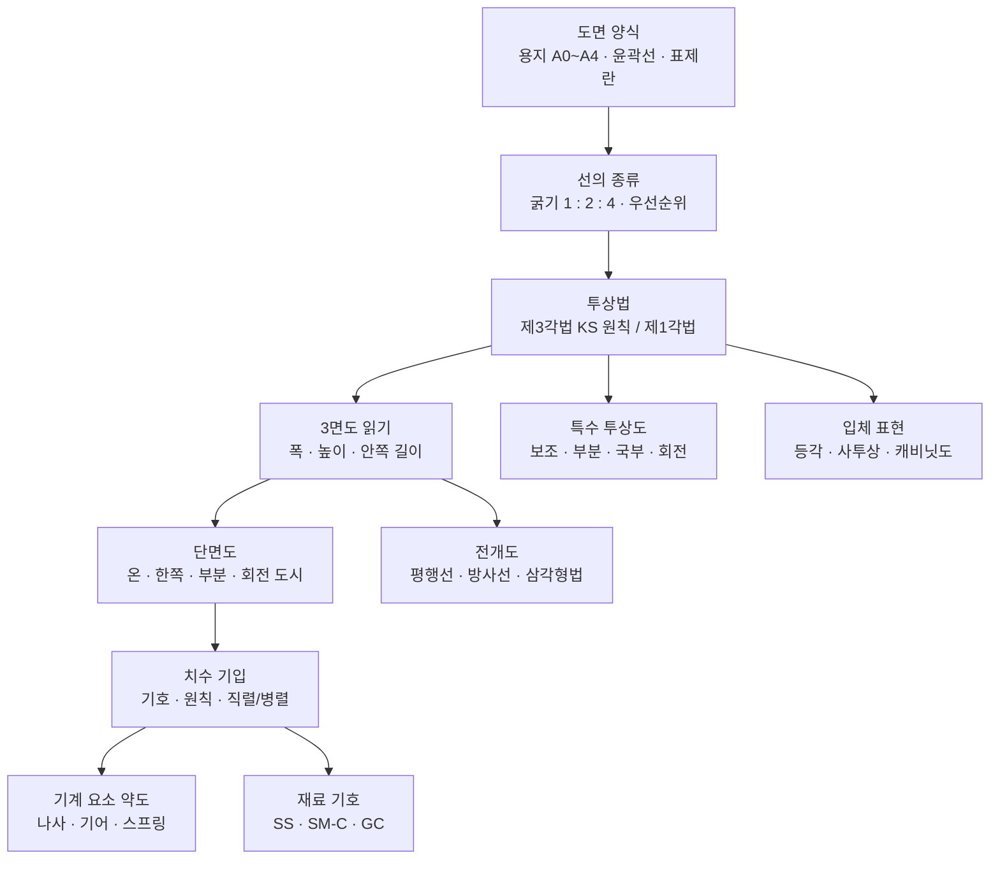

## 1. 도면의 양식 — 용지, 윤곽, 표제란

도면은 만든 사람이 없어도 **다른 사람이 같은 물건을 만들 수 있게 하는 약속된 문서**다. 그래서 어느 회사 도면을 펴도 같은 자리에 같은 정보가 있어야 한다: 표제란은 오른쪽 아래, 테두리는 굵은 실선, 가장자리 가운데에는 위치 맞춤용 중심 마크.

*손으로 도면을 그리던 시절의 제도 작업. 지금은 CAD로 그리지만 용지 크기·선·투상법 약속은 그대로다.*

### 용지 크기 — A열

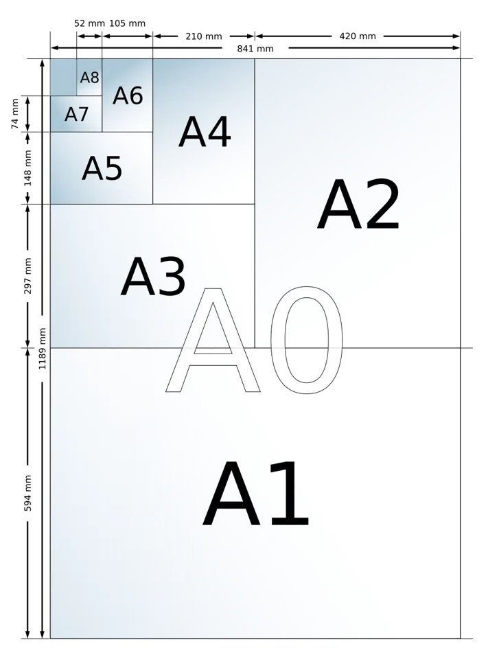

*A0(841 × 1189 mm)를 긴 변 방향으로 반 자르면 A1, 또 반 자르면 A2 … 가 된다. 그래서 **한 단계 클수록 면적 2배**이고, 가로·세로 비는 어느 크기든 $1 : \sqrt{2}$로 같다. 그림 위쪽의 210 mm, 420 mm, 841 mm가 A4·A2·A0의 짧은 변이다.*

$$\text{A}n \text{의 긴 변} = \text{A}(n+1) \text{의 짧은 변} \times 2, \qquad \text{가로 : 세로} = 1 : \sqrt{2}$$

| 크기 | A4 | A3 | A2 | A1 | A0 |
| --- | --- | --- | --- | --- | --- |
| 치수 (mm) | 210 × 297 | 297 × 420 | 420 × 594 | 594 × 841 | 841 × 1189 |
| 윤곽 여백 c | 10 | 10 | 10 | 20 | 20 |

### 도면의 양식

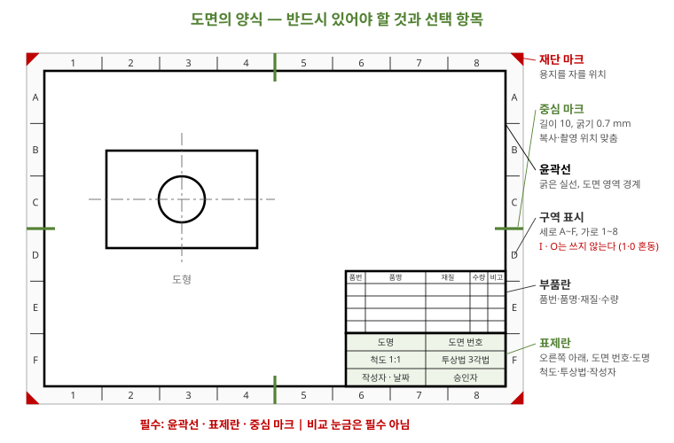

*용지 모서리의 빨간 삼각형이 **재단 마크**(자를 위치), 굵은 테두리가 **윤곽선**, 네 변 가운데 초록 굵은 짧은 선이 **중심 마크**다. 여백의 숫자 1~8과 글자 A~F가 **구역 표시**로, "C-3 구역"처럼 도면 위치를 찾는다. 오른쪽 아래 초록 칸이 **표제란**, 그 위가 **부품란**이다.*

| 요소 | 내용 |
| --- | --- |
| 윤곽선 | 도면 영역 경계, 굵은 실선 |
| 표제란 | 도면 번호, 도명, 척도, 투상법, 작성자, 날짜 |
| 부품란 | 품번, 품명, 재질, 수량 |
| 중심 마크 | 복사·마이크로필름 위치 맞춤 |
| 재단 마크 | 용지 자를 위치 |
| 비교 눈금 | 축소·확대 복사 시 척도 확인 |
| 구역 표시 | 도면 위치 찾기 (A~F, 1~8) |

- **척도**: 현척 1:1, 축척 1:2·1:5·1:10, 배척 2:1·5:1. 비례하지 않을 때 **NS** (Not to Scale).
- **구역 표시**: 세로 방향은 영문 대문자, 가로 방향은 숫자. 숫자 1·0과 헷갈리는 **I와 O는 쓰지 않는다**.
- **도면의 분류**: 내용에 따라 부품도·조립도·부분 조립도·상세도, 표현 형식에 따라 외관도·전개도·곡면선도 등. **스케치도**는 프리핸드로 그리고 실측 치수뿐 아니라 **재질·가공법도 적는다** (제작도 대용 가능).

> [!tip] 감 잡기 — 척도는 "그림 : 실물"
> 1:2는 그림이 실물의 절반(축척), 2:1은 그림이 실물의 두 배(배척). 앞 숫자가 그림이다. 척도가 몇이든 치수 숫자는 **실물 치수**를 적는다. 100 mm 부품을 1:5로 그리면 종이 위 길이는 20 mm지만 치수는 100.

**교재(CH03 02절) 보충**

- 도면 요건 (KS A 0005): 크기·모양·자세·위치 정보(필요하면 표면·재료·가공법), 해석이 애매하지 않을 것, 정합성·보편성·국제성, 복사·보존·검색이 확실할 것. 문장은 **가로쓰기**.
- 표제란 필수 항목: 법적 소유자, 식별 번호, 발행 일자, 시트 번호, 제목, 승인자, 작성자, 문서 형식. 개정 표시·시트 수·용지 크기는 선택.
- 중심 마크: 길이 10 mm, 굵기 0.7 mm 굵은 실선을 네 변 가운데에. 구역 한 칸은 중심 마크에서 50 mm 간격.
- 윤곽 여백 c(최소): A0·A1 **20 mm**, A2~A4 **10 mm**. 철할 쪽 여백 d는 모두 20 mm.
- 원도는 접지 않는다. 복사본을 접을 때는 **표제란이 보이게 A4 크기**로.

### 도면 분류 정리표

| 분류 기준 | 도면 |
| --- | --- |
| 용도 | 주문도, 견적도, 승인도, 계획도, 제작도, 설명도 |
| 내용 | 스케치도, 조립도, 부품도, 구조도, 배치도, 장치도, 실측도 |
| 표현 형식 | 외관도, **전개도**, 곡면선도, 계통선도, 입체도 |

> [!question] 시험에서는
> "내용에 따른 분류가 **아닌** 것" → 전개도(표현 형식). "구역 표시에 쓰지 않는 문자" → I, O. "반드시 표시할 사항이 아닌 것" → 비교 눈금.

## 2. 선의 종류와 용도

도면에는 색이 없다. 대신 **굵기와 끊김 모양**으로 "보이는 모서리인지, 숨은 모서리인지, 중심인지, 가상의 위치인지"를 구분한다. 굵은 선은 물체 자체, 가는 선은 설명(치수·해칭·중심), 끊긴 선은 보이지 않거나 실제로 없는 것이라고 기억하면 대부분 맞는다.

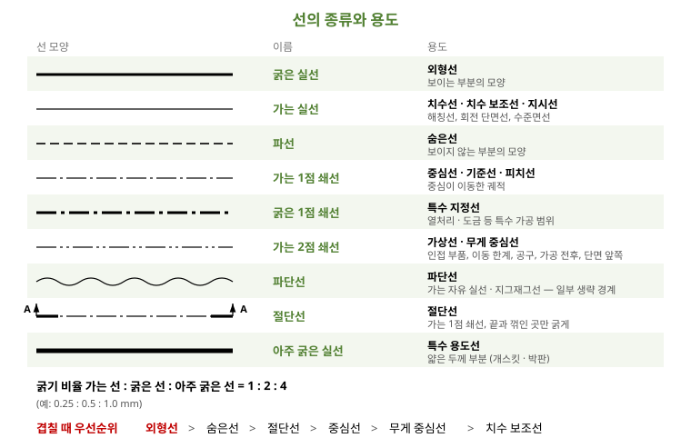

*왼쪽이 실제 선 모양, 오른쪽이 이름과 용도다. 같은 1점 쇄선이라도 **가는 것은 중심선**, **굵은 것은 특수 지정선**이다. 절단선은 가는 1점 쇄선인데 양 끝과 꺾인 곳만 굵게 하고 화살표와 기호(A)로 보는 방향을 표시한다. 아래 줄은 굵기 비율 1 : 2 : 4와 선이 겹칠 때 남기는 순서.*

### 선의 종류와 용도

| 선 | 모양 | 용도 |
| --- | --- | --- |
| 외형선 | 굵은 실선 | 보이는 부분의 모양 |
| 치수선·치수 보조선·지시선 | 가는 실선 | 치수 기입 |
| 해칭선 | 가는 실선 (45°) | 단면 표시 |
| 회전 단면선, 수준면선 | 가는 실선 | |
| 숨은선 | 가는 파선 또는 굵은 파선 | 보이지 않는 부분 |
| 중심선, 기준선, 피치선 | 가는 1점 쇄선 | 중심, 피치원 |
| 특수 지정선 | 굵은 1점 쇄선 | 열처리·도금 등 특수 가공 범위 |
| 가상선, 무게 중심선 | 가는 2점 쇄선 | 인접 부품, 이동 위치, 공구 |
| 파단선 | 가는 자유 실선, 지그재그선 | 일부 생략 경계 |
| 절단선 | 가는 1점 쇄선 (끝·꺾인 부분 굵게) | 단면 위치 |
| 특수 용도선 | 가는 실선 | 평면임을 나타내는 대각선, 위치 명시 |
| 특수 용도선 | 아주 굵은 실선 | 얇은 두께 부분 (개스킷, 박판) |

- **선 굵기 비율**: 가는 선 : 굵은 선 : 아주 굵은 선 = **1 : 2 : 4**. 굵은 선 0.5 mm면 가는 선 0.25, 아주 굵은 선 1.0 mm. 표준 굵기는 0.13~2 mm 범위 (교재 CH03 03절).
- 가공 **전후 모양**을 나타내는 선 = 가상선(가는 2점 쇄선) (교재 3-3).
- **가상선(가는 2점 쇄선) 용도**: 인접 부분 참고, 공구·지그 위치, 가동 부분의 이동 한계, 가공 전 또는 가공 후 모양, 되풀이하는 도형의 생략, 도시된 단면의 **앞쪽**에 있는 부분.
- **가는 1점 쇄선**은 중심선 외에 **중심이 이동한 궤적**, 피치선에도 쓴다.

> [!tip] 감 잡기 — 우선순위는 "물체에 가까운 선부터"
> 같은 자리에 선 두 개가 겹치면 하나만 그린다. 물체 모양을 직접 보여 주는 외형선이 이기고, 그다음 숨은 모양(숨은선), 자르는 위치(절단선), 중심선, 무게 중심선, 마지막이 순수한 보조인 치수 보조선이다.

## 3. 투상법 — 제3각법과 제1각법

물체를 상자 안에 넣고 각 면에 비친 모양을 그린 뒤 상자를 펼친다고 생각하자. **제3각법**은 상자가 유리이고 그 유리 **앞쪽 면에** 그림을 그린다(눈 → 투상면 → 물체). 그래서 위에서 본 그림이 위 유리판에, 오른쪽에서 본 그림이 오른쪽 유리판에 남는다. **제1각법**은 물체 **뒤쪽 벽에 비친 그림자**를 그린다(눈 → 물체 → 투상면). 위에서 비추면 그림자가 바닥(아래)에 생기므로 평면도가 아래로 간다.

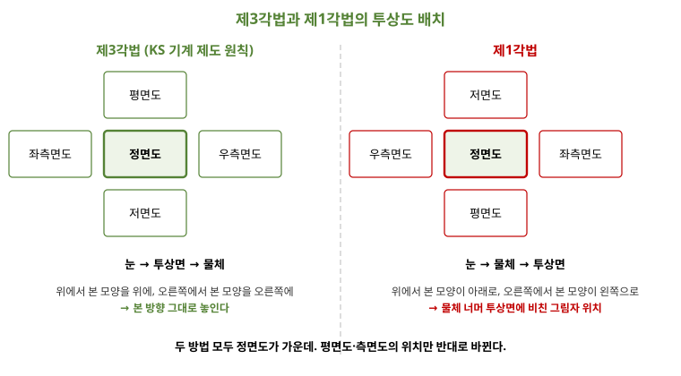

*두 방법 모두 정면도가 가운데다. 초록(제3각법)은 평면도가 위, 우측면도가 오른쪽 — 본 방향 그대로. 빨강(제1각법)은 평면도가 아래, 우측면도가 왼쪽, 정면도 오른쪽에는 **좌측면도**가 온다.*

| 구분 | 제1각법 | 제3각법 |
| --- | --- | --- |
| 배치 순서 | 눈 → 물체 → 투상면 | 눈 → 투상면 → 물체 |
| 평면도 위치 | 정면도 아래 | 정면도 위 |
| 우측면도 위치 | 정면도 왼쪽 | 정면도 오른쪽 |
| 사용 | 유럽 일부, 토목·건축 | **KS 기계 제도 원칙**, 미국 |

### 투상법 기호 — 표제란에서 확인

| 제3각법 기호 | 제1각법 기호 |
| :-: | :-: |
| 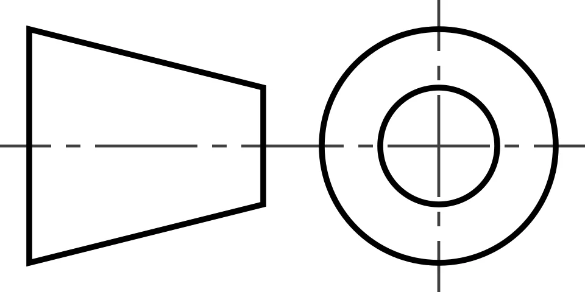 | 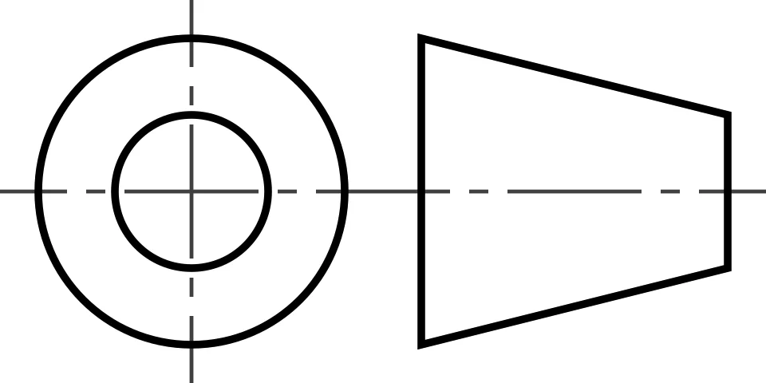 |

*표제란의 투상법 칸에 이 기호가 들어간다. 원뿔대(잘린 원뿔)를 옆에서 본 사다리꼴과 끝에서 본 동심원을 나란히 놓은 것으로, **제3각법은 사다리꼴이 왼쪽·동심원이 오른쪽**(가는 쪽 끝을 오른쪽에서 본 모습을 오른쪽에 둠), 제1각법은 그 반대 배치다.*

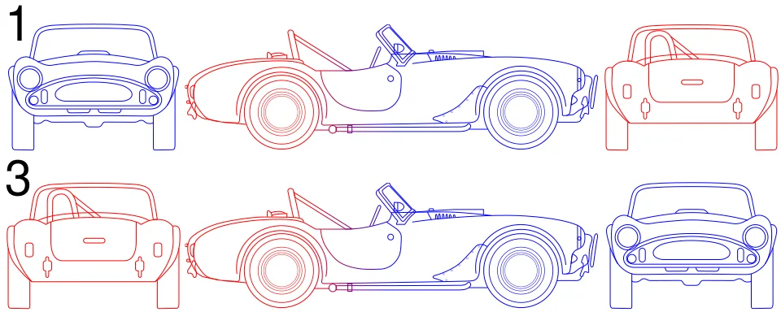

*가운데 옆모습에서 차의 앞(파랑)은 오른쪽, 뒤(빨강)는 왼쪽이다. 위 줄(제1각법)은 오른쪽에서 본 **앞모습이 왼쪽**에 놓이고, 아래 줄(제3각법)은 앞모습이 **오른쪽**에 놓인다. 3각법은 "본 쪽에 놓는다", 1각법은 "본 쪽의 반대편에 놓는다".*

- **정면도 선택**: 물체의 특징을 가장 잘 나타내는 면, 숨은선이 적은 면, 가공할 때 놓이는 방향.
- **투상도 분류** (교재 CH03 04절): 평행 투상 → 직각 투상(정투상, 축측 투상: 등각·부등각) + 사투상 / 투시 투상 → 1소점·다소점. 정투상도가 가장 많이 쓰이고 나머지는 특수 투상도.
- **보조 투상도**: 경사면의 실제 모양. **부분 투상도**, **국부 투상도**(키 홈 등), **회전 투상도**.

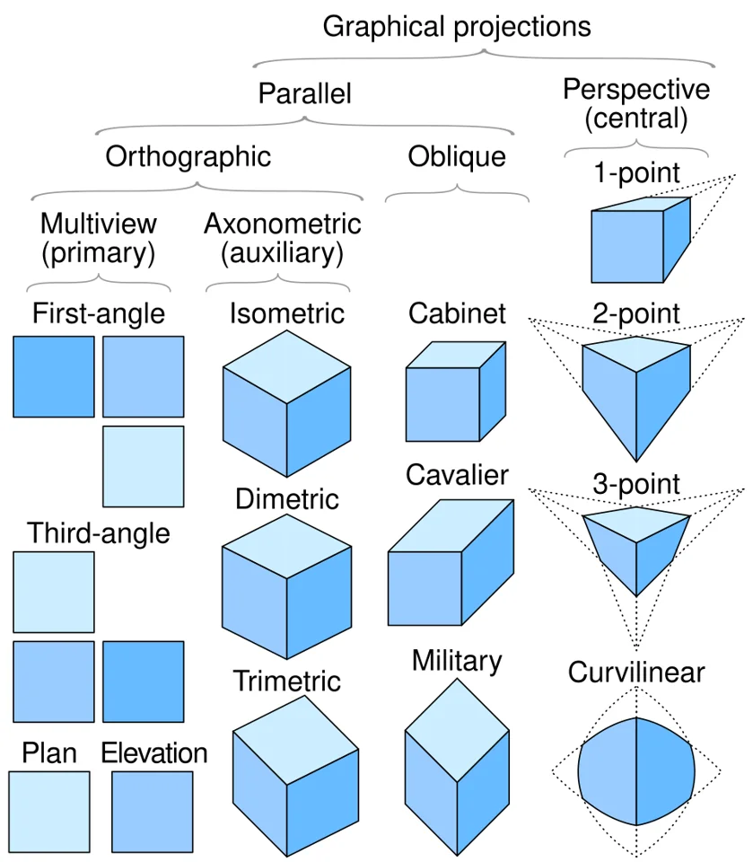

*같은 정육면체를 여러 투상법으로 그린 분류표(영문). Parallel(평행 투상) 아래 Orthographic(정투상)은 Multiview(다면도: First-angle 1각법, Third-angle 3각법)와 Axonometric(축측 투상: Isometric 등각, Dimetric, Trimetric)으로, Oblique(사투상)는 Cabinet·Cavalier로 나뉜다. 오른쪽 Perspective(투시 투상)는 소점 수(1·2·3-point)로 나뉜다.*

## 4. 3면도 읽기 — 폭·높이·안쪽 길이

3각법 문제는 "입체도를 보고 3면도 고르기", "두 투상도를 보고 나머지 하나 고르기"로 거의 매회 나온다. 비결은 **세 투상도가 치수를 나눠 갖는다**는 것 하나다. 정면도는 폭과 높이, 평면도는 폭과 안쪽 길이, 우측면도는 안쪽 길이와 높이를 보여 준다.

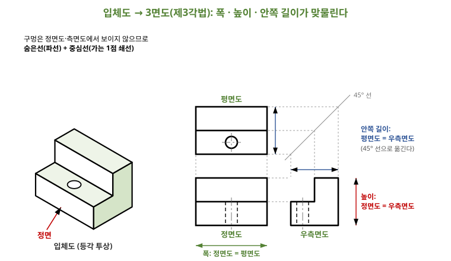

*왼쪽 입체도의 빨간 화살표 쪽이 정면이다. 정면도와 평면도는 **폭**(초록)이 세로 투상선으로 맞물리고, 정면도와 우측면도는 **높이**(빨강)가 가로 투상선으로 맞물린다. 평면도의 **안쪽 길이**(파랑)는 45° 선에서 꺾어 우측면도로 옮긴다. 아래 단에 뚫린 구멍은 평면도에서는 원으로 보이지만 정면도·우측면도에서는 보이지 않아 **파선(숨은선)** 두 줄과 중심선으로 나타난다.*

- **3각법 문제 풀이 요령**: 정면도와 평면도는 **가로 폭**, 정면도와 측면도는 **높이**, 평면도와 측면도는 **안쪽 길이**가 같다. 보이지 않는 모서리는 숨은선(파선)으로 들어가야 한다.

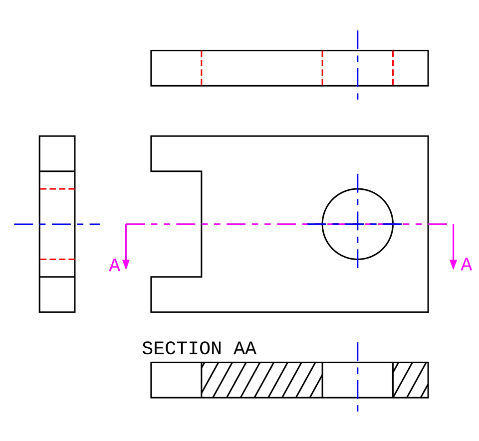

*실제 도면 예(영문 표기). 가운데 정면도 위에 평면도, 왼쪽에 **좌측면도**가 있으니 제3각법이다. 빨간 파선이 숨은선(구멍과 홈), 파란 1점 쇄선이 중심선이다. 분홍 1점 쇄선 A–A가 절단선이고, 화살표 방향으로 본 단면이 맨 아래 SECTION AA로, 잘린 살 부분에만 해칭이 들어가고 구멍과 홈은 비어 있다.*

> [!question] 시험에서는
> 보기 4개가 거의 같고 **선 하나**(실선이냐 파선이냐, 있느냐 없느냐)만 다르다. 정면도에서 보이는 모서리 하나를 골라 평면도·측면도의 어디에 오는지 투상선으로 따라가 확인하고, 뒤쪽에 숨은 홈·구멍은 반드시 파선인지 본다.

## 5. 특수 투상도와 입체 표현

정투상의 세 방향만으로는 비스듬한 면의 진짜 모양이 나오지 않는다. 경사면 위의 원 구멍은 정면도·평면도에서 찌그러진 타원이나 선으로만 보인다. 이럴 때 **그 면과 마주 보는 방향에서 한 번 더** 그리는 것이 보조 투상도다. 반대로 키 홈 하나 보여 주려고 측면도 전체를 그리는 것은 낭비라서, 필요한 곳만 떼어 그리는 것이 국부 투상도다.

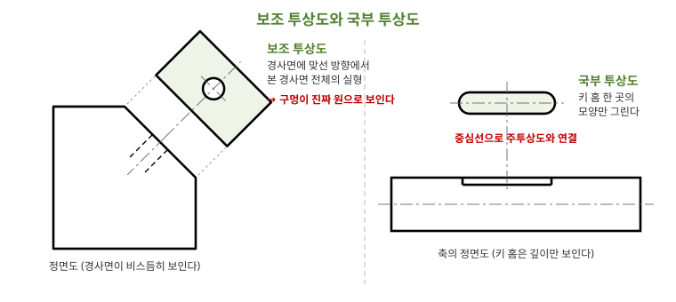

*왼쪽: 경사면에 수직인 방향으로 투상선(점선)을 뽑아 경사면 전체를 그린 **보조 투상도**. 정면도에서는 파선 두 줄로만 보이던 구멍이 진짜 원으로 나타난다. 오른쪽: 축의 정면도에서는 키 홈 깊이만 보이므로, 키 홈 위쪽에 홈 모양만 그리고 중심선으로 정면도와 이은 **국부 투상도**.*

### 특수 투상도와 기타 투상법

| 투상도 | 쓰는 경우 |
| --- | --- |
| 보조 투상도 | 경사면 **전체**의 실형을 그 면에 맞선 방향에서 그림 |
| 부분 투상도 | 물체의 일부만 그려도 충분할 때, 생략 경계는 파단선 |
| 국부 투상도 | 구멍·홈 등 **한 국부의 모양**만 그림, 주투상도와 중심선 등으로 연결 |
| 회전 투상도 | 암·경사진 부분을 회전시켜 실형으로 그림 |
| 부분 확대도 | 작은 부분(축의 구석, 홈)을 확대, 척도 표기 |

- **사투상법**: 정면은 실형, 안쪽 방향은 경사선. **캐비닛도**는 안쪽 길이를 1/2로 줄이고, 카발리에도는 실제 길이 그대로.
- **등각 투상법**: 세 축이 120°씩. 입체도 문제의 그림이 대부분 등각 투상도다.

*정면의 아치는 찌그러지지 않은 실형이고, 안쪽으로 들어가는 모서리만 45°로 비스듬히 그렸다(아래 빨간 45° 표시). 안쪽 길이를 1/2로 줄여 그리면 캐비닛도, 그대로 그리면 카발리에도다. 3절 분류표의 Cabinet·Cavalier 정육면체를 비교하면 카발리에도가 더 길쭉해 보인다.*

## 6. 전개도와 상관선

전개도는 판금으로 상자·깔때기·덕트를 만들 때 **잘라 낼 평판 모양**이다. 종이컵을 세로로 잘라 펴면 부채꼴이 되는 것처럼, 입체 표면을 찢지 않고 펼친 모양을 그린다.

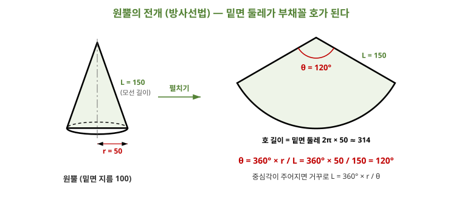

*원뿔을 모선을 따라 잘라 펼친 모양. 부채꼴의 반지름은 **모선 길이 L**, 호의 길이는 **밑면 둘레 2πr**이다. 그래서 중심각은 "전체 원 둘레 2πL 중 2πr이 차지하는 비율"만큼 = 360° × r / L. 그림의 값은 아래 계산 예와 같다.*

$$\theta = 360° \times \frac{r}{L}$$

### 전개법 정리표

| 전개법 | 대상 |
| --- | --- |
| 평행선법 | 각기둥, 원기둥 |
| 방사선법 | 각뿔, 원뿔 (꼭짓점 중심) |
| 삼각형법 | 꼭짓점이 멀거나 편심된 원뿔 등 복잡한 형상 |

- 원뿔 전개도의 부채꼴 중심각 $\theta = 360° \times \dfrac{r}{L}$ (r: 밑면 반지름, L: 모선 길이).
  - **계산 예**: 밑면 지름 100 mm, 중심각 120° → $120 = 360 \times 50 / L$ → $L = 150$ mm
- **상관선**: 두 입체가 만나 표면에 생기는 교차선.
- 전개도에는 "전개도" 주서를 달고, 판금 제품은 **이음 여유**를 둔다. **절단된 편심 원뿔은 삼각형법** (교재 4-8).

> [!tip] 감 잡기 — 세 전개법 고르기
> 모서리가 서로 **평행**하면(기둥) 평행선법, 모서리가 **한 꼭짓점에 모이면**(뿔) 방사선법, 꼭짓점이 너무 멀거나 비뚤어져 어느 쪽도 안 되면 표면을 작은 **삼각형**으로 쪼개는 삼각형법.

## 7. 단면도

속이 빈 부품을 바깥에서만 그리면 숨은선(파선)이 잔뜩 겹쳐 읽을 수 없다. 그래서 **가상으로 잘라 속을 보여 준다**. 잘린 살 부분에는 45° 빗금(해칭)을 넣어 "여기가 재료"라고 표시한다.

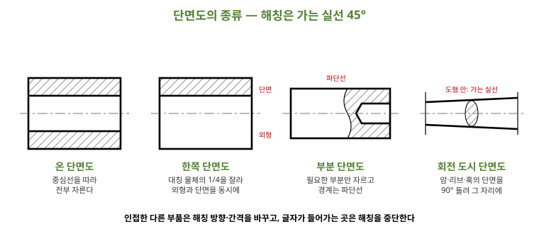

*같은 속 빈 원통을 **온 단면도**는 전부, **한쪽 단면도**는 중심선 위쪽 절반만(아래는 외형) 잘라 보였다. **부분 단면도**는 축 끝의 막힌 구멍만 보이도록 파단선(가는 자유 실선) 안쪽만 잘랐고, **회전 도시 단면도**는 막대(암)의 단면을 90° 돌려 그 자리에 가는 실선으로 겹쳐 그렸다.*

| 종류 | 내용 |
| --- | --- |
| 온 단면도 (전단면) | 중심선을 따라 전부 자름 |
| 한쪽 단면도 (반단면) | 대칭 물체의 1/4을 잘라 외형과 단면 동시에 |
| 부분 단면도 | 필요한 부분만, 파단선으로 경계 |
| 회전 도시 단면도 | 바퀴 암, 리브, 훅 단면을 90° 돌려 그림 |
| 계단 단면도 | 여러 평면으로 꺾어 자름 |
| 조합 단면도 | 각도를 가진 평면 조합 |

- **해칭 규칙**: 가는 실선, 주된 중심선에 **45°**, 등간격. **인접한 다른 부품은 방향이나 간격을 바꾼다**. 해칭 부분에 글자를 넣을 때는 **해칭을 중단**한다. 넓은 단면은 외형선을 따라 일부만 해칭하거나 스머징(색칠)해도 된다.
- **회전 도시 단면도**: 핸들·바퀴의 암, 림, 리브, 훅, 축의 단면을 90° 돌려 그림. 도형 안에 그리면 가는 실선, 절단선 연장선 위나 도형 밖에 그리면 굵은 실선.
- 교재(CH03 18절) 보충: 해칭 간격은 **3~5 mm**, 얇은 물체 단면은 **아주 굵은 실선**. 대칭 도형은 중심선 양 끝에 **짧은 평행선 두 개(=)** 를 그리고 한쪽을 생략한다. 부분 확대도는 확대할 곳을 가는 실선으로 두르고 **영문 대문자**로 지시한다. 가공에 쓰는 공구는 가상선(2점 쇄선).
- 구부러진 관을 중심선을 따라 전부 자른 단면도 = **온 단면도** (교재 18-2). 길이 방향으로 잘라도 되는 것은 **미끄럼 베어링** (교재 18-3).

> [!question] 시험에서는 — 왜 축·볼트는 길이 방향으로 자르지 않나
> 속이 꽉 찬 부품은 잘라도 새로 보이는 것이 없고, 해칭만 늘어 조립도가 오히려 읽기 어려워진다. 그래서 축, 핀, 볼트, 너트, 와셔, 키, 리벳, 리브, 바퀴 암, 기어의 이, 베어링의 볼·롤러는 단면도 안에서도 **자르지 않은 외형**으로 그린다. 속이 빈 미끄럼 베어링(부시)은 예외로 잘라 그린다.

## 8. 치수 기입 기호

치수 숫자 앞에 붙는 작은 기호 하나가 "이 50이 지름인지, 반지름인지, 정사각형 한 변인지"를 알려 준다. 투상도를 하나 덜 그려도 되게 해 주는 장치다. 예를 들어 축은 φ만 붙이면 측면도 없이 정면도 하나로 둥글다는 것이 전달된다.

### 치수 기입 기호

| 기호 | 뜻 | 기호 | 뜻 |
| --- | --- | --- | --- |
| φ | 지름 | R | 반지름 |
| Sφ | 구의 지름 | SR | 구의 반지름 |
| □ | 정사각형 변 | C | 45° 모따기 |
| t | 판 두께 | ⌒ | 원호 길이 |
| ( ) | 참고 치수 | 밑줄 | 비례하지 않는 치수 |
| EQS | 등간격 | 네모 틀 | 이론적으로 정확한 치수 |

- 보조 기호는 모두 치수 숫자 **앞**에 붙인다. 교재(CH03 09절) 표에는 실제 둥글기를 뜻하는 기호도 있다. 괄호 (15)는 절대 치수가 아니라 **참고 치수**다 (교재 9-3).

- 치수는 **mm** 단위를 쓰고 단위 기호는 생략. 각도는 도(°).
- 중복 치수 금지, 기준면에서 기입, 가공·측정하기 쉽게.

## 9. 치수 기입 원칙과 방법

치수는 **만드는 사람이 계산하지 않고 바로 가공·측정할 수 있게** 다는 것이 원칙이다. 같은 구멍 세 개의 위치도 "앞 구멍에서 얼마"로 다느냐 "기준면에서 얼마"로 다느냐에 따라 오차가 쌓이는 방식이 달라진다.

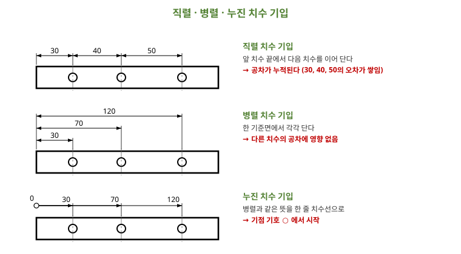

*같은 판의 구멍 세 개. **직렬**은 30, 40, 50으로 이어 달아서 세 번째 구멍 위치에 세 치수의 오차가 모두 쌓인다. **병렬**은 왼쪽 기준면에서 30, 70, 120을 각각 달아 서로 영향이 없다. **누진**은 병렬과 같은 뜻을 기점 기호 ○에서 시작하는 치수선 한 줄로 줄여 쓴 것이다.*

- 치수는 **주투상도에 집중**, 관련 치수는 **한곳에 모아서**, **계산하지 않아도 알 수 있게** 기입한다 (도면에서 계산해서 구하게 하는 것은 원칙 위반).
- 치수선은 **가는 실선**, 지시하는 길이에 **평행**하게 긋는다. 치수 숫자는 다른 치수선과 **교차하거나 겹치지 않게** 둔다. 이어지는 치수선은 가능한 한 일직선에 맞춘다.
- 공간이 좁으면 **인출선(지시선)** 으로 끌어내어 기입한다.
- **호의 길이**는 치수 숫자 위에 호 기호(⌒)를 붙이고 치수선을 원호로 그린다. **현의 길이**는 직선 치수선.
- 교재(CH03 05절) 보충:
  - 치수는 **완성(다듬질) 치수**, 단위 기호 생략(mm 외 단위만 표기), 큰 수에도 **자릿수 쉼표를 찍지 않는다**.
  - 치수 숫자는 치수선에 평행하게 **중앙 위쪽**, 다른 선과 겹치지 않게.
  - 치수 보조선은 필요하면 치수선에 **60°** 로 끌어낼 수 있다. 보조선 간격이 좁으면 화살표 대신 **45° 사선이나 검은 점**.
  - 좁은 곳은 치수선을 밖으로 끌어내 수평으로 긋고, 그 끝에는 아무것도 붙이지 않는다.
  - 치수선을 생략할 수 있는 경우: 한쪽 단면 주투상도의 지름 지시, 대칭 생략 도형, 기준 중심이 없는 경우.

### 치수 기입법 정리표

| 기입법 | 특징 |
| --- | --- |
| 직렬 치수 기입 | 이어서 기입, **공차가 누적**된다 |
| 병렬 치수 기입 | 기준면에서 각각 기입, 다른 치수 공차에 **영향 없음** |
| 누진 치수 기입 | 병렬과 같은 의미를 한 줄 치수선으로, 기점 기호(○) 사용 |
| 좌표 치수 기입 | 구멍 위치를 표로 정리 |

- **테이퍼** $= \dfrac{D - d}{l}$, **기울기** $= \dfrac{H - h}{l}$. 테이퍼는 중심선 위에, 기울기는 경사면을 따라 기입.

> [!tip] 감 잡기 — 테이퍼와 기울기
> 테이퍼는 축 양쪽이 **대칭으로** 가늘어지는 것(지름 차 D − d), 기울기는 **한쪽 면만** 비스듬한 것(높이 차 H − h)이다. 예: 길이 100에서 지름이 30 → 20이면 테이퍼 $(30-20)/100 = 1/10$.

## 10. 도면에서 길이·질량 읽기

도면은 치수가 다 적혀 있으므로 부품을 만들기 전에 무게를 미리 알 수 있다. 체적을 구하고 재료 밀도를 곱하면 된다.

$$m = \rho V$$

- 질량 = 체적 × 밀도. 예: 지름 20 mm, 길이 100 mm 강봉(밀도 7.85 g/cm³) → 체적 $\pi \times 1^2 \times 10 \approx 31.4$ cm³ → 약 **247 g**.
- 단위 맞추기: g/cm³이면 치수를 cm로 바꿔 계산한다.

## 11. 기계 요소의 약도

나사산 하나하나, 기어 이 하나하나를 다 그리면 시간도 오래 걸리고 도면이 오히려 복잡해진다. 그래서 자주 쓰는 요소는 **정해진 선 몇 개로 간략하게** 그리고, 세부는 기호와 요목표로 적는다.

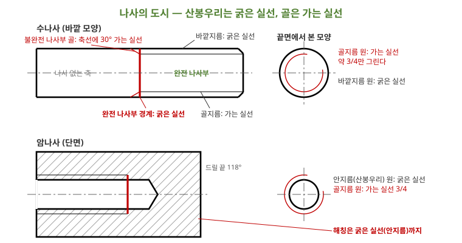

*수나사는 바깥지름(산봉우리)이 굵은 실선, 골지름이 가는 실선이고, 완전 나사부 경계는 굵은 실선(빨강)이다. 끝면에서 본 골지름 원은 약 3/4만 가는 실선으로 그린다. 암나사는 반대로 안지름(산봉우리)이 굵은 실선이다. 자세한 내용은 [나사와 볼트](나사와_볼트.md#4-나사의-도시).*

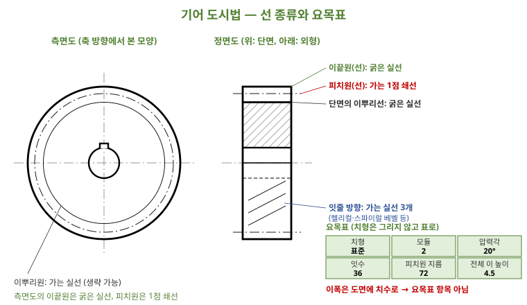

*기어는 이끝원 굵은 실선, 피치원 가는 1점 쇄선, 이뿌리원 가는 실선으로 그리고 잇수·모듈·압력각은 요목표에 적는다. 자세한 내용은 [기어](기어.md).*

- **나사**: 수나사 바깥지름·암나사 안지름 = 굵은 실선, 골지름 = 가는 실선, 완전 나사부 경계 = 굵은 실선.
- **기어**: 이끝원 굵은 실선, 피치원 가는 1점 쇄선, 이뿌리원 가는 실선.
- **스프링**: 무하중 상태로 그림, 요목표 기입.
- **베어링**: 간략 도시(사각형 + 십자).
- **평면 표시**: 축의 일부가 평면(면취·D컷)임을 나타낼 때 그 면에 **가는 실선으로 대각선**.
- **센터 구멍 간략 도시** (KS B ISO 6411): 센터 구멍을 **남겨야 함** / **남아도 됨** / **남으면 안 됨** 세 가지를 기호로 구분하고, 옆에 규격 번호와 형식·치수(예: `KS B ISO 6411-A 2/4.25`, A형, 파일럿 지름 2, 카운터싱크 지름 4.25)를 적는다. 기호 모양은 교재 그림으로 확인할 것.
- **형강 표시**: 형강 기호 뒤에 높이 × 폭 × 두께 − 길이 순 (예: `I 200×150×9 − 1000`).
- **리벳·볼트 구멍 기호**(구조물): 공장 구멍인지 현장 구멍인지, 어느 쪽 면에 접시(카운터싱크)가 있는지를 기호로 구분한다.
  - 교재(CH03 09절): 위치는 **십자(+)** 로 지시하고, 구멍 φ13, 볼트 M12×50, 리벳 φ12×50처럼 적는다. 카운터싱크 면(가까운 면·먼 면·양쪽)과 작업 장소(공장 드릴·공장 끼워맞춤 / 공장 드릴·현장 끼워맞춤 / 현장 드릴·현장 끼워맞춤)를 조합한 기호다. 기호 모양은 교재 그림으로 확인 (교재 9-8 그림 문제).

## 12. 재료 기호

재료 기호는 대개 **[재질] + [제품 모양·용도] + [숫자]** 순서로 읽는다. 첫 글자 S는 강(Steel), G는 주철(Gray cast iron), 둘째 자리는 S(일반 구조용), M(기계 구조용), C(주조품), F(단조품), P(판) 같은 모양·용도다. 마지막 숫자가 **강도인지 탄소량인지**가 시험의 핵심이다.

| 기호 | 재료 |
| --- | --- |
| SS400 | 일반 구조용 압연 강재 (인장 강도 400 MPa 이상) |
| SS235, SS275 | 일반 구조용 압연 강재, 개정 기호 (**항복 강도** 235·275 N/mm² 이상) |
| SM45C | 기계 구조용 탄소 강재 (탄소 0.45%) |
| SM25C | 기계 구조용 탄소 강재 (탄소 약 0.22~0.28%) |
| SCM440 | 크롬몰리브덴강 |
| SCr, SMn, SMnC, SNC | 크롬강, 망가니즈강, 망가니즈크롬강, 니켈크롬강 |
| SF | 탄소강 단강품 |
| SC | 탄소강 주강품 |
| SPCD | 냉간 압연 강판 (드로잉용) |
| SPPS | 압력 배관용 탄소 강관 |
| STS304 | 스테인리스강 |
| SPCC | 냉간 압연 강판 |
| GC250 | 회주철품 (인장 강도 250 MPa) |
| GCD450 | 구상 흑연 주철품 |
| SPS | 스프링 강재 |
| SKH | 고속도 공구강 |
| STC | 탄소 공구강 |

> [!tip] 감 잡기 — 숫자의 뜻
> - SS**400**, GC**250**, GCD**450**: 최저 **인장 강도**(MPa).
> - SS**235**, SS**275** (개정 KS): 최저 **항복 강도**(N/mm²).
> - SM**45**C: 탄소 함유량 **0.45%** (숫자 ÷ 100). 끝의 C는 Carbon.

## 그림

Mermaid는 상자 위치를 자동으로 배치해서 투상도 배치를 정확히 보여 주지 못하므로 표로 나타낸다.

| 제3각법 (KS) | | | | 제1각법 | | |
| :-: | :-: | :-: | --- | :-: | :-: | :-: |
| | 평면도 | | | | 저면도 | |
| 좌측면도 | **정면도** | 우측면도 | | 우측면도 | **정면도** | 좌측면도 |
| | 저면도 | | | | 평면도 | |

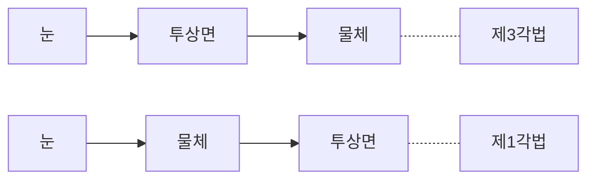

## 기출 포인트

2014~2020년 생산자동화산업기사 필기 19회분 기준 (분석: [기출분석 – 기계요소설계](../01_시험안내/기출분석_기계요소설계.md)).

- 3각법 투상도 해석 (입체도 → 3면도, 두 투상도 → 나머지 하나) — **22회**, 거의 매회 1문제 이상 (2016-1, 2016-2 ×2, 2016-3, 2017-1, 2017-2, 2017-3, 2018-1 ×2, 2018-2, 2018-3, 2019-1, 2019-2, 2019-3, 2020-1, 2020-3 외)
- 선 종류별 용도 — 10회 (2014-3, 2015-2, 2017-1, 2017-2, 2018-1, 2018-3, 2019-1, 2019-2, 2019-3, 2020-3)
  - 가는 2점 쇄선(가상선) 용도가 아닌 것 고르기 — 2017-1, 2018-3, 2019-2
  - 굵은 1점 쇄선 = 특수 지정선 — 2017-2, 2019-1, 2020-3
  - 파단선 정의, 치수선 선 종류, 선 굵기 비율 — 2019-3, 2014-3, 2015-2
- 선이 겹칠 때 우선순위 — 6회 (2014-1, 2015-2, 2017-3, 2018-1, 2019-1, 2020-1). 순서 나열, 가장 높은 것, 가장 낮은 것(치수 보조선) 모두 나왔다.
- 단면도 종류·규칙 — 9회: 한쪽·온·회전 도시 단면도 이름 (2014-2, 2015-2, 2016-2, 2016-3, 2018-3), 해칭 규칙 (2019-1), 길이 방향으로 단면하지 않는 부품·축 도시 (2014-1, 2014-3, 2017-1)
- 치수 기입 — 14회: 보조 기호 ( )·밑줄 (2014-2, 2018-2), 척도와 기입 치수 (2016-1), 기입 원칙 (2019-2, 2020-1), 치수선·인출선 (2016-3, 2019-2, 2019-3), 호 치수 (2020-1), 각도 허용 한계 (2019-1), 병렬 치수 기입 (2018-2), 도면에서 길이·지름·테이퍼 읽기 (2016-1, 2016-2, 2017-2)
- 특수 투상도·투상법 — 6회: 1각법·3각법 배치 (2016-1, 2017-1), 국부 투상도 (2017-3, 2020-3), 보조 투상도 (2018-3), 사투상도·캐비닛도 (2017-2)
- 재료 기호 — 9회 (2014-1 ×2, 2014-2, 2014-3, 2015-1 ×2, 2017-1, 2018-1, 2019-3). SM□□C의 숫자, GC, SF, SPCD, SCM, STC, SPS, SS235 순으로 나왔다.
- 도면 양식·분류 — 5회: 구역 표시에 쓰지 않는 문자 (2016-2), 재단 마크·비교 눈금 (2018-2), 도면 분류·스케치도 (2015-1, 2015-2)
- 전개도·상관선 — 4회 (2018-1, 2018-2, 2019-1, 2019-2)
- 기타 도시법 — 평면 표시 대각선 (2016-3), 센터 구멍 간략 도시 (2020-3), 형강 치수 표시 (2020-1), 배관 표시 (2017-1), 리벳 구멍 기호 (2019-3), 도면으로 질량 계산 (2014-2, 2017-3)

**교재 예제 유형** (Win-Q 2025 PART 01 CHAPTER 03, 02~05절): 도면 요건으로 틀린 것(작으면 안 그림), 1:5 척도의 그리는 길이와 기입 치수, 필수 표시가 아닌 것(비교 눈금), 내용 분류가 아닌 것(전개도), 표제란에서 먼 것(도면 크기), 기본 원칙 위반(1:2는 축척, 문장은 가로쓰기), 구역 표시 금지 문자(O), 선 겹침 우선순위, 해칭선(가는 실선), 가공 전후 모양(가상선), 굵은 1점 쇄선 의미(그림), 평면 표시 대각선(그림), 선 용도 중 틀린 것, 1각법 배치, 투상도 그림 문제 6개, 편심 원뿔 전개(삼각형법), 치수선 표기가 아닌 것(그림), 병렬 치수 기입, 인출선 기입(그림), 치수 숫자 교차 금지, 참고 치수는 괄호. 09절: 치수 밑 선(비례척 아님), 보조 기호 중 틀린 것((15)는 참고 치수), 카운터싱크·공장 드릴·현장 끼워맞춤 기호(그림). 18절: 종류가 다른 단면도(그림, 부분 단면도), 구부러진 관 전체 단면(온 단면도), 길이 방향 단면이 되는 것(미끄럼 베어링), 대칭 생략 간략도(그림), 해칭 규칙, 경사면 실형(보조 투상도), 제도 통칙에 맞는 투상도(그림), 플랜지 드릴 구멍 지름(그림, 8 × φ19).

## 관련 단원

- [기초공학 – 힘·운동·단위](기초공학_힘_운동_단위.md)
- [치수공차와 끼워맞춤](치수공차와_끼워맞춤.md)
- [기하공차](기하공차.md)
- [표면거칠기·열처리·가공기호](표면거칠기_열처리_가공기호.md)
- [기어](기어.md)
- [나사와 볼트](나사와_볼트.md)

## 체크리스트

- [ ] A0~A4 도면 크기를 안다
- [ ] 선 종류별 용도와 겹칠 때 우선순위를 안다
- [ ] 제1각법·제3각법 배치를 구분한다
- [ ] 단면도 종류와 단면하지 않는 부품을 안다
- [ ] 치수 기호(φ, R, SR, C, t, □)를 읽는다
- [ ] SS400, SM45C, GC250의 의미를 안다
- [ ] 정면도·평면도·측면도에서 같아야 하는 치수(폭·높이·안쪽 길이)로 누락 투상도를 찾는다
- [ ] 가는 2점 쇄선·굵은 1점 쇄선·아주 굵은 실선의 용도를 구분한다
- [ ] 보조·부분·국부·회전 투상도를 구분한다
- [ ] 해칭 규칙(45°, 인접 부품 방향 변경, 글자 부분 중단)을 안다
- [ ] 치수 기입 원칙과 직렬·병렬 치수 기입의 차이를 말한다
- [ ] 구역 표시에 I·O를 쓰지 않는 이유를 안다
- [ ] 원뿔 전개도 중심각을 계산한다
- [ ] 센터 구멍 간략 도시 3가지 지시를 구분한다
- [ ] 투상법 기호(원뿔대 + 동심원)로 제3각법·제1각법을 판별한다
- [ ] 캐비닛도와 카발리에도의 안쪽 길이 차이를 말한다

## 참고

- [큐넷 자동화설비산업기사 출제기준](https://www.q-net.or.kr/crf005.do?id=crf00503&jmCd=2034)
- KS B 0001 (기계 제도)

### 그림 출처

위키미디어 공용(Wikimedia Commons)과 Openverse에서 가져온 공개 라이선스 자료이고, 노트에 맞게 크기를 줄이고 WebP로 변환했다.

| 그림 | 작성자 | 라이선스 | 출처 |
| --- | --- | --- | --- |
| [Drafter at work](https://commons.wikimedia.org/wiki/File:Drafter_at_work.jpg) | bls.gov | 퍼블릭 도메인 | Wikimedia Commons |
| [A size illustration](https://commons.wikimedia.org/wiki/File:A_size_illustration.svg) | User:Sven | [CC BY-SA 3.0](http://creativecommons.org/licenses/by-sa/3.0/) | Wikimedia Commons |
| [Third angle projection symbol](https://commons.wikimedia.org/wiki/File:Third_angle_projection_symbol.svg) | Redrose64 | 퍼블릭 도메인 | Wikimedia Commons |
| [First angle projection symbol](https://commons.wikimedia.org/wiki/File:First_angle_projection_symbol.svg) | Redrose64 | 퍼블릭 도메인 | Wikimedia Commons |
| [Projection shelby cobra](https://commons.wikimedia.org/wiki/File:Projection_shelby_cobra.svg) | cmglee, Igor Križanovskij | [CC BY-SA 4.0](https://creativecommons.org/licenses/by-sa/4.0) | Wikimedia Commons |
| [Comparison of graphical projections](https://commons.wikimedia.org/wiki/File:Comparison_of_graphical_projections.svg) | Cmglee | [CC BY-SA 4.0](https://creativecommons.org/licenses/by-sa/4.0) | Wikimedia Commons |
| [Mech draw 1](https://commons.wikimedia.org/wiki/File:Mech_draw_1.svg) | HereToHelp, based on BAxelrod | [CC BY-SA 3.0](https://creativecommons.org/licenses/by-sa/3.0) | Wikimedia Commons |
| [Cabinet perspective 45](https://commons.wikimedia.org/wiki/File:Cabinet_perspective_45.svg) | 작성자 미표기 (출처 페이지 참조) | [CC BY-SA 3.0](http://creativecommons.org/licenses/by-sa/3.0/) | Wikimedia Commons |

직접 그린 그림(SVG, 이 볼트용으로 새로 작성): 도면 양식, 선의 종류, 제3각법 제1각법, 3면도 치수관계, 보조 국부투상도, 원뿔 전개, 단면도 종류, 치수 기입법, 나사 도시, 기어 도시 선종류.

