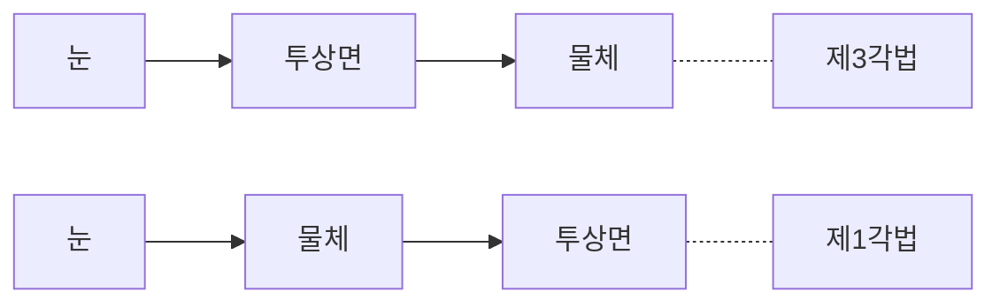

# 도면 양식과 투상법

> [!summary] 핵심 요약
> - KS 기계 제도는 **제3각법**이 원칙: 정면도 기준 **평면도는 위, 우측면도는 오른쪽**.
> - 도면 크기: **A4 210×297, A3 297×420, A2 420×594, A1 594×841, A0 841×1189** (mm). 한 단계 클수록 면적 2배.
> - 선: 외형선 = **굵은 실선**, 숨은선 = **파선**, 중심선 = **가는 1점 쇄선**, 가상선 = **가는 2점 쇄선**, 치수선·해칭 = **가는 실선**.
> - 표제란은 도면 **오른쪽 아래**. 부품란은 표제란 위나 도면 오른쪽 위.

> [!warning] 자주 틀리는 포인트
> - 제1각법은 정면도 기준 평면도가 **아래**, 우측면도가 **왼쪽**. 3각법과 반대.
> - 선이 겹칠 때 우선순위: **외형선 > 숨은선 > 절단선 > 중심선 > 무게 중심선 > 치수 보조선**.
> - **길이 방향으로 단면하지 않는 부품**: 축, 핀, 볼트, 너트, 와셔, 키, 리벳, 리브, 바퀴 암, 기어의 이, 베어링의 볼·롤러.
> - 치수 숫자 아래 **밑줄**은 "척도와 비례하지 않는 치수". 괄호 ( )는 **참고 치수**.
> - SS400의 400은 **최저 인장 강도(MPa)**, SM45C의 45는 **탄소 함유량 0.45%**.

## 개념 정리

### 도면의 양식

| 요소 | 내용 |
| --- | --- |
| 윤곽선 | 도면 영역 경계, 굵은 실선 |
| 표제란 | 도면 번호, 도명, 척도, 투상법, 작성자, 날짜 |
| 부품란 | 품번, 품명, 재질, 수량 |
| 중심 마크 | 복사·마이크로필름 위치 맞춤 |
| 재단 마크 | 용지 자를 위치 |
| 비교 눈금 | 축소·확대 복사 시 척도 확인 |
| 구역 표시 | 도면 위치 찾기 (A~F, 1~8) |

- **척도**: 현척 1:1, 축척 1:2·1:5·1:10, 배척 2:1·5:1. 비례하지 않을 때 **NS** (Not to Scale).

### 선의 종류와 용도

| 선 | 모양 | 용도 |
| --- | --- | --- |
| 외형선 | 굵은 실선 | 보이는 부분의 모양 |
| 치수선·치수 보조선·지시선 | 가는 실선 | 치수 기입 |
| 해칭선 | 가는 실선 (45°) | 단면 표시 |
| 회전 단면선, 수준면선 | 가는 실선 | |
| 숨은선 | 가는 파선 또는 굵은 파선 | 보이지 않는 부분 |
| 중심선, 기준선, 피치선 | 가는 1점 쇄선 | 중심, 피치원 |
| 특수 지정선 | 굵은 1점 쇄선 | 열처리·도금 등 특수 가공 범위 |
| 가상선, 무게 중심선 | 가는 2점 쇄선 | 인접 부품, 이동 위치, 공구 |
| 파단선 | 가는 자유 실선, 지그재그선 | 일부 생략 경계 |
| 절단선 | 가는 1점 쇄선 (끝·꺾인 부분 굵게) | 단면 위치 |

### 투상법

| 구분 | 제1각법 | 제3각법 |
| --- | --- | --- |
| 배치 순서 | 눈 → 물체 → 투상면 | 눈 → 투상면 → 물체 |
| 평면도 위치 | 정면도 아래 | 정면도 위 |
| 우측면도 위치 | 정면도 왼쪽 | 정면도 오른쪽 |
| 사용 | 유럽 일부, 토목·건축 | **KS 기계 제도 원칙**, 미국 |

- **정면도 선택**: 물체의 특징을 가장 잘 나타내는 면, 숨은선이 적은 면, 가공할 때 놓이는 방향.
- **보조 투상도**: 경사면의 실제 모양. **부분 투상도**, **국부 투상도**(키 홈 등), **회전 투상도**.

### 단면도

| 종류 | 내용 |
| --- | --- |
| 온 단면도 (전단면) | 중심선을 따라 전부 자름 |
| 한쪽 단면도 (반단면) | 대칭 물체의 1/4을 잘라 외형과 단면 동시에 |
| 부분 단면도 | 필요한 부분만, 파단선으로 경계 |
| 회전 도시 단면도 | 바퀴 암, 리브, 훅 단면을 90° 돌려 그림 |
| 계단 단면도 | 여러 평면으로 꺾어 자름 |
| 조합 단면도 | 각도를 가진 평면 조합 |

### 치수 기입 기호

| 기호 | 뜻 | 기호 | 뜻 |
| --- | --- | --- | --- |
| φ | 지름 | R | 반지름 |
| Sφ | 구의 지름 | SR | 구의 반지름 |
| □ | 정사각형 변 | C | 45° 모따기 |
| t | 판 두께 | ⌒ | 원호 길이 |
| ( ) | 참고 치수 | 밑줄 | 비례하지 않는 치수 |

- 치수는 **mm** 단위를 쓰고 단위 기호는 생략. 각도는 도(°).
- 중복 치수 금지, 기준면에서 기입, 가공·측정하기 쉽게.

### 기계 요소의 약도

- **나사**: 수나사 바깥지름·암나사 안지름 = 굵은 실선, 골지름 = 가는 실선, 완전 나사부 경계 = 굵은 실선.
- **기어**: 이끝원 굵은 실선, 피치원 가는 1점 쇄선, 이뿌리원 가는 실선.
- **스프링**: 무하중 상태로 그림, 요목표 기입.
- **베어링**: 간략 도시(사각형 + 십자).

### 재료 기호

| 기호 | 재료 |
| --- | --- |
| SS400 | 일반 구조용 압연 강재 (인장 강도 400 MPa 이상) |
| SM45C | 기계 구조용 탄소 강재 (탄소 0.45%) |
| SCM440 | 크롬몰리브덴강 |
| STS304 | 스테인리스강 |
| SPCC | 냉간 압연 강판 |
| GC250 | 회주철품 (인장 강도 250 MPa) |
| GCD450 | 구상 흑연 주철품 |
| SPS | 스프링 강재 |
| SKH | 고속도 공구강 |
| STC | 탄소 공구강 |

## 그림

Mermaid는 상자 위치를 자동으로 배치해서 투상도 배치를 정확히 보여 주지 못하므로 표로 나타낸다.

| 제3각법 (KS) | | | | 제1각법 | | |
| :-: | :-: | :-: | --- | :-: | :-: | :-: |
| | 평면도 | | | | 저면도 | |
| 좌측면도 | **정면도** | 우측면도 | | 우측면도 | **정면도** | 좌측면도 |
| | 저면도 | | | | 평면도 | |

## 관련 단원

- [치수공차와 끼워맞춤](치수공차와_끼워맞춤.md)
- [기하공차](기하공차.md)
- [표면거칠기·열처리·가공기호](표면거칠기_열처리_가공기호.md)
- [기어](기어.md)

## 체크리스트

- [ ] A0~A4 도면 크기를 안다
- [ ] 선 종류별 용도와 겹칠 때 우선순위를 안다
- [ ] 제1각법·제3각법 배치를 구분한다
- [ ] 단면도 종류와 단면하지 않는 부품을 안다
- [ ] 치수 기호(φ, R, SR, C, t, □)를 읽는다
- [ ] SS400, SM45C, GC250의 의미를 안다

## 참고

- [큐넷 자동화설비산업기사 출제기준](https://www.q-net.or.kr/crf005.do?id=crf00503&jmCd=2034)
- KS B 0001 (기계 제도)
