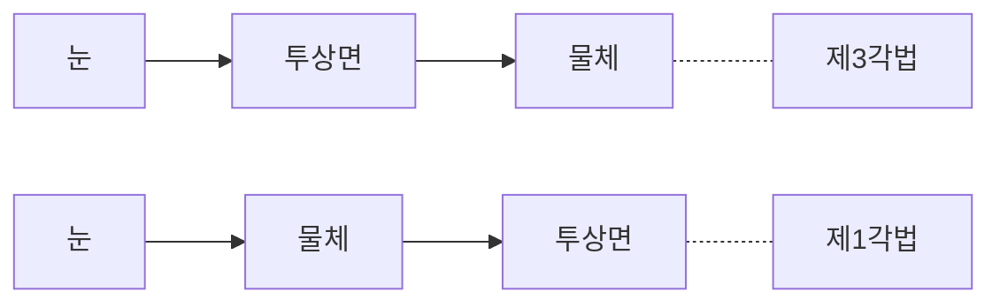

# 도면 양식과 투상법

> [!summary] 핵심 요약
> - KS 기계 제도는 **제3각법**이 원칙: 정면도 기준 **평면도는 위, 우측면도는 오른쪽**.
> - 도면 크기: **A4 210×297, A3 297×420, A2 420×594, A1 594×841, A0 841×1189** (mm). 한 단계 클수록 면적 2배.
> - 선: 외형선 = **굵은 실선**, 숨은선 = **파선**, 중심선 = **가는 1점 쇄선**, 가상선 = **가는 2점 쇄선**, 치수선·해칭 = **가는 실선**.
> - 표제란은 도면 **오른쪽 아래**. 부품란은 표제란 위나 도면 오른쪽 위.

> [!warning] 자주 틀리는 포인트
> - 제1각법은 정면도 기준 평면도가 **아래**, 우측면도가 **왼쪽**. 3각법과 반대.
> - 선이 겹칠 때 우선순위: **외형선 > 숨은선 > 절단선 > 중심선 > 무게 중심선 > 치수 보조선**.
> - **길이 방향으로 단면하지 않는 부품**: 축, 핀, 볼트, 너트, 와셔, 키, 리벳, 리브, 바퀴 암, 기어의 이, 베어링의 볼·롤러.
> - 치수 숫자 아래 **밑줄**은 "척도와 비례하지 않는 치수". 괄호 ( )는 **참고 치수**.
> - SS400의 400은 **최저 인장 강도(MPa)**, SM45C의 45는 **탄소 함유량 0.45%**.
> - 개정 KS의 **SS235·SS275**는 숫자가 **최저 항복 강도(N/mm²)** 다. 연신율·탄소량이 아니다.
> - **가는 2점 쇄선(가상선)** 은 단면의 **앞쪽** 부분을 나타낼 때 쓴다. "단면 **뒷부분**", "평면 표시", "얇은 두께"는 가상선 용도가 아니다 (평면은 가는 실선 대각선, 얇은 두께는 아주 굵은 실선).
> - **굵은 1점 쇄선** = 특수 지정선(열처리·도금 등 범위). 수면·유면 위치는 **가는 실선**(수준면선)이다.
> - 1:5 척도라도 **치수 숫자는 실물 치수**를 적는다. 그리는 길이만 1/5.
> - 축은 길이 방향으로 단면하지 않는다. 대신 **회전 도시 단면도**나 **부분 확대도**로 보여 준다. 반면 **미끄럼 베어링(부시)** 은 길이 방향으로 잘라 그려도 된다.
> - 경사면이라는 말만 보고 **보조 투상도**를 고르지 말 것. 구멍·홈 **한 부분만** 따로 그린 그림이면 **국부 투상도**다.

## 개념 정리

### 도면의 양식

| 요소 | 내용 |
| --- | --- |
| 윤곽선 | 도면 영역 경계, 굵은 실선 |
| 표제란 | 도면 번호, 도명, 척도, 투상법, 작성자, 날짜 |
| 부품란 | 품번, 품명, 재질, 수량 |
| 중심 마크 | 복사·마이크로필름 위치 맞춤 |
| 재단 마크 | 용지 자를 위치 |
| 비교 눈금 | 축소·확대 복사 시 척도 확인 |
| 구역 표시 | 도면 위치 찾기 (A~F, 1~8) |

- **척도**: 현척 1:1, 축척 1:2·1:5·1:10, 배척 2:1·5:1. 비례하지 않을 때 **NS** (Not to Scale).
- **구역 표시**: 세로 방향은 영문 대문자, 가로 방향은 숫자. 숫자 1·0과 헷갈리는 **I와 O는 쓰지 않는다**.
- **도면의 분류**: 내용에 따라 부품도·조립도·부분 조립도·상세도, 표현 형식에 따라 외관도·전개도·곡면선도 등. **스케치도**는 프리핸드로 그리고 실측 치수뿐 아니라 **재질·가공법도 적는다** (제작도 대용 가능).

### 선의 종류와 용도

| 선 | 모양 | 용도 |
| --- | --- | --- |
| 외형선 | 굵은 실선 | 보이는 부분의 모양 |
| 치수선·치수 보조선·지시선 | 가는 실선 | 치수 기입 |
| 해칭선 | 가는 실선 (45°) | 단면 표시 |
| 회전 단면선, 수준면선 | 가는 실선 | |
| 숨은선 | 가는 파선 또는 굵은 파선 | 보이지 않는 부분 |
| 중심선, 기준선, 피치선 | 가는 1점 쇄선 | 중심, 피치원 |
| 특수 지정선 | 굵은 1점 쇄선 | 열처리·도금 등 특수 가공 범위 |
| 가상선, 무게 중심선 | 가는 2점 쇄선 | 인접 부품, 이동 위치, 공구 |
| 파단선 | 가는 자유 실선, 지그재그선 | 일부 생략 경계 |
| 절단선 | 가는 1점 쇄선 (끝·꺾인 부분 굵게) | 단면 위치 |
| 특수 용도선 | 가는 실선 | 평면임을 나타내는 대각선, 위치 명시 |
| 특수 용도선 | 아주 굵은 실선 | 얇은 두께 부분 (개스킷, 박판) |

- **선 굵기 비율**: 가는 선 : 굵은 선 : 아주 굵은 선 = **1 : 2 : 4**. 굵은 선 0.5 mm면 가는 선 0.25, 아주 굵은 선 1.0 mm.
- **가상선(가는 2점 쇄선) 용도**: 인접 부분 참고, 공구·지그 위치, 가동 부분의 이동 한계, 가공 전 또는 가공 후 모양, 되풀이하는 도형의 생략, 도시된 단면의 **앞쪽**에 있는 부분.
- **가는 1점 쇄선**은 중심선 외에 **중심이 이동한 궤적**, 피치선에도 쓴다.

### 투상법

| 구분 | 제1각법 | 제3각법 |
| --- | --- | --- |
| 배치 순서 | 눈 → 물체 → 투상면 | 눈 → 투상면 → 물체 |
| 평면도 위치 | 정면도 아래 | 정면도 위 |
| 우측면도 위치 | 정면도 왼쪽 | 정면도 오른쪽 |
| 사용 | 유럽 일부, 토목·건축 | **KS 기계 제도 원칙**, 미국 |

- **정면도 선택**: 물체의 특징을 가장 잘 나타내는 면, 숨은선이 적은 면, 가공할 때 놓이는 방향.
- **보조 투상도**: 경사면의 실제 모양. **부분 투상도**, **국부 투상도**(키 홈 등), **회전 투상도**.

### 특수 투상도와 기타 투상법

| 투상도 | 쓰는 경우 |
| --- | --- |
| 보조 투상도 | 경사면 **전체**의 실형을 그 면에 맞선 방향에서 그림 |
| 부분 투상도 | 물체의 일부만 그려도 충분할 때, 생략 경계는 파단선 |
| 국부 투상도 | 구멍·홈 등 **한 국부의 모양**만 그림, 주투상도와 중심선 등으로 연결 |
| 회전 투상도 | 암·경사진 부분을 회전시켜 실형으로 그림 |
| 부분 확대도 | 작은 부분(축의 구석, 홈)을 확대, 척도 표기 |

- **사투상법**: 정면은 실형, 안쪽 방향은 경사선. **캐비닛도**는 안쪽 길이를 1/2로 줄이고, 카발리에도는 실제 길이 그대로.
- **등각 투상법**: 세 축이 120°씩. 입체도 문제의 그림이 대부분 등각 투상도다.
- **3각법 문제 풀이 요령**: 정면도와 평면도는 **가로 폭**, 정면도와 측면도는 **높이**, 평면도와 측면도는 **안쪽 길이**가 같다. 보이지 않는 모서리는 숨은선(파선)으로 들어가야 한다.

### 전개도와 상관선

| 전개법 | 대상 |
| --- | --- |
| 평행선법 | 각기둥, 원기둥 |
| 방사선법 | 각뿔, 원뿔 (꼭짓점 중심) |
| 삼각형법 | 꼭짓점이 멀거나 편심된 원뿔 등 복잡한 형상 |

- 원뿔 전개도의 부채꼴 중심각 $\theta = 360° \times \dfrac{r}{L}$ (r: 밑면 반지름, L: 모선 길이).
  - **계산 예**: 밑면 지름 100 mm, 중심각 120° → $120 = 360 \times 50 / L$ → $L = 150$ mm
- **상관선**: 두 입체가 만나 표면에 생기는 교차선.

### 단면도

| 종류 | 내용 |
| --- | --- |
| 온 단면도 (전단면) | 중심선을 따라 전부 자름 |
| 한쪽 단면도 (반단면) | 대칭 물체의 1/4을 잘라 외형과 단면 동시에 |
| 부분 단면도 | 필요한 부분만, 파단선으로 경계 |
| 회전 도시 단면도 | 바퀴 암, 리브, 훅 단면을 90° 돌려 그림 |
| 계단 단면도 | 여러 평면으로 꺾어 자름 |
| 조합 단면도 | 각도를 가진 평면 조합 |

- **해칭 규칙**: 가는 실선, 주된 중심선에 **45°**, 등간격. **인접한 다른 부품은 방향이나 간격을 바꾼다**. 해칭 부분에 글자를 넣을 때는 **해칭을 중단**한다. 넓은 단면은 외형선을 따라 일부만 해칭하거나 스머징(색칠)해도 된다.
- **회전 도시 단면도**: 핸들·바퀴의 암, 림, 리브, 훅, 축의 단면을 90° 돌려 그림. 도형 안에 그리면 가는 실선, 절단선 연장선 위나 도형 밖에 그리면 굵은 실선.

### 치수 기입 기호

| 기호 | 뜻 | 기호 | 뜻 |
| --- | --- | --- | --- |
| φ | 지름 | R | 반지름 |
| Sφ | 구의 지름 | SR | 구의 반지름 |
| □ | 정사각형 변 | C | 45° 모따기 |
| t | 판 두께 | ⌒ | 원호 길이 |
| ( ) | 참고 치수 | 밑줄 | 비례하지 않는 치수 |

- 치수는 **mm** 단위를 쓰고 단위 기호는 생략. 각도는 도(°).
- 중복 치수 금지, 기준면에서 기입, 가공·측정하기 쉽게.

### 치수 기입 원칙과 방법

- 치수는 **주투상도에 집중**, 관련 치수는 **한곳에 모아서**, **계산하지 않아도 알 수 있게** 기입한다 (도면에서 계산해서 구하게 하는 것은 원칙 위반).
- 치수선은 **가는 실선**, 지시하는 길이에 **평행**하게 긋는다. 치수 숫자는 다른 치수선과 **교차하거나 겹치지 않게** 둔다. 이어지는 치수선은 가능한 한 일직선에 맞춘다.
- 공간이 좁으면 **인출선(지시선)** 으로 끌어내어 기입한다.
- **호의 길이**는 치수 숫자 위에 호 기호(⌒)를 붙이고 치수선을 원호로 그린다. **현의 길이**는 직선 치수선.

| 기입법 | 특징 |
| --- | --- |
| 직렬 치수 기입 | 이어서 기입, **공차가 누적**된다 |
| 병렬 치수 기입 | 기준면에서 각각 기입, 다른 치수 공차에 **영향 없음** |
| 누진 치수 기입 | 병렬과 같은 의미를 한 줄 치수선으로, 기점 기호(○) 사용 |
| 좌표 치수 기입 | 구멍 위치를 표로 정리 |

- **테이퍼** $= \dfrac{D - d}{l}$, **기울기** $= \dfrac{H - h}{l}$. 테이퍼는 중심선 위에, 기울기는 경사면을 따라 기입.

### 도면에서 길이·질량 읽기

- 질량 = 체적 × 밀도. 예: 지름 20 mm, 길이 100 mm 강봉(밀도 7.85 g/cm³) → 체적 $\pi \times 1^2 \times 10 \approx 31.4$ cm³ → 약 **247 g**.
- 단위 맞추기: g/cm³이면 치수를 cm로 바꿔 계산한다.

### 기계 요소의 약도

- **나사**: 수나사 바깥지름·암나사 안지름 = 굵은 실선, 골지름 = 가는 실선, 완전 나사부 경계 = 굵은 실선.
- **기어**: 이끝원 굵은 실선, 피치원 가는 1점 쇄선, 이뿌리원 가는 실선.
- **스프링**: 무하중 상태로 그림, 요목표 기입.
- **베어링**: 간략 도시(사각형 + 십자).
- **평면 표시**: 축의 일부가 평면(면취·D컷)임을 나타낼 때 그 면에 **가는 실선으로 대각선**.
- **센터 구멍 간략 도시** (KS B ISO 6411): 센터 구멍을 **남겨야 함** / **남아도 됨** / **남으면 안 됨** 세 가지를 기호로 구분하고, 옆에 규격 번호와 형식·치수(예: `KS B ISO 6411-A 2/4.25`, A형, 파일럿 지름 2, 카운터싱크 지름 4.25)를 적는다. 기호 모양은 교재 그림으로 확인할 것.
- **형강 표시**: 형강 기호 뒤에 높이 × 폭 × 두께 − 길이 순 (예: `I 200×150×9 − 1000`).
- **리벳·볼트 구멍 기호**(구조물): 공장 구멍인지 현장 구멍인지, 어느 쪽 면에 접시(카운터싱크)가 있는지를 기호로 구분한다.

### 재료 기호

| 기호 | 재료 |
| --- | --- |
| SS400 | 일반 구조용 압연 강재 (인장 강도 400 MPa 이상) |
| SS235, SS275 | 일반 구조용 압연 강재, 개정 기호 (**항복 강도** 235·275 N/mm² 이상) |
| SM45C | 기계 구조용 탄소 강재 (탄소 0.45%) |
| SM25C | 기계 구조용 탄소 강재 (탄소 약 0.22~0.28%) |
| SCM440 | 크롬몰리브덴강 |
| SCr, SMn, SMnC, SNC | 크롬강, 망가니즈강, 망가니즈크롬강, 니켈크롬강 |
| SF | 탄소강 단강품 |
| SC | 탄소강 주강품 |
| SPCD | 냉간 압연 강판 (드로잉용) |
| SPPS | 압력 배관용 탄소 강관 |
| STS304 | 스테인리스강 |
| SPCC | 냉간 압연 강판 |
| GC250 | 회주철품 (인장 강도 250 MPa) |
| GCD450 | 구상 흑연 주철품 |
| SPS | 스프링 강재 |
| SKH | 고속도 공구강 |
| STC | 탄소 공구강 |

## 그림

Mermaid는 상자 위치를 자동으로 배치해서 투상도 배치를 정확히 보여 주지 못하므로 표로 나타낸다.

| 제3각법 (KS) | | | | 제1각법 | | |
| :-: | :-: | :-: | --- | :-: | :-: | :-: |
| | 평면도 | | | | 저면도 | |
| 좌측면도 | **정면도** | 우측면도 | | 우측면도 | **정면도** | 좌측면도 |
| | 저면도 | | | | 평면도 | |

## 기출 포인트

2014~2020년 생산자동화산업기사 필기 19회분 기준 (분석: [기출분석 – 기계요소설계](../01_시험안내/기출분석_기계요소설계.md)).

- 3각법 투상도 해석 (입체도 → 3면도, 두 투상도 → 나머지 하나) — **22회**, 거의 매회 1문제 이상 (2016-1, 2016-2 ×2, 2016-3, 2017-1, 2017-2, 2017-3, 2018-1 ×2, 2018-2, 2018-3, 2019-1, 2019-2, 2019-3, 2020-1, 2020-3 외)
- 선 종류별 용도 — 10회 (2014-3, 2015-2, 2017-1, 2017-2, 2018-1, 2018-3, 2019-1, 2019-2, 2019-3, 2020-3)
  - 가는 2점 쇄선(가상선) 용도가 아닌 것 고르기 — 2017-1, 2018-3, 2019-2
  - 굵은 1점 쇄선 = 특수 지정선 — 2017-2, 2019-1, 2020-3
  - 파단선 정의, 치수선 선 종류, 선 굵기 비율 — 2019-3, 2014-3, 2015-2
- 선이 겹칠 때 우선순위 — 6회 (2014-1, 2015-2, 2017-3, 2018-1, 2019-1, 2020-1). 순서 나열, 가장 높은 것, 가장 낮은 것(치수 보조선) 모두 나왔다.
- 단면도 종류·규칙 — 9회: 한쪽·온·회전 도시 단면도 이름 (2014-2, 2015-2, 2016-2, 2016-3, 2018-3), 해칭 규칙 (2019-1), 길이 방향으로 단면하지 않는 부품·축 도시 (2014-1, 2014-3, 2017-1)
- 치수 기입 — 14회: 보조 기호 ( )·밑줄 (2014-2, 2018-2), 척도와 기입 치수 (2016-1), 기입 원칙 (2019-2, 2020-1), 치수선·인출선 (2016-3, 2019-2, 2019-3), 호 치수 (2020-1), 각도 허용 한계 (2019-1), 병렬 치수 기입 (2018-2), 도면에서 길이·지름·테이퍼 읽기 (2016-1, 2016-2, 2017-2)
- 특수 투상도·투상법 — 6회: 1각법·3각법 배치 (2016-1, 2017-1), 국부 투상도 (2017-3, 2020-3), 보조 투상도 (2018-3), 사투상도·캐비닛도 (2017-2)
- 재료 기호 — 9회 (2014-1 ×2, 2014-2, 2014-3, 2015-1 ×2, 2017-1, 2018-1, 2019-3). SM□□C의 숫자, GC, SF, SPCD, SCM, STC, SPS, SS235 순으로 나왔다.
- 도면 양식·분류 — 5회: 구역 표시에 쓰지 않는 문자 (2016-2), 재단 마크·비교 눈금 (2018-2), 도면 분류·스케치도 (2015-1, 2015-2)
- 전개도·상관선 — 4회 (2018-1, 2018-2, 2019-1, 2019-2)
- 기타 도시법 — 평면 표시 대각선 (2016-3), 센터 구멍 간략 도시 (2020-3), 형강 치수 표시 (2020-1), 배관 표시 (2017-1), 리벳 구멍 기호 (2019-3), 도면으로 질량 계산 (2014-2, 2017-3)

## 관련 단원

- [기초공학 – 힘·운동·단위](기초공학_힘_운동_단위.md)
- [치수공차와 끼워맞춤](치수공차와_끼워맞춤.md)
- [기하공차](기하공차.md)
- [표면거칠기·열처리·가공기호](표면거칠기_열처리_가공기호.md)
- [기어](기어.md)

## 체크리스트

- [ ] A0~A4 도면 크기를 안다
- [ ] 선 종류별 용도와 겹칠 때 우선순위를 안다
- [ ] 제1각법·제3각법 배치를 구분한다
- [ ] 단면도 종류와 단면하지 않는 부품을 안다
- [ ] 치수 기호(φ, R, SR, C, t, □)를 읽는다
- [ ] SS400, SM45C, GC250의 의미를 안다
- [ ] 정면도·평면도·측면도에서 같아야 하는 치수(폭·높이·안쪽 길이)로 누락 투상도를 찾는다
- [ ] 가는 2점 쇄선·굵은 1점 쇄선·아주 굵은 실선의 용도를 구분한다
- [ ] 보조·부분·국부·회전 투상도를 구분한다
- [ ] 해칭 규칙(45°, 인접 부품 방향 변경, 글자 부분 중단)을 안다
- [ ] 치수 기입 원칙과 직렬·병렬 치수 기입의 차이를 말한다
- [ ] 구역 표시에 I·O를 쓰지 않는 이유를 안다
- [ ] 원뿔 전개도 중심각을 계산한다
- [ ] 센터 구멍 간략 도시 3가지 지시를 구분한다

## 참고

- [큐넷 자동화설비산업기사 출제기준](https://www.q-net.or.kr/crf005.do?id=crf00503&jmCd=2034)
- KS B 0001 (기계 제도)
