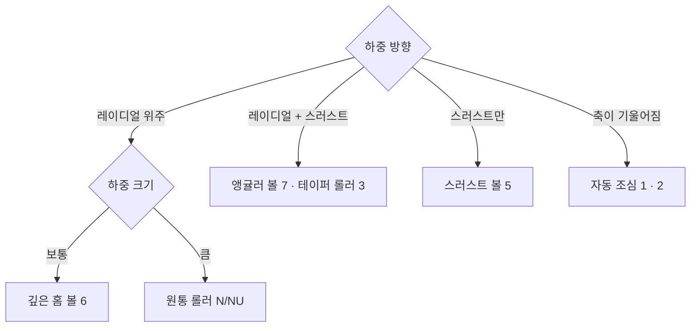

# 베어링

> [!summary] 핵심 요약
> - **구름 베어링**: 볼·롤러가 굴러 마찰 작음, 기동 마찰 작음, 규격품, 교환 쉬움. **미끄럼 베어링**: 유막으로 지지, 충격·고속·고하중에 강함, 조용함.
> - 호칭 번호 **6205**: 6 = 깊은 홈 볼 베어링, 2 = 지름 계열, **05 → 안지름 05 × 5 = 25 mm**.
> - 수명 $L_{10} = \left(\dfrac{C}{P}\right)^r \times 10^6$ 회전. 볼 $r = 3$, 롤러 $r = 10/3$.
> - 시간 수명 $L_h = \dfrac{L_{10}}{60N}$ [h].

> [!warning] 자주 틀리는 포인트
> - 안지름 번호 **00 = 10 mm, 01 = 12 mm, 02 = 15 mm, 03 = 17 mm**. 04부터 ×5.
> - 하중이 2배가 되면 볼 베어링 수명은 $1/2^3 = $ **1/8**.
> - 기본 동정격 하중 C: 수명 **100만 회전**을 견디는 하중.
> - **테이퍼 롤러·앵귤러 볼** 베어링은 레이디얼 + 한 방향 스러스트 하중 → 보통 **쌍으로** 쓴다.
> - 미끄럼 베어링의 발열 기준은 **pv 값**(압력 × 미끄럼 속도).

## 개념 정리

### 구름 베어링 vs 미끄럼 베어링

| 항목 | 구름 베어링 | 미끄럼 베어링 |
| --- | --- | --- |
| 마찰 | 작음, 기동 마찰 작음 | 기동 마찰 큼, 유막 형성 후 작음 |
| 충격 | 약함 | 강함 |
| 소음 | 큼 | 작음 |
| 고속 | 제한 | 유리 |
| 규격 | 표준품, 호환 쉬움 | 주문 제작 많음 |
| 윤활 | 그리스로 간단 | 윤활유 관리 중요 |

### 구름 베어링 종류

| 형식 번호 | 종류 | 받는 하중 |
| --- | --- | --- |
| 6 | 깊은 홈 볼 베어링 | 레이디얼 + 약간의 양방향 스러스트, 가장 일반적 |
| 7 | 앵귤러 볼 베어링 | 레이디얼 + 한 방향 스러스트 |
| 1 | 자동 조심 볼 베어링 | 축 기울어짐 허용 |
| 2 | 자동 조심 롤러 베어링 | 큰 하중 + 기울어짐 |
| 3 | 테이퍼 롤러 베어링 | 큰 레이디얼 + 스러스트 (자동차 휠) |
| 5 | 스러스트 볼 베어링 | 축 방향 하중만 |
| N, NU | 원통 롤러 베어링 | 큰 레이디얼, 고속 |
| NA | 니들 롤러 베어링 | 지름 방향 공간 좁을 때 |

### 호칭 번호 읽기

`6205ZZ C3` 예:
- **6**: 베어링 계열 (깊은 홈 볼)
- **2**: 지름 계열 (0, 1, 2, 3, 4 순으로 바깥지름·폭 커짐)
- **05**: 안지름 25 mm
- **ZZ**: 양쪽 철판 실드 (2RS는 고무 실)
- **C3**: 내부 틈새가 보통보다 큼

### 수명 계산

- **계산 예**: 6205 (C ≈ 14 kN 가정), P = 1.4 kN, N = 1000 rpm
  - $L_{10} = (14/1.4)^3 \times 10^6 = 10^9$ 회전
  - $L_h = 10^9 / (60 \times 1000) \approx 16{,}700$ 시간
- 동등가 하중 $P = XF_r + YF_a$ (레이디얼·축 하중 합성).
- **수명 계수** $f_h$, 속도 계수 $f_n$으로 계산하는 방법도 있다: $f_h = f_n \dfrac{C}{P}$.

### 베어링 설치와 끼워맞춤

- **회전하는 쪽 링은 억지 끼워맞춤**, 정지하는 쪽은 헐거움 또는 중간 (하중 방향 기준).
- 축 방향 고정: 한쪽은 **고정측**, 다른 쪽은 **자유측**(열팽창 흡수).
- 조립 시 힘은 끼워맞추는 링에만 가한다 (볼을 거쳐 누르면 궤도 손상).
- 고정 요소: 멈춤 링(스냅 링), 로크 너트 + 와셔, 하우징 어깨.

### 윤활과 밀봉

- 그리스: 밀봉 간단, 저·중속. 오일: 고속·고온, 냉각.
- 밀봉: 접촉식(오일 실, 고무 실), 비접촉식(래버린스, 실드).

### 미끄럼 베어링

- 저널(레이디얼), 스러스트(피벗·칼라) 베어링.
- 재료: 화이트 메탈(배빗), 청동, 오일리스(함유) 베어링, 수지.
- 유막 두께는 회전 속도·점도가 클수록, 하중이 작을수록 두껍다.

## 그림

## 관련 단원

- [축과 축이음](축과_축이음.md)
- [치수공차와 끼워맞춤](치수공차와_끼워맞춤.md)
- [볼스크루와 LM 가이드](볼스크루와_LM가이드.md)

## 체크리스트

- [ ] 구름·미끄럼 베어링의 장단점을 비교한다
- [ ] 호칭 번호에서 형식과 안지름을 읽는다
- [ ] 볼·롤러 수명 지수 r을 안다
- [ ] 수명 시간을 계산한다
- [ ] 하중 방향에 맞는 베어링을 고른다
- [ ] 회전 링 억지 끼워맞춤 원칙을 안다

## 참고

- [큐넷 자동화설비산업기사 출제기준](https://www.q-net.or.kr/crf005.do?id=crf00503&jmCd=2034)
