# 베어링

> [!summary] 핵심 요약
> - **구름 베어링**: 볼·롤러가 굴러 마찰 작음, 기동 마찰 작음, 규격품, 교환 쉬움. **미끄럼 베어링**: 유막으로 지지, 충격·고속·고하중에 강함, 조용함.
> - 호칭 번호 **6205**: 6 = 깊은 홈 볼 베어링, 2 = 지름 계열, **05 → 안지름 05 × 5 = 25 mm**.
> - 수명 $L_{10} = \left(\dfrac{C}{P}\right)^r \times 10^6$ 회전. 볼 $r = 3$, 롤러 $r = 10/3$.
> - 시간 수명 $L_h = \dfrac{L_{10}}{60N}$ [h].

> [!warning] 자주 틀리는 포인트
> - 안지름 번호 **00 = 10 mm, 01 = 12 mm, 02 = 15 mm, 03 = 17 mm**. 04부터 ×5.
> - 하중이 2배가 되면 볼 베어링 수명은 $1/2^3 = $ **1/8**.
> - 기본 동정격 하중 C: 수명 **100만 회전**을 견디는 하중.
> - **테이퍼 롤러·앵귤러 볼** 베어링은 레이디얼 + 한 방향 스러스트 하중 → 보통 **쌍으로** 쓴다.
> - 미끄럼 베어링의 발열 기준은 **pv 값**(압력 × 미끄럼 속도).
> - 안지름 번호는 **마지막 두 자리**. 6212 → 12 × 5 = **60 mm**, 6001 → 01 = **12 mm**, NF307 → 07 × 5 = **35 mm**. 7000 → 00 = **10 mm**.
> - **69**는 깊은 홈 볼 베어링의 계열 기호(6 + 치수 계열 9)다. 6900 = 안지름 10 mm 깊은 홈 볼 베어링.
> - 자동 조심 볼 베어링 계열은 **12, 13, 22, 23** (22·23은 형식 번호 1이 생략된 것이라 자동 조심 **롤러**로 착각하기 쉽다). 60·62·63은 깊은 홈 볼, 70·72·73은 앵귤러 볼, 511 등은 스러스트 볼.
> - 보조 기호의 뜻을 바꿔 놓은 보기가 단골: **P4·P5 = 정밀도 등급**, **C2·C3 = 내부 틈새**, **DB·DF·DT = 조합 방식**, **C(앵귤러에서) = 접촉각**. 조합 기호를 "틈새"라 하면 틀린다.

## 학습 목표

이 단원을 마치면 다음을 할 수 있어야 한다.

1. 구름 베어링과 미끄럼 베어링이 하중을 받치는 방법을 설명하고, 마찰·충격·소음·고속·규격 면에서 비교한다.
2. 외륜·내륜·전동체·리테이너를 구분하고, 하중 방향(레이디얼·스러스트)과 축 기울어짐에 맞는 베어링 형식을 고른다.
3. 호칭 번호(예: 6205ZZ C3, 7206C DB, 6012 C2 P4)에서 형식·지름 계열·안지름·보조 기호를 읽는다. 특히 안지름 번호 00~03을 바로 mm로 바꾼다.
4. 기본 정격 수명 $L_{10}$과 시간 수명 $L_h$를 계산하고, 하중이 바뀔 때 수명이 몇 배가 되는지 구한다.
5. 고정측·자유측 배치와 회전 링 억지 끼워맞춤 원칙을 설명하고, DB·DF·DT 조합을 구분한다.
6. 간략 도시·상세 도시 기호를 보고 베어링 형식을 알아본다.

## 한눈에 보기

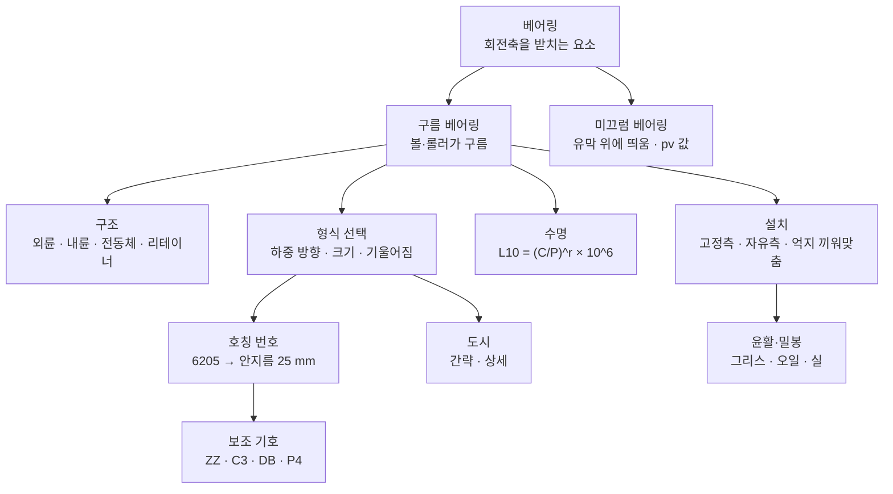

## 1. 구름 베어링과 미끄럼 베어링

무거운 상자를 바닥에 놓고 끌면 힘이 많이 들지만, 밑에 둥근 통나무를 깔면 쉽게 밀린다. **구름 베어링**은 이 통나무 역할을 볼·롤러가 하고, **미끄럼 베어링**은 축과 구멍 사이에 기름막을 끼워 축을 "띄워" 받친다. 회전을 시작할 때는 아직 기름막이 없으므로 미끄럼 베어링은 **기동 마찰이 크고**, 일단 돌기 시작해 유막이 생기면 마찰이 작아진다.

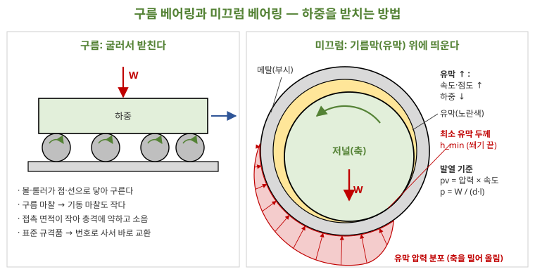

*왼쪽: 하중 W를 받는 상자가 롤러 위에서 구른다. 접촉은 점·선이라 마찰이 작지만, 좁은 면에 힘이 몰려 충격에 약하다. 오른쪽: 저널(축)이 돌면 기름이 좁아지는 틈(쐐기)으로 끌려 들어가 압력이 생기고, 이 압력(빨간 분포)이 축을 밀어 올려 하중 W를 받친다. 축은 구멍 한가운데가 아니라 한쪽으로 치우쳐 돌고, 가장 좁은 곳이 **최소 유막 두께**다. 넓은 면이 기름을 사이에 두고 받치므로 충격에 강하고 조용하다.*

### 구름 베어링 vs 미끄럼 베어링

| 항목 | 구름 베어링 | 미끄럼 베어링 |
| --- | --- | --- |
| 마찰 | 작음, 기동 마찰 작음 | 기동 마찰 큼, 유막 형성 후 작음 |
| 충격 | 약함 | 강함 |
| 소음 | 큼 | 작음 |
| 고속 | 제한 | 유리 |
| 규격 | 표준품, 호환 쉬움 | 주문 제작 많음 |
| 윤활 | 그리스로 간단 | 윤활유 관리 중요 |

> [!question] 시험에서는
> "구름 베어링은 충격 하중에 강하다", "미끄럼 베어링은 기동 마찰이 작다"처럼 **두 칸을 맞바꾼 보기**가 나온다. 구름 = 기동 마찰 작음·충격 약함·소음 큼, 미끄럼 = 그 반대로 외워 두면 된다.

## 2. 구름 베어링의 구조

깊은 홈 볼 베어링 하나를 반으로 잘라 보면 부품은 넷뿐이다. 축에 끼워 함께 도는 **내륜**, 하우징에 끼워 고정되는 **외륜**, 그 사이에서 구르는 **전동체**(볼·롤러), 그리고 전동체끼리 부딪치지 않게 간격을 잡아 주는 **리테이너(케이지)** 다.

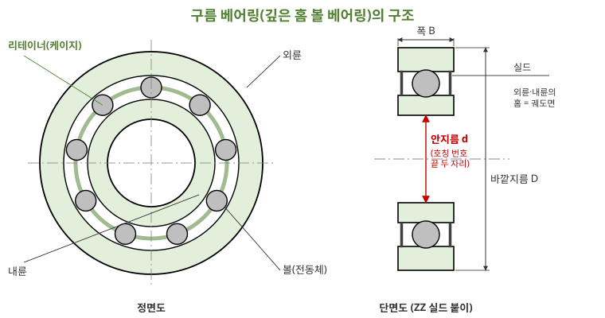

*왼쪽 정면도: 외륜과 내륜 사이에 볼 9개가 같은 간격으로 놓이고, 초록 고리(리테이너)가 볼 사이 간격을 잡는다. 오른쪽 단면도: 볼은 외륜·내륜에 파인 **홈(궤도면)** 에 얹혀 구르고, 양옆의 얇은 철판이 **실드(ZZ)** 다. 치수는 안지름 d(축이 들어가는 구멍), 바깥지름 D, 폭 B의 세 가지이며, 호칭 번호의 마지막 두 자리가 안지름 d를 나타낸다.*

| 리테이너(케이지) | 철판 실드(ZZ) | 고무 실(2RS) |
| --- | --- | --- |
| 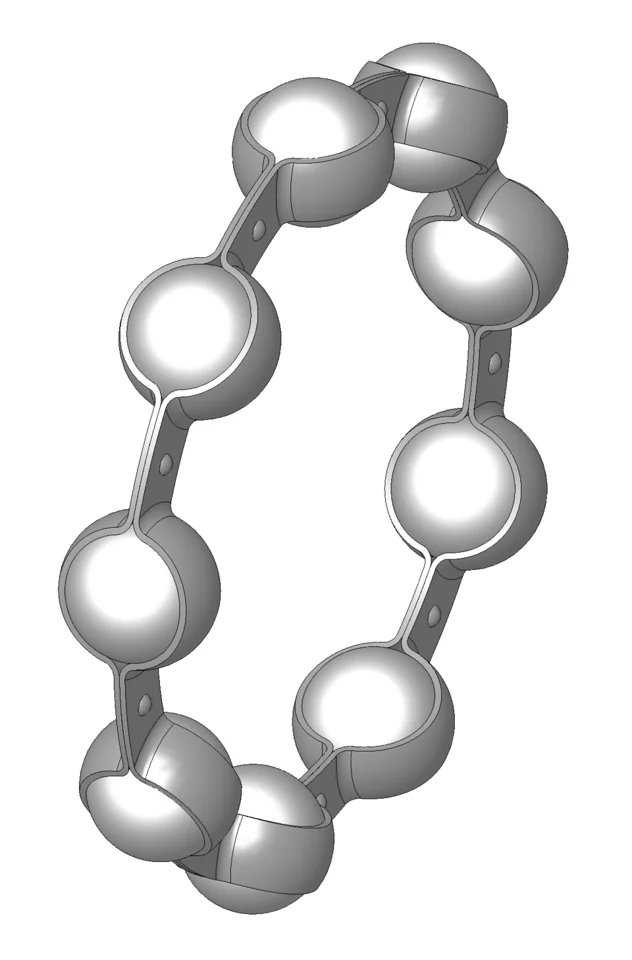 | 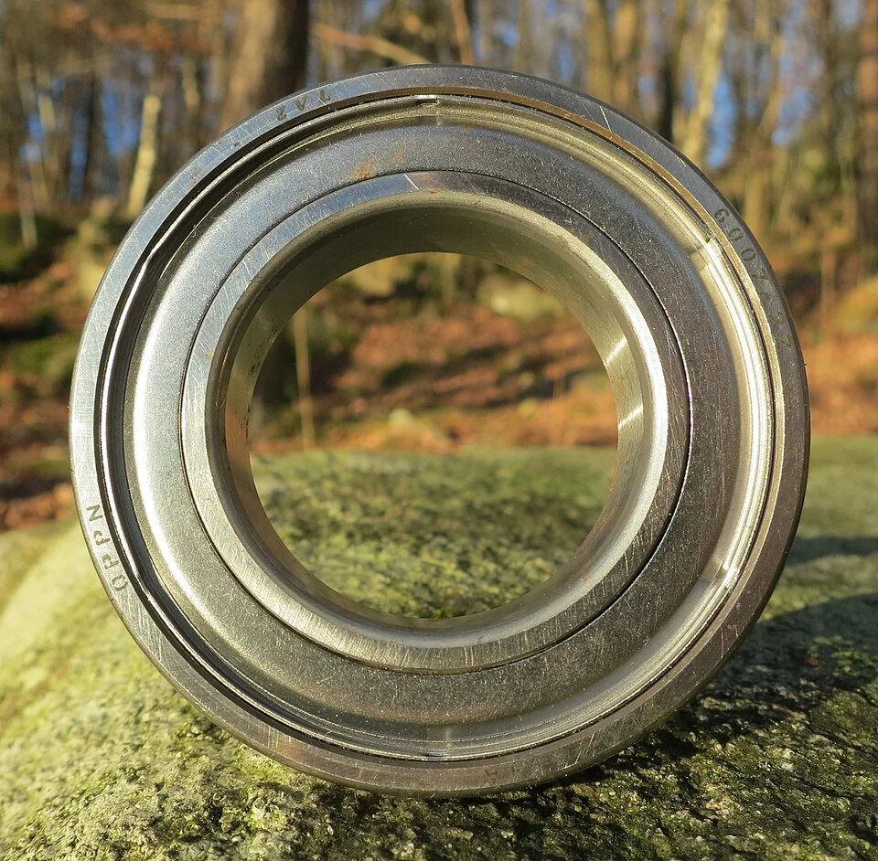 | 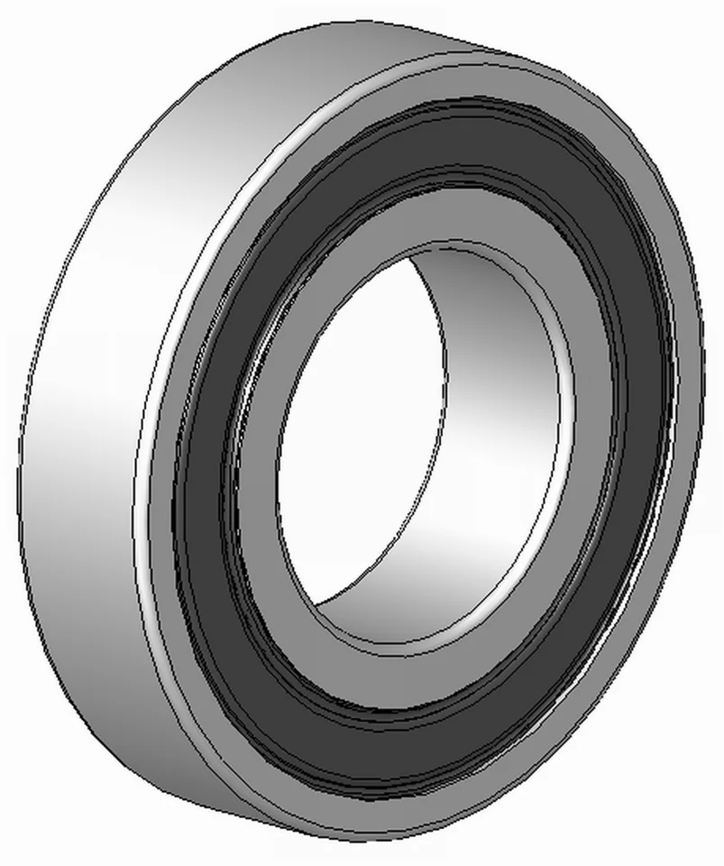 |

*왼쪽: 철판 두 장을 리벳으로 맞붙인 리테이너. 주머니마다 볼이 하나씩 들어가 볼 사이 간격이 일정하게 유지된다. 가운데: 외륜과 내륜 사이 틈을 얇은 철판(실드)이 덮고 있는 실물 베어링이다. 철판은 내륜에 닿지 않고 좁은 틈만 남기는 비접촉식이라 호칭 번호에 ZZ(또는 2Z)를 붙인다. 오른쪽: 양쪽 면이 검은 고무 실로 막힌 베어링. 고무 입술이 내륜에 닿는 접촉식이고 2RS를 붙인다. 둘 다 안에 그리스를 채워 밀봉한 형태다.*

- 전동체(볼·롤러) 간격을 일정하게 잡아 주는 부품은 **리테이너(케이지)** (교재 14-4).

## 3. 구름 베어링 종류 — 하중 방향으로 고른다

축에 걸리는 하중은 두 방향으로 나눈다. 축에 **직각**으로 누르는 **레이디얼 하중** $F_r$(벨트 장력, 기어 반력)과 축 **방향**으로 미는 **스러스트(액시얼) 하중** $F_a$(헬리컬 기어 추력, 자중이 걸린 세로축)다. 볼은 점으로, 롤러는 선으로 닿기 때문에 **롤러가 더 큰 하중**을 받고, 궤도가 기울어 있으면 **스러스트 하중도** 받는다.

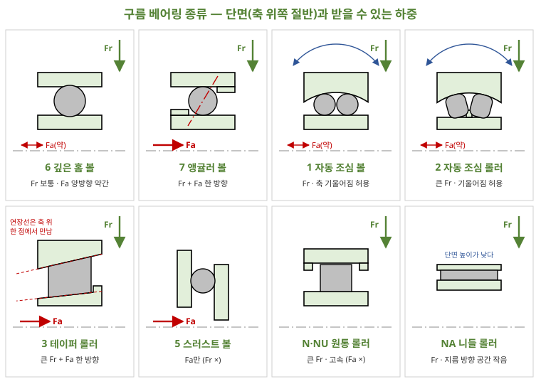

*초록 화살표 Fr은 레이디얼 하중, 빨간 화살표 Fa는 스러스트 하중이다. 앵귤러 볼(7)은 외륜·내륜의 어깨 높이가 서로 반대쪽에 있어 접촉선(빨간 점선)이 기울고, 그래서 **한 방향** 스러스트를 받는다. 테이퍼 롤러(3)는 궤도 연장선이 축 위 한 점에서 만나는 원뿔 모양이다. 자동 조심형(1·2)은 외륜 궤도가 구면이라 파란 화살표처럼 축이 기울어도 따라간다. 스러스트 볼(5)은 궤도반이 축에 직각이라 레이디얼 하중은 받지 못한다. 원통 롤러 NU형은 내륜에 턱이 없어 축 방향으로 미끄러질 수 있으므로 스러스트를 받지 못한다. 니들은 단면 높이가 낮다.*

### 구름 베어링 종류

| 형식 번호 | 종류 | 받는 하중 |
| --- | --- | --- |
| 6 | 깊은 홈 볼 베어링 | 레이디얼 + 약간의 양방향 스러스트, 가장 일반적 |
| 7 | 앵귤러 볼 베어링 | 레이디얼 + 한 방향 스러스트 |
| 1 | 자동 조심 볼 베어링 | 축 기울어짐 허용 |
| 2 | 자동 조심 롤러 베어링 | 큰 하중 + 기울어짐 |
| 3 | 테이퍼 롤러 베어링 | 큰 레이디얼 + 스러스트 (자동차 휠) |
| 5 | 스러스트 볼 베어링 | 축 방향 하중만 |
| N, NU | 원통 롤러 베어링 | 큰 레이디얼, 고속 |
| NA | 니들 롤러 베어링 | 지름 방향 공간 좁을 때 |

### 실물로 보기

| 앵귤러 볼 베어링 (7) | 원통 롤러 베어링 (NUP) | 자동 조심 롤러 베어링 (2) |
| --- | --- | --- |
| 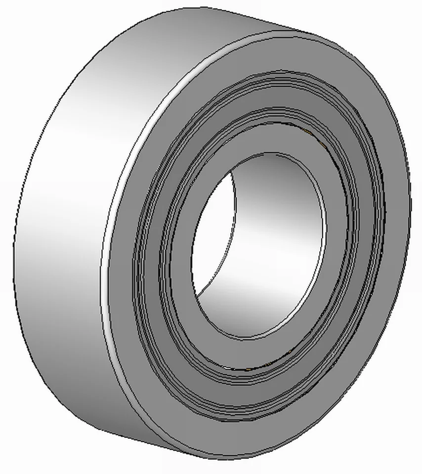 | 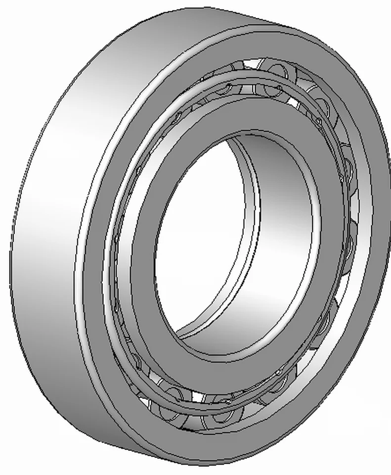 | 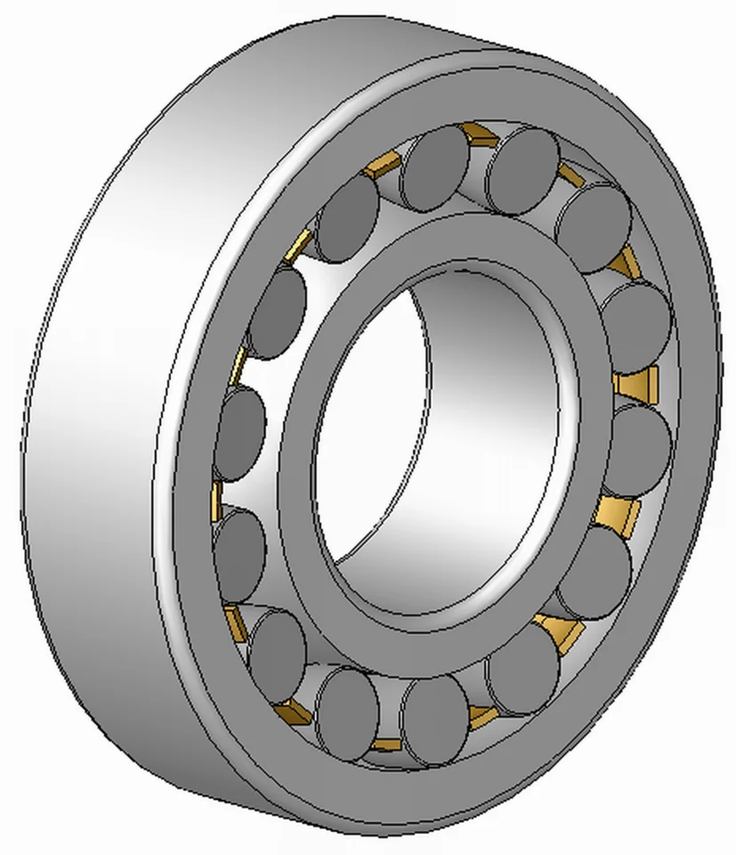 |
| 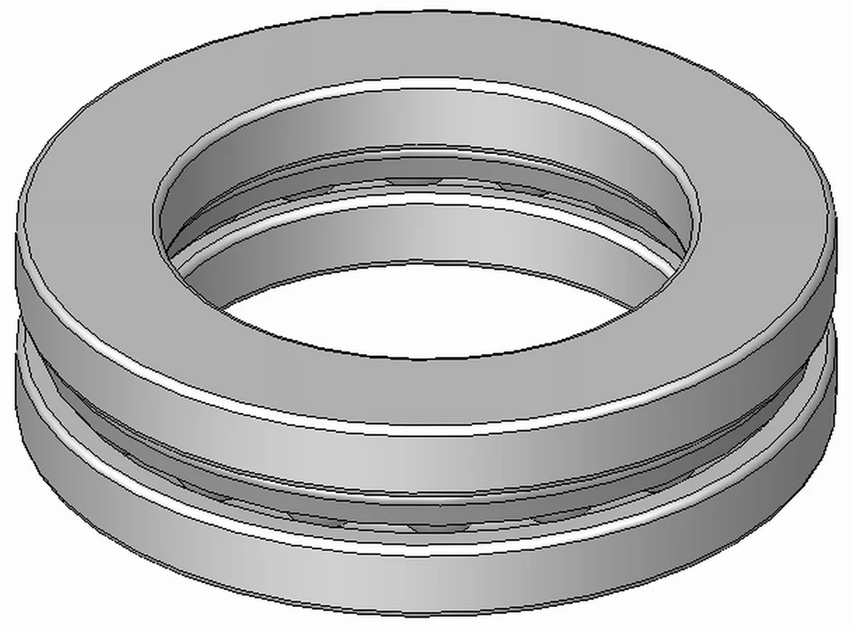 |  | 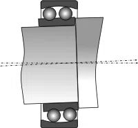 |
| 스러스트 볼 베어링 (5) | 니들 롤러 베어링 (NA) | 자동 조심 볼 베어링 (1) |

*윗줄: 앵귤러 볼 베어링은 겉모양이 깊은 홈 볼과 비슷하지만 한쪽 면이 다르게 생겼다(어깨 높이가 다르다). 원통 롤러 베어링은 링 사이로 원통 모양 롤러가 보이고, 자동 조심 롤러 베어링은 볼록한(술통 모양) 롤러 두 줄 사이에 황동색 케이지가 보인다. 아랫줄: 스러스트 볼 베어링은 납작한 와셔 모양 궤도반 두 장이 볼을 사이에 끼우고 포개져 있어, 축 방향으로 눌러야 하중을 받는다. 니들 롤러 베어링 절개도는 얇은 판으로 만든 외륜(셸) 안에 바늘처럼 가늘고 긴 롤러가 케이지에 끼워져 있고, 내륜 없이 축이 직접 궤도가 되는 형태라 바깥지름이 작다. 자동 조심 볼 베어링 애니메이션은 축(가운데)이 이리저리 기울어져도 내륜과 볼 두 줄이 함께 기울고 외륜은 그대로인 모습이다.*

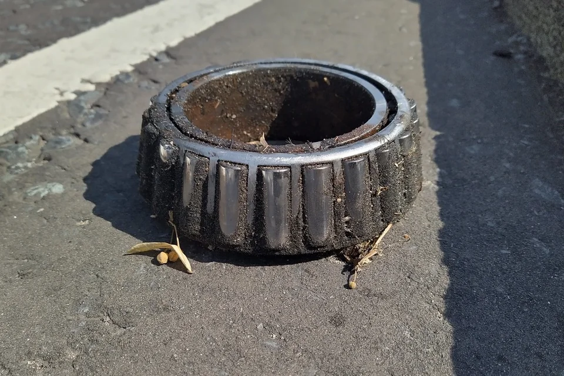

*테이퍼(원뿔) 롤러 베어링(3)의 내륜과 롤러 조립체. 롤러가 **원뿔대 모양**이고 안쪽 궤도도 비스듬해서, 지름 방향 하중과 한쪽 축 방향 하중을 함께 받는다 — 그래서 **쌍으로 마주 보게** 설치한다. 외륜(컵)은 빠져 있다. 사용하다 버려진 실물이라 지저분하지만 롤러의 원뿔 모양과 케이지가 잘 보인다.*

> [!tip] 감 잡기 — 형식 번호 첫 자리로 고르기
> "보통 축이면 6, 축 방향 힘이 한쪽으로 크면 7이나 3을 **쌍으로**, 축이 휘거나 두 하우징 중심이 안 맞으면 1·2, 세로축 자중만 받으면 5, 지름 방향 공간이 없으면 NA." 하중이 크면 볼 대신 롤러(N·3·2)를 쓴다.

## 4. 호칭 번호 읽기

호칭 번호는 **앞은 형식, 끝 두 자리는 안지름**이다. 그 사이 숫자는 같은 안지름에서 바깥지름·폭이 얼마나 큰지(지름·치수 계열)를 나타내고, 뒤에 붙는 영문은 보조 기호다.

*초록 = 형식, 파랑 = 지름 계열, 빨강 = 안지름 번호. 6205ZZ C3는 깊은 홈 볼·지름 계열 2·안지름 25 mm·양쪽 철판 실드·틈새 C3이고, 7206C DB는 앵귤러 볼·안지름 30 mm·접촉각 C(약 15°)·배면 조합이다. 아래 표의 빨간 칸(00~03)은 ×5 규칙이 통하지 않는 예외이고, /22처럼 슬래시가 붙으면 숫자가 곧 mm다.*

$$d = (\text{안지름 번호}) \times 5 \text{ mm} \quad (04 \sim 96), \qquad 00 \to 10,\; 01 \to 12,\; 02 \to 15,\; 03 \to 17 \text{ mm}$$

### 호칭 번호 읽기

`6205ZZ C3` 예:
- **6**: 베어링 계열 (깊은 홈 볼)
- **2**: 지름 계열 (0, 1, 2, 3, 4 순으로 바깥지름·폭 커짐)
- **05**: 안지름 25 mm
- **ZZ**: 양쪽 철판 실드 (2RS는 고무 실)
- **C3**: 내부 틈새가 보통보다 큼

### 보조 기호 정리

| 위치·기호 | 뜻 | 예 |
| --- | --- | --- |
| 계열 기호 (앞 2~3자리) | 형식 + 치수 계열 | 62, 73, NU2, 12 |
| 안지름 번호 (뒤 2자리) | 00=10, 01=12, 02=15, 03=17, 04 이상 ×5 | 05 → 25 mm |
| 접촉각 기호 (앵귤러) | A: 약 30°, B: 약 40°, C: 약 15° (10° 초과 22° 이하) | 7310 C |
| 실드·실 | Z, ZZ(철판 실드), RS, 2RS(고무 실) | 6205ZZ |
| 궤도륜 모양 | N(멈춤 링 홈), NR(멈춤 링 붙음), K(테이퍼 구멍) | |
| 조합 | **DB 배면**, **DF 정면**, **DT 병렬** | 7310 C DB |
| 내부 틈새 | C1 < C2 < 보통(CN) < C3 < C4 | 6012 C2 |
| 정밀도 등급 | 보통(0급) < P6 < P5 < P4 < P2 | 6012 C2 P4 |

- 읽는 순서 예: `6012 C2 P4` → 깊은 홈 볼 베어링, 치수 계열 0, 안지름 60 mm, 내부 틈새 C2, 정밀도 4급.
- 원통 롤러 베어링 형식 기호 **N, NU, NJ, NUP, NF** 등은 턱이 있는 궤도륜 모양의 차이다. 안지름 읽는 방법은 같다.
- 교재(CH03 14절) 예: **6312Z** = 단열 깊은 홈 볼, 안지름 12 × 5 = 60 mm, 한쪽 실드. **7206C DB** = 앵귤러 볼, 안지름 30 mm, 접촉각 C, 배면 조합. 실링은 U·UU로도 적는다. `/22`, `/28`, `/32`처럼 슬래시가 붙으면 숫자가 그대로 mm.
- 보조 기호 배열 순서: 밀봉·실드 → 궤도륜 모양 → 조합 → 내부 틈새 → 정밀도 등급.

| 계열 기호 (교재 14절) | 베어링 |
| --- | --- |
| 60, 62, 63, 64, 68, 69 | 깊은 홈 볼 |
| 70, 72, 73, 74 | 앵귤러 볼 |
| NU, NUP, N, NF | 원통 롤러 |
| 12, 22, 13, 23 | 자동 조심 볼 |
| 302, 303, 320, 322, 323 | 테이퍼 롤러 |
| NA49, RNA49 | 니들 롤러 |
| 511~514, 522~524 | 평면 자리 스러스트 볼 |

> [!question] 시험에서는
> - **안지름 구하기**가 가장 많이 나온다(6회). 끝 두 자리만 보고, 00·01·02·03이면 10·12·15·17, 그 밖에는 ×5. 형식 기호가 영문(NF307, NU2208)이어도 방법은 같다.
> - "C"는 자리에 따라 뜻이 다르다. **C 뒤에 숫자**(C2, C3)는 내부 틈새, 앵귤러 번호 바로 뒤의 **C 단독**(7206C)은 접촉각이다.
> - 22·23으로 시작하면 자동 조심 **볼**(형식 1 생략)이다. 형식 2(자동 조심 롤러)와 헷갈리지 않는다.

## 5. 수명 계산

베어링은 아무리 잘 써도 궤도면이 반복해서 눌리다 보면 결국 표면이 비늘처럼 벗겨진다(피로 박리). 같은 베어링 여러 개를 같은 조건으로 돌렸을 때 **90 %가 박리 없이 견디는 회전수**가 기본 정격 수명 $L_{10}$이다. 하중이 조금만 늘어도 수명은 **세제곱으로** 줄어드는 것이 핵심이다.

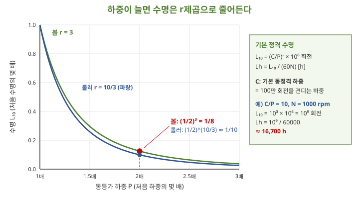

*가로축은 하중이 처음의 몇 배인지, 세로축은 수명이 처음의 몇 배인지다. 하중이 2배가 되면 볼 베어링(초록)은 1/8, 롤러 베어링(파랑)은 약 1/10로 줄어든다. 오른쪽 상자는 아래 계산 예와 같은 값(C/P = 10, 1000 rpm → 약 16,700 h)이다.*

$$L_{10} = \left(\frac{C}{P}\right)^r \times 10^6 \text{ [회전]}, \qquad L_h = \frac{L_{10}}{60N} \text{ [h]}, \qquad r = \begin{cases} 3 & \text{볼} \\ 10/3 & \text{롤러} \end{cases}$$

### 수명 계산

- **계산 예**: 6205 (C ≈ 14 kN 가정), P = 1.4 kN, N = 1000 rpm
  - $L_{10} = (14/1.4)^3 \times 10^6 = 10^9$ 회전
  - $L_h = 10^9 / (60 \times 1000) \approx 16{,}700$ 시간
- 동등가 하중 $P = XF_r + YF_a$ (레이디얼·축 하중 합성).
- **수명 계수** $f_h$, 속도 계수 $f_n$으로 계산하는 방법도 있다: $f_h = f_n \dfrac{C}{P}$.

> [!tip] 감 잡기 — 거꾸로 풀기
> 수명을 2배로 늘리고 싶으면 하중을 $2^{-1/3} \approx 0.79$배, 즉 약 21 % 줄이면 된다(볼). 회전수를 2배로 올리면 회전 수명 $L_{10}$은 그대로지만 시간 수명 $L_h$는 절반이 된다.

## 6. 베어링 설치와 끼워맞춤

축은 돌면서 온도가 올라 늘어난다. 양쪽 베어링을 모두 꽉 묶어 두면 늘어난 길이가 갈 곳이 없어 베어링에 큰 축 방향 힘이 걸린다. 그래서 **한쪽만 축 방향으로 묶고(고정측), 다른 쪽은 미끄러지게(자유측)** 둔다.

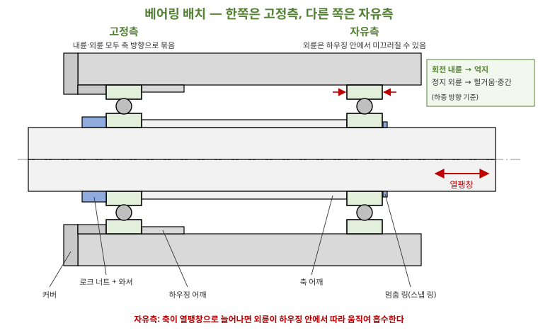

*왼쪽 고정측은 내륜을 축 어깨와 로크 너트로, 외륜을 하우징 어깨와 커버로 양쪽에서 잡아 축 방향 위치를 정한다. 오른쪽 자유측은 내륜만 축 어깨와 멈춤 링으로 잡고 외륜은 하우징 구멍 안에서 축 방향으로 움직일 여유(빨간 화살표)를 두어, 축의 열팽창을 흡수한다. 축과 함께 도는 내륜은 억지 끼워맞춤, 멈춰 있는 외륜은 헐거움·중간 끼워맞춤이다.*

### 베어링 설치와 끼워맞춤

- **회전하는 쪽 링은 억지 끼워맞춤**, 정지하는 쪽은 헐거움 또는 중간 (하중 방향 기준).
- 축 방향 고정: 한쪽은 **고정측**, 다른 쪽은 **자유측**(열팽창 흡수).
- 조립 시 힘은 끼워맞추는 링에만 가한다 (볼을 거쳐 누르면 궤도 손상).
- 고정 요소: 멈춤 링(스냅 링), 로크 너트 + 와셔, 하우징 어깨.

> [!tip] 감 잡기 — 왜 회전하는 링을 억지로?
> 하중 방향은 그대로인데 링이 돌면, 링의 모든 둘레가 번갈아 하중을 받는다. 이때 끼워맞춤이 헐거우면 링이 축 위에서 조금씩 미끄러져 돌며(크리프) 축 표면을 갉아 먹는다. 그래서 **하중에 대해 회전하는 링**을 억지로 끼운다. 반대로 바퀴 허브처럼 외륜이 돌고 축이 멈춰 있으면 외륜 쪽이 억지 끼워맞춤이 된다.

### 앵귤러 볼 베어링 조합 — DB·DF·DT

앵귤러 볼·테이퍼 롤러는 한 방향 스러스트만 받으므로 두 개를 맞대어 쓴다. 맞대는 방향에 따라 이름이 다르다.

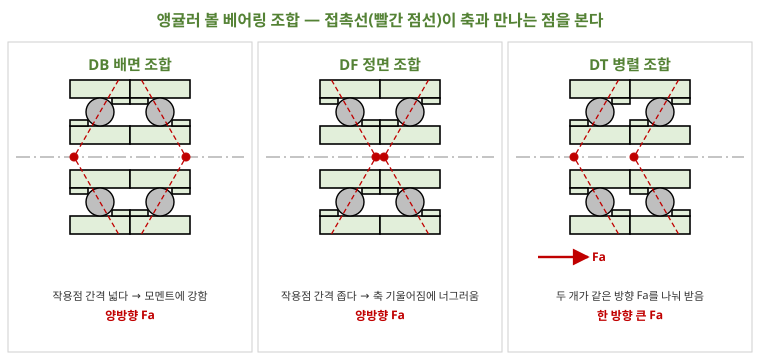

*빨간 점선은 접촉선(힘이 지나가는 선)이고, 축과 만나는 빨간 점이 하중 작용점이다. **DB(배면)** 는 두 작용점이 바깥쪽으로 벌어져 간격이 넓으므로 축을 기울이려는 모멘트에 강하다. **DF(정면)** 는 작용점이 안쪽으로 모여 간격이 좁으므로 축 기울어짐에 너그럽다. 둘 다 양방향 스러스트를 받는다. **DT(병렬)** 는 접촉선이 나란해 두 베어링이 한 방향 스러스트를 나눠 받는다.*

> [!question] 시험에서는
> DB·DF·DT는 **조합 방식**을 나타내는 보조 기호다. "DB는 내부 틈새 기호", "DF는 정밀도 등급"처럼 다른 보조 기호와 뜻을 맞바꾼 보기가 나온다(2018-3 출제).

## 7. 윤활과 밀봉

윤활은 금속끼리 직접 닿지 않게 하고 열을 빼 주는 일이다. 그리스는 한 번 채우면 오래가고 새지 않지만 열을 잘 못 빼고, 오일은 흐르면서 열을 가져가는 대신 관리가 번거롭다.

### 윤활과 밀봉

- 그리스: 밀봉 간단, 저·중속. 오일: 고속·고온, 냉각.
- 밀봉: 접촉식(오일 실, 고무 실), 비접촉식(래버린스, 실드).

> [!tip] 감 잡기
> 접촉식 실은 고무 입술이 축에 닿아 밀봉은 확실하지만 마찰·발열이 있어 고속에 불리하다. 비접촉식(래버린스·실드)은 좁은 틈만 두어 마찰이 없으므로 고속에 쓴다. 호칭 번호의 **ZZ(철판 실드)는 비접촉**, **2RS(고무 실)는 접촉식**이다.

## 8. 미끄럼 베어링

미끄럼 베어링은 축의 받쳐지는 부분(**저널**)과 그것을 감싸는 **메탈(부시)** 사이에 기름막을 만든다. 회전이 빠르고 기름이 끈적할수록 쐐기 속으로 끌려 들어가는 기름이 많아 막이 두꺼워지고, 하중이 크면 막이 눌려 얇아진다.

| 플랜지형 미끄럼 베어링(부시) | 저널 베어링 메탈 |
| --- | --- |
| 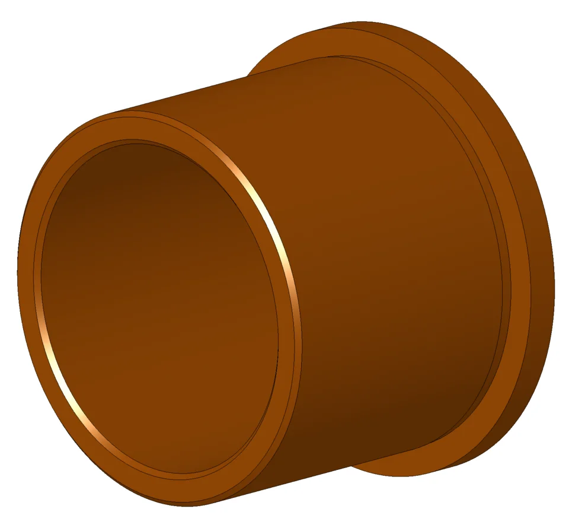 | 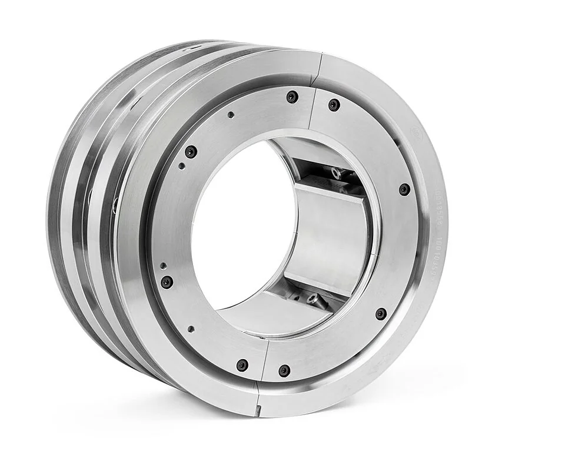 |

*왼쪽: 하우징 구멍에 끼우는 원통 부시에 축 방향 위치를 잡는 플랜지가 붙어 있다. 전동체가 없으므로 단면이 얇고 구조가 단순하다. 오른쪽: 대형 회전기용 저널 베어링. 하우징이 위아래 반쪽으로 나뉘는 분할형이라 축을 올려놓고 덮을 수 있고, 안쪽에 축을 받치는 패드(메탈)와 급유 구멍이 보인다. 이런 미끄럼 면에는 화이트 메탈 같은 베어링 합금을 입힌다.*

### 미끄럼 베어링

- 저널(레이디얼), 스러스트(피벗·칼라) 베어링.
- 재료: 화이트 메탈(배빗), 청동, 오일리스(함유) 베어링, 수지.
- 유막 두께는 회전 속도·점도가 클수록, 하중이 작을수록 두껍다.

$$p = \frac{W}{d\,l} \;[\text{MPa}], \qquad v = \frac{\pi d N}{60 \times 1000} \;[\text{m/s}], \qquad pv \le (pv)_{\text{허용}}$$

> [!tip] 감 잡기 — pv 값
> 마찰열은 "누르는 힘 × 미끄러지는 거리"에 비례하므로, 단위 면적·단위 시간당 발열은 압력 p와 미끄럼 속도 v의 곱으로 본다. pv 값이 재료의 허용값을 넘으면 메탈이 녹거나 눌어붙는다(소착). 여기서 $d$는 저널 지름, $l$은 저널 길이다.

## 9. 베어링 도시

도면에서 베어링은 규격품이므로 실제 모양을 다 그리지 않고 기호로 줄여 그린다. 단면 한쪽에 사각형을 그리고, 그 안에 선 몇 개로 형식을 알려 준다.

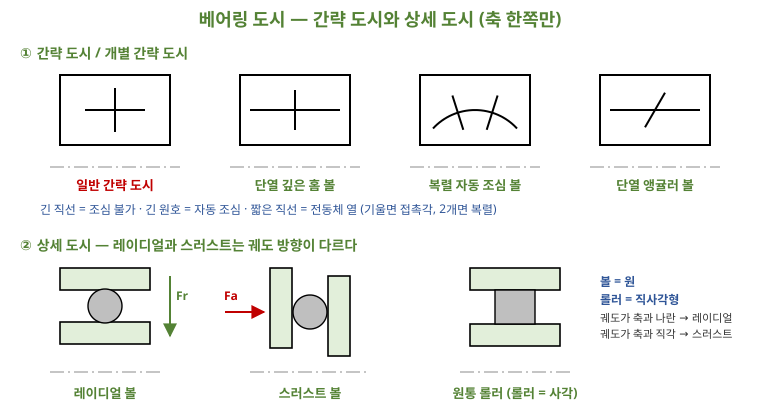

*윗줄: 형식을 밝히지 않을 때는 사각형 안에 십자(+)만 그린다. 형식을 밝힐 때는 긴 직선(조심 불가)이나 긴 원호(자동 조심) 위에 전동체 열을 뜻하는 짧은 직선을 긋는다. 짧은 선이 2개면 복렬, 기울어 있으면 접촉각이 있는 앵귤러다. 아랫줄 상세 도시: 레이디얼 볼은 볼이 축과 나란한 두 링 사이에, 스러스트 볼은 축에 직각인 두 궤도반 사이에 끼어 있다. 롤러는 원 대신 직사각형으로 그린다.*

### 베어링 도시

- **간략 도시**: 외형 사각형 안에 **십자(+)** 를 넣는다 (가는 실선 또는 굵은 실선).
- **개별 간략 도시**: 사각형 안에 형식을 나타내는 기호. 볼은 원, 롤러는 직사각형, 자동 조심은 원호, 복렬이면 2개, 스러스트는 축 방향으로 배치.
- 교재(14절) 간략 도시 요소: 긴 연속 직선 = 조심(정렬) 불가, 긴 연속 원호 = 자동 조심, 짧은 직선 90° 교차·볼·롤러·니들 표시. 교재는 "외우지 말고 문제를 풀 정도만" 보라고 한다.
- **상세 도시**: 실제 모양에 가깝게 그림. 볼 1개 + 궤도 모양으로 단열/복렬, 레이디얼/스러스트, 한 방향/두 방향을 구분한다.

## 그림

하중 조건으로 베어링 형식을 고르는 순서:

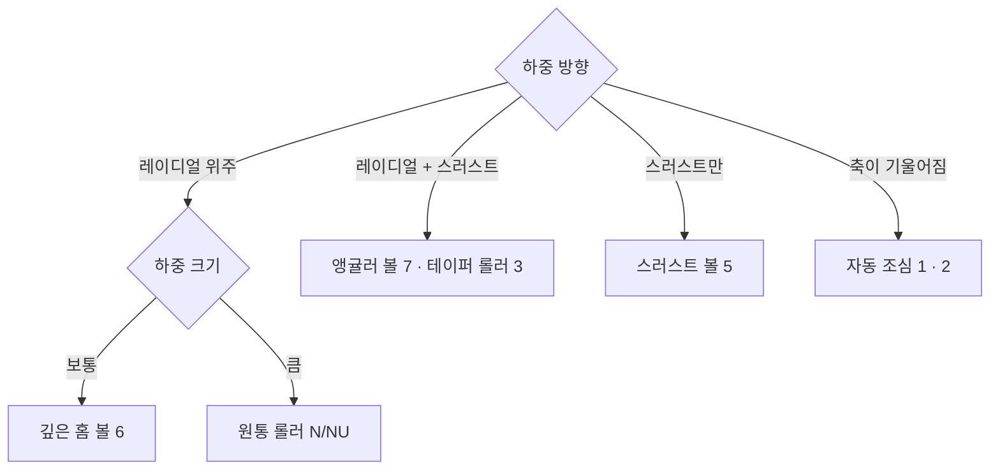

## 기출 포인트

- 호칭 번호로 안지름 구하기 — **6회** (2014-1, 2014-2, 2015-1, 2017-1, 2017-3, 2019-2). 00~03 예외 번호(10·12·15·17 mm)를 묻는 경우가 절반이다.
- 보조 기호의 뜻 — 2회: 정밀도 등급 P4 (2016-3), 조합 기호 DB (2018-3)
- 계열 기호로 베어링 형식 찾기 — 1회: 자동 조심 볼 베어링 (2019-3)
- 베어링 도시 — 2회: 복렬 자동 조심 볼 베어링 간략 기호 (2018-2), 상세 도시로 스러스트 볼 베어링 구분 (2020-1)
- 합계 **11회**. 수명 계산·끼워맞춤 선정은 2014~2020년에 나오지 않았다.

**교재 예제 유형** (Win-Q 2025 PART 01 CHAPTER 03, 14절): 안지름 25 mm의 번호(05), 6012 C2 P4 설명 중 틀린 것(P4는 조합이 아니라 등급), NF307 안지름(35 mm), 전동체 간격 유지 부품(리테이너), 자동 조심 볼 계열(12, 22, 23). 교재 보조 기호 표는 C2가 두 번 나오고 P3를 "2급"으로 적는 등 오기가 있어, 등급은 이 노트 표(보통 < P6 < P5 < P4 < P2)를 기준으로 본다.

## 관련 단원

- [축과 축이음](축과_축이음.md)
- [치수공차와 끼워맞춤](치수공차와_끼워맞춤.md)
- [볼스크루와 LM 가이드](볼스크루와_LM가이드.md)
- [도면 양식과 투상법](도면_양식과_투상법.md)
- [기어](기어.md) — 헬리컬 기어 축 방향 추력 → 앵귤러·테이퍼 롤러 베어링

## 체크리스트

- [ ] 구름·미끄럼 베어링의 장단점을 비교한다
- [ ] 호칭 번호에서 형식과 안지름을 읽는다
- [ ] 볼·롤러 수명 지수 r을 안다
- [ ] 수명 시간을 계산한다
- [ ] 하중 방향에 맞는 베어링을 고른다
- [ ] 회전 링 억지 끼워맞춤 원칙을 안다
- [ ] 안지름 번호 00·01·02·03을 즉시 mm로 바꾼다
- [ ] 계열 기호 60·62·69(깊은 홈), 70·72·73(앵귤러), 12·13·22·23(자동 조심)을 구분한다
- [ ] P(정밀도)·C 숫자(틈새)·DB/DF/DT(조합) 보조 기호를 구분한다
- [ ] 간략 도시와 상세 도시 기호로 베어링 형식을 알아본다

## 참고

- [큐넷 자동화설비산업기사 출제기준](https://www.q-net.or.kr/crf005.do?id=crf00503&jmCd=2034)

### 그림 출처

위키미디어 공용(Wikimedia Commons)과 Openverse에서 가져온 공개 라이선스 자료이고, 노트에 맞게 크기를 줄이고 WebP로 변환했다.

| 그림 | 작성자 | 라이선스 | 출처 |
| --- | --- | --- | --- |
| [Bearing cage balls steel riveted with balls](https://commons.wikimedia.org/wiki/File:Bearing_cage_balls_steel_riveted_with_balls.png) | Silberwolf (talk) | [CC BY-SA 2.5](https://creativecommons.org/licenses/by-sa/2.5) | Wikimedia Commons |
| [1990s deep groove ball bearing with metal shields G007-2Z by Slovakian company ZVL](https://commons.wikimedia.org/wiki/File:1990s_deep_groove_ball_bearing_with_metal_shields_G007-2Z_by_Slovakian_company_ZVL.jpg) | R. Henrik Nilsson | [CC BY 4.0](https://creativecommons.org/licenses/by/4.0) | Wikimedia Commons |
| [Radial-deep-groove-ball-bearing din625-t1 2rs](https://commons.wikimedia.org/wiki/File:Radial-deep-groove-ball-bearing_din625-t1_2rs.png) | Silberwolf | [CC BY 2.5](https://creativecommons.org/licenses/by/2.5) | Wikimedia Commons |
| [Angular-contact-ball-bearing single-row din628 type-b](https://commons.wikimedia.org/wiki/File:Angular-contact-ball-bearing_single-row_din628_type-b.png) | Silberwolf | [CC BY 2.5](https://creativecommons.org/licenses/by/2.5) | Wikimedia Commons |
| [Cylindrical-roller-bearing din5412-t1 type-nup](https://commons.wikimedia.org/wiki/File:Cylindrical-roller-bearing_din5412-t1_type-nup.png) | Silberwolf | [CC BY 2.5](https://creativecommons.org/licenses/by/2.5) | Wikimedia Commons |
| [Spherical-roller-bearing double-row din635-t2](https://commons.wikimedia.org/wiki/File:Spherical-roller-bearing_double-row_din635-t2.png) | Silberwolf | [CC BY 2.5](https://creativecommons.org/licenses/by/2.5) | Wikimedia Commons |
| [Thrust-ball-bearing din711](https://commons.wikimedia.org/wiki/File:Thrust-ball-bearing_din711.png) | Silberwolf | [CC BY 2.5](https://creativecommons.org/licenses/by/2.5) | Wikimedia Commons |
| [Needle roller bearing](https://commons.wikimedia.org/wiki/File:Needle_roller_bearing.svg) | Kaboldy | [CC BY-SA 3.0](https://creativecommons.org/licenses/by-sa/3.0) | Wikimedia Commons |
| [Ball bearing self aligning](https://commons.wikimedia.org/wiki/File:Ball_bearing_self_aligning.gif) | Lidingo | 퍼블릭 도메인 | Wikimedia Commons |
| [Project 365 #240: 280822 Bearing Left](https://www.flickr.com/photos/23408922@N07/52317333506) | comedy_nose | [CC BY 2.0](https://creativecommons.org/licenses/by/2.0/) | Openverse (flickr) |
| [Plain-bearing DIN-ISO4379 Type-F](https://commons.wikimedia.org/wiki/File:Plain-bearing_DIN-ISO4379_Type-F.png) | Silberwolf | [CC BY-SA 2.5](https://creativecommons.org/licenses/by-sa/2.5) | Wikimedia Commons |
| [Miba Journal Bearing](https://commons.wikimedia.org/wiki/File:Miba_Journal_Bearing.jpg) | Miba Industrial Bearings | [CC BY-SA 4.0](https://creativecommons.org/licenses/by-sa/4.0) | Wikimedia Commons |

직접 그린 그림(SVG, 이 볼트용으로 새로 작성): 구름 미끄럼 원리, 베어링 구조, 베어링 종류 하중, 베어링 호칭번호, 베어링 수명 하중, 베어링 고정측 자유측, 베어링 조합 DB DF DT, 베어링 도시.

