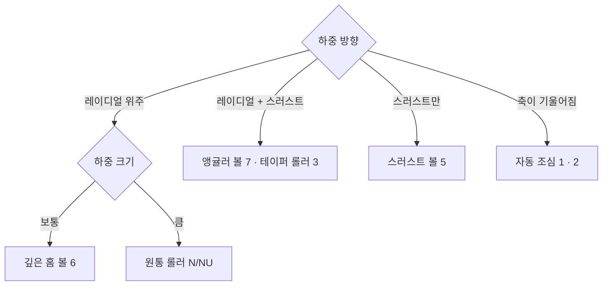

# 베어링

> [!summary] 핵심 요약
> - **구름 베어링**: 볼·롤러가 굴러 마찰 작음, 기동 마찰 작음, 규격품, 교환 쉬움. **미끄럼 베어링**: 유막으로 지지, 충격·고속·고하중에 강함, 조용함.
> - 호칭 번호 **6205**: 6 = 깊은 홈 볼 베어링, 2 = 지름 계열, **05 → 안지름 05 × 5 = 25 mm**.
> - 수명 $L_{10} = \left(\dfrac{C}{P}\right)^r \times 10^6$ 회전. 볼 $r = 3$, 롤러 $r = 10/3$.
> - 시간 수명 $L_h = \dfrac{L_{10}}{60N}$ [h].

> [!warning] 자주 틀리는 포인트
> - 안지름 번호 **00 = 10 mm, 01 = 12 mm, 02 = 15 mm, 03 = 17 mm**. 04부터 ×5.
> - 하중이 2배가 되면 볼 베어링 수명은 $1/2^3 = $ **1/8**.
> - 기본 동정격 하중 C: 수명 **100만 회전**을 견디는 하중.
> - **테이퍼 롤러·앵귤러 볼** 베어링은 레이디얼 + 한 방향 스러스트 하중 → 보통 **쌍으로** 쓴다.
> - 미끄럼 베어링의 발열 기준은 **pv 값**(압력 × 미끄럼 속도).
> - 안지름 번호는 **마지막 두 자리**. 6212 → 12 × 5 = **60 mm**, 6001 → 01 = **12 mm**, NF307 → 07 × 5 = **35 mm**. 7000 → 00 = **10 mm**.
> - **69**는 깊은 홈 볼 베어링의 계열 기호(6 + 치수 계열 9)다. 6900 = 안지름 10 mm 깊은 홈 볼 베어링.
> - 자동 조심 볼 베어링 계열은 **12, 13, 22, 23** (22·23은 형식 번호 1이 생략된 것이라 자동 조심 **롤러**로 착각하기 쉽다). 60·62·63은 깊은 홈 볼, 70·72·73은 앵귤러 볼, 511 등은 스러스트 볼.
> - 보조 기호의 뜻을 바꿔 놓은 보기가 단골: **P4·P5 = 정밀도 등급**, **C2·C3 = 내부 틈새**, **DB·DF·DT = 조합 방식**, **C(앵귤러에서) = 접촉각**. 조합 기호를 "틈새"라 하면 틀린다.

## 개념 정리

### 구름 베어링 vs 미끄럼 베어링

| 항목 | 구름 베어링 | 미끄럼 베어링 |
| --- | --- | --- |
| 마찰 | 작음, 기동 마찰 작음 | 기동 마찰 큼, 유막 형성 후 작음 |
| 충격 | 약함 | 강함 |
| 소음 | 큼 | 작음 |
| 고속 | 제한 | 유리 |
| 규격 | 표준품, 호환 쉬움 | 주문 제작 많음 |
| 윤활 | 그리스로 간단 | 윤활유 관리 중요 |

### 구름 베어링 종류

| 형식 번호 | 종류 | 받는 하중 |
| --- | --- | --- |
| 6 | 깊은 홈 볼 베어링 | 레이디얼 + 약간의 양방향 스러스트, 가장 일반적 |
| 7 | 앵귤러 볼 베어링 | 레이디얼 + 한 방향 스러스트 |
| 1 | 자동 조심 볼 베어링 | 축 기울어짐 허용 |
| 2 | 자동 조심 롤러 베어링 | 큰 하중 + 기울어짐 |
| 3 | 테이퍼 롤러 베어링 | 큰 레이디얼 + 스러스트 (자동차 휠) |
| 5 | 스러스트 볼 베어링 | 축 방향 하중만 |
| N, NU | 원통 롤러 베어링 | 큰 레이디얼, 고속 |
| NA | 니들 롤러 베어링 | 지름 방향 공간 좁을 때 |

### 호칭 번호 읽기

`6205ZZ C3` 예:
- **6**: 베어링 계열 (깊은 홈 볼)
- **2**: 지름 계열 (0, 1, 2, 3, 4 순으로 바깥지름·폭 커짐)
- **05**: 안지름 25 mm
- **ZZ**: 양쪽 철판 실드 (2RS는 고무 실)
- **C3**: 내부 틈새가 보통보다 큼

### 보조 기호 정리

| 위치·기호 | 뜻 | 예 |
| --- | --- | --- |
| 계열 기호 (앞 2~3자리) | 형식 + 치수 계열 | 62, 73, NU2, 12 |
| 안지름 번호 (뒤 2자리) | 00=10, 01=12, 02=15, 03=17, 04 이상 ×5 | 05 → 25 mm |
| 접촉각 기호 (앵귤러) | A: 약 30°, B: 약 40°, C: 약 15° (10° 초과 22° 이하) | 7310 C |
| 실드·실 | Z, ZZ(철판 실드), RS, 2RS(고무 실) | 6205ZZ |
| 궤도륜 모양 | N(멈춤 링 홈), NR(멈춤 링 붙음), K(테이퍼 구멍) | |
| 조합 | **DB 배면**, **DF 정면**, **DT 병렬** | 7310 C DB |
| 내부 틈새 | C1 < C2 < 보통(CN) < C3 < C4 | 6012 C2 |
| 정밀도 등급 | 보통(0급) < P6 < P5 < P4 < P2 | 6012 C2 P4 |

- 읽는 순서 예: `6012 C2 P4` → 깊은 홈 볼 베어링, 치수 계열 0, 안지름 60 mm, 내부 틈새 C2, 정밀도 4급.
- 원통 롤러 베어링 형식 기호 **N, NU, NJ, NUP, NF** 등은 턱이 있는 궤도륜 모양의 차이다. 안지름 읽는 방법은 같다.
- 교재(CH03 14절) 예: **6312Z** = 단열 깊은 홈 볼, 안지름 12 × 5 = 60 mm, 한쪽 실드. **7206C DB** = 앵귤러 볼, 안지름 30 mm, 접촉각 C, 배면 조합. 실링은 U·UU로도 적는다. `/22`, `/28`, `/32`처럼 슬래시가 붙으면 숫자가 그대로 mm.
- 보조 기호 배열 순서: 밀봉·실드 → 궤도륜 모양 → 조합 → 내부 틈새 → 정밀도 등급.

| 계열 기호 (교재 14절) | 베어링 |
| --- | --- |
| 60, 62, 63, 64, 68, 69 | 깊은 홈 볼 |
| 70, 72, 73, 74 | 앵귤러 볼 |
| NU, NUP, N, NF | 원통 롤러 |
| 12, 22, 13, 23 | 자동 조심 볼 |
| 302, 303, 320, 322, 323 | 테이퍼 롤러 |
| NA49, RNA49 | 니들 롤러 |
| 511~514, 522~524 | 평면 자리 스러스트 볼 |

- 전동체(볼·롤러) 간격을 일정하게 잡아 주는 부품은 **리테이너(케이지)** (교재 14-4).

### 베어링 도시

- **간략 도시**: 외형 사각형 안에 **십자(+)** 를 넣는다 (가는 실선 또는 굵은 실선).
- **개별 간략 도시**: 사각형 안에 형식을 나타내는 기호. 볼은 원, 롤러는 직사각형, 자동 조심은 원호, 복렬이면 2개, 스러스트는 축 방향으로 배치.
- 교재(14절) 간략 도시 요소: 긴 연속 직선 = 조심(정렬) 불가, 긴 연속 원호 = 자동 조심, 짧은 직선 90° 교차·볼·롤러·니들 표시. 교재는 "외우지 말고 문제를 풀 정도만" 보라고 한다.
- **상세 도시**: 실제 모양에 가깝게 그림. 볼 1개 + 궤도 모양으로 단열/복렬, 레이디얼/스러스트, 한 방향/두 방향을 구분한다.

### 수명 계산

- **계산 예**: 6205 (C ≈ 14 kN 가정), P = 1.4 kN, N = 1000 rpm
  - $L_{10} = (14/1.4)^3 \times 10^6 = 10^9$ 회전
  - $L_h = 10^9 / (60 \times 1000) \approx 16{,}700$ 시간
- 동등가 하중 $P = XF_r + YF_a$ (레이디얼·축 하중 합성).
- **수명 계수** $f_h$, 속도 계수 $f_n$으로 계산하는 방법도 있다: $f_h = f_n \dfrac{C}{P}$.

### 베어링 설치와 끼워맞춤

- **회전하는 쪽 링은 억지 끼워맞춤**, 정지하는 쪽은 헐거움 또는 중간 (하중 방향 기준).
- 축 방향 고정: 한쪽은 **고정측**, 다른 쪽은 **자유측**(열팽창 흡수).
- 조립 시 힘은 끼워맞추는 링에만 가한다 (볼을 거쳐 누르면 궤도 손상).
- 고정 요소: 멈춤 링(스냅 링), 로크 너트 + 와셔, 하우징 어깨.

### 윤활과 밀봉

- 그리스: 밀봉 간단, 저·중속. 오일: 고속·고온, 냉각.
- 밀봉: 접촉식(오일 실, 고무 실), 비접촉식(래버린스, 실드).

### 미끄럼 베어링

- 저널(레이디얼), 스러스트(피벗·칼라) 베어링.
- 재료: 화이트 메탈(배빗), 청동, 오일리스(함유) 베어링, 수지.
- 유막 두께는 회전 속도·점도가 클수록, 하중이 작을수록 두껍다.

## 그림

## 기출 포인트

- 호칭 번호로 안지름 구하기 — **6회** (2014-1, 2014-2, 2015-1, 2017-1, 2017-3, 2019-2). 00~03 예외 번호(10·12·15·17 mm)를 묻는 경우가 절반이다.
- 보조 기호의 뜻 — 2회: 정밀도 등급 P4 (2016-3), 조합 기호 DB (2018-3)
- 계열 기호로 베어링 형식 찾기 — 1회: 자동 조심 볼 베어링 (2019-3)
- 베어링 도시 — 2회: 복렬 자동 조심 볼 베어링 간략 기호 (2018-2), 상세 도시로 스러스트 볼 베어링 구분 (2020-1)
- 합계 **11회**. 수명 계산·끼워맞춤 선정은 2014~2020년에 나오지 않았다.

**교재 예제 유형** (Win-Q 2025 PART 01 CHAPTER 03, 14절): 안지름 25 mm의 번호(05), 6012 C2 P4 설명 중 틀린 것(P4는 조합이 아니라 등급), NF307 안지름(35 mm), 전동체 간격 유지 부품(리테이너), 자동 조심 볼 계열(12, 22, 23). 교재 보조 기호 표는 C2가 두 번 나오고 P3를 "2급"으로 적는 등 오기가 있어, 등급은 이 노트 표(보통 < P6 < P5 < P4 < P2)를 기준으로 본다.

## 관련 단원

- [축과 축이음](축과_축이음.md)
- [치수공차와 끼워맞춤](치수공차와_끼워맞춤.md)
- [볼스크루와 LM 가이드](볼스크루와_LM가이드.md)
- [도면 양식과 투상법](도면_양식과_투상법.md)

## 체크리스트

- [ ] 구름·미끄럼 베어링의 장단점을 비교한다
- [ ] 호칭 번호에서 형식과 안지름을 읽는다
- [ ] 볼·롤러 수명 지수 r을 안다
- [ ] 수명 시간을 계산한다
- [ ] 하중 방향에 맞는 베어링을 고른다
- [ ] 회전 링 억지 끼워맞춤 원칙을 안다
- [ ] 안지름 번호 00·01·02·03을 즉시 mm로 바꾼다
- [ ] 계열 기호 60·62·69(깊은 홈), 70·72·73(앵귤러), 12·13·22·23(자동 조심)을 구분한다
- [ ] P(정밀도)·C 숫자(틈새)·DB/DF/DT(조합) 보조 기호를 구분한다
- [ ] 간략 도시와 상세 도시 기호로 베어링 형식을 알아본다

## 참고

- [큐넷 자동화설비산업기사 출제기준](https://www.q-net.or.kr/crf005.do?id=crf00503&jmCd=2034)
