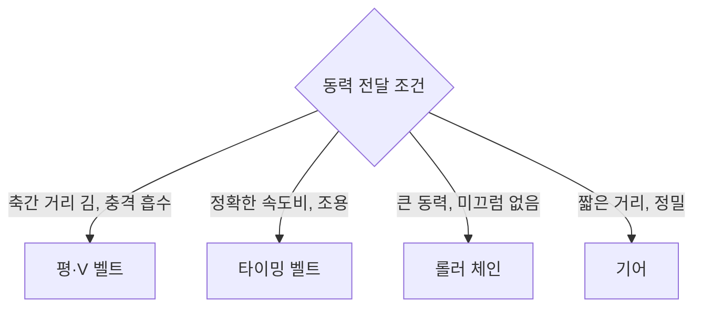

# 벨트·체인·스프링·브레이크

> [!summary] 핵심 요약
> - **감아걸기 전동**: 벨트(미끄럼 있음, 충격 흡수, 장거리), 체인(미끄럼 없음, 큰 힘), 타이밍 벨트(미끄럼 없음, 조용).
> - 벨트 전달 동력 $H = T_e v = (T_t - T_s)v$ (긴장측 − 이완측 장력 × 속도).
> - 스프링 상수 $k = \dfrac{W}{\delta}$. 직렬 $\dfrac{1}{k} = \dfrac{1}{k_1} + \dfrac{1}{k_2}$, 병렬 $k = k_1 + k_2$.
> - **제어용 기계요소**: 스프링(충격 흡수·에너지 저장), 브레이크(감속·정지), 래칫(역전 방지).

> [!warning] 자주 틀리는 포인트
> - **V벨트 단면 크기**: M < A < B < C < D < E. 각도는 **40°**.
> - 벨트 **오픈 걸기**는 같은 방향, **크로스(엇)걸기**는 반대 방향 회전.
> - 체인은 링크 수를 **짝수**로. 홀수면 **오프셋 링크** 필요.
> - 체인은 스프로킷이 다각형처럼 돌아 **속도 변동(폴리고널 작용)** 이 있다 → 잇수가 많을수록 작아짐.
> - 스프링 직렬 연결은 **더 부드러워지고(k 감소)**, 병렬은 **더 단단해진다(k 증가)**. 저항과 반대로 생각하면 된다.

## 개념 정리

### 벨트

| 종류 | 특징 |
| --- | --- |
| 평 벨트 | 장거리, 고속, 미끄럼 큼 |
| V 벨트 | 쐐기 작용으로 큰 마찰, 짧은 축간 거리, 조용 |
| 타이밍 벨트 | 이가 있어 미끄럼 없음, 정확한 속도비, 위치 이송 |
| 리브드(폴리 V) 벨트 | 얇고 유연, 고속 |

- 속도비 $i = \dfrac{N_2}{N_1} = \dfrac{D_1}{D_2}$ (미끄럼 무시).
- 벨트 속도 $v = \dfrac{\pi D N}{60 \times 1000}$ [m/s] (D: mm).
- **이완측을 위쪽**에 두면 접촉각이 커진다(수평 배치 시).
- **아이들러(텐션 풀리)**: 장력 조절, 접촉각 증가.
- **크리핑**: 장력 차로 벨트가 조금씩 미끄러지는 현상. **플래핑**: 벨트가 펄럭임.

### 체인

| 종류 | 특징 |
| --- | --- |
| 롤러 체인 | 가장 일반적, 큰 동력 |
| 사일런트 체인 | 소음 적음, 고속 |

- 속도비 $i = \dfrac{z_1}{z_2}$ (스프로킷 잇수).
- 체인 속도 $v = \dfrac{p z N}{60 \times 1000}$ [m/s] (p: 피치 mm).
- 장점: 미끄럼 없음, 큰 동력, 초기 장력 불필요. 단점: 소음·진동, 윤활 필요, 고속 부적합.

### 전동 방식 비교

| 항목 | 평·V 벨트 | 타이밍 벨트 | 체인 | 기어 |
| --- | --- | --- | --- | --- |
| 미끄럼 | 있음 | 없음 | 없음 | 없음 |
| 축간 거리 | 길다 | 중간 | 중간 | 짧다 |
| 충격 흡수 | 좋음 | 보통 | 낮음 | 낮음 |
| 소음 | 작음 | 작음 | 큼 | 중간 |

### 스프링

| 종류 | 용도 |
| --- | --- |
| 압축·인장 코일 스프링 | 가장 일반적 |
| 비틀림 코일 스프링 | 회전 복귀 (문 경첩) |
| 판 스프링 (겹판) | 차량 현가 장치, 감쇠 |
| 접시 스프링 | 작은 공간, 큰 하중 |
| 토션 바 | 비틀림 탄성 |
| 태엽 스프링 | 에너지 저장 (시계) |

- **스프링 지수** $C = \dfrac{D}{d}$ (코일 평균 지름 / 소선 지름). 보통 4~10.
- 코일 스프링 처짐 $\delta = \dfrac{8 n D^3 W}{G d^4}$ (n: 유효 감김 수).
- 저장 에너지 $U = \dfrac{1}{2}W\delta = \dfrac{1}{2}k\delta^2$.

### 브레이크와 래칫

| 종류 | 특징 |
| --- | --- |
| 블록 브레이크 | 드럼을 블록으로 누름, 단순 |
| 밴드 브레이크 | 드럼에 띠를 감아 조임, 큰 제동력 |
| 디스크 브레이크 | 방열 좋음, 자동차 |
| 전자 브레이크 | 무여자 작동형 → **정전 시 제동** (서보 모터 브레이크) |
| 래칫 휠 + 폴 | 한 방향 회전만 허용, 역전 방지 |

- 제동 용량: 블록에 미는 힘 W, 마찰 계수 μ → 제동력 $f = \mu W$, 제동 토크 $T = f \dfrac{D}{2}$.

### 캠

- 회전 운동을 원하는 **왕복·요동 운동**으로 변환.
- 평면 캠: 판 캠, 정면 캠, 직선 운동 캠. 입체 캠: 원통 캠, 원추 캠, 구면 캠.
- **캠 선도**: 회전각에 따른 종동절 변위 그래프 (등속, 등가속, 단현, 사이클로이드 운동).

## 그림

## 관련 단원

- [기어](기어.md)
- [볼스크루와 LM 가이드](볼스크루와_LM가이드.md)
- [축과 축이음](축과_축이음.md)

## 체크리스트

- [ ] 벨트·체인·타이밍 벨트의 차이를 비교한다
- [ ] 풀리 지름으로 속도비를 계산한다
- [ ] 유효 장력과 속도로 전달 동력을 구한다
- [ ] 체인 링크 수 짝수 원칙과 폴리고널 작용을 안다
- [ ] 스프링 직렬·병렬 합성 상수를 계산한다
- [ ] 무여자 작동형 전자 브레이크의 용도를 말한다

## 참고

- [큐넷 자동화설비산업기사 출제기준](https://www.q-net.or.kr/crf005.do?id=crf00503&jmCd=2034)
