# 벨트·체인·스프링·브레이크

> [!summary] 핵심 요약
> - **감아걸기 전동**: 벨트(미끄럼 있음, 충격 흡수, 장거리), 체인(미끄럼 없음, 큰 힘), 타이밍 벨트(미끄럼 없음, 조용).
> - 벨트 전달 동력 $H = T_e v = (T_t - T_s)v$ (긴장측 − 이완측 장력 × 속도).
> - 스프링 상수 $k = \dfrac{W}{\delta}$. 직렬 $\dfrac{1}{k} = \dfrac{1}{k_1} + \dfrac{1}{k_2}$, 병렬 $k = k_1 + k_2$.
> - **제어용 기계요소**: 스프링(충격 흡수·에너지 저장), 브레이크(감속·정지), 래칫(역전 방지).

> [!warning] 자주 틀리는 포인트
> - **V벨트 단면 크기**: M < A < B < C < D < E. 각도는 **40°**.
> - 벨트 **오픈 걸기**는 같은 방향, **크로스(엇)걸기**는 반대 방향 회전.
> - 체인은 링크 수를 **짝수**로. 홀수면 **오프셋 링크** 필요.
> - 체인은 스프로킷이 다각형처럼 돌아 **속도 변동(폴리고널 작용)** 이 있다 → 잇수가 많을수록 작아짐.
> - 스프링 직렬 연결은 **더 부드러워지고(k 감소)**, 병렬은 **더 단단해진다(k 증가)**. 저항과 반대로 생각하면 된다.
> - **벨트** 단면각은 40°이지만 **풀리 홈 각도는 34°·36°·38°** (풀리 지름이 작을수록 작은 각). 둘을 혼동하지 말 것.
> - V벨트 풀리의 **암은 길이 방향으로 단면하지 않는다** → 회전 도시 단면도로 그린다.
> - 스프링은 **무하중 상태**로 그리는 것이 원칙. 단, **겹판 스프링은 상용 하중 상태**(판이 곧게 펴진 상태)로 그린다.
> - **초기 장력**은 **인장** 코일 스프링 요목표 항목이다. 압축 코일 스프링 요목표에는 넣지 않는다.
> - "응력 집중 완화"는 스프링의 기능이 아니다. 기능은 에너지 저장, 충격·진동 흡수, 하중 측정·조정, 복원력.

## 학습 목표

이 단원을 마치면 다음을 할 수 있어야 한다.

1. 평·V·타이밍 벨트, 체인, 기어를 미끄럼·축간 거리·충격 흡수·소음으로 비교해 조건에 맞는 전동 방식을 고른다.
2. 풀리 지름·스프로킷 잇수로 속도비를, 지름·회전수·피치로 벨트·체인 속도를, 긴장측·이완측 장력으로 전달 동력을 계산한다.
3. V벨트 단면각(40°)과 풀리 홈 각(34°·36°·38°)을 구분하고, 쐐기 작용과 V벨트 풀리 도시 규칙을 설명한다.
4. 체인 링크 수를 짝수로 하는 이유와 폴리고널 작용(잇수와 속도 변동의 관계)을 설명한다.
5. 스프링 지수·처짐·저장 에너지를 계산하고, 직렬·병렬 합성 스프링 상수를 구한다.
6. 스프링을 무하중·하중 상태 중 어느 쪽으로 그리는지, 압축·인장 코일 스프링 요목표 차이(초기 장력)를 안다.
7. 블록·밴드·디스크·무여자 작동형 전자 브레이크와 래칫, 캠의 원리와 쓰임을 설명한다.

## 한눈에 보기

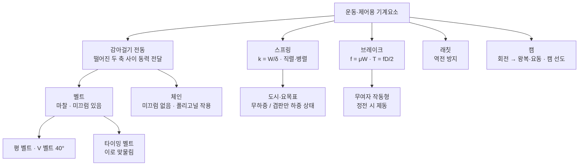

## 1. 감아걸기 전동 — 벨트·체인 한눈에

두 축이 멀리 떨어져 있으면 기어를 맞물리게 할 수 없다. 자전거처럼 **띠나 사슬을 두 바퀴에 감아 걸어** 동력을 보내는 것이 감아걸기 전동이다. 띠(벨트)는 **마찰**로 끌고 가므로 조금 미끄러지는 대신 충격을 흡수하고, 사슬(체인)·이 달린 벨트(타이밍 벨트)는 **맞물려** 가므로 미끄러지지 않는다.

| V벨트 전동 (공기 압축기) | 타이밍 벨트와 리브드 벨트 (자동차 엔진) |
| --- | --- |
| 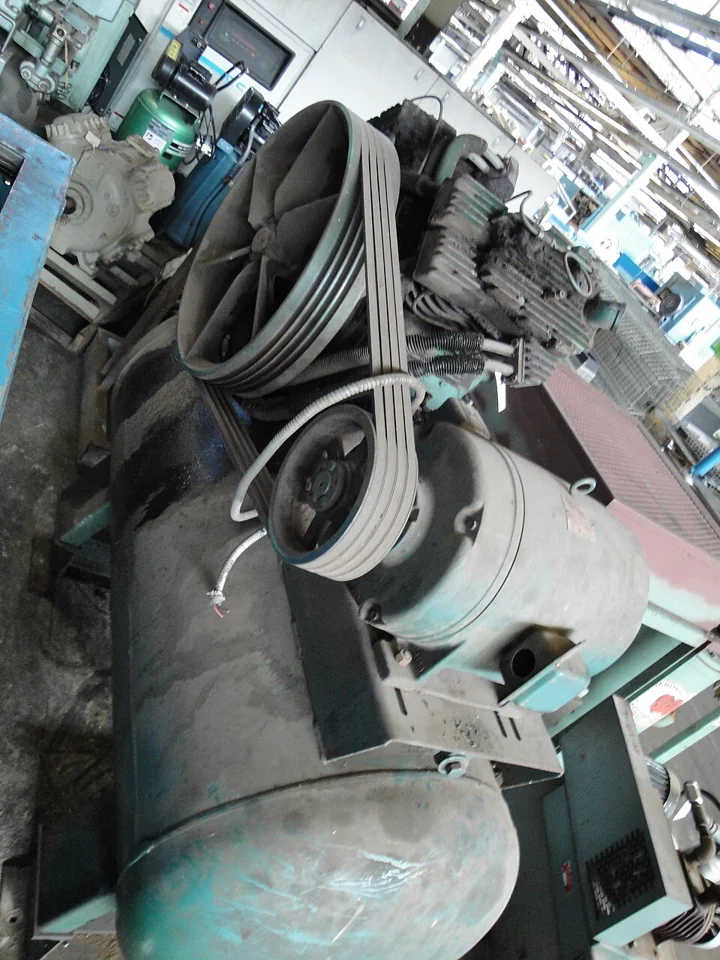 | 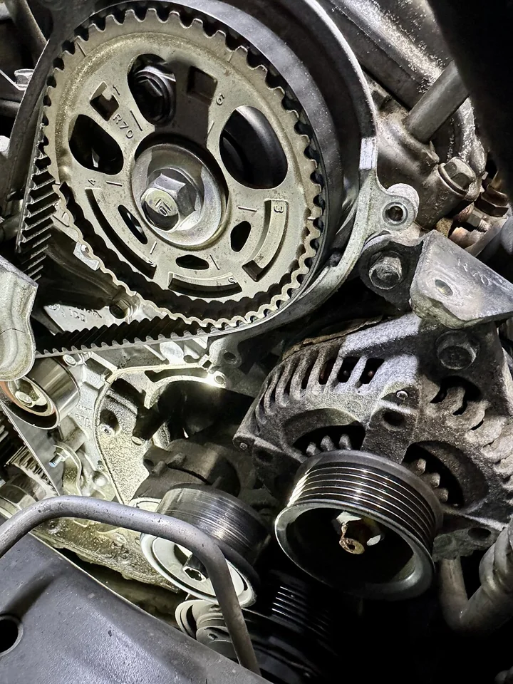 |

*왼쪽: 공기 압축기 탱크 위에서 아래쪽 전동기의 작은 풀리가 위쪽 압축기의 큰 풀리를 V벨트 4줄로 돌린다. 큰 동력을 보낼 때는 V벨트를 여러 줄 나란히 건다. 작은 풀리(원동) → 큰 풀리(종동)이므로 회전 속도가 줄어든다. 오른쪽: 위쪽 큰 풀리 둘레에 톱니가 있고, 안쪽에 이가 난 검은 **타이밍 벨트**가 맞물려 있다. 이와 이가 맞물리므로 미끄럼이 없어 캠축이 크랭크축과 정확한 비율로 돈다. 아래쪽 발전기 풀리에는 얕은 홈이 여러 줄 파여 있는데, 이것이 얇고 유연한 **리브드(폴리 V) 벨트**용 풀리다.*

### 전동 방식 비교

| 항목 | 평·V 벨트 | 타이밍 벨트 | 체인 | 기어 |
| --- | --- | --- | --- | --- |
| 미끄럼 | 있음 | 없음 | 없음 | 없음 |
| 축간 거리 | 길다 | 중간 | 중간 | 짧다 |
| 충격 흡수 | 좋음 | 보통 | 낮음 | 낮음 |
| 소음 | 작음 | 작음 | 큼 | 중간 |

> [!tip] 감 잡기 — 조건으로 고르기
> "멀고, 충격이 있고, 조금 미끄러져도 된다 → 벨트", "정확한 비율이 필요하고 조용해야 한다 → 타이밍 벨트", "힘이 크고 미끄러지면 안 되며 속도는 느리다 → 체인", "가깝고 정밀하다 → 기어". 아래 `## 그림`의 흐름도가 같은 내용이다.

## 2. 벨트 — 장력 차이로 동력을 보낸다

벨트는 두 풀리를 감싼 고무 띠다. 원동 풀리가 돌면서 한쪽 벨트를 **끌어당기고**(긴장측, 팽팽), 반대쪽으로는 **내보낸다**(이완측, 느슨). 종동 풀리를 돌리는 힘은 이 두 장력의 **차이**, 곧 유효 장력 $T_e = T_t - T_s$ 이다. 줄다리기에서 양쪽이 같은 힘으로 당기면 움직이지 않는 것과 같다.

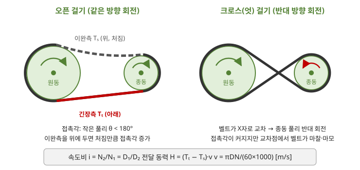

*왼쪽 오픈 걸기: 원동 풀리가 시계 방향으로 돌면 아래쪽 벨트를 끌어당기므로 **아래가 긴장측**(빨강), 위가 처진 **이완측**(점선)이 되고, 종동 풀리도 같은 시계 방향으로 돈다. 위쪽 이완측이 아래로 처지면서 풀리를 더 감싸므로 접촉각이 커진다 — 그래서 수평 배치에서는 이완측을 위에 둔다. 작은 풀리 쪽 접촉각이 180°보다 작아 먼저 미끄러진다. 오른쪽 크로스 걸기: 벨트가 X자로 꼬여 종동 풀리가 **반대 방향**(빨간 화살표)으로 돈다. 접촉각은 커지지만 교차점에서 벨트끼리 비벼진다.*

$$i = \frac{N_2}{N_1} = \frac{D_1}{D_2}, \qquad v = \frac{\pi D N}{60 \times 1000}\ [\text{m/s}], \qquad H = T_e v = (T_t - T_s)\,v$$

$$\frac{T_t}{T_s} = e^{\mu\theta} \qquad (\text{아이텔바인 식, } \theta: \text{접촉각[rad]})$$

### 벨트

| 종류 | 특징 |
| --- | --- |
| 평 벨트 | 장거리, 고속, 미끄럼 큼 |
| V 벨트 | 쐐기 작용으로 큰 마찰, 짧은 축간 거리, 조용 |
| 타이밍 벨트 | 이가 있어 미끄럼 없음, 정확한 속도비, 위치 이송 |
| 리브드(폴리 V) 벨트 | 얇고 유연, 고속 |

- 속도비 $i = \dfrac{N_2}{N_1} = \dfrac{D_1}{D_2}$ (미끄럼 무시).
- 벨트 속도 $v = \dfrac{\pi D N}{60 \times 1000}$ [m/s] (D: mm).
- **이완측을 위쪽**에 두면 접촉각이 커진다(수평 배치 시).
- **아이들러(텐션 풀리)**: 장력 조절, 접촉각 증가.
- **크리핑**: 장력 차로 벨트가 조금씩 미끄러지는 현상. **플래핑**: 벨트가 펄럭임.

> [!example] 계산 예 — 벨트 속도와 전달 동력
> 지름 200 mm 원동 풀리가 1500 rpm으로 돌 때 $v = \dfrac{\pi \times 200 \times 1500}{60\,000} \approx 15.7$ m/s.
> 긴장측 900 N, 이완측 400 N이면 $T_e = 500$ N, $H = 500 \times 15.7 \approx 7850$ W ≈ **7.85 kW**.
> 종동 풀리 지름이 600 mm이면 $N_2 = 1500 \times \dfrac{200}{600} = 500$ rpm.

> [!question] 시험에서는
> "크로스 걸기는 같은 방향으로 회전한다", "이완측을 아래에 두면 접촉각이 커진다"처럼 **방향을 뒤집은 보기**가 나온다. 크리핑(장력 차로 생기는 미세한 미끄럼)과 플래핑(펄럭임)도 서로 바꿔 놓는다.

## 3. V벨트와 풀리 도시

V벨트는 사다리꼴 단면이라 풀리의 V자 홈에 **쐐기처럼 박힌다.** 같은 장력이라도 홈의 양 옆면을 세게 눌러 마찰이 평 벨트보다 훨씬 커지므로, 짧은 축간 거리에서도 미끄러지지 않고 큰 동력을 보낸다.

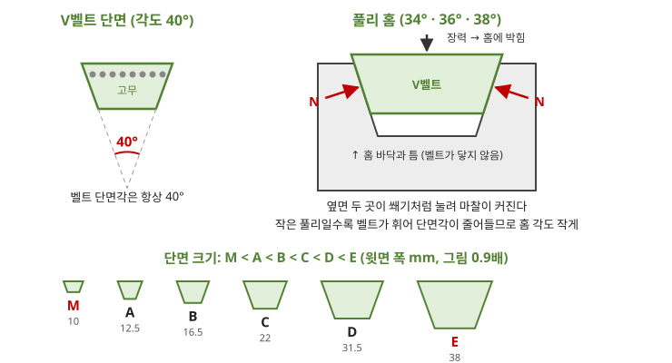

*왼쪽: V벨트 단면의 두 옆면을 연장하면 **40°** 로 만난다. 위쪽 점들은 장력을 받는 심선(코드)이다. 가운데: 벨트는 홈 바닥에 닿지 않고 **두 옆면에서만** 눌린다(빨간 N). 위에서 장력으로 밀어 넣는 힘보다 옆면 수직력 N이 훨씬 커서 마찰이 커진다. 벨트가 작은 풀리에 감기면 바깥쪽은 늘고 안쪽은 불룩해져 단면각이 40°보다 작아지므로, 홈 각도는 풀리가 작을수록 34°, 36°, 38°로 작게 만든다. 아래: 일반용 V고무벨트 6종의 윗면 폭(mm)을 같은 비율로 그렸다. M이 가장 작고 E가 가장 크다.*

$$\mu' = \frac{\mu}{\sin\dfrac{\alpha}{2} + \mu\cos\dfrac{\alpha}{2}} \qquad (\alpha = 40°,\ \mu = 0.3 \Rightarrow \mu' \approx 0.48)$$

*유효 마찰 계수 μ'가 μ보다 커지는 것이 쐐기 작용이다.*

### V벨트 풀리 도시

- 일반용 V고무벨트는 단면 치수에 따라 **M, A, B, C, D, E의 6종**.
- 풀리 홈 부분 치수는 벨트 **형별과 호칭 지름**에 따라 정해진다 (KS 표 참조).
- 축에 직각인 방향에서 본 그림을 **정면도(주투상도)** 로 할 수 있다.
- 암은 길이 방향으로 절단하지 않고 **회전 도시 단면도**로 단면 모양을 보여 준다.

> [!question] 시험에서는
> "V벨트 단면각은?" → **40°**. 보기에 34°·36°·38°가 섞여 나오는데, 이것은 **풀리 홈 각**이다. 풀리 도시 문제에서는 "암은 길이 방향으로 절단하여 도시한다"가 틀린 보기다 — 암·리브·축·핀처럼 길이 방향으로 자르면 오히려 알아보기 어려운 부품은 길이 방향 단면을 하지 않는다([도면 양식과 투상법](도면_양식과_투상법.md)의 회전 도시 단면).

## 4. 체인 — 미끄럼 없는 사슬

체인은 짧은 판(링크)을 핀으로 이어 만든 사슬이 스프로킷 이에 걸려 돌아가므로 **미끄럼이 없고**, 벨트처럼 미리 팽팽하게 당겨 둘 필요(초기 장력)도 없다. 대신 금속끼리 부딪쳐 시끄럽고, 기름을 쳐야 하며, 빨리 돌리기 어렵다.

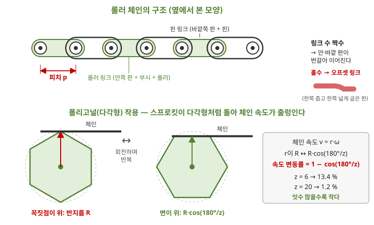

*위: 롤러 체인은 **롤러 링크**(안쪽 판 + 부시 + 롤러, 초록)와 **핀 링크**(바깥쪽 판 + 핀, 검은 테두리)가 번갈아 이어진다. 핀 중심 사이 거리가 **피치 p**다. 두 끝을 이으려면 안쪽 판 끝과 바깥쪽 판 끝이 만나야 하므로 링크 수가 **짝수**여야 하고, 홀수이면 한쪽은 좁고 한쪽은 넓게 굽은 **오프셋 링크**를 끼운다. 아래: 스프로킷을 잇수 6개짜리로 단순화했다. 꼭짓점이 위에 올 때는 체인이 반지름 R에 걸리고, 30° 더 돌면 변이 위로 와서 R·cos 30°로 낮아진다. 같은 각속도라도 반지름이 바뀌니 체인 속도가 출렁이는 것이 **폴리고널(다각형) 작용**이다.*

$$i = \frac{N_2}{N_1} = \frac{z_1}{z_2}, \qquad v = \frac{p z N}{60 \times 1000}\ [\text{m/s}], \qquad \text{속도 변동률} = 1 - \cos\frac{180°}{z}$$

### 체인

| 종류 | 특징 |
| --- | --- |
| 롤러 체인 | 가장 일반적, 큰 동력 |
| 사일런트 체인 | 소음 적음, 고속 |

- 속도비 $i = \dfrac{z_1}{z_2}$ (스프로킷 잇수).
- 체인 속도 $v = \dfrac{p z N}{60 \times 1000}$ [m/s] (p: 피치 mm).
- 장점: 미끄럼 없음, 큰 동력, 초기 장력 불필요. 단점: 소음·진동, 윤활 필요, 고속 부적합.

> [!example] 계산 예 — 체인 속도
> 피치 15.875 mm(호칭 50번), 잇수 20, 600 rpm → $v = \dfrac{15.875 \times 20 \times 600}{60\,000} \approx 3.18$ m/s.
> 잇수 6이면 속도 변동률이 $1 - \cos 30° \approx 13.4\%$, 잇수 20이면 $1 - \cos 9° \approx 1.2\%$ → **잇수가 많을수록 매끄럽다.**

## 5. 스프링 — 종류와 쓰임

스프링은 힘을 받으면 변형하면서 **에너지를 저장**했다가, 힘이 빠지면 되돌려 준다. 그래서 충격·진동을 흡수하고(자동차 현가 장치), 물체를 원위치로 돌려보내고(밸브·스위치 복귀), 늘어난 길이로 힘을 재고(저울), 태엽처럼 동력원이 된다.

### 스프링

| 종류 | 용도 |
| --- | --- |
| 압축·인장 코일 스프링 | 가장 일반적 |
| 비틀림 코일 스프링 | 회전 복귀 (문 경첩) |
| 판 스프링 (겹판) | 차량 현가 장치, 감쇠 |
| 접시 스프링 | 작은 공간, 큰 하중 |
| 토션 바 | 비틀림 탄성 |
| 태엽 스프링 | 에너지 저장 (시계) |

- 교재(CH03 17절) 예: 압축 코일(볼펜), 인장 코일(저울·게이지), 비틀림 코일(집게·클립), 토션 바(자동차 서스펜션), **벌류트 스프링**(원뿔형), 스파이럴 스프링(태엽), 접시 스프링(단위 부피당 탄성력이 큼). 교재의 인장 코일 설명에 "압축력에 의해 탄성이 저장"이라고 적힌 것은 압축 코일 문장이 잘못 들어간 것으로 보인다.

### 실물로 보기

| 겹판 스프링 | 접시 스프링 |
| --- | --- |
| 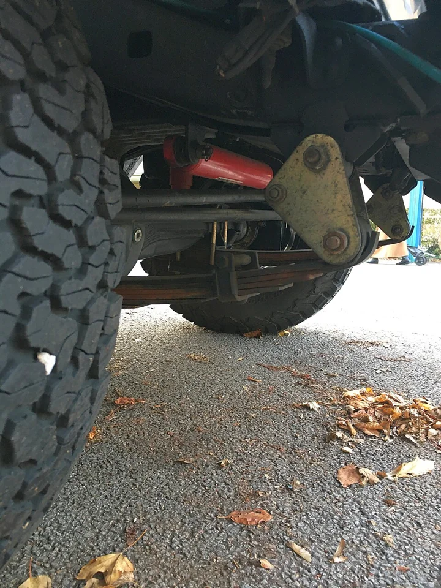 | 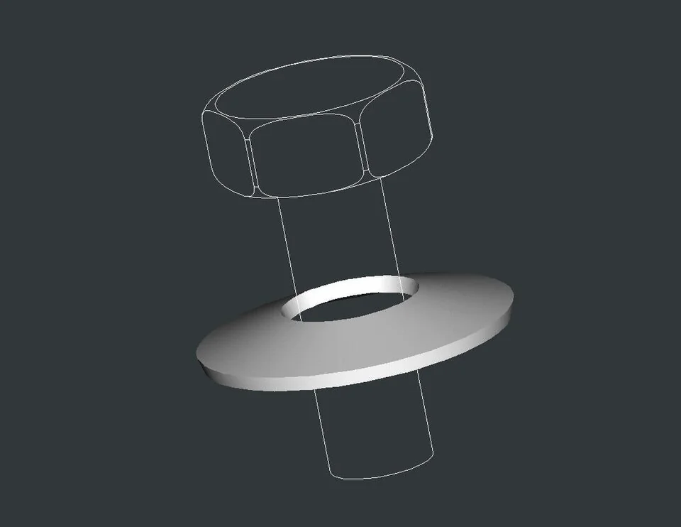 |
| 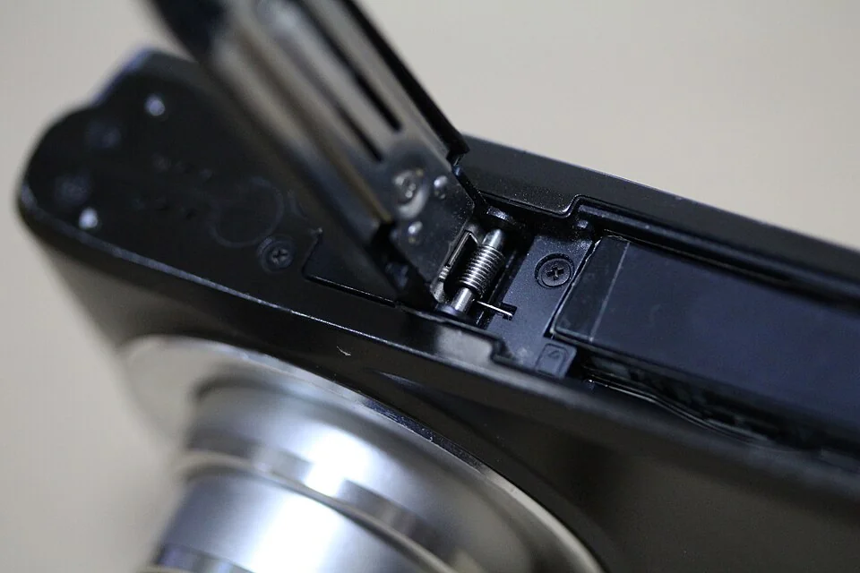 | 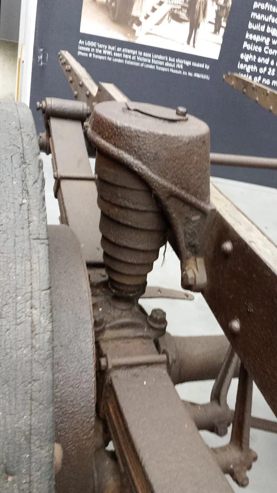 |
| 비틀림 코일 스프링 | 벌류트 스프링 |

*겹판 스프링: 바퀴 안쪽 차축 아래로 길이가 다른 강판 여러 장이 겹쳐 묶여 있다. 판끼리 비벼지는 마찰이 진동을 줄여 주므로(감쇠) 트럭·SUV 현가 장치에 쓴다. 접시 스프링: 가운데 구멍이 있는 원판이 접시처럼 살짝 솟아 있어, 볼트로 누르면 납작해지면서 아주 작은 처짐으로 큰 힘을 낸다. 여러 장을 포개면 하중이나 처짐을 키울 수 있다. 비틀림 코일 스프링: 카메라 배터리 덮개 경첩 축에 작은 코일이 감겨 있고, 한쪽 다리가 덮개를 밀어 열린 쪽으로 돌려 준다. 축 둘레로 **비틀어** 쓰는 스프링이라 회전 복귀에 쓴다. 벌류트 스프링: 넓은 띠 강판을 원뿔 모양으로 감은 스프링으로, 옛 버스의 차대와 차축 사이에 달려 있다. 눌리면 큰 코일 속으로 작은 코일이 들어가며 짧은 길이로 큰 하중을 받는다.*

> [!question] 시험에서는
> "스프링의 기능이 아닌 것은?" → **응력 집중 완화**. 에너지 저장, 충격·진동 흡수, 하중 측정·조정, 복원력은 스프링의 기능이다. 응력 집중 완화는 노치에 둥글기(필릿)를 주는 것처럼 형상 설계의 일이다.

## 6. 스프링 계산 — 지수·처짐·직렬·병렬

코일 스프링은 굵은 철사(소선)를 감은 것이다. 같은 철사라도 **크게 감을수록(D↑)**, **많이 감을수록(n↑)** 잘 늘어나 부드럽고, 철사가 **굵을수록(d↑)** 단단하다. 처짐 식에서 D는 세제곱, d는 네제곱으로 들어가므로 소선 지름의 영향이 가장 크다.

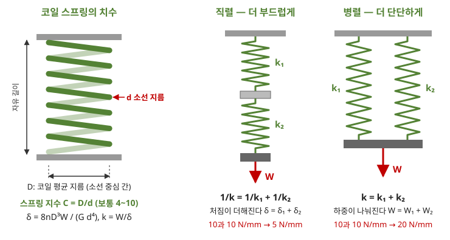

*왼쪽: **D**는 코일 바깥지름이 아니라 소선 중심에서 중심까지 잰 **평균 지름**, **d**는 소선(철사) 굵기다. 오른쪽 위 판에서 아래 판까지가 하중이 없을 때의 자유 길이다. 가운데 직렬: 두 스프링이 같은 하중 W를 그대로 받고 처짐이 더해지므로 전체가 더 부드럽다. 오른쪽 병렬: 하중을 둘이 나눠 받고 처짐은 같으므로 더 단단하다. 같은 10 N/mm 두 개를 직렬로 이으면 5 N/mm, 병렬이면 20 N/mm.*

$$k = \frac{W}{\delta}, \qquad \text{직렬: } \frac{1}{k} = \frac{1}{k_1} + \frac{1}{k_2}, \qquad \text{병렬: } k = k_1 + k_2$$

- **스프링 지수** $C = \dfrac{D}{d}$ (코일 평균 지름 / 소선 지름). 보통 4~10.
- 코일 스프링 처짐 $\delta = \dfrac{8 n D^3 W}{G d^4}$ (n: 유효 감김 수).
- 저장 에너지 $U = \dfrac{1}{2}W\delta = \dfrac{1}{2}k\delta^2$.

> [!example] 계산 예 — 코일 스프링
> D = 40 mm, d = 5 mm, n = 10, G = 80 000 N/mm², W = 100 N.
> 스프링 지수 $C = 40/5 = 8$.
> 처짐 $\delta = \dfrac{8 \times 10 \times 40^3 \times 100}{80\,000 \times 5^4} = \dfrac{512\,000\,000}{50\,000\,000} \approx 10.2$ mm, 스프링 상수 $k = 100 / 10.24 \approx 9.8$ N/mm.
> 저장 에너지 $U = \tfrac{1}{2} \times 100 \times 10.24 \approx 512$ N·mm.

> [!tip] 감 잡기 — 저항과 반대
> 전기 저항은 직렬이면 더하고 병렬이면 역수로 더한다. 스프링 상수는 **정반대**다. 헷갈리면 "직렬로 이으면 늘어나는 길이가 두 배 → 부드러워진다"를 떠올린다.

## 7. 스프링 도시와 요목표

스프링 도면은 "언제 모양으로 그리느냐"가 핵심이다. 스프링은 하중에 따라 모양이 계속 바뀌므로 기준 상태를 정해 두고, 그림으로 나타내기 어려운 하중·감김 수 같은 정보는 **요목표**에 모은다.

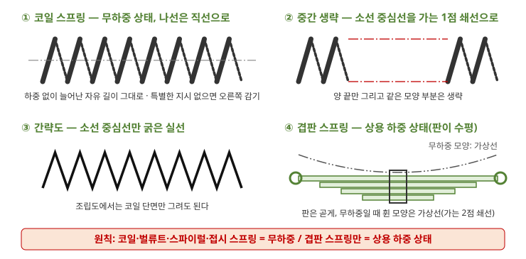

*① 코일 스프링은 하중이 없는 자유 길이로 그리고, 나선은 곡선 대신 **직선**으로 그린다(앞쪽 소선은 실선, 뒤쪽은 숨은선). ② 같은 모양이 반복되는 가운데 부분은 생략하고, 소선 중심선 위치만 **가는 1점 쇄선**(빨강)으로 잇는다. ③ 간략도는 소선 중심선 하나를 **굵은 실선**으로 그린다. ④ 겹판 스프링만은 차량 무게를 받아 판이 **수평으로 펴진 상용 하중 상태**로 그리고, 하중이 없을 때 휜 모양은 **가상선**(가는 2점 쇄선)으로 덧붙인다.*

### 스프링 도시와 요목표

- 코일 스프링은 **무하중 상태**로 그린다. 하중이 걸린 상태로 그릴 때는 그 하중을 적는다.
- **겹판 스프링**은 원칙적으로 **상용 하중 상태**로 그리고, 무하중 모양은 가상선으로 덧붙인다.
- 양 끝을 뺀 같은 모양 부분은 일부 생략할 수 있다. 생략 부분은 소선 중심선을 가는 1점 쇄선으로.
- 간략도는 소선 중심선만 **굵은 실선**으로 그린다.
- 특별한 지시가 없으면 **오른쪽 감기**로 본다. 왼쪽이면 "감김 방향 왼쪽"이라고 적는다.
- 교재(17절, KS B 0005) 보충: 코일·벌류트·스파이럴·접시 스프링은 **무하중**, 겹판 스프링만 **하중 상태(판이 수평)**. 정면도의 나선은 직선으로, 피치·각도가 계속 변하는 곳은 꺾은선으로 그린다. 조립도에서는 코일 스프링 단면만 그려도 된다. 그림으로 나타내기 어려운 내용은 요목표에 모은다.

| 요목표 항목 | 압축 코일 | 인장 코일 |
| --- | :-: | :-: |
| 재료, 소선 지름, 코일 평균 지름(또는 안·바깥지름) | ○ | ○ |
| 총 감김 수, 유효 감김 수, 감김 방향 | ○ | ○ |
| 자유 길이, 스프링 상수 | ○ | ○ |
| 지정 길이 시 하중·응력 | ○ | ○ |
| **초기 장력** | – | ○ |
| 표면 처리, 성형 후 처리 | ○ | ○ |

> [!tip] 감 잡기 — 초기 장력
> 인장 코일 스프링은 코일끼리 서로 꽉 눌린 채 감겨 있어서, 어느 정도 힘을 주기 전에는 전혀 늘어나지 않는다. 이 "처음 버티는 힘"이 **초기 장력**이다. 압축 코일 스프링은 코일 사이가 벌어져 있으니 초기 장력이라는 개념 자체가 없다.

## 8. 브레이크와 래칫

브레이크는 돌고 있는 드럼·디스크에 무언가를 **눌러 붙여** 마찰로 운동 에너지를 열로 바꾼다. 누르는 힘 W에 마찰 계수 μ를 곱한 것이 제동력이고, 그 힘이 드럼 반지름에서 작용하므로 제동 토크가 된다.

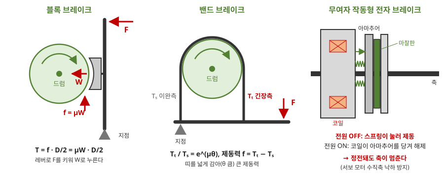

*왼쪽 블록 브레이크: 레버 끝을 F로 밀면 지렛대 원리로 커진 힘 W가 블록을 드럼에 누르고, 드럼 표면에는 회전을 막는 마찰력 f = μW(빨강, 위쪽)가 생긴다. 가운데 밴드 브레이크: 드럼 위를 띠가 감싸고 한 끝은 지점, 다른 끝은 레버에 걸려 있다. 레버를 F로 내리면 띠가 조여지고, 드럼이 도는 쪽 끝이 긴장측 $T_t$가 된다. 감긴 각 θ가 클수록 $T_t/T_s$가 지수적으로 커져 작은 힘으로 큰 제동력이 난다. 오른쪽 무여자 작동형 전자 브레이크: 전원이 없으면 스프링이 아마추어를 밀어 축에 붙은 마찰판을 꽉 문다(제동). 전원을 넣으면 코일이 아마추어를 끌어당겨 틈이 생기고 축이 풀린다. 그래서 **정전되면 저절로 제동**된다.*

$$f = \mu W, \qquad T = f\frac{D}{2}, \qquad \text{밴드: } \frac{T_t}{T_s} = e^{\mu\theta},\ f = T_t - T_s$$

| 디스크 브레이크 | 밴드 브레이크 (자전거 뒷바퀴) |
| --- | --- |
| 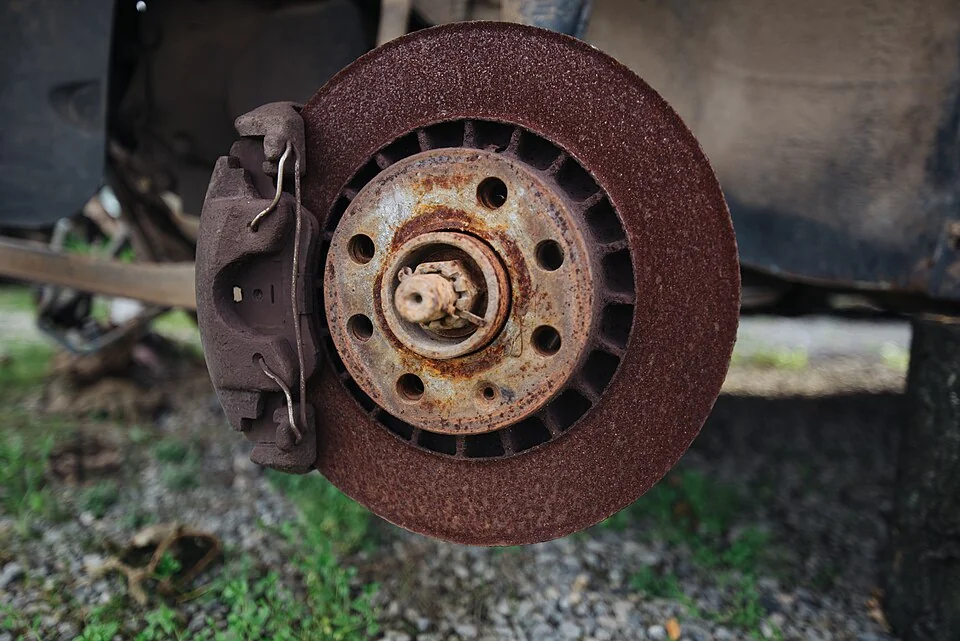 | 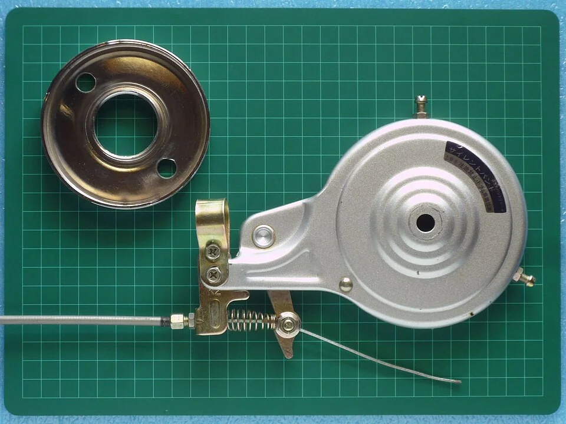 |

*왼쪽 디스크 브레이크: 바퀴와 함께 도는 원판(디스크) 가장자리를 캘리퍼(왼쪽 덩어리)가 양쪽에서 집는다. 원판이 공기 중에 드러나 있고 안쪽에 통풍 구멍이 있어 열이 잘 빠진다 — 자동차에 쓰는 이유다. 오른쪽 밴드 브레이크: 둥근 덮개 안에 드럼과 띠가 들어 있고, 왼쪽에서 들어온 케이블이 레버를 당기면 띠가 드럼을 조인다. 레버 옆 코일 스프링은 브레이크 손잡이를 놓았을 때 레버를 되돌린다.*

### 브레이크와 래칫

| 종류 | 특징 |
| --- | --- |
| 블록 브레이크 | 드럼을 블록으로 누름, 단순 |
| 밴드 브레이크 | 드럼에 띠를 감아 조임, 큰 제동력 |
| 디스크 브레이크 | 방열 좋음, 자동차 |
| 전자 브레이크 | 무여자 작동형 → **정전 시 제동** (서보 모터 브레이크) |
| 래칫 휠 + 폴 | 한 방향 회전만 허용, 역전 방지 |

- 제동 용량: 블록에 미는 힘 W, 마찰 계수 μ → 제동력 $f = \mu W$, 제동 토크 $T = f \dfrac{D}{2}$.

> [!example] 계산 예 — 블록 브레이크
> μ = 0.3, 블록을 미는 힘 W = 1000 N, 드럼 지름 D = 400 mm → $f = 0.3 \times 1000 = 300$ N, $T = 300 \times 0.2 = 60$ N·m.

### 래칫 — 한쪽으로만 도는 톱니

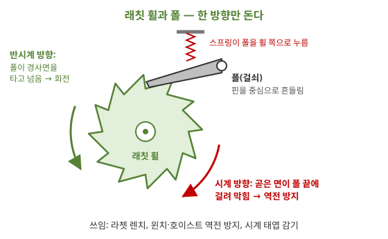

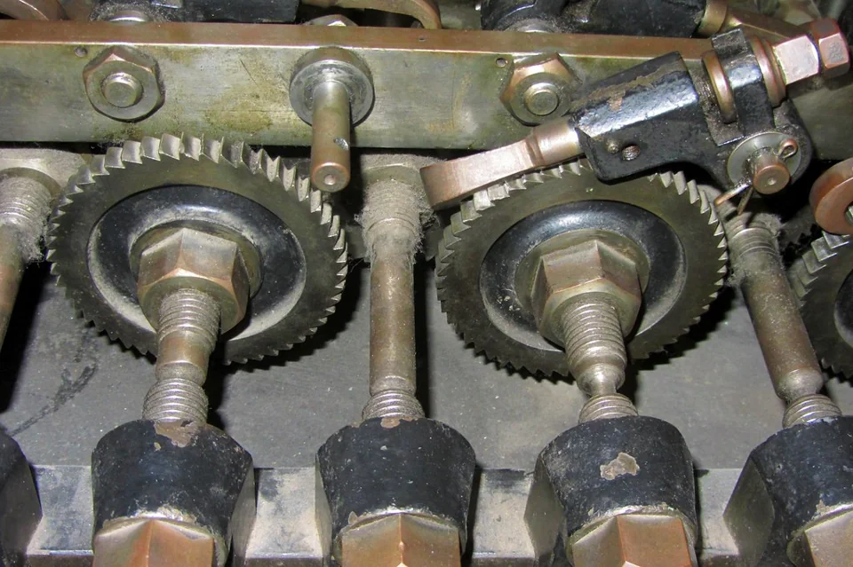

*실물 래칫. 톱니가 **한 방향으로 기울어진 톱니바퀴(래칫 휠)** 두 개가 보이고, 오른쪽 위에서 레버 모양의 **폴(걸쇠)** 이 오른쪽 바퀴의 톱니에 걸려 있다. 톱니 모양이 비대칭이어서 한쪽으로는 폴이 톱니를 타고 넘고, 반대쪽으로는 걸려 멈춘다. 아래 그림은 이 원리를 단순화한 것이다.*

*래칫 휠의 톱니는 한쪽이 완만한 경사면, 다른 쪽이 거의 반지름 방향의 곧은 면이다. 위에서 스프링이 걸쇠(폴)를 휠 쪽으로 눌러 폴 끝이 톱니 사이에 끼어 있다. 휠이 반시계 방향(초록)으로 돌 때는 폴이 경사면을 타고 올라갔다가 다음 홈으로 떨어지며 넘어가지만(딸깍 소리), 시계 방향(빨강)으로 돌리려 하면 곧은 면이 폴 끝을 밀어 폴이 버팀대처럼 걸려 막힌다. 라쳇 렌치, 윈치·호이스트의 역전 방지, 시계 태엽에 쓴다.*

> [!question] 시험에서는
> 서보 모터에 붙은 브레이크는 **무여자 작동형**이다. 수직축(Z축)에서 정전이 나면 모터 힘이 사라져 짐이 떨어지므로, 전원이 끊기면 저절로 잡아 주는 쪽을 쓴다. "여자(전원 ON) 시 제동"이라고 쓴 보기는 틀린 것이다.

## 9. 캠

캠은 **모양으로 운동을 만드는** 부품이다. 둥글지 않은 판을 돌리면, 그 위에 얹힌 막대(종동절)가 판의 반지름이 바뀌는 만큼 오르내린다. 판 모양을 바꾸면 원하는 시점에, 원하는 만큼, 원하는 방식으로 움직임을 만들 수 있어 자동 기계의 타이밍 장치에 많이 쓴다.

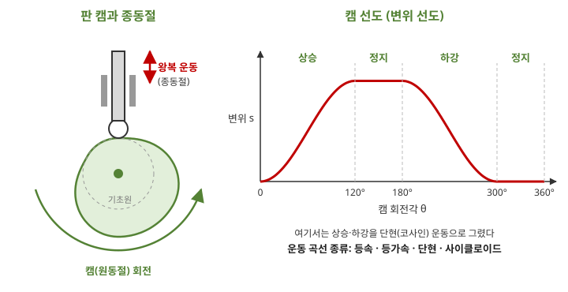

*왼쪽: 판 캠(원동절)이 돌면 롤러가 달린 종동절이 안내 사이에서 위아래로 움직인다. 점선 원은 **기초원**(캠 중심에서 가장 가까운 윤곽)이다. 종동절이 기초원 위에 있을 때 변위가 0이다. 오른쪽 캠 선도: 가로축은 캠 회전각, 세로축은 종동절 변위다. 0~120° 동안 상승, 120~180° 정지, 180~300° 하강, 300~360° 정지한다. 왼쪽 캠 윤곽은 이 선도를 그대로 둘레에 감아 만든 것이다.*

### 캠

- 회전 운동을 원하는 **왕복·요동 운동**으로 변환.
- 평면 캠: 판 캠, 정면 캠, 직선 운동 캠. 입체 캠: 원통 캠, 원추 캠, 구면 캠.
- **캠 선도**: 회전각에 따른 종동절 변위 그래프 (등속, 등가속, 단현, 사이클로이드 운동).

> [!tip] 감 잡기 — 운동 곡선 고르기
> 등속 운동은 시작·끝에서 속도가 갑자기 바뀌어 충격이 크다. 등가속·단현(코사인) 운동은 그 충격을 줄이고, 사이클로이드 운동은 가속도까지 매끄럽게 이어져 고속 캠에 알맞다.

## 그림

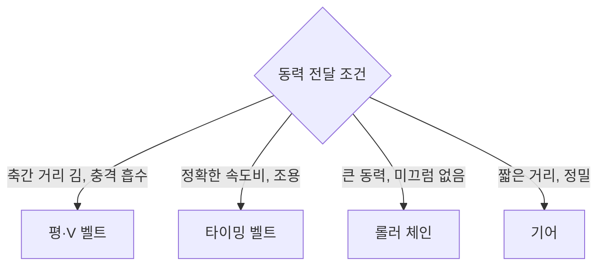

## 기출 포인트

- 스프링 — 3회: 하중 상태로 그리는 스프링(겹판) (2018-3), 스프링의 기능이 아닌 것 (2019-3), 압축 코일 스프링 요목표에 넣지 않는 항목(초기 장력) (2020-1)
- V벨트 — 2회: V벨트 단면각 40° (2019-1), V벨트 풀리 도시 규칙 중 틀린 것(암을 길이 방향으로 절단) (2018-1)
- 체인·브레이크·캠 계산은 2014~2020년 2과목에 나오지 않았다. 새 출제기준의 제어용 기계요소로 개념만 정리해 둔다.

**교재 예제 유형** (Win-Q 2025 PART 01 CHAPTER 03, 17절): 원칙적으로 하중 상태로 그리는 스프링(겹판). 기출 2018-3과 같은 문제다.

## 관련 단원

- [기어](기어.md)
- [볼스크루와 LM 가이드](볼스크루와_LM가이드.md)
- [축과 축이음](축과_축이음.md)
- [도면 양식과 투상법](도면_양식과_투상법.md)

## 체크리스트

- [ ] 벨트·체인·타이밍 벨트의 차이를 비교한다
- [ ] 풀리 지름으로 속도비를 계산한다
- [ ] 유효 장력과 속도로 전달 동력을 구한다
- [ ] 체인 링크 수 짝수 원칙과 폴리고널 작용을 안다
- [ ] 스프링 직렬·병렬 합성 상수를 계산한다
- [ ] 무여자 작동형 전자 브레이크의 용도를 말한다
- [ ] V벨트 단면각(40°)과 풀리 홈 각(34·36·38°)을 구분한다
- [ ] V벨트 6종(M·A·B·C·D·E)과 풀리 도시 규칙을 안다
- [ ] 스프링을 무하중·하중 상태 중 어느 쪽으로 그리는지 안다
- [ ] 압축·인장 코일 스프링 요목표 항목 차이(초기 장력)를 안다

## 참고

- [큐넷 자동화설비산업기사 출제기준](https://www.q-net.or.kr/crf005.do?id=crf00503&jmCd=2034)

### 그림 출처

위키미디어 공용(Wikimedia Commons)과 Openverse에서 가져온 공개 라이선스 자료이고, 노트에 맞게 크기를 줄이고 WebP로 변환했다.

| 그림 | 작성자 | 라이선스 | 출처 |
| --- | --- | --- | --- |
| [Multiple-V-belt drive 001](https://commons.wikimedia.org/wiki/File:Multiple-V-belt_drive_001.jpg) | Three-quarter-ten | [CC BY-SA 3.0](https://creativecommons.org/licenses/by-sa/3.0) | Wikimedia Commons |
| [Toothed rubber timing belt](https://commons.wikimedia.org/wiki/File:Toothed_rubber_timing_belt.jpg) | Logansenf | [CC BY-SA 4.0](https://creativecommons.org/licenses/by-sa/4.0) | Wikimedia Commons |
| [Front suspension with leaf springs and part of steering of Toyota Land Cruiser J60](https://commons.wikimedia.org/wiki/File:Front_suspension_with_leaf_springs_and_part_of_steering_of_Toyota_Land_Cruiser_J60.jpg) | Pittigrilli | [CC BY-SA 4.0](https://creativecommons.org/licenses/by-sa/4.0) | Wikimedia Commons |
| [Belleville washer](https://commons.wikimedia.org/wiki/File:Belleville_washer.jpg) | The original uploader was Pud at English Wikipedia. | [CC BY-SA 3.0](http://creativecommons.org/licenses/by-sa/3.0/) | Wikimedia Commons |
| [Helical torsion spring for battery lid](https://commons.wikimedia.org/wiki/File:Helical_torsion_spring_for_battery_lid.jpg) | Yapparina | CC0 | Wikimedia Commons |
| [Suspension spring - volute](https://commons.wikimedia.org/wiki/File:Suspension_spring_-_volute.jpg) | Gaius Cornelius | [CC BY-SA 4.0](https://creativecommons.org/licenses/by-sa/4.0) | Wikimedia Commons |
| [Rusty brake disc and caliper shown on a vehicle parked on gravel near a road](https://commons.wikimedia.org/wiki/File:Rusty_brake_disc_and_caliper_shown_on_a_vehicle_parked_on_gravel_near_a_road.jpg) | Shixart1985 | [CC BY 2.0](https://creativecommons.org/licenses/by/2.0) | Wikimedia Commons |
| [Band-brake (for bicycle rear wheel)a](https://commons.wikimedia.org/wiki/File:Band-brake_(for_bicycle_rear_wheel)a.jpg) | imoni | [CC BY-SA 3.0](https://creativecommons.org/licenses/by-sa/3.0) | Wikimedia Commons |
| [Ratchet and pawl](https://www.flickr.com/photos/61132483@N00/7371029548) | Elsie esq. | [CC BY 2.0](https://creativecommons.org/licenses/by/2.0/) | Openverse (flickr) |

직접 그린 그림(SVG, 이 볼트용으로 새로 작성): 벨트 오픈 크로스, V벨트 단면 홈각, 체인 구조 폴리고널, 스프링 치수 직렬병렬, 스프링 도시, 브레이크 종류, 래칫 원리, 캠 선도.

