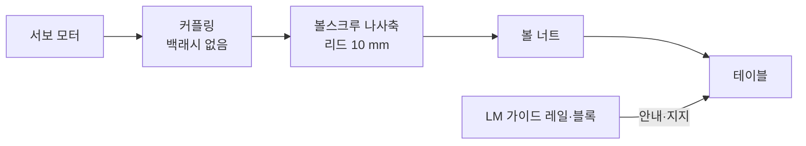

# 볼스크루와 LM 가이드

> [!summary] 핵심 요약
> - **볼스크루**: 나사축과 너트 사이에 강구가 순환하며 회전 → 직선 운동. 효율 90% 이상, 고정밀.
> - **LM 가이드(리니어 가이드)**: 레일 위를 블록이 볼·롤러로 굴러가며 직선 운동을 **안내**. 마찰 작고 강성 큼.
> - 이송 속도 $v = \text{리드} \times \text{회전수}$. 예: 리드 10 mm × 1500 rpm = 15 m/min.
> - 백래시를 없애려면 **예압**(더블 너트, 오버사이즈 볼)을 준다.

> [!warning] 자주 틀리는 포인트
> - 볼스크루는 **역구동된다**(자립 안 됨). 수직축은 모터 브레이크 필수.
> - **전조(롤링) 볼스크루**는 저렴·일반 정밀, **연삭 볼스크루**는 고정밀.
> - 긴 나사축은 **위험 속도**와 **좌굴**을 검토한다. 지지 방식(고정–고정 > 고정–지지 > 고정–자유)에 따라 허용값이 달라진다.
> - 예압을 너무 크게 하면 발열·수명 감소.
> - 모터–볼스크루 연결부는 **백래시 없는 서보용 커플링**(디스크·벨로즈형 등)으로 직결한다. 기어·체인·타이밍 벨트를 끼우면 그만큼 백래시·탄성 오차가 생긴다.

## 개념 정리

### 직선 운동 변환 요소 비교

| 요소 | 정밀도 | 속도 | 강성·하중 | 비고 |
| --- | --- | --- | --- | --- |
| 볼스크루 | 높음 | 중간 | 큼 | 공작기계, 정밀 이송 |
| 사다리꼴 나사 | 낮음 | 낮음 | 큼 | 자립 가능, 저렴 |
| 타이밍 벨트 | 중간 | 빠름 | 작음 | 긴 스트로크, 경량 |
| 랙과 피니언 | 중간 | 빠름 | 큼 | 매우 긴 스트로크 |
| 리니어 모터 | 매우 높음 | 매우 빠름 | 중간 | 기계적 변환 없음, 고가 |
| 공압 실린더 | 낮음 (끝점만) | 빠름 | 중간 | 2위치 이송 ([30_공유압](../30_공유압/README.md)) |

### 볼스크루

- 구성: 나사축, 너트, 강구, 순환 부품(리턴 튜브, 엔드 캡, 디플렉터).
- **리드** 선택: 리드가 크면 빠르지만 분해능·추력이 줄어든다.
- 모터 필요 토크(마찰 무시): $T = \dfrac{F \cdot L}{2\pi\eta}$ (F: 축 방향 힘, L: 리드).
  - 예: F = 1000 N, L = 10 mm, η = 0.9 → $T = \dfrac{1000 \times 0.01}{2\pi \times 0.9} \approx 1.77$ N·m
- **정밀도 등급**: C0(최고) ~ C10. 숫자가 작을수록 정밀.
- **지지 방식**: 모터 쪽 고정측(앵귤러 베어링 쌍), 반대쪽 지지측(깊은 홈 볼).

### LM 가이드

- 구성: 레일, 블록(캐리지), 볼·롤러, 엔드 실, 그리스 니플.
- 장점: 마찰 계수 매우 작음(미끄럼 안내의 1/20~1/40 수준), 스틱슬립 없음, 고속, 정밀 유지.
- 하중 방향: 상하·좌우·모멘트 하중을 모두 받는 4방향 등하중형이 많다.
- **조립 순서**: 기준면 청소 → 기준 레일을 기준면에 밀착·고정 → 종속 레일 평행 맞춤 → 블록 장착 → 테이블 조립 → 동작 확인.
- 정밀도·예압 등급과 레일 길이, 블록 수를 함께 선정.

### 유지보수

- 윤활: 그리스 주기적 보충 (사용 거리 기준).
- 이물질 차단: 벨로즈 커버, 와이퍼 실.
- 이상 징후: 소음·진동 증가, 백래시 증가, 동작 저항 증가 → 볼·궤도 손상 확인.

## 그림

## 기출 포인트

- 옛 시험에서는 2과목이 아니라 3과목 자동제어에 가끔 나왔다.
- 서보 모터 회전을 테이블 직선 운동으로 바꾸는 요소 = 볼스크루 — 1회 (2014-1, 3과목)
- 서보 모터와 볼스크루 축을 백래시 없이 직결하는 요소 = 커플링 — 1회 (2018-1, 3과목)
- LM 가이드·예압·구동 토크 계산은 2014~2020년에 출제되지 않았다. 새 출제기준의 운동용 기계요소로 실무 위주 내용을 유지한다.

## 관련 단원

- [나사와 볼트](나사와_볼트.md)
- [베어링](베어링.md)
- [축과 축이음](축과_축이음.md)
- [서보 모터와 서보 제어](../10_자동제어/서보모터와_서보제어.md)

## 체크리스트

- [ ] 볼스크루와 사다리꼴 나사의 효율·자립 차이를 안다
- [ ] 리드와 회전수로 이송 속도를 계산한다
- [ ] 볼스크루 구동 토크를 계산한다
- [ ] 예압의 목적과 부작용을 말한다
- [ ] LM 가이드 조립 순서를 안다
- [ ] 직선 운동 요소들을 정밀도·속도로 비교한다
- [ ] 서보 모터–볼스크루 직결에 커플링을 쓰는 이유를 말한다

## 참고

- [큐넷 자동화설비산업기사 출제기준](https://www.q-net.or.kr/crf005.do?id=crf00503&jmCd=2034)
