# 볼스크루와 LM 가이드

> [!summary] 핵심 요약
> - **볼스크루**: 나사축과 너트 사이에 강구가 순환하며 회전 → 직선 운동. 효율 90% 이상, 고정밀.
> - **LM 가이드(리니어 가이드)**: 레일 위를 블록이 볼·롤러로 굴러가며 직선 운동을 **안내**. 마찰 작고 강성 큼.
> - 이송 속도 $v = \text{리드} \times \text{회전수}$. 예: 리드 10 mm × 1500 rpm = 15 m/min.
> - 백래시를 없애려면 **예압**(더블 너트, 오버사이즈 볼)을 준다.

> [!warning] 자주 틀리는 포인트
> - 볼스크루는 **역구동된다**(자립 안 됨). 수직축은 모터 브레이크 필수.
> - **전조(롤링) 볼스크루**는 저렴·일반 정밀, **연삭 볼스크루**는 고정밀.
> - 긴 나사축은 **위험 속도**와 **좌굴**을 검토한다. 지지 방식(고정–고정 > 고정–지지 > 고정–자유)에 따라 허용값이 달라진다.
> - 예압을 너무 크게 하면 발열·수명 감소.
> - 모터–볼스크루 연결부는 **백래시 없는 서보용 커플링**(디스크·벨로즈형 등)으로 직결한다. 기어·체인·타이밍 벨트를 끼우면 그만큼 백래시·탄성 오차가 생긴다.

## 학습 목표

이 단원을 마치면 다음을 할 수 있어야 한다.

1. 볼스크루·사다리꼴 나사·타이밍 벨트·랙과 피니언·리니어 모터·공압 실린더를 정밀도·속도·강성으로 비교해 용도에 맞는 직선 운동 요소를 고른다.
2. 볼스크루가 사다리꼴 나사보다 효율이 높은 이유(구름 접촉)와, 그 때문에 역구동되어 수직축에 브레이크가 필요한 이유를 설명한다.
3. 리드와 회전수로 이송 속도를, 축 방향 힘·리드·효율로 모터 구동 토크를 계산한다.
4. 백래시의 뜻과 예압 방법(더블 너트, 오버사이즈 볼), 예압 과다의 부작용을 설명한다.
5. 고정–고정 · 고정–지지 · 고정–자유 지지 방식을 위험 속도·좌굴 허용값 순으로 늘어놓고, 고정측·지지측 베어링을 구분한다.
6. LM 가이드의 구조와 4방향 하중 지지 원리, 조립 순서(기준 레일 → 종속 레일)를 설명하고, 서보 모터 직결에 커플링을 쓰는 이유를 말한다.

## 한눈에 보기

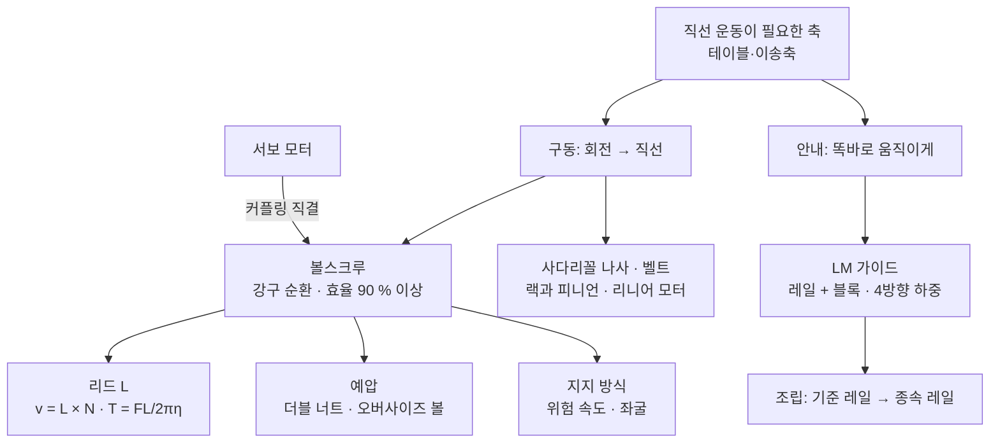

## 1. 직선 운동 변환 요소 — 회전을 직선으로

공장 자동화 장비의 대부분은 "물건을 정확한 위치까지 똑바로 옮기는" 일을 한다. 그런데 모터는 **돈다.** 그래서 회전을 직선으로 바꾸는 **구동 요소**(볼스크루, 벨트, 랙 등)와, 움직이는 테이블이 흔들리지 않고 **한 줄로 가게 잡아 주는 안내 요소**(LM 가이드)가 짝을 이룬다. 서랍으로 치면 서랍을 미는 손이 구동 요소, 서랍 레일이 안내 요소다.

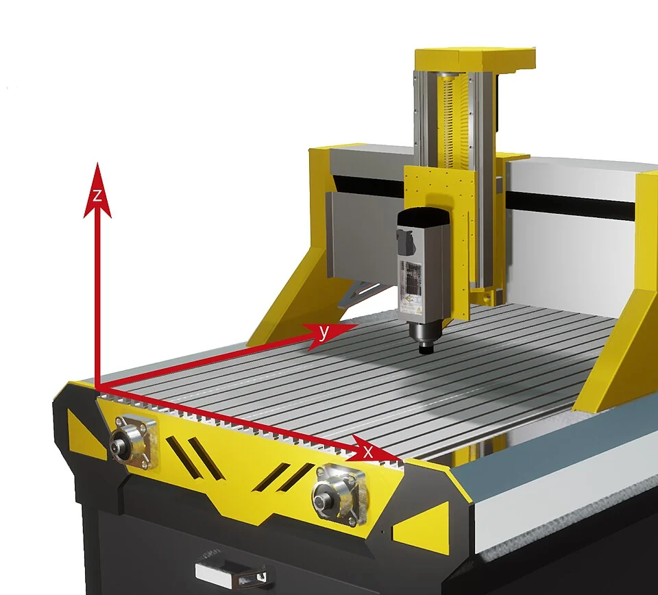

*소형 CNC 라우터(3D 렌더링). 빨간 화살표가 X·Y·Z 세 이송축 방향이다. 가운데 위쪽 노란 Z축 판을 보면 **세로 나사축**이 가운데 있고 그 양옆에 **안내 레일**이 나란히 서 있다 — 나사축이 밀고, 레일이 똑바로 잡아 주는 구성이 이 단원 전체의 모습이다. 앞판의 둥근 부품 둘은 축 끝을 받치는 플랜지형 베어링 유닛이다.*

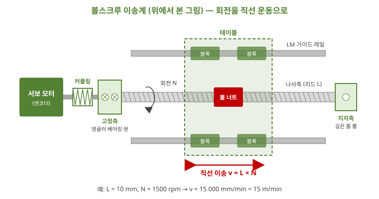

*위에서 내려다본 전형적인 1축 이송 장치. 서보 모터가 **커플링**을 거쳐 나사축을 돌리면, 테이블에 붙은 **볼 너트**(빨강)가 나사를 따라 앞뒤로 움직인다. 테이블 무게와 옆으로 미는 힘은 너트가 아니라 양쪽 **LM 가이드 레일 위의 블록 4개**가 받는다. 나사축은 모터 쪽이 **고정측**(앵귤러 베어링 쌍), 반대쪽이 **지지측**(깊은 홈 볼 베어링)이다.*

### 직선 운동 변환 요소 비교

| 요소 | 정밀도 | 속도 | 강성·하중 | 비고 |
| --- | --- | --- | --- | --- |
| 볼스크루 | 높음 | 중간 | 큼 | 공작기계, 정밀 이송 |
| 사다리꼴 나사 | 낮음 | 낮음 | 큼 | 자립 가능, 저렴 |
| 타이밍 벨트 | 중간 | 빠름 | 작음 | 긴 스트로크, 경량 |
| 랙과 피니언 | 중간 | 빠름 | 큼 | 매우 긴 스트로크 |
| 리니어 모터 | 매우 높음 | 매우 빠름 | 중간 | 기계적 변환 없음, 고가 |
| 공압 실린더 | 낮음 (끝점만) | 빠름 | 중간 | 2위치 이송 ([30_공유압](../30_공유압/README.md)) |

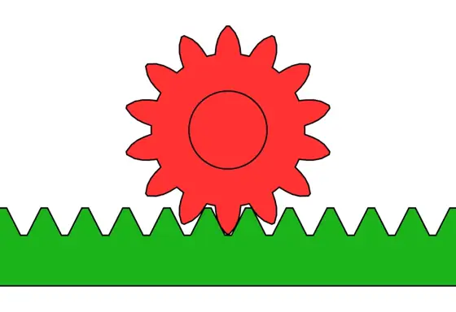

*랙과 피니언: 피니언이 한 바퀴 돌면 랙이 (피니언 피치원 둘레)만큼 움직인다. 랙을 이어 붙이면 스트로크를 얼마든지 늘릴 수 있어 갠트리처럼 긴 축에 쓴다. 볼스크루는 나사축이 길어질수록 휘둘림(5절) 때문에 속도를 낮춰야 하므로, 아주 긴 축은 랙이나 벨트로 간다.*

> [!tip] 감 잡기 — 고르는 기준
> "정밀·강성 → 볼스크루", "길고 빠르고 가벼운 짐 → 타이밍 벨트", "아주 길고 무거움 → 랙과 피니언", "끝점 두 곳만 → 공압 실린더", "최고 속도·정밀, 비용 무관 → 리니어 모터". 리니어 모터만 회전 → 직선 **변환이 없다**(모터 자체가 펴진 형태).

## 2. 볼스크루 — 볼이 구르는 나사

### 개념 정리

일반 나사(사다리꼴 나사)는 수나사 산과 암나사 산이 **면끼리 비비며** 돌아간다. 볼스크루는 그 사이에 **강구(볼)** 를 넣어 비비는 대신 **굴린다.** 바퀴 달린 의자가 끌어서 옮기는 의자보다 훨씬 가볍게 밀리는 것과 같다.

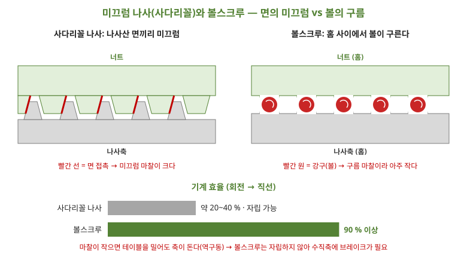

*왼쪽: 사다리꼴 나사는 너트 산(연두)과 나사축 산(회색)이 빨간 선의 **면**으로 닿아 미끄러지므로 마찰이 크다. 반대쪽 면에는 틈(백래시)이 보인다. 오른쪽: 볼스크루는 너트와 나사축에 둥근 **홈**을 파고 그 사이에 볼(빨강)을 넣어 **구른다.** 아래 막대처럼 효율이 크게 달라진다. 마찰이 작다는 것은 거꾸로 테이블을 밀어도 나사축이 돌아간다는 뜻 — 그래서 볼스크루는 **자립하지 않는다.***

- 구성: 나사축, 너트, 강구, 순환 부품(리턴 튜브, 엔드 캡, 디플렉터).
- **볼 순환**: 볼은 너트 안에서 나사 홈을 따라 몇 바퀴 굴러간 뒤, 순환 부품을 통해 출발점으로 되돌아간다. 되돌리지 않으면 볼이 너트 밖으로 빠져 버린다.
  - **리턴 튜브식**: 너트 바깥에 U자 관을 얹어 볼을 되돌린다(아래 사진).
  - **엔드 캡식**: 너트 양 끝 덮개 속 통로로 되돌린다. 리드가 큰 고속형에 많다.
  - **디플렉터식**: 볼이 한 바퀴마다 옆 산을 넘어 바로 이웃 홈으로 돌아간다. 너트 바깥지름이 작다.

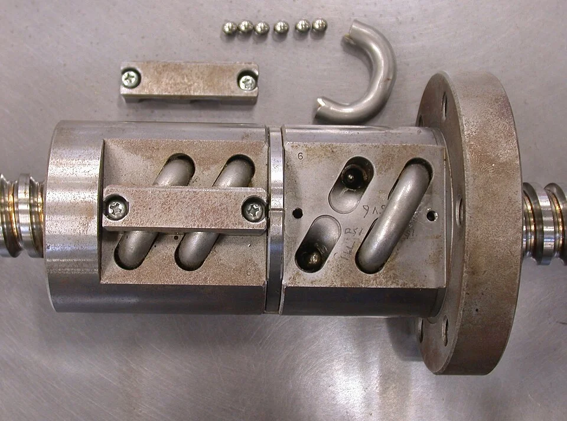

*리턴 튜브식 볼 너트를 일부 분해한 모습. 너트 겉면의 비스듬한 U자 관이 **리턴 튜브**이고, 위쪽에 떼어 낸 관 하나와 강구 6개가 놓여 있다. 오른쪽 너트의 타원 구멍 속에 볼이 보이는데, 여기가 볼이 홈에서 튜브로 들어가는 입구다. 너트가 가운데 틈으로 **두 토막**으로 나뉘어 있는 것은 4절의 더블 너트 예압 구조다. 오른쪽 끝 원판은 테이블에 볼트로 고정하는 **플랜지**다.*

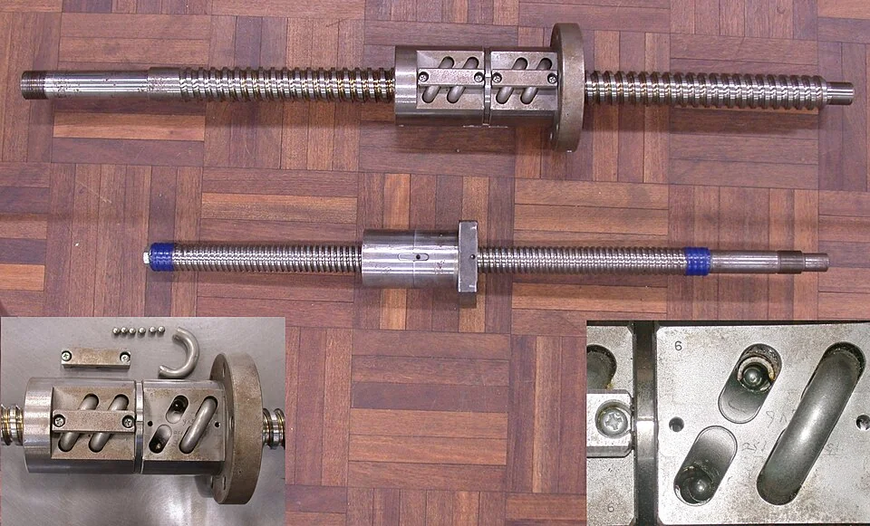

*위: 더블 너트(리턴 튜브식)가 달린 긴 볼스크루. 나사축 양 끝은 베어링을 끼우도록 지름을 줄여 깎은 **축 끝 가공부**다. 아래: 싱글 너트에 사각 플랜지가 붙은 볼스크루. 아래 두 작은 사진은 위 더블 너트를 가까이 찍은 것으로, 리턴 튜브와 볼 입구가 보인다.*

### 볼스크루

- **리드** 선택: 리드가 크면 빠르지만 분해능·추력이 줄어든다.
- 모터 필요 토크(마찰 무시): $T = \dfrac{F \cdot L}{2\pi\eta}$ (F: 축 방향 힘, L: 리드).
  - 예: F = 1000 N, L = 10 mm, η = 0.9 → $T = \dfrac{1000 \times 0.01}{2\pi \times 0.9} \approx 1.77$ N·m
- **정밀도 등급**: C0(최고) ~ C10. 숫자가 작을수록 정밀.
- **지지 방식**: 모터 쪽 고정측(앵귤러 베어링 쌍), 반대쪽 지지측(깊은 홈 볼).

### 전조 볼스크루와 연삭 볼스크루

| 구분 | 만드는 법 | 정밀도 등급(대략) | 쓰임 |
| --- | --- | --- | --- |
| **전조(롤링)** | 둥근 봉을 다이스로 눌러 홈을 성형 | C7 · C8 · C10 | 일반 자동화 장비, 반송 장치 — 저렴 |
| **연삭(정밀)** | 홈을 숫돌로 갈아 마무리 | C0 ~ C5 | 공작기계, 측정·반도체 장비 — 고가 |

*C 뒤 숫자는 정해진 길이(300 mm 등)마다 허용되는 **리드 오차**의 등급이다. 숫자가 작을수록 오차가 작다.*

> [!question] 시험에서는
> "볼스크루는 자립성이 좋아 수직축에 브레이크가 필요 없다"는 틀린 보기다. 자립성은 마찰이 큰 **사다리꼴 나사**의 장점이고, 볼스크루는 역구동되므로 **브레이크 붙은 모터**(무여자 작동형 브레이크, [벨트·체인·스프링·브레이크](벨트_체인_스프링_브레이크.md))를 쓴다. "전조 = 고정밀"도 뒤집힌 보기다.

## 3. 리드 · 이송 속도 · 구동 토크

나사축이 **한 바퀴** 돌 때 너트(테이블)가 나아가는 거리가 **리드**다. 1분에 N바퀴 돌면 1분에 L × N만큼 간다 — 이것이 이송 속도의 전부다. 1줄 나사는 리드 = 피치, 2줄 나사는 리드 = 2 × 피치다([나사와 볼트](나사와_볼트.md)).

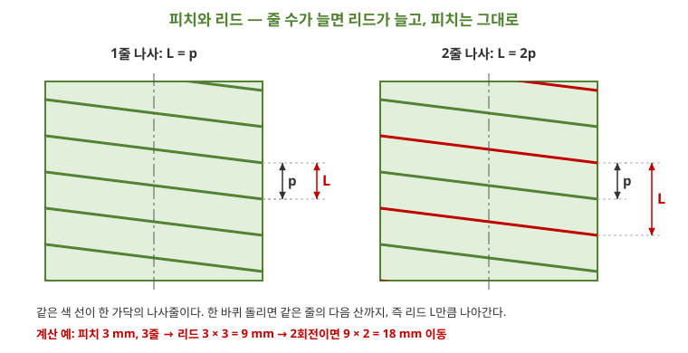

*나사와 볼트 단원의 그림을 다시 쓴다. 피치는 이웃한 산 사이 거리, 리드는 한 바퀴에 나아가는 거리다. 볼스크루도 리드를 키우려고 2줄·여러 줄로 만든다(고리드형).*

$$v = L \times N \qquad (L: \text{리드[mm]},\ N: \text{회전수[rpm]} \Rightarrow v\ [\text{mm/min}])$$

$$T = \frac{F \cdot L}{2\pi\eta} \qquad (F: \text{축 방향 힘[N]},\ L: \text{리드[m]},\ \eta: \text{효율})$$

*토크 식은 일의 보존이다. 모터가 한 바퀴 하는 일 $2\pi T$에 효율 η를 곱한 것이 테이블이 한 리드 나아가며 하는 일 $F L$과 같다.*

> [!example] 계산 예 — 이송 속도·토크·분해능
> - 이송 속도: 리드 10 mm × 1500 rpm = 15 000 mm/min = **15 m/min** (= 250 mm/s).
> - 구동 토크: F = 1000 N, L = 10 mm = 0.01 m, η = 0.9 → $T = \dfrac{1000 \times 0.01}{2\pi \times 0.9} \approx$ **1.77 N·m**.
> - 같은 조건에서 리드를 5 mm로 줄이면 토크는 절반(≈ 0.88 N·m)으로 줄지만, 같은 속도를 내려면 회전수는 3000 rpm으로 두 배가 필요하다.
> - 분해능: 모터 한 바퀴 10 000 펄스, 리드 10 mm → 1펄스당 10 mm / 10 000 = **1 μm**.

> [!tip] 감 잡기 — 리드는 자전거 기어
> 리드가 큰 볼스크루는 자전거의 **무거운 기어**와 같다. 한 바퀴에 멀리 가지만(빠름) 페달이 무겁고(토크 큼, 추력 작음) 섬세한 조절이 어렵다(분해능 낮음). 리드가 작으면 그 반대다.

## 4. 백래시와 예압

볼과 홈 사이에 조금이라도 틈이 있으면, 모터가 방향을 바꿀 때 그 틈만큼은 모터만 돌고 테이블은 가만히 있다. 이 헛도는 양이 **백래시**다. 1 μm 단위로 위치를 맞추는 장비에서는 치명적이므로, 볼이 홈에 **미리 꽉 눌려 있게** 만든다. 이것이 **예압(preload)** 이다.

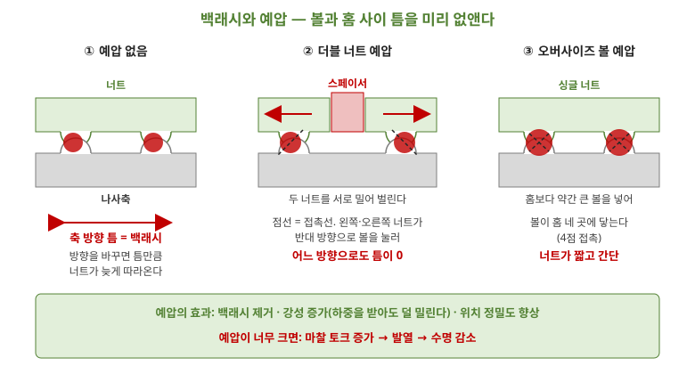

*① 볼보다 홈이 넉넉해 볼이 한쪽으로 쏠려 있다 — 방향이 바뀌면 반대쪽에 닿을 때까지 너트가 늦게 따라온다. ② 두 너트 사이에 두꺼운 **스페이서**(빨강)를 끼워 서로 밀어 벌리면, 왼쪽 너트의 볼과 오른쪽 너트의 볼이 접촉선(점선)이 서로 반대로 기운 채 눌린다. 어느 방향으로 힘이 와도 한쪽 너트가 이미 닿아 있으므로 틈이 0이다. 2절의 분해 사진 속 두 토막 너트가 이 구조다. ③ 홈보다 조금 큰 볼을 넣으면 볼이 홈 위아래 네 곳에 닿아(4점 접촉) 싱글 너트로도 틈이 없어진다.*

- 백래시를 없애려면 **예압**(더블 너트, 오버사이즈 볼)을 준다.
- 예압의 이점: 백래시 제거, **강성 증가**(하중을 받아도 덜 밀림), 위치 결정 정밀도 향상.
- 예압을 너무 크게 하면 발열·수명 감소. 마찰 토크가 커져 모터 부하도 늘어난다.
- 그래서 예압은 "필요한 만큼만" — 볼스크루·LM 가이드 모두 예압 등급을 골라 주문한다.

> [!question] 시험에서는
> "예압을 크게 할수록 수명이 늘어난다"는 틀린 보기다. 예압은 **강성·정밀도**를 얻는 대신 **마찰·발열·수명**을 내준다.

## 5. 지지 방식 · 위험 속도 · 좌굴

길고 가는 나사축은 줄넘기 줄처럼 돌리면 **휘둘린다.** 회전 속도가 축의 고유 진동수와 맞으면 크게 흔들리는데 이 속도가 **위험 속도**다. 또 너트가 축을 **누르는** 방향으로 힘을 받으면 긴 막대가 옆으로 휘어 꺾이는 **좌굴**이 생긴다. 두 값 모두 축 양 끝을 얼마나 단단히 잡았느냐(지지 방식)에 달려 있다.

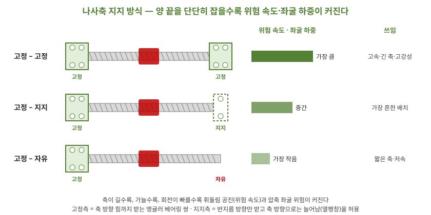

*실선 상자 = **고정**(앵귤러 베어링 쌍으로 축 방향·반지름 방향 모두 구속), 점선 상자 = **지지**(반지름 방향만 받치고 축 방향으로는 미끄러질 수 있게), 빈 끝 = **자유**. 양 끝을 모두 고정하면 가장 빠르게 돌리고 가장 큰 압축 하중을 걸 수 있다. 막대 길이는 크기 순서만 나타낸 것이다.*

$$n_c \propto \frac{d}{\ell^{2}}, \qquad P_k \propto \frac{d^{4}}{\ell^{2}} \qquad (d: \text{나사축 골지름},\ \ell: \text{지지 간 거리})$$

*위험 속도와 좌굴 하중 모두 **길이의 제곱에 반비례**한다. 축을 두 배로 늘리면 허용 회전수가 1/4로 떨어진다 — 긴 축에서 볼스크루가 느려지는 이유다.*

- 긴 나사축은 **위험 속도**와 **좌굴**을 검토한다. 지지 방식(고정–고정 > 고정–지지 > 고정–자유)에 따라 허용값이 달라진다.
- **고정측**: 모터 쪽. 앵귤러 베어링을 쌍(DB·DF 조합)으로 써서 양방향 축 방향 하중을 받는다([베어링](베어링.md)).
- **지지측**: 반대쪽. 깊은 홈 볼 베어링으로 반지름 방향만 받치고, 나사축이 열로 늘어나는 것을 축 방향으로 흡수한다.

## 6. 서보 모터와의 연결 — 커플링

볼스크루로 μm 단위 정밀도를 내도, 모터와 나사축 사이에 **헐거움**이 있으면 다 소용없다. 서보 모터는 엔코더로 **모터 축**의 각도를 재기 때문에, 그 뒤에서 생긴 백래시는 제어기가 알아채지 못한다([서보 모터와 서보 제어](../10_자동제어/서보모터와_서보제어.md)).

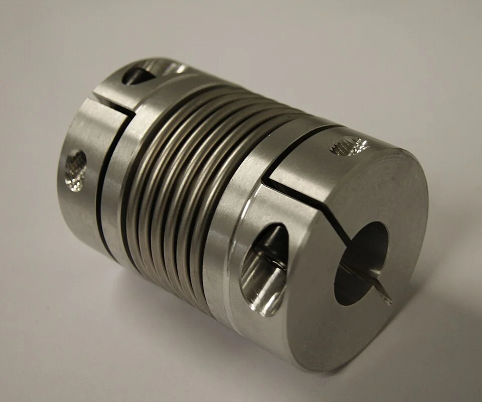

*금속 **벨로즈 커플링**. 가운데 주름관(벨로즈)이 비틀림 방향으로는 단단해 회전을 그대로 전하면서, 굽힘 방향으로는 조금 휘어 두 축의 작은 어긋남(편심·각도)을 흡수한다. 양 끝 허브는 **슬릿**이 파여 있어 옆 구멍의 볼트를 조이면 축을 꽉 물어(클램프식) 키 홈 없이도 헐거움이 없다.*

- 모터–볼스크루 연결부는 **백래시 없는 서보용 커플링**(디스크·벨로즈형 등)으로 직결한다. 기어·체인·타이밍 벨트를 끼우면 그만큼 백래시·탄성 오차가 생긴다.
- **디스크(판 스프링)형**: 얇은 금속 판을 겹쳐 비틀림 강성이 높다. **벨로즈형**: 위 사진. 둘 다 축 어긋남을 조금 흡수하면서 회전 방향으로는 거의 틈이 없다.
- 커플링 종류 전반(플랜지·올덤·유니버설 조인트)은 [축과 축이음](축과_축이음.md)에서 다룬다.

> [!question] 시험에서는
> "서보 모터와 볼스크루 축을 **백래시 없이 직결**하는 요소는?" → **커플링**(2018-1, 3과목). "서보 모터 회전을 테이블 **직선 운동**으로 바꾸는 요소는?" → **볼스크루**(2014-1, 3과목). 두 문제의 답을 바꿔 놓은 보기에 주의.

## 7. LM 가이드 — 굴러가는 레일

LM(Linear Motion) 가이드는 **레일** 위에 **블록**(캐리지)이 올라탄 구조다. 블록 안에는 볼이 여러 줄 들어 있어 레일 홈을 따라 구르고, 블록 끝에서 되돌아 순환한다 — 볼스크루의 볼 순환을 직선으로 편 것과 같다. 미끄럼 안내(면과 면이 비비는 미닫이)보다 훨씬 가볍게, 같은 힘으로 똑같이 움직인다.

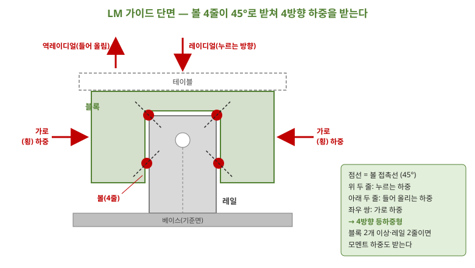

*레일(회색)을 블록(연두)이 말안장처럼 감싼다. 빨간 볼 4줄의 점선이 **접촉선**이다. 위 두 줄은 접촉선이 안쪽 아래로 기울어 테이블을 **누르는 하중**(레이디얼)을, 아래 두 줄은 반대로 기울어 **들어 올리는 하중**(역레이디얼)을 받는다. 접촉선이 45°라 좌우 볼 쌍이 **가로 하중**도 똑같이 나눠 받는다 — 이것이 **4방향 등하중형**이다. 레일 가운데 구멍은 레일을 베이스에 고정하는 볼트 자리다.*

### LM 가이드

- 구성: 레일, 블록(캐리지), 볼·롤러, 엔드 실, 그리스 니플.
- 장점: 마찰 계수 매우 작음(미끄럼 안내의 1/20~1/40 수준), 스틱슬립 없음, 고속, 정밀 유지.
- 하중 방향: 상하·좌우·모멘트 하중을 모두 받는 4방향 등하중형이 많다.
- 정밀도·예압 등급과 레일 길이, 블록 수를 함께 선정.
- **볼형 vs 롤러형**: 볼은 점 접촉이라 가볍고 빠르며, 원통 롤러는 선 접촉이라 강성·하중이 커서 무거운 공작기계에 쓴다.
- **스틱슬립**: 미끄럼 안내에서 정지 마찰이 운동 마찰보다 커서 "멈칫–툭" 하며 움직이는 현상. 구름 안내는 두 마찰 차이가 작아 미세 이송도 매끄럽다.

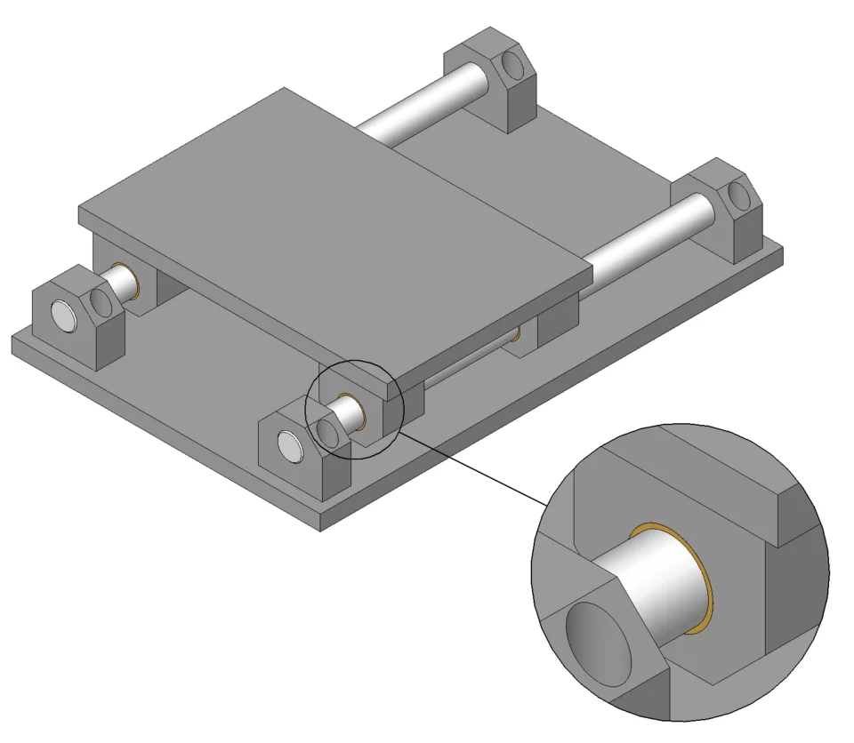

*LM 가이드보다 단순한 **둥근 축 안내**. 연마한 둥근 축(샤프트) 2개를 양 끝 받침대로 베이스에 고정하고, 테이블 아래 블록이 부시(확대 원 안의 축을 감싼 고리)를 끼고 축을 따라 움직인다. 싸고 조립이 쉽지만 축이 양 끝에서만 받쳐져 가운데가 처지므로, 강성·정밀도가 필요한 축은 베이스 전 길이에 볼트로 붙이는 각형 레일(LM 가이드)을 쓴다.*

> [!tip] 감 잡기 — 왜 레일이 2줄인가
> 블록 하나는 회전(모멘트)에 약하다. 레일 2줄에 블록을 2개씩, 모두 4개를 쓰면 테이블이 앞뒤·좌우로 기우는 힘을 블록 사이 거리로 버틴다. 1절의 이송계 그림이 바로 이 배치다.

## 8. LM 가이드 조립 — 기준 레일부터

LM 가이드의 정밀도는 레일 자체보다 **레일이 얼마나 곧고 평행하게 붙어 있느냐**로 결정된다. 그래서 먼저 기준면(가공된 턱)에 한 줄을 정확히 붙이고, 나머지 한 줄은 그 줄에 맞춰 따라 붙인다.

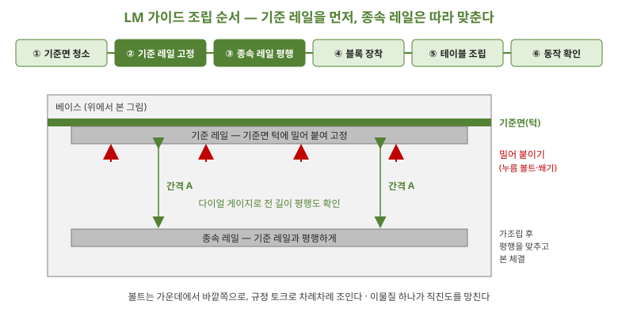

*위: 조립 순서 6단계, 진한 칸(②·③)이 정밀도를 좌우하는 단계다. 아래: 베이스를 위에서 본 그림. **기준 레일**은 베이스의 기준면 턱(진한 녹색 띠)에 빨간 화살표처럼 밀어 붙인 채 고정한다. **종속 레일**은 전 길이에서 간격 A가 같도록 다이얼 게이지로 평행도를 확인하며 맞춘다.*

- **조립 순서**: 기준면 청소 → 기준 레일을 기준면에 밀착·고정 → 종속 레일 평행 맞춤 → 블록 장착 → 테이블 조립 → 동작 확인.
- 볼트는 가조립 후 평행을 맞추고 **규정 토크**로 본 체결한다.
- 동작 확인: 테이블을 손으로 전 행정 밀어 걸림·저항 변화가 없는지 본다.

> [!question] 시험에서는
> 조립 순서를 섞어 놓고 "가장 먼저 할 일"을 물으면 **기준면 청소**, "레일 중 먼저 고정하는 것"은 **기준 레일**이다. 블록·테이블을 먼저 올리고 레일을 맞추는 순서는 틀린 보기다.

## 9. 유지보수

### 유지보수

- 윤활: 그리스 주기적 보충 (사용 거리 기준).
- 이물질 차단: 벨로즈 커버, 와이퍼 실.
- 이상 징후: 소음·진동 증가, 백래시 증가, 동작 저항 증가 → 볼·궤도 손상 확인.

| 증상 | 의심 원인 | 조치 |
| --- | --- | --- |
| 소음·진동 증가 | 윤활 부족, 이물질, 볼·궤도 손상 | 그리스 보충, 실·커버 점검, 손상 시 교체 |
| 백래시 증가 | 마모로 예압 감소, 커플링·고정측 베어링 너트 풀림 | 예압·체결 상태 점검, 커플링 클램프 재조임 |
| 동작 저항 증가 | 레일 평행 불량, 예압 과다, 그리스 열화 | 평행도 재측정, 그리스 교환 |

> [!tip] 감 잡기 — 그리스는 거리로
> 자동차 엔진오일을 "주행 거리"로 바꾸듯, 볼스크루·LM 가이드 그리스는 **이동 거리**(예: 100 km마다)로 보충한다. 짧게 자주 움직이는 축은 시간으로는 오래 안 됐어도 거리가 금방 쌓인다.

## 그림

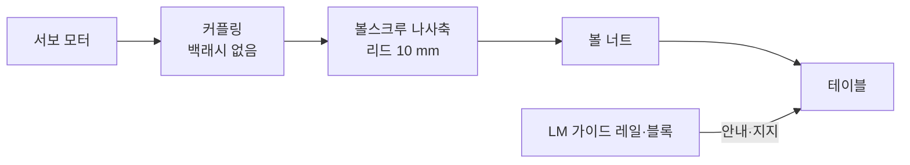

## 기출 포인트

- 옛 시험에서는 2과목이 아니라 3과목 자동제어에 가끔 나왔다.
- 서보 모터 회전을 테이블 직선 운동으로 바꾸는 요소 = 볼스크루 — 1회 (2014-1, 3과목)
- 서보 모터와 볼스크루 축을 백래시 없이 직결하는 요소 = 커플링 — 1회 (2018-1, 3과목)
- LM 가이드·예압·구동 토크 계산은 2014~2020년에 출제되지 않았다. 새 출제기준의 운동용 기계요소로 실무 위주 내용을 유지한다.

## 관련 단원

- [나사와 볼트](나사와_볼트.md)
- [베어링](베어링.md)
- [축과 축이음](축과_축이음.md)
- [서보 모터와 서보 제어](../10_자동제어/서보모터와_서보제어.md)
- [벨트·체인·스프링·브레이크](벨트_체인_스프링_브레이크.md)
- [기어](기어.md)

## 체크리스트

- [ ] 볼스크루와 사다리꼴 나사의 효율·자립 차이를 안다
- [ ] 리드와 회전수로 이송 속도를 계산한다
- [ ] 볼스크루 구동 토크를 계산한다
- [ ] 예압의 목적과 부작용을 말한다
- [ ] LM 가이드 조립 순서를 안다
- [ ] 직선 운동 요소들을 정밀도·속도로 비교한다
- [ ] 서보 모터–볼스크루 직결에 커플링을 쓰는 이유를 말한다
- [ ] 지지 방식 3가지를 위험 속도·좌굴 허용값 순으로 늘어놓는다
- [ ] 전조·연삭 볼스크루와 정밀도 등급(C0~C10)을 구분한다

## 참고

- [큐넷 자동화설비산업기사 출제기준](https://www.q-net.or.kr/crf005.do?id=crf00503&jmCd=2034)

### 그림 출처

위키미디어 공용(Wikimedia Commons)과 Openverse에서 가져온 공개 라이선스 자료이고, 노트에 맞게 크기를 줄이고 WebP로 변환했다.

| 그림 | 작성자 | 라이선스 | 출처 |
| --- | --- | --- | --- |
| [Assix,y,z](https://commons.wikimedia.org/wiki/File:Assix,y,z.jpg) | LabMecsrl | [CC BY-SA 4.0](https://creativecommons.org/licenses/by-sa/4.0) | Wikimedia Commons |
| [Animated rack and pinion](https://commons.wikimedia.org/wiki/File:Animated_rack_and_pinion.gif) | Jahobr | CC0 | Wikimedia Commons |
| [BallScrewNut-showing-balls-recirculating-tubes](https://commons.wikimedia.org/wiki/File:BallScrewNut-showing-balls-recirculating-tubes.jpg) | No machine-readable author provided. Graibeard assumed (based on copyright claims). | [CC BY-SA 3.0](http://creativecommons.org/licenses/by-sa/3.0/) | Wikimedia Commons |
| [BallScrews-with-detail-insets](https://commons.wikimedia.org/wiki/File:BallScrews-with-detail-insets.jpg) | No machine-readable author provided. Graibeard assumed (based on copyright claims). | [CC BY-SA 3.0](http://creativecommons.org/licenses/by-sa/3.0/) | Wikimedia Commons |
| [Ausgleichskupplung](https://commons.wikimedia.org/wiki/File:Ausgleichskupplung.JPG) | Archiumtechnica | [CC BY-SA 3.0](https://creativecommons.org/licenses/by-sa/3.0) | Wikimedia Commons |
| [Linear-table with detail](https://commons.wikimedia.org/wiki/File:Linear-table_with_detail.png) | Silberwolf | [CC BY-SA 2.5](https://creativecommons.org/licenses/by-sa/2.5) | Wikimedia Commons |

직접 그린 그림(SVG, 이 볼트용으로 새로 작성): 볼스크루 이송계, 볼스크루 미끄럼나사 비교, 나사 리드 피치([나사와 볼트](나사와_볼트.md)에서 재사용), 볼스크루 예압, 볼스크루 지지방식, LM가이드 단면, LM가이드 조립.

