# 축과 축이음

> [!summary] 핵심 요약
> - 축 종류: **차축**(굽힘만), **전동축**(비틀림 + 굽힘), **스핀들**(주로 비틀림, 정밀).
> - 비틀림만 받는 축 지름: $d = \sqrt[3]{\dfrac{16T}{\pi\tau_a}}$. 굽힘만: $d = \sqrt[3]{\dfrac{32M}{\pi\sigma_a}}$.
> - 굽힘 + 비틀림: **상당 비틀림 모멘트** $T_e = \sqrt{M^2 + T^2}$, **상당 굽힘 모멘트** $M_e = \dfrac{1}{2}(M + T_e)$.
> - **커플링**: 운전 중 분리 안 됨. **클러치**: 운전 중 끊고 이을 수 있음.

> [!warning] 자주 틀리는 포인트
> - **위험 속도**: 축의 고유 진동수와 회전수가 같아지면 공진 → 상용 회전수를 위험 속도에서 **±20% 이상** 떨어뜨린다는 설명이 일반적.
> - **올덤 커플링**: 두 축이 **평행하고 조금 어긋난(편심)** 경우. 고속에는 부적합.
> - **유니버설 조인트(훅 조인트)**: 두 축이 **교차**하는 경우. 교차각은 보통 30° 이하, 1개만 쓰면 속도 변동 → 2개로 상쇄.
> - 연성 재료는 $T_e$ (최대 전단 응력설), 취성 재료는 $M_e$ (최대 주응력설)로 설계.
> - **바흐(Bach)의 축 공식**: 연강 축의 비틀림 각은 길이 **1 m당 1/4° 이내**로 제한.
> - 풀리·기어가 달린 회전축에는 **굽힘 모멘트와 비틀림 모멘트가 동시에** 생긴다 (전동축).
> - 토크 식의 상수는 **단위에 따라 다르다**: N·mm·kW면 $9.55 \times 10^6$, kgf·m·PS면 716.2, kgf·m·kW면 974. 단위를 먼저 확인한다.
> - 굽힘 모멘트는 단위가 있다 (N·m). "무차원"이라는 보기는 틀린 것.
> - 축은 도면에서 **길이 방향으로 단면하지 않는다**. 긴 축은 중간을 잘라 짧게 그려도 **치수는 실제 길이**로 적는다.

## 학습 목표

이 단원을 마치면 다음을 할 수 있어야 한다.

1. 차축·전동축·스핀들을 **받는 하중**(굽힘만 / 굽힘 + 비틀림 / 주로 비틀림)으로 구분하고 예를 든다.
2. 동력과 회전수로 토크를 구하되 단위 조합에 맞는 상수(9.55×10⁶, 9549, 716.2, 974, 71620)를 고르고, 비틀림만 받는 축의 지름을 계산한다.
3. 굽힘과 비틀림을 함께 받는 축에서 상당 비틀림 모멘트 $T_e$와 상당 굽힘 모멘트 $M_e$를 계산하고, 연성·취성 재료에 어느 것을 쓰는지 말한다.
4. 중공축이 같은 무게에서 실체축보다 강한 이유를 응력 분포로 설명하고 중공축 지름 식을 쓴다.
5. 강도 기준과 강성 기준(바흐의 축 공식, 1 m당 1/4°)을 구분하고, 위험 속도의 뜻과 피하는 방법을 설명한다.
6. 두 축의 배치(일직선·조금 어긋남·평행 편심·교차)에 맞는 커플링을 고르고, 커플링과 클러치의 차이와 축 도시 규칙을 말한다.

## 한눈에 보기

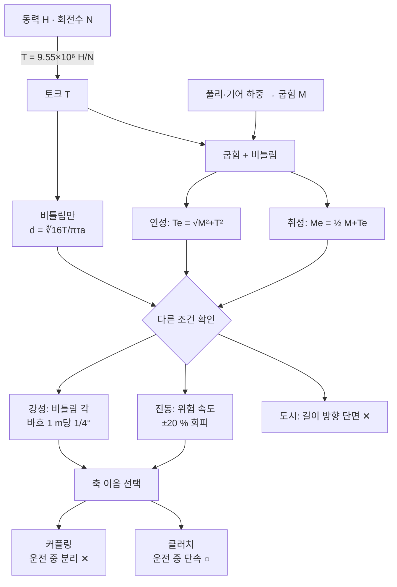

## 1. 축의 종류 — 무엇을 받느냐가 먼저다

축은 "돌아가는 막대"이지만, 모든 축이 같은 일을 하지는 않는다. 기차 바퀴축은 차체 무게를 **떠받치기만** 하고, 공장의 동력축은 모터 힘을 **전하면서** 풀리에 걸린 벨트에 **휘기도** 하며, 공작기계 주축은 공구를 **정밀하게 돌리는** 데 집중한다. 어떤 하중을 받는지가 정해져야 어느 공식으로 지름을 구할지가 정해진다.

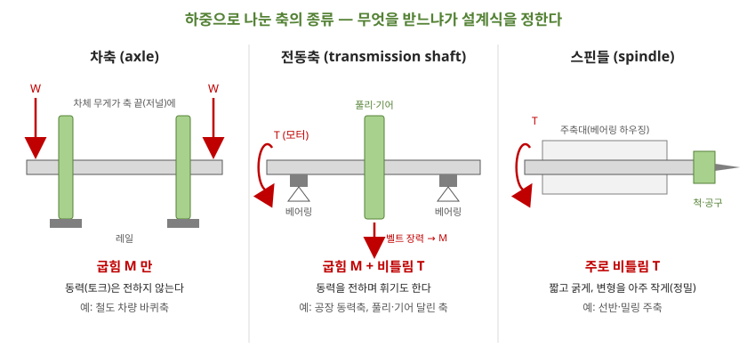

*왼쪽 **차축**: 차체 무게 W가 바퀴 바깥 축 끝(저널)에 걸리고 바퀴는 레일이 받친다 — 축은 휘기만 하고 동력은 전하지 않는다. 가운데 **전동축**: 왼쪽 끝에서 모터 토크 T가 들어오고, 가운데 풀리의 벨트 장력이 축을 아래로 당겨 굽힘 M이 같이 생긴다. 오른쪽 **스핀들**: 주축대(베어링 하우징)에 짧게 물려 공구를 돌리므로 주로 비틀림을 받고, 변형을 아주 작게 해야 한다.*

| 철도 차량의 바퀴축(차축) | 크랭크 축 |
| --- | --- |
| 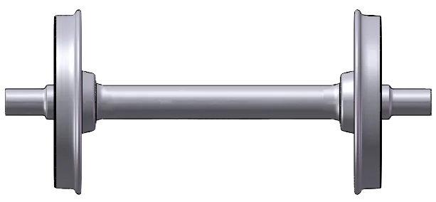 | 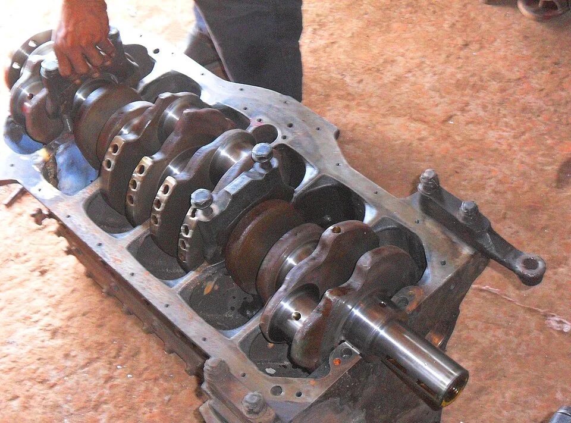 |
| *바퀴 2개를 축 하나에 압입한 **윤축(wheelset)**. 바퀴 바깥으로 가늘게 튀어나온 양 끝이 차체 무게를 받는 **저널**(축 상자 베어링 자리)이다. 축 자체가 바퀴와 함께 돌지만 동력을 전하지 않는 객차 바퀴축은 굽힘만 받는 대표적 차축이다.* | *뒤집어 놓은 엔진 블록의 메인 베어링 자리에 얹힌 크랭크 축. 축 중심선에서 벗어난 **크랭크 핀**과 균형추가 번갈아 있고, 오른쪽 끝이 동력을 꺼내는 축 끝이다. 크랭크 핀에 커넥팅 로드가 물려 피스톤의 왕복 운동을 회전으로 바꾼다 — 모양으로 분류한 '크랭크 축'.* |

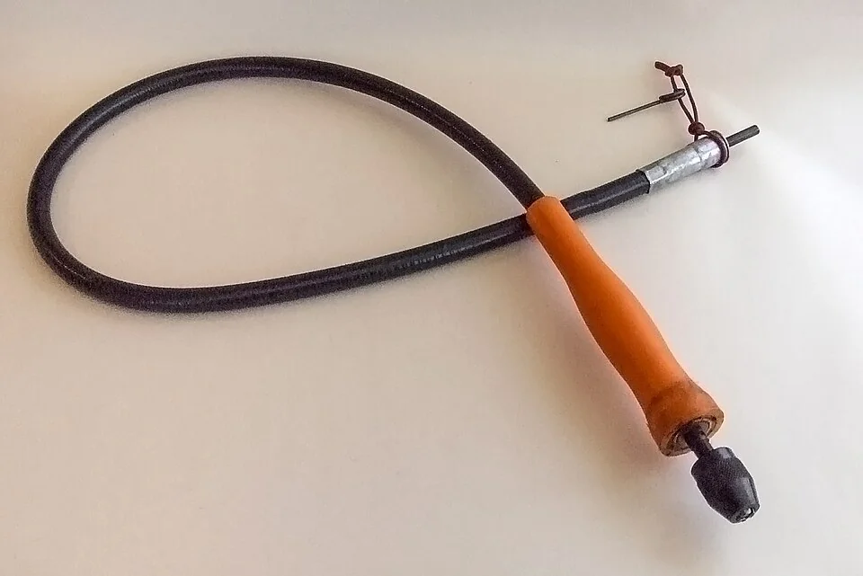

*전동 드릴용 플렉시블 축. 오른쪽 위 금속 끝에 튀어나온 심선을 드릴 척에 물리면, 강선을 여러 겹 감은 심선이 검은 피복 안에서 돌아 주황 손잡이 끝의 작은 척까지 **휘어진 경로**로 회전을 전한다. 큰 토크는 못 전하지만 손이 닿기 어려운 곳까지 공구를 끌고 갈 수 있다.*

### 축의 분류

| 분류 | 종류 |
| --- | --- |
| 하중 | 차축(철도 차량 바퀴축), 전동축(공장 동력축), 스핀들(공작기계 주축) |
| 모양 | 직선 축, 크랭크 축(왕복 ↔ 회전), 플렉시블 축(휘어진 경로 전달) |
| 단면 | 실체 축, 중공 축(같은 무게로 강도·강성 큼) |

> [!question] 시험에서는
> "풀리·기어가 달린 회전축에 생기는 모멘트는?" → **굽힘 모멘트와 비틀림 모멘트 둘 다**(전동축). 차축과 혼동시키는 보기가 나온다.

## 2. 축을 설계할 때 보는 네 가지

부러지지 않는 것(강도)만으로는 부족하다. 안 부러져도 너무 휘거나 비틀리면 기어 물림이 어긋나고(강성), 특정 회전수에서 크게 흔들리면 결국 망가진다(진동). 그래서 아래 네 가지를 차례로 확인하고, **가장 굵게 나오는 지름**을 고른다.

### 축 설계 고려 사항

1. **강도**: 굽힘·비틀림·조합 응력.
2. **강성**: 처짐과 비틀림 각이 허용값 이내. 비틀림 각 $\theta = \dfrac{Tl}{GI_p}$.
3. **진동**: 위험 속도 회피.
4. **열팽창**, 부식, 키 홈에 의한 응력 집중.

*강도는 3·4절, 강성은 5절, 진동은 6절에서 그림과 함께 다룬다. 키 홈의 응력 집중은 [기계설계 기초와 재료강도](기계설계_기초와_재료강도.md), 키 자체는 [키·핀·코터·리벳·용접](키_핀_코터_리벳_용접.md) 참고.*

## 3. 토크와 비틀림 축 지름

### 동력에서 토크로

같은 동력이라도 천천히 돌리면 토크가 크고, 빨리 돌리면 토크가 작다. 그래서 감속기 뒤쪽(저속) 축은 앞쪽(고속) 축보다 굵다.

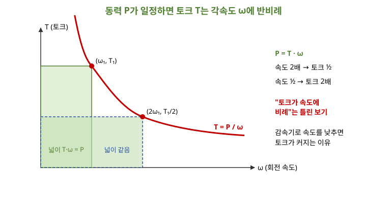

*기초공학 단원의 그림을 다시 쓴다. $H = T\omega$가 일정하면 곡선 위 어느 점이든 직사각형 넓이가 같다 — 회전수를 절반으로 줄이면 토크가 두 배가 되어, 같은 재료라면 축 지름이 $\sqrt[3]{2} \approx 1.26$배가 되어야 한다.*

$$T = \frac{H}{\omega} = \frac{60H}{2\pi N} \quad\Rightarrow\quad T\,[\text{N·mm}] = 9.55 \times 10^6 \frac{H\,[\text{kW}]}{N\,[\text{rpm}]}$$

### 동력–토크 실용식 모음

| 단위 조합 | 식 |
| --- | --- |
| T [N·mm], H [kW], N [rpm] | $T = 9.55 \times 10^6 \dfrac{H}{N}$ |
| T [N·m], H [kW] | $T = 9549 \dfrac{H}{N}$ |
| T [kgf·m], H [PS] | $T = 716.2 \dfrac{H}{N}$ |
| T [kgf·m], H [kW] | $T = 974 \dfrac{H}{N}$ |
| T [kgf·cm], H [PS] | $T = 71620 \dfrac{H}{N}$ |

- **계산 예**: 3800 rpm에서 12.5 kgf·m인 엔진 → $H = \dfrac{T N}{716.2} = \dfrac{12.5 \times 3800}{716.2} \approx 66.3$ PS
- 1 PS = 75 kgf·m/s ≈ 735.5 W, 1 kW = 102 kgf·m/s.

> [!tip] 감 잡기 — 상수가 어디서 나왔나
> 모두 $T = \dfrac{60}{2\pi}\dfrac{H}{N}$에 단위 환산을 곱한 것이다. kW → W는 ×1000, N·m → N·mm는 ×1000이라 $\dfrac{60 \times 10^6}{2\pi} = 9.55 \times 10^6$. PS는 75 kgf·m/s이므로 $\dfrac{60 \times 75}{2\pi} = 716.2$, kW는 102 kgf·m/s이므로 $\dfrac{60 \times 102}{2\pi} \approx 974$. 외우기 어려우면 이 한 줄로 되살린다.

### 비틀림 응력과 축 지름

비틀린 축에서 전단 응력은 중심에서 0, **표면에서 최대**다. 그 최대값을 한 번에 구하게 만든 값이 극단면 계수 $Z_p$다.

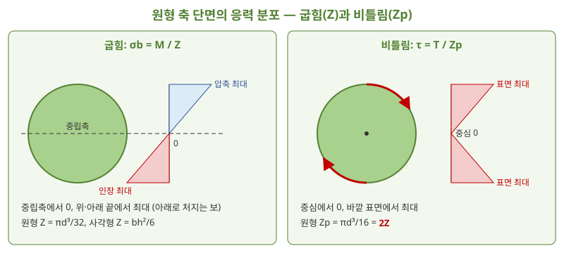

*재료강도 단원의 그림을 다시 쓴다. 왼쪽 굽힘 응력은 중립축에서 0이고 위·아래 끝에서 최대, 오른쪽 비틀림 전단 응력은 중심 0, 표면 최대다. 원형에서는 $Z_p = 2Z$이므로 비틀림 식의 16이 굽힘 식에서는 32가 된다.*

$$T = \tau_a Z_p = \tau_a \frac{\pi d^3}{16} \quad\Rightarrow\quad d = \sqrt[3]{\frac{16T}{\pi\tau_a}}$$

### 축 지름 계산 예

- 5 kW, 1000 rpm 전동축, $\tau_a = 20$ MPa
  - $T = 9549 \times 5 / 1000 \approx 47.7$ N·m $= 47700$ N·mm
  - $d = \sqrt[3]{\dfrac{16 \times 47700}{\pi \times 20}} \approx \sqrt[3]{12150} \approx 23$ mm → 규격 25 mm 선택.

*이 25 mm 축이 강성 조건도 만족하는지는 5절에서 다시 확인한다.*

## 4. 굽힘 + 비틀림 — 상당 모멘트와 중공축

### 굽힘만 받을 때

차축처럼 굽힘만 받으면 비틀림 식의 $\tau_a$, $Z_p$ 자리에 $\sigma_a$, $Z$가 들어간다.

$$M = \sigma_a Z = \sigma_a \frac{\pi d^3}{32} \quad\Rightarrow\quad d = \sqrt[3]{\frac{32M}{\pi\sigma_a}}$$

### 둘을 하나로 — 상당 모멘트

전동축은 굽힘 M과 비틀림 T를 **동시에** 받는다. 두 효과를 따로 계산해 더하면 안 되고, "이 둘을 합치면 비틀림만 받는 셈으로 치면 얼마짜리냐"(상당 비틀림 $T_e$), "굽힘만 받는 셈으로 치면 얼마짜리냐"(상당 굽힘 $M_e$)로 바꿔 기존 식에 넣는다.

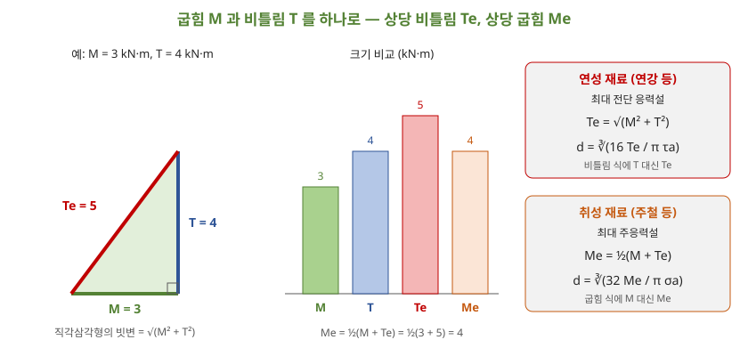

*왼쪽: M(가로)과 T(세로)를 두 변으로 하는 직각삼각형의 **빗변**이 $T_e$다. 3-4-5 삼각형이라 $T_e = 5$. 가운데: $M_e = \tfrac{1}{2}(M + T_e) = 4$로, 항상 M보다 크고 $T_e$보다 작다. 오른쪽: 연강처럼 잘 늘어나는(연성) 재료는 전단으로 항복하므로 $T_e$를 비틀림 식에, 주철처럼 잘 깨지는(취성) 재료는 최대 인장 응력으로 깨지므로 $M_e$를 굽힘 식에 넣는다.*

$$T_e = \sqrt{M^2 + T^2}, \qquad M_e = \frac{1}{2}\left(M + \sqrt{M^2 + T^2}\right) = \frac{1}{2}(M + T_e)$$

$$d = \sqrt[3]{\frac{16T_e}{\pi\tau_a}} \ (\text{연성}), \qquad d = \sqrt[3]{\frac{32M_e}{\pi\sigma_a}} \ (\text{취성})$$

> [!example] 계산 예 — 상당 모멘트로 축 지름
> M = 3 kN·m, T = 4 kN·m인 축.
> - 연강($\tau_a = 40$ MPa): $T_e = 5$ kN·m $= 5 \times 10^6$ N·mm → $d = \sqrt[3]{\dfrac{16 \times 5 \times 10^6}{\pi \times 40}} \approx 86$ mm.
> - 주철($\sigma_a = 60$ MPa): $M_e = 4$ kN·m $= 4 \times 10^6$ N·mm → $d = \sqrt[3]{\dfrac{32 \times 4 \times 10^6}{\pi \times 60}} \approx 88$ mm.

### 굽힘 모멘트와 축 지름

- $M = \sigma_b Z = \sigma_b \dfrac{\pi d^3}{32}$ → 허용 굽힘 모멘트는 **허용 응력과 단면 계수에 비례**, 지름의 **세제곱**에 비례.
- **중공축** (바깥 $d_2$, 안 $d_1$, 내외경비 $x = d_1/d_2$): $T = \tau_a \dfrac{\pi d_2^3}{16}(1 - x^4)$ → $d_2 = \sqrt[3]{\dfrac{16T}{\pi\tau_a(1 - x^4)}}$.
- 같은 무게라면 중공축이 실체축보다 굽힘·비틀림에 강하다.
- 교재(CH03 21절): 굽힘에는 단면 계수 $Z = \dfrac{\pi d^3}{32}$, 비틀림에는 극단면 계수 $Z_p = \dfrac{\pi d^3}{16}$을 쓴다 ($M = \sigma_b Z$, $T = \tau Z_p$). 문제에 "중공축"이라는 말이 있어도 **안·바깥지름 조건이 없으면 실체축 식**으로 푼다 (교재 21-5).
- 바흐의 축 공식은 강도가 아니라 **강성(비틀림 변형·진동) 기준**의 설계식이다.

### 중공축은 왜 강한가

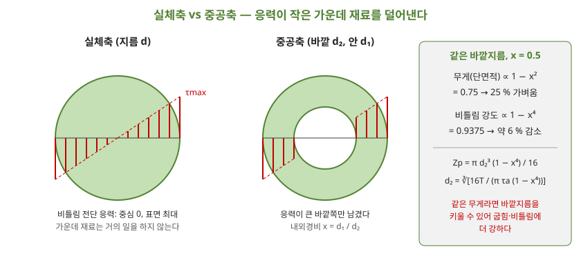

*빨간 선의 길이가 그 자리의 전단 응력이다. 실체축 가운데 재료는 응력이 작아 **거의 일을 하지 않는다**. 그 부분을 덜어 낸 중공축은 바깥지름이 같을 때 내외경비 $x = 0.5$에서 무게는 $1 - x^2 = 0.75$로 25 % 줄지만, 비틀림 강도는 $1 - x^4 = 0.9375$로 약 6 %만 준다. 거꾸로 같은 무게로 만들면 바깥지름을 키울 수 있어 실체축보다 강해진다 — 자전거 프레임·자동차 추진축이 관인 이유다.*

## 5. 강성 — 비틀림 각과 바흐의 축 공식

긴 고무 막대 한쪽을 잡고 다른 쪽을 비틀면, 끝이 많이 돌아간다. 강철 축도 정도만 다를 뿐 똑같이 비틀린다. 너무 많이 비틀리면 축 양 끝에 달린 기어·캠의 **타이밍이 어긋나고** 비틀림 진동이 생긴다. 그래서 "부러지지 않을 만큼"과 별도로 "**이만큼까지만 비틀려라**"라는 기준을 둔다.

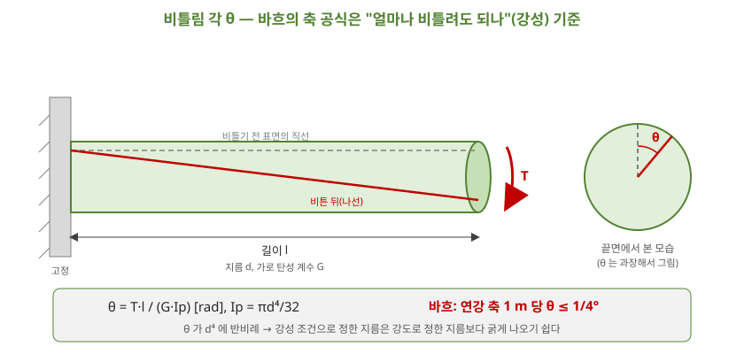

*회색 점선은 비틀기 전 축 표면에 그은 직선, 빨간 선은 비튼 뒤의 모습(나선)이다. 오른쪽 끝면에서 보면 처음 위를 향하던 반지름이 θ만큼 돌아가 있다. 길이 l이 길수록, 지름이 작을수록($I_p \propto d^4$) θ가 커진다.*

$$\theta = \frac{T\,l}{G\,I_p}\ [\text{rad}], \qquad I_p = \frac{\pi d^4}{32}, \qquad \text{바흐: } \theta \le \frac{1}{4}^\circ \ (l = 1\ \text{m 당})$$

> [!example] 계산 예 — 3절의 25 mm 축은 강성도 괜찮을까?
> T = 47 700 N·mm, d = 25 mm, 연강 G ≈ 81 GPa = 81 000 MPa, l = 1000 mm.
> - $I_p = \pi \times 25^4 / 32 \approx 38\,350$ mm⁴
> - $\theta = \dfrac{47\,700 \times 1000}{81\,000 \times 38\,350} \approx 0.0154$ rad ≈ **0.88°** > 1/4° → **강성 부족**.
> - θ는 $d^4$에 반비례하므로 필요한 지름은 $25 \times (0.88/0.25)^{1/4} \approx 34$ mm → 규격 35 mm.
> - 바흐 조건을 지름 식으로 정리한 실용식 $d \approx 130\sqrt[4]{H/N}$ (H [kW], d [mm]), $d \approx 120\sqrt[4]{H/N}$ (H [PS])에 넣어도 $130\sqrt[4]{5/1000} \approx 34.6$ mm로 같은 결과다.
>
> 강도로는 23 mm면 되지만 강성으로는 34 mm가 필요하다 — 긴 전동축은 이렇게 **강성이 지름을 정하는** 경우가 많다.

> [!question] 시험에서는
> "바흐의 축 공식은 ○○ 기준" → **강성**(비틀림 변형). "1 m당 1/4°"를 1/2°나 1°로 바꾼 보기가 나온다.

## 6. 진동 — 위험 속도

빨랫줄 가운데에 무거운 것을 매달고 흔들면, 어떤 박자에서만 유난히 크게 출렁인다. 회전축도 마찬가지로 **스스로 흔들리기 좋아하는 박자**(고유 진동수)가 있다. 회전수가 그 박자와 맞으면 아주 작은 불균형도 계속 커져 축이 줄넘기 줄처럼 휘둘린다. 이 회전수가 **위험 속도** $N_c$다.

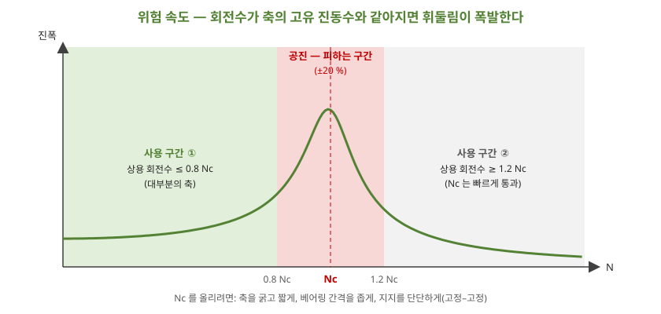

*회전수 N이 $N_c$에 가까워지면 진폭이 급격히 커진다. 그래서 상용 회전수는 $N_c$에서 **±20 % 이상** 떨어뜨린다. 대부분의 축은 왼쪽 초록 구간($\le 0.8N_c$)에서 쓰고, 터빈처럼 아주 빠른 축은 기동할 때 $N_c$를 **빠르게 통과**해 오른쪽 구간에서 쓴다.*

- 위험 속도는 **축의 굵기·길이·지지 방식**으로 정해진다. 굵고 짧을수록, 베어링 간격이 좁을수록, 양 끝을 단단히 잡을수록 $N_c$가 올라간다 (볼스크루의 지지 방식과 같은 이야기 — [볼스크루와 LM 가이드](볼스크루와_LM가이드.md)).
- (참고) 원판 하나 달린 축은 그 원판 무게로 생기는 정적 처짐 δ로 $N_c = \dfrac{30}{\pi}\sqrt{\dfrac{g}{\delta}}$ [rpm]로 어림한다. δ = 0.1 mm이면 $N_c \approx 2990$ rpm — 처짐이 작을수록(강성이 클수록) 위험 속도가 높다.

> [!tip] 감 잡기
> 위험 속도는 "하중이 커서" 생기는 문제가 아니라 "**박자가 맞아서**" 생기는 문제다. 그래서 축을 더 강한 재료로 바꾸는 것보다 **굵기·길이·지지**를 바꾸는 쪽이 효과가 있다.

## 7. 축의 도시

축은 속이 꽉 찬 원기둥이라 길이 방향으로 잘라 봐야 새로 보이는 것이 없다. 그래서 **길이 방향으로 단면하지 않고**, 키 홈처럼 속을 봐야 하는 곳만 국부적으로 따서 보여 준다([도면 양식과 투상법](도면_양식과_투상법.md)의 단면도 규칙).

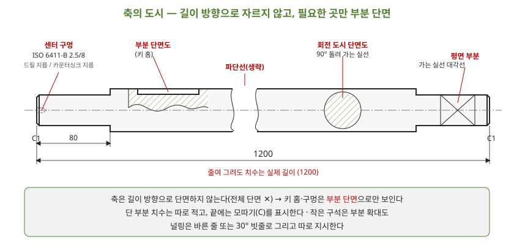

*① 키 홈은 그 부분만 물결 모양 파단선으로 따서 해칭한 **부분 단면도**. ② 가운데는 파단선으로 잘라 짧게 그렸지만 치수는 **실제 길이 1200**. ③ 원 모양 해칭은 단면 모양을 그 자리에 90° 돌려 가는 실선으로 그린 **회전 도시 단면도**. ④ 오른쪽 끝 X자 가는 실선은 그 부분이 **평면**(스패너 물림 자리 등)이라는 표시. ⑤ 왼쪽 끝 센터 구멍은 드릴 지름 2.5를 앞, 카운터싱크 지름 8을 뒤에 쓴다.*

### 축의 도시

- 길이 방향으로 단면하지 않는다. 키 홈·구멍 등은 **부분 단면도**로 보여 준다.
- 단면 모양은 **회전 도시 단면도**(90° 돌려 그림)로 표시할 수 있다.
- 구석 라운드·단 부분처럼 작은 곳은 **부분 확대도**.
- 긴 축은 중간을 파단선으로 생략할 수 있으나 치수는 실제 길이.
- 축 끝 모따기, 센터 구멍, 평면 부분(가는 실선 대각선) 표시를 잊지 않는다.
- 교재(CH03 16절) 보충: 단 부분 치수는 따로 적는다. **널링**은 바른 줄 또는 30° 빗줄로 그리고 따로 지시한다. 센터 구멍은 KS A ISO 6411을 따르며, 표시에서 **드릴 구멍 지름을 앞에, 카운터싱크 지름을 뒤에** 쓴다 (예: B형, 2.5/8) (교재 16-3).

> [!question] 시험에서는
> "축은 길이 방향으로 온 단면도를 그린다", "긴 축을 줄여 그리면 치수도 줄인 길이로 적는다"는 틀린 보기다. 축·키·핀·볼트·리벳·베어링 볼처럼 **길이 방향으로 잘라도 의미 없는 부품**은 단면하지 않는다.

## 8. 커플링 — 두 축을 한 몸으로

모터 축과 펌프 축처럼 따로 만든 두 축을 이어 붙이는 것이 축 이음이다. **커플링**은 한 번 이으면 운전 중에는 떼지 않는 영구 이음, **클러치**(9절)는 운전 중에도 끊고 잇는 이음이다. 커플링은 무엇보다 **두 축이 어떻게 놓여 있느냐**로 고른다.

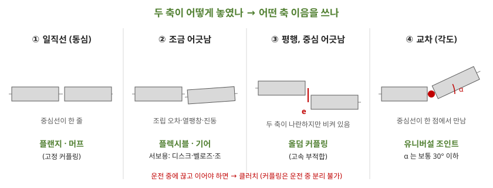

*① 중심선이 정확히 한 줄이면 단단히 묶는 고정 커플링. ② 조립 오차·열팽창으로 조금 어긋나면 그 어긋남을 흡수하는 플렉시블 커플링. ③ 두 축이 나란하지만 e만큼 비켜 있으면 올덤 커플링. ④ 중심선이 한 점에서 각도 α로 만나면 유니버설 조인트.*

### 플랜지 커플링 — 가장 일반적인 고정 커플링

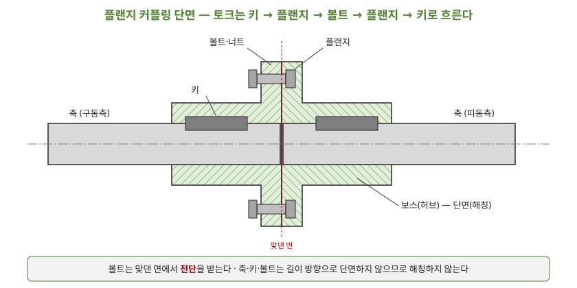

*각 축 끝에 **플랜지**(원판)를 **키**로 고정하고, 두 플랜지를 맞대어 **볼트**로 조인다. 토크는 축 → 키 → 플랜지 → 볼트 → 반대쪽 플랜지 → 키 → 축으로 흐르며, 볼트는 맞댄 면(빨간 점선)에서 **전단**을 받는다. 도면에서 보스·플랜지는 해칭하지만 축·키·볼트는 길이 방향으로 단면하지 않으므로 해칭하지 않는다.*

### 어긋남을 흡수하는 커플링

| 기어 커플링 (절개) | 조(jaw) 커플링 |
| --- | --- |
| 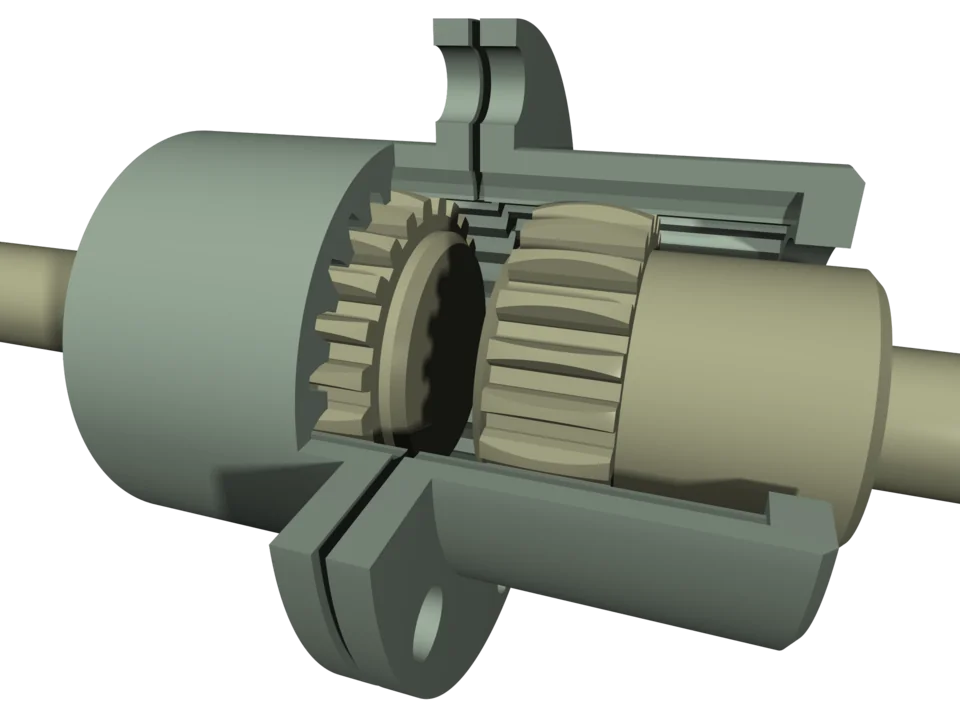 | 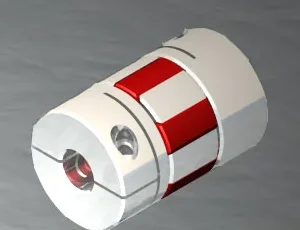 |
| *양 축 허브의 **외치 기어**가 바깥 슬리브의 **내치 기어**에 물린다. 이 모양을 둥글게(크라우닝) 깎아 약간의 각도 어긋남과 **축 방향 이동**을 허용하면서 큰 토크를 전한다.* | *양쪽 허브의 발톱(조) 사이에 빨간 **탄성체**(스파이더)를 끼운다. 탄성체가 충격·진동과 작은 어긋남을 흡수한다. 허브 끝의 슬릿과 볼트 구멍은 축을 조이는 클램프다.* |

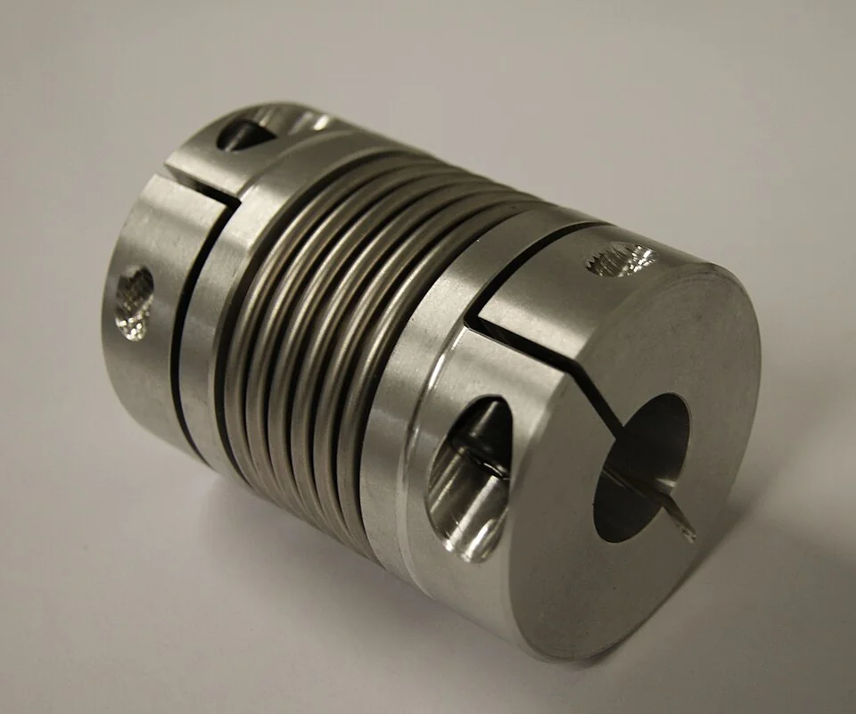

*볼스크루 단원의 사진을 다시 쓴다. **벨로즈 커플링**은 주름관이 비틀림 방향으로는 단단하고 굽힘 방향으로는 조금 휘어, **백래시 없이** 작은 어긋남만 흡수한다. 서보 모터–볼스크루 직결처럼 위치 정밀이 중요한 곳에 쓴다(디스크형도 같은 목적).*

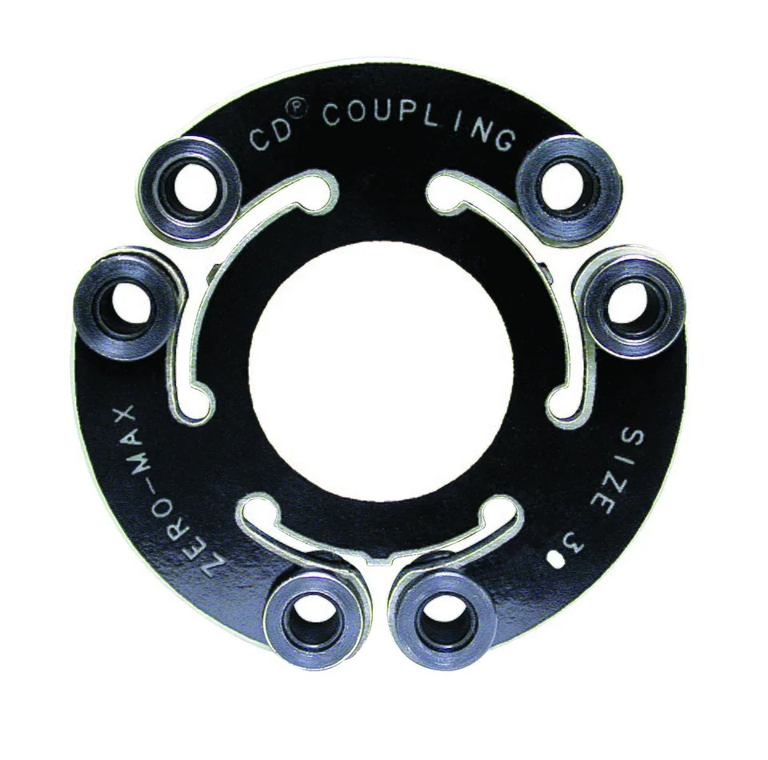

*디스크 커플링의 핵심인 **디스크 팩**(이 제품은 복합재 원판). 둘레의 부싱 6개 중 하나 건너 하나(3개)는 한쪽 허브에, 나머지 3개는 반대쪽 허브에 볼트로 묶인다. 부싱 사이의 원판이 살짝 휘며 어긋남을 흡수하고, 미끄러지는 부분이 없어 백래시가 없다. 금속 디스크형은 얇은 스테인리스 판을 여러 장 겹쳐 같은 일을 한다.*

### 올덤 커플링 — 평행하게 비켜 있는 두 축

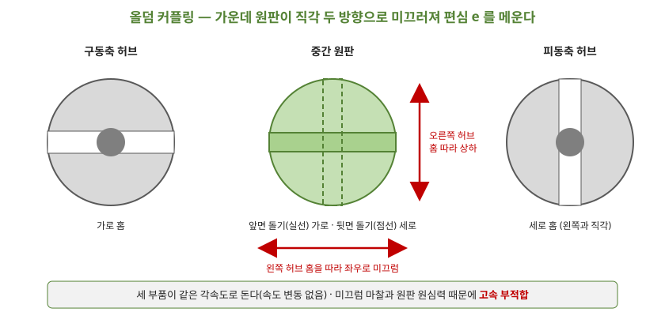

*세 부품을 축 방향에서 펼쳐 본 그림. 구동축 허브에는 **가로 홈**, 피동축 허브에는 **세로 홈**이 서로 **직각 방향**으로 파여 있고, 가운데 원판 앞면의 가로 돌기(실선)와 뒷면의 세로 돌기(점선)가 각각 거기에 끼워진다. 두 축이 e만큼 비켜 있으면 원판이 돌면서 두 홈을 따라 **미끄러져** 어긋남을 메운다. 미끄럼 마찰과 원판의 원심력 때문에 **고속에는 부적합**하다.*

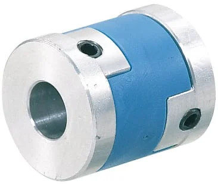

*MISUMI 카탈로그의 올덤형 커플링 제품 사진(제조사 사진). 양쪽의 은색 **알루미늄 허브**에 축을 끼우고 세트 스크류로 조이며, 두 허브 사이에 끼인 **파란 수지 중간 원판**이 허브의 돌기와 맞물려 토크를 전한다. 위 분해도의 가운데 원판에 해당하며, 이 원판이 미끄러지거나 변형되어 두 축의 평행 편심을 흡수한다.*

### 유니버설 조인트 — 각도로 만나는 두 축

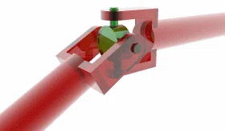

*두 축 끝의 **U자 요크**를 가운데 **십자축**(spider)으로 잇는다. 십자축의 두 팔이 각각 한 요크의 핀 구멍에 들어가 있어, 축이 꺾여 있어도 회전이 전달된다(훅 조인트, 카르단 조인트라고도 한다).*

- 하나만 쓰면 입력 축이 일정하게 돌아도 출력 축은 한 바퀴 안에서 **빨라졌다 느려졌다** 한다. 교차각 α일 때 출력/입력 속도비가 $\cos\alpha \sim \dfrac{1}{\cos\alpha}$ 사이를 오간다 — α = 30°이면 0.87 ~ 1.15배. 그래서 교차각은 보통 30° 이하로 둔다.

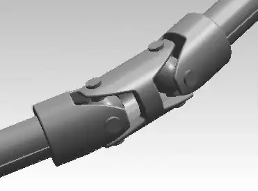

*유니버설 조인트 **두 개**를 중간축으로 이으면, 첫 번째가 만든 속도 변동을 두 번째가 거꾸로 상쇄해 입·출력 축이 **같은 속도**로 돈다(두 교차각을 같게, 중간축 양 끝 요크 방향을 맞춰 조립할 때). 자동차 추진축이 이 구성이다.*

### 커플링 (축 이음)

| 종류 | 사용 조건 | 특징 |
| --- | --- | --- |
| 머프(슬리브) 커플링 | 일직선 | 원통에 두 축 끼우고 키 고정, 간단 |
| 플랜지 커플링 | 일직선 | 가장 일반적, 볼트 체결, 큰 토크 |
| 플렉시블 커플링 | 약간 어긋남 | 고무·스프링·디스크로 진동·충격 흡수 |
| 기어 커플링 | 약간 어긋남 | 큰 토크, 축 방향 이동 허용 |
| 올덤 커플링 | 평행 편심 | 중간 원판의 홈이 미끄러짐 |
| 유니버설 조인트 | 교차 (각도) | 자동차 추진축, 각도 변화 |
| 서보용 커플링 (디스크·벨로즈·조 타입) | 미세 어긋남 | 백래시 없음, 위치 정밀 |

> [!question] 시험에서는
> "서보 모터와 볼스크루를 직결하는 요소" → **커플링**(서보용). "평행하고 조금 어긋난 두 축" → 올덤, "교차하는 두 축" → 유니버설 조인트. 두 보기를 맞바꾼 함정이 흔하다.

## 9. 클러치 — 운전 중에 끊고 잇는다

자동차가 서 있는 동안에도 엔진은 돈다. 엔진을 끄지 않고 바퀴 쪽 동력만 끊었다 이었다 하는 장치가 클러치다. 커플링과의 차이는 딱 하나, **운전 중 단속**이 되느냐다.

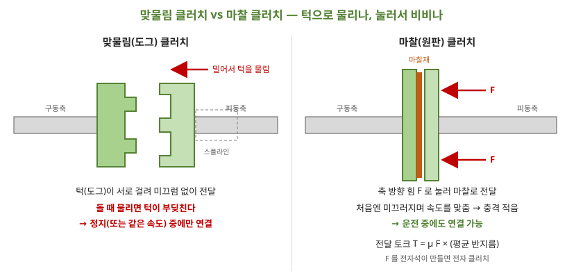

*왼쪽 **맞물림(도그) 클러치**: 피동축 쪽 반쪽이 스플라인 위를 미끄러져 와서 마주 보는 **턱**끼리 물린다. 미끄럼이 없어 확실하지만, 돌고 있을 때 물리면 턱이 부딪쳐 깨지므로 **정지(또는 같은 속도) 중에만** 연결한다. 오른쪽 **마찰 클러치**: 두 원판 사이 마찰재(주황)를 축 방향 힘 F로 눌러 붙인다. 처음엔 미끄러지며 속도를 맞추므로 운전 중에도 연결된다.*

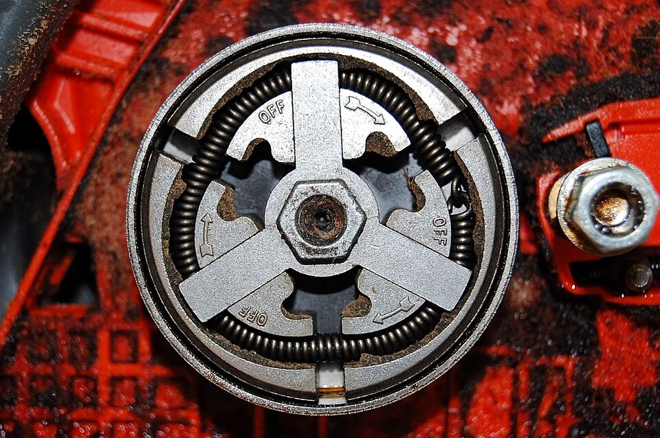

*체인톱의 원심 클러치. 엔진에 물린 가운데 허브(세 팔)가 **슈** 3개를 돌리고, 슈 바깥을 감은 **코일 스프링**이 슈를 안쪽으로 당기고 있다. 회전이 빨라지면 원심력이 스프링을 이겨 슈가 바깥 **드럼**에 밀착해 연결되고, 느려지면 스프링이 슈를 당겨 끊긴다 — 사람이 조작하지 않아도 **자동 연결**. 체인톱·예초기·소형 오토바이에 쓴다.*

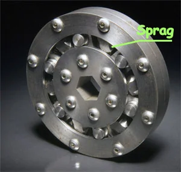

*일방향 클러치(스프래그형, NASA 고다드 우주센터 자료 사진). 육각 구멍이 난 안쪽 허브와 바깥 링 사이 틈에 비스듬한 **스프래그**(쐐기, 그림의 Sprag 표시)가 늘어서 있다. 한쪽으로 돌리면 스프래그가 누워 헛돌고, 반대쪽으로 돌리면 서면서 두 링 사이에 끼어 잠긴다 — **한 방향만 전달**, 역회전 방지·자전거 프리휠의 원리다.*

### 클러치

| 종류 | 원리 | 특징 |
| --- | --- | --- |
| 맞물림 (도그) 클러치 | 턱이 서로 물림 | 미끄럼 없음, 정지 중에만 연결 |
| 마찰 클러치 (원판·원추) | 마찰면 접촉 | 운전 중 연결, 충격 적음 |
| 원심 클러치 | 회전이 빨라지면 슈가 밀착 | 자동 연결 |
| 전자 클러치 | 전자석으로 흡착 | 원격·자동 제어 |
| 일방향 클러치 | 한 방향만 전달 | 역회전 방지, 프리휠 |

> [!tip] 감 잡기 — 마찰 클러치
> 마찰 클러치는 두 원판(또는 원추)을 **축 방향 힘**으로 눌러 붙인다. 처음엔 미끄러지며 서서히 속도를 맞추므로 충격이 적고, 그래서 운전 중에도 연결할 수 있다. 전자 클러치는 이 누르는 힘을 전자석으로 만든 것이라 PLC로 원격 제어할 수 있다. 같은 원리를 정지 쪽에 쓰면 브레이크가 된다([벨트·체인·스프링·브레이크](벨트_체인_스프링_브레이크.md)).

## 그림

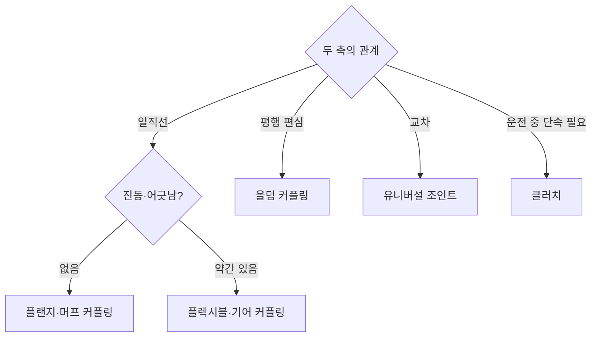

## 기출 포인트

- 동력·회전수·토크 관계식 — 4회: N·mm·kW 식 (2017-1), N·m 식 (2017-1), kgf·cm·PS 식 (2019-3), 엔진 마력 계산 (2019-2, 기초공학)
- 굽힘 + 비틀림 조합 — 4회: 상당 굽힘·상당 비틀림 모멘트 식 (2014-2, 2016-3), 회전축에 생기는 모멘트 종류 (2019-1), 굽힘 모멘트의 성질 (2015-1)
- 바흐의 축 공식 1 m당 1/4° — 2회 (2015-1, 2018-1)
- 중공축 지름 식 — 1회 (2017-3)
- 축의 도시방법 중 틀린 것(길이 방향 단면) — 2회 (2014-3, 2017-1)
- 서보 모터와 볼스크루를 직결하는 요소(커플링) — 1회 (2018-1, 3과목)
- 위험 속도·커플링 종류·클러치는 2014~2020년에 출제되지 않았다.

**교재 예제 유형** (Win-Q 2025 PART 01 CHAPTER 03, 16절): 축 도시 설명 중 틀린 것(길이 방향 단면), B형 센터 구멍 도시(그림, 드릴 지름 앞·카운터싱크 지름 뒤).

**교재 예제 유형** (21절): 상당 굽힘 모멘트 식 $\tfrac{1}{2}(M + \sqrt{M^2 + T^2})$ 고르기, 굽힘 모멘트가 무차원이라는 틀린 보기, 비틀림만 받는 축 지름 식 $\sqrt[3]{16T/(\pi\tau_a)}$ (중공 조건 없음 → 실체축).

## 관련 단원

- [기계설계 기초와 재료강도](기계설계_기초와_재료강도.md)
- [기초공학 – 힘·운동·단위](기초공학_힘_운동_단위.md)
- [베어링](베어링.md)
- [키·핀·코터·리벳·용접](키_핀_코터_리벳_용접.md)
- [볼스크루와 LM 가이드](볼스크루와_LM가이드.md)
- [벨트·체인·스프링·브레이크](벨트_체인_스프링_브레이크.md)
- [도면 양식과 투상법](도면_양식과_투상법.md)

## 체크리스트

- [ ] 차축·전동축·스핀들을 하중으로 구분한다
- [ ] 비틀림 축 지름을 계산한다
- [ ] 상당 비틀림·상당 굽힘 모멘트 식을 쓴다
- [ ] 위험 속도의 뜻과 회피 방법을 안다
- [ ] 축 배치에 맞는 커플링을 고른다
- [ ] 커플링과 클러치의 차이를 말한다
- [ ] 단위 조합별 토크 실용식 상수(9.55×10⁶, 716.2, 974)를 고른다
- [ ] 바흐의 축 공식(1 m당 1/4°)을 안다
- [ ] 중공축 지름 식을 쓴다
- [ ] 축 도시에서 틀리기 쉬운 규칙(길이 방향 단면 금지, 실제 길이 기입)을 안다

## 참고

- [큐넷 자동화설비산업기사 출제기준](https://www.q-net.or.kr/crf005.do?id=crf00503&jmCd=2034)

### 그림 출처

위키미디어 공용(Wikimedia Commons)과 Openverse에서 가져온 공개 라이선스 자료이고, 노트에 맞게 크기를 줄이고 WebP로 변환했다.

| 그림 | 작성자 | 라이선스 | 출처 |
| --- | --- | --- | --- |
| [Rail vehicle wheelset](https://commons.wikimedia.org/wiki/File:Rail_vehicle_wheelset.png) | SCHolar44 at Wikipedia | CC0 | Wikimedia Commons |
| [Crankshaft of an engine](https://commons.wikimedia.org/wiki/File:Crankshaft_of_an_engine.jpg) | Seedlesslime | [CC BY-SA 4.0](https://creativecommons.org/licenses/by-sa/4.0) | Wikimedia Commons |
| [Flexible shaft for a power drill](https://commons.wikimedia.org/wiki/File:Flexible_shaft_for_a_power_drill.jpg) | W.carter | [CC BY-SA 4.0](https://creativecommons.org/licenses/by-sa/4.0) | Wikimedia Commons |
| [Gear coupling](https://commons.wikimedia.org/wiki/File:Gear_coupling.png) | Petteri Aimonen | 퍼블릭 도메인 | Wikimedia Commons |
| [JawConcept](https://commons.wikimedia.org/wiki/File:JawConcept.jpg) | Aruland | [CC BY-SA 3.0](https://creativecommons.org/licenses/by-sa/3.0) | Wikimedia Commons |
| [Ausgleichskupplung](https://commons.wikimedia.org/wiki/File:Ausgleichskupplung.JPG) | Archiumtechnica | [CC BY-SA 3.0](https://creativecommons.org/licenses/by-sa/3.0) | Wikimedia Commons |
| [CD Coupling Disc Pack](https://commons.wikimedia.org/wiki/File:CD_Coupling_Disc_Pack.jpg) | Perianah | [CC BY-SA 4.0](https://creativecommons.org/licenses/by-sa/4.0) | Wikimedia Commons |
| [MISUMI 올덤형 커플링 CPO (카탈로그 사진)](https://kr.misumi-ec.com/vona2/detail/110302556770/) | MISUMI | 저작권 보유(개인 학습용, 비공개 저장소 한정) | MISUMI 카탈로그 |
| [Universal joint](https://commons.wikimedia.org/wiki/File:Universal_joint.gif) | Van helsing | [CC BY 2.5](https://creativecommons.org/licenses/by/2.5) | Wikimedia Commons |
| [Double Cardan Joint (animated)](https://commons.wikimedia.org/wiki/File:Double_Cardan_Joint_(animated).gif) | User:Catsquisher | 퍼블릭 도메인 | Wikimedia Commons |
| [CentrifugalClutch](https://commons.wikimedia.org/wiki/File:CentrifugalClutch.jpg) | Fletcher6 | [CC BY-SA 3.0](https://creativecommons.org/licenses/by-sa/3.0) | Wikimedia Commons |
| [Sprag one-way bearing labeled](https://commons.wikimedia.org/wiki/File:Sprag_one-way_bearing_labeled.png) | Staff, Goddard Space Center | 퍼블릭 도메인 | Wikimedia Commons |

제조사 카탈로그 사진은 저작권이 각 회사에 있으며, 개인 학습용으로 비공개 저장소에서만 쓴다(공개 전에 삭제).

직접 그린 그림(SVG, 이 볼트용으로 새로 작성): 축 종류 하중, 동력 토크 속도([기초공학 – 힘·운동·단위](기초공학_힘_운동_단위.md)에서 재사용), 굽힘 비틀림 응력분포([기계설계 기초와 재료강도](기계설계_기초와_재료강도.md)에서 재사용), 상당모멘트 Te Me, 실체축 중공축, 비틀림각 바흐, 위험속도 공진, 축 도시, 축 어긋남 커플링선택, 플랜지커플링 단면, 올덤커플링 원리, 클러치 맞물림 마찰.

