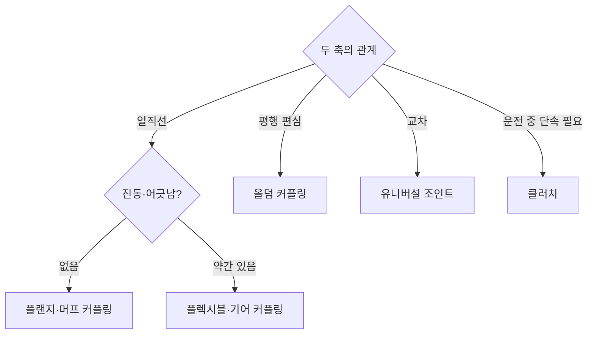

# 축과 축이음

> [!summary] 핵심 요약
> - 축 종류: **차축**(굽힘만), **전동축**(비틀림 + 굽힘), **스핀들**(주로 비틀림, 정밀).
> - 비틀림만 받는 축 지름: $d = \sqrt[3]{\dfrac{16T}{\pi\tau_a}}$. 굽힘만: $d = \sqrt[3]{\dfrac{32M}{\pi\sigma_a}}$.
> - 굽힘 + 비틀림: **상당 비틀림 모멘트** $T_e = \sqrt{M^2 + T^2}$, **상당 굽힘 모멘트** $M_e = \dfrac{1}{2}(M + T_e)$.
> - **커플링**: 운전 중 분리 안 됨. **클러치**: 운전 중 끊고 이을 수 있음.

> [!warning] 자주 틀리는 포인트
> - **위험 속도**: 축의 고유 진동수와 회전수가 같아지면 공진 → 상용 회전수를 위험 속도에서 **±20% 이상** 떨어뜨린다는 설명이 일반적.
> - **올덤 커플링**: 두 축이 **평행하고 조금 어긋난(편심)** 경우. 고속에는 부적합.
> - **유니버설 조인트(훅 조인트)**: 두 축이 **교차**하는 경우. 교차각은 보통 30° 이하, 1개만 쓰면 속도 변동 → 2개로 상쇄.
> - 연성 재료는 $T_e$ (최대 전단 응력설), 취성 재료는 $M_e$ (최대 주응력설)로 설계.
> - **바흐(Bach)의 축 공식**: 연강 축의 비틀림 각은 길이 **1 m당 1/4° 이내**로 제한.
> - 풀리·기어가 달린 회전축에는 **굽힘 모멘트와 비틀림 모멘트가 동시에** 생긴다 (전동축).
> - 토크 식의 상수는 **단위에 따라 다르다**: N·mm·kW면 $9.55 \times 10^6$, kgf·m·PS면 716.2, kgf·m·kW면 974. 단위를 먼저 확인한다.
> - 굽힘 모멘트는 단위가 있다 (N·m). "무차원"이라는 보기는 틀린 것.
> - 축은 도면에서 **길이 방향으로 단면하지 않는다**. 긴 축은 중간을 잘라 짧게 그려도 **치수는 실제 길이**로 적는다.

## 개념 정리

### 축의 분류

| 분류 | 종류 |
| --- | --- |
| 하중 | 차축(철도 차량 바퀴축), 전동축(공장 동력축), 스핀들(공작기계 주축) |
| 모양 | 직선 축, 크랭크 축(왕복 ↔ 회전), 플렉시블 축(휘어진 경로 전달) |
| 단면 | 실체 축, 중공 축(같은 무게로 강도·강성 큼) |

### 축 설계 고려 사항

1. **강도**: 굽힘·비틀림·조합 응력.
2. **강성**: 처짐과 비틀림 각이 허용값 이내. 비틀림 각 $\theta = \dfrac{Tl}{GI_p}$.
3. **진동**: 위험 속도 회피.
4. **열팽창**, 부식, 키 홈에 의한 응력 집중.

### 축 지름 계산 예

- 5 kW, 1000 rpm 전동축, $\tau_a = 20$ MPa
  - $T = 9549 \times 5 / 1000 \approx 47.7$ N·m $= 47700$ N·mm
  - $d = \sqrt[3]{\dfrac{16 \times 47700}{\pi \times 20}} \approx \sqrt[3]{12150} \approx 23$ mm → 규격 25 mm 선택.

### 동력–토크 실용식 모음

| 단위 조합 | 식 |
| --- | --- |
| T [N·mm], H [kW], N [rpm] | $T = 9.55 \times 10^6 \dfrac{H}{N}$ |
| T [N·m], H [kW] | $T = 9549 \dfrac{H}{N}$ |
| T [kgf·m], H [PS] | $T = 716.2 \dfrac{H}{N}$ |
| T [kgf·m], H [kW] | $T = 974 \dfrac{H}{N}$ |
| T [kgf·cm], H [PS] | $T = 71620 \dfrac{H}{N}$ |

- **계산 예**: 3800 rpm에서 12.5 kgf·m인 엔진 → $H = \dfrac{T N}{716.2} = \dfrac{12.5 \times 3800}{716.2} \approx 66.3$ PS
- 1 PS = 75 kgf·m/s ≈ 735.5 W, 1 kW = 102 kgf·m/s.

### 굽힘 모멘트와 축 지름

- $M = \sigma_b Z = \sigma_b \dfrac{\pi d^3}{32}$ → 허용 굽힘 모멘트는 **허용 응력과 단면 계수에 비례**, 지름의 **세제곱**에 비례.
- **중공축** (바깥 $d_2$, 안 $d_1$, 내외경비 $x = d_1/d_2$): $T = \tau_a \dfrac{\pi d_2^3}{16}(1 - x^4)$ → $d_2 = \sqrt[3]{\dfrac{16T}{\pi\tau_a(1 - x^4)}}$.
- 같은 무게라면 중공축이 실체축보다 굽힘·비틀림에 강하다.
- 교재(CH03 21절): 굽힘에는 단면 계수 $Z = \dfrac{\pi d^3}{32}$, 비틀림에는 극단면 계수 $Z_p = \dfrac{\pi d^3}{16}$을 쓴다 ($M = \sigma_b Z$, $T = \tau Z_p$). 문제에 "중공축"이라는 말이 있어도 **안·바깥지름 조건이 없으면 실체축 식**으로 푼다 (교재 21-5).
- 바흐의 축 공식은 강도가 아니라 **강성(비틀림 변형·진동) 기준**의 설계식이다.

### 축의 도시

- 길이 방향으로 단면하지 않는다. 키 홈·구멍 등은 **부분 단면도**로 보여 준다.
- 단면 모양은 **회전 도시 단면도**(90° 돌려 그림)로 표시할 수 있다.
- 구석 라운드·단 부분처럼 작은 곳은 **부분 확대도**.
- 긴 축은 중간을 파단선으로 생략할 수 있으나 치수는 실제 길이.
- 축 끝 모따기, 센터 구멍, 평면 부분(가는 실선 대각선) 표시를 잊지 않는다.
- 교재(CH03 16절) 보충: 단 부분 치수는 따로 적는다. **널링**은 바른 줄 또는 30° 빗줄로 그리고 따로 지시한다. 센터 구멍은 KS A ISO 6411을 따르며, 표시에서 **드릴 구멍 지름을 앞에, 카운터싱크 지름을 뒤에** 쓴다 (예: B형, 2.5/8) (교재 16-3).

### 커플링 (축 이음)

| 종류 | 사용 조건 | 특징 |
| --- | --- | --- |
| 머프(슬리브) 커플링 | 일직선 | 원통에 두 축 끼우고 키 고정, 간단 |
| 플랜지 커플링 | 일직선 | 가장 일반적, 볼트 체결, 큰 토크 |
| 플렉시블 커플링 | 약간 어긋남 | 고무·스프링·디스크로 진동·충격 흡수 |
| 기어 커플링 | 약간 어긋남 | 큰 토크, 축 방향 이동 허용 |
| 올덤 커플링 | 평행 편심 | 중간 원판의 홈이 미끄러짐 |
| 유니버설 조인트 | 교차 (각도) | 자동차 추진축, 각도 변화 |
| 서보용 커플링 (디스크·벨로즈·조 타입) | 미세 어긋남 | 백래시 없음, 위치 정밀 |

### 클러치

| 종류 | 원리 | 특징 |
| --- | --- | --- |
| 맞물림 (도그) 클러치 | 턱이 서로 물림 | 미끄럼 없음, 정지 중에만 연결 |
| 마찰 클러치 (원판·원추) | 마찰면 접촉 | 운전 중 연결, 충격 적음 |
| 원심 클러치 | 회전이 빨라지면 슈가 밀착 | 자동 연결 |
| 전자 클러치 | 전자석으로 흡착 | 원격·자동 제어 |
| 일방향 클러치 | 한 방향만 전달 | 역회전 방지, 프리휠 |

## 그림

## 기출 포인트

- 동력·회전수·토크 관계식 — 4회: N·mm·kW 식 (2017-1), N·m 식 (2017-1), kgf·cm·PS 식 (2019-3), 엔진 마력 계산 (2019-2, 기초공학)
- 굽힘 + 비틀림 조합 — 4회: 상당 굽힘·상당 비틀림 모멘트 식 (2014-2, 2016-3), 회전축에 생기는 모멘트 종류 (2019-1), 굽힘 모멘트의 성질 (2015-1)
- 바흐의 축 공식 1 m당 1/4° — 2회 (2015-1, 2018-1)
- 중공축 지름 식 — 1회 (2017-3)
- 축의 도시방법 중 틀린 것(길이 방향 단면) — 2회 (2014-3, 2017-1)
- 서보 모터와 볼스크루를 직결하는 요소(커플링) — 1회 (2018-1, 3과목)
- 위험 속도·커플링 종류·클러치는 2014~2020년에 출제되지 않았다.

**교재 예제 유형** (Win-Q 2025 PART 01 CHAPTER 03, 16절): 축 도시 설명 중 틀린 것(길이 방향 단면), B형 센터 구멍 도시(그림, 드릴 지름 앞·카운터싱크 지름 뒤).

**교재 예제 유형** (21절): 상당 굽힘 모멘트 식 $\tfrac{1}{2}(M + \sqrt{M^2 + T^2})$ 고르기, 굽힘 모멘트가 무차원이라는 틀린 보기, 비틀림만 받는 축 지름 식 $\sqrt[3]{16T/(\pi\tau_a)}$ (중공 조건 없음 → 실체축).

## 관련 단원

- [기계설계 기초와 재료강도](기계설계_기초와_재료강도.md)
- [기초공학 – 힘·운동·단위](기초공학_힘_운동_단위.md)
- [베어링](베어링.md)
- [키·핀·코터·리벳·용접](키_핀_코터_리벳_용접.md)

## 체크리스트

- [ ] 차축·전동축·스핀들을 하중으로 구분한다
- [ ] 비틀림 축 지름을 계산한다
- [ ] 상당 비틀림·상당 굽힘 모멘트 식을 쓴다
- [ ] 위험 속도의 뜻과 회피 방법을 안다
- [ ] 축 배치에 맞는 커플링을 고른다
- [ ] 커플링과 클러치의 차이를 말한다
- [ ] 단위 조합별 토크 실용식 상수(9.55×10⁶, 716.2, 974)를 고른다
- [ ] 바흐의 축 공식(1 m당 1/4°)을 안다
- [ ] 중공축 지름 식을 쓴다
- [ ] 축 도시에서 틀리기 쉬운 규칙(길이 방향 단면 금지, 실제 길이 기입)을 안다

## 참고

- [큐넷 자동화설비산업기사 출제기준](https://www.q-net.or.kr/crf005.do?id=crf00503&jmCd=2034)
