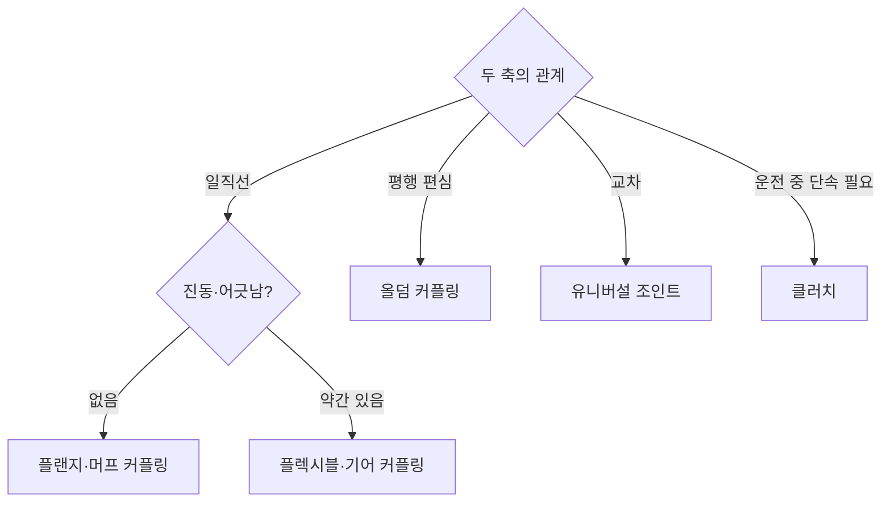

# 축과 축이음

> [!summary] 핵심 요약
> - 축 종류: **차축**(굽힘만), **전동축**(비틀림 + 굽힘), **스핀들**(주로 비틀림, 정밀).
> - 비틀림만 받는 축 지름: $d = \sqrt[3]{\dfrac{16T}{\pi\tau_a}}$. 굽힘만: $d = \sqrt[3]{\dfrac{32M}{\pi\sigma_a}}$.
> - 굽힘 + 비틀림: **상당 비틀림 모멘트** $T_e = \sqrt{M^2 + T^2}$, **상당 굽힘 모멘트** $M_e = \dfrac{1}{2}(M + T_e)$.
> - **커플링**: 운전 중 분리 안 됨. **클러치**: 운전 중 끊고 이을 수 있음.

> [!warning] 자주 틀리는 포인트
> - **위험 속도**: 축의 고유 진동수와 회전수가 같아지면 공진 → 상용 회전수를 위험 속도에서 **±20% 이상** 떨어뜨린다는 설명이 일반적.
> - **올덤 커플링**: 두 축이 **평행하고 조금 어긋난(편심)** 경우. 고속에는 부적합.
> - **유니버설 조인트(훅 조인트)**: 두 축이 **교차**하는 경우. 교차각은 보통 30° 이하, 1개만 쓰면 속도 변동 → 2개로 상쇄.
> - 연성 재료는 $T_e$ (최대 전단 응력설), 취성 재료는 $M_e$ (최대 주응력설)로 설계.

## 개념 정리

### 축의 분류

| 분류 | 종류 |
| --- | --- |
| 하중 | 차축(철도 차량 바퀴축), 전동축(공장 동력축), 스핀들(공작기계 주축) |
| 모양 | 직선 축, 크랭크 축(왕복 ↔ 회전), 플렉시블 축(휘어진 경로 전달) |
| 단면 | 실체 축, 중공 축(같은 무게로 강도·강성 큼) |

### 축 설계 고려 사항

1. **강도**: 굽힘·비틀림·조합 응력.
2. **강성**: 처짐과 비틀림 각이 허용값 이내. 비틀림 각 $\theta = \dfrac{Tl}{GI_p}$.
3. **진동**: 위험 속도 회피.
4. **열팽창**, 부식, 키 홈에 의한 응력 집중.

### 축 지름 계산 예

- 5 kW, 1000 rpm 전동축, $\tau_a = 20$ MPa
  - $T = 9549 \times 5 / 1000 \approx 47.7$ N·m $= 47700$ N·mm
  - $d = \sqrt[3]{\dfrac{16 \times 47700}{\pi \times 20}} \approx \sqrt[3]{12150} \approx 23$ mm → 규격 25 mm 선택.

### 커플링 (축 이음)

| 종류 | 사용 조건 | 특징 |
| --- | --- | --- |
| 머프(슬리브) 커플링 | 일직선 | 원통에 두 축 끼우고 키 고정, 간단 |
| 플랜지 커플링 | 일직선 | 가장 일반적, 볼트 체결, 큰 토크 |
| 플렉시블 커플링 | 약간 어긋남 | 고무·스프링·디스크로 진동·충격 흡수 |
| 기어 커플링 | 약간 어긋남 | 큰 토크, 축 방향 이동 허용 |
| 올덤 커플링 | 평행 편심 | 중간 원판의 홈이 미끄러짐 |
| 유니버설 조인트 | 교차 (각도) | 자동차 추진축, 각도 변화 |
| 서보용 커플링 (디스크·벨로즈·조 타입) | 미세 어긋남 | 백래시 없음, 위치 정밀 |

### 클러치

| 종류 | 원리 | 특징 |
| --- | --- | --- |
| 맞물림 (도그) 클러치 | 턱이 서로 물림 | 미끄럼 없음, 정지 중에만 연결 |
| 마찰 클러치 (원판·원추) | 마찰면 접촉 | 운전 중 연결, 충격 적음 |
| 원심 클러치 | 회전이 빨라지면 슈가 밀착 | 자동 연결 |
| 전자 클러치 | 전자석으로 흡착 | 원격·자동 제어 |
| 일방향 클러치 | 한 방향만 전달 | 역회전 방지, 프리휠 |

## 그림

## 관련 단원

- [기계설계 기초와 재료강도](기계설계_기초와_재료강도.md)
- [베어링](베어링.md)
- [키·핀·코터·리벳·용접](키_핀_코터_리벳_용접.md)

## 체크리스트

- [ ] 차축·전동축·스핀들을 하중으로 구분한다
- [ ] 비틀림 축 지름을 계산한다
- [ ] 상당 비틀림·상당 굽힘 모멘트 식을 쓴다
- [ ] 위험 속도의 뜻과 회피 방법을 안다
- [ ] 축 배치에 맞는 커플링을 고른다
- [ ] 커플링과 클러치의 차이를 말한다

## 참고

- [큐넷 자동화설비산업기사 출제기준](https://www.q-net.or.kr/crf005.do?id=crf00503&jmCd=2034)
