# 치수공차와 끼워맞춤

> [!summary] 핵심 요약
> - **치수 공차** = 최대 허용 치수 − 최소 허용 치수 = 위 치수 허용차 − 아래 치수 허용차.
> - 구멍은 **대문자**(H7), 축은 **소문자**(g6). 문자는 공차역 **위치**, 숫자는 **IT 등급(공차 크기)**.
> - **H 구멍**은 아래 치수 허용차 0, **h 축**은 위 치수 허용차 0.
> - 끼워맞춤: **헐거움**(항상 틈새), **억지**(항상 죔새), **중간**(틈새 또는 죔새).

> [!warning] 자주 틀리는 포인트
> - **최대 틈새** = 구멍 최대 − 축 최소. **최대 죔새** = 축 최대 − 구멍 최소.
> - 구멍 기준식(H 고정, 축을 바꿈)이 **가공·측정이 쉬워 더 많이 쓴다**. 축 기준식은 h 고정.
> - 축 기호 a~h는 헐거움 쪽, js·k·m·n은 중간, p~zc는 억지 쪽 (H 구멍 기준일 때 대략적 경향).
> - IT 등급은 **IT01, IT0, IT1 ~ IT18** (20등급). 숫자가 작을수록 정밀.
> - **최소 틈새** = 구멍 최소 − 축 최대. 최대 틈새와 짝을 바꿔 쓰는 실수가 많다.
> - **G7/h6** 처럼 축이 h면 **축 기준식**이다. 구멍 문자가 G라서 구멍 기준식이라고 착각하지 말 것.
> - 치수 공차는 항상 **양수**(위 − 아래). 위·아래 허용차가 둘 다 음수여도 공차는 그 차이다. 예: $^{-0.012}_{-0.025}$ → 공차 0.013.
> - 같은 IT 등급이면 축 기호가 알파벳 뒤로 갈수록(a → z) 축이 커진다. 그래서 n7 > m7 > h7 > g7 순으로 최대 허용 치수가 크다.
> - 교재 요령: 시험장에서는 끼워맞춤 표를 볼 수 없으니 **문자가 z에 가까울수록 축은 커지고(죔새), A에 가까울수록 구멍은 커진다(틈새)** 로 판단한다. H7/r6 → **구멍 기준식 억지** (교재 CH03 6-4).
> - 축이 구멍보다 클 때 생기는 것은 **죔새**다. "틈새"로 바꾼 정의는 틀림 (교재 6-6).

## 학습 목표

이 단원을 마치면 다음을 할 수 있어야 한다.

1. 기준 치수·위/아래 치수 허용차·최대/최소 허용 치수로 **치수 공차**를 계산한다 (음수 허용차 포함).
2. φ50H7 같은 공차 기호에서 **문자(공차역 위치)** 와 **숫자(IT 등급)** 를 나눠 읽고, H·h의 의미를 말한다.
3. 구멍·축 한계 치수로 **최대·최소 틈새, 최대·최소 죔새**를 계산해 헐거움·중간·억지를 판정한다.
4. 표를 보지 않고 문자 순서(A→ZC, a→zc)만으로 끼워맞춤 쪽과 축 크기 순서를 판단한다.
5. 구멍 기준식과 축 기준식을 구분하고(G7/h6), 구멍 기준식을 많이 쓰는 이유를 설명한다.
6. 도면의 공차 표시 4가지와 일반 공차 f·m·c·v, 공차 누적을 줄이는 치수 기입법을 고른다.

## 한눈에 보기

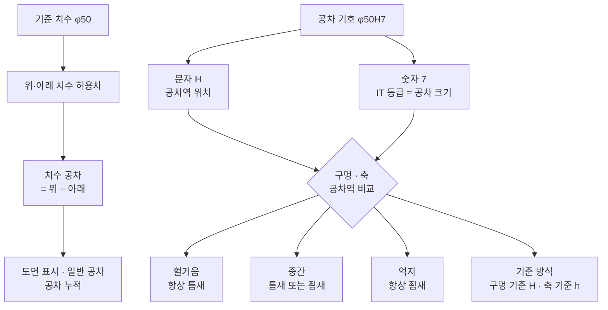

## 1. 치수 공차의 용어

공장에서 φ50을 "정확히 50.000"으로 깎는 것은 불가능하다. 그래서 설계자는 "**50.000 ~ 50.025 사이면 합격**"처럼 허용 범위를 준다. 이 범위의 폭이 **치수 공차**, 범위의 위·아래 끝이 기준 치수에서 얼마나 떨어졌는지가 **치수 허용차**다.

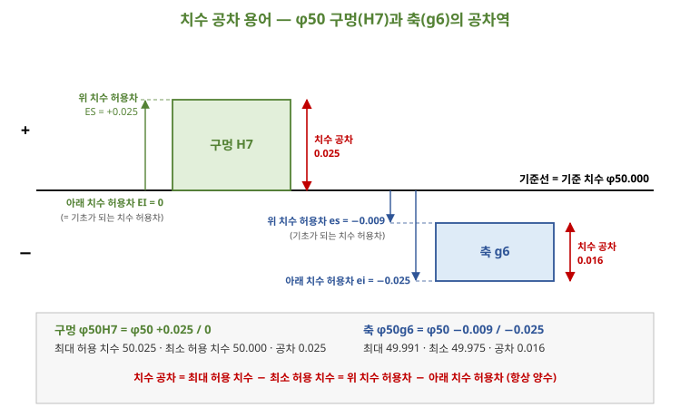

*가로 검은 선이 **기준선**(기준 치수 φ50.000)이다. 구멍 H7의 공차역(초록)은 기준선에서 시작해 위로 0.025, 축 g6의 공차역(파랑)은 기준선 아래 −0.009 ~ −0.025에 떠 있다. 상자의 **높이**가 치수 공차이고, 상자 중 **기준선에 가까운 쪽 끝**이 기초가 되는 치수 허용차다 (구멍 H는 아래 0, 축 g는 위 −0.009). 구멍은 대문자 ES·EI, 축은 소문자 es·ei로 쓴다.*

$$\text{위 치수 허용차} = \text{최대 허용 치수} - \text{기준 치수}, \qquad \text{아래 치수 허용차} = \text{최소 허용 치수} - \text{기준 치수}$$

$$\text{치수 공차} = \text{최대 허용 치수} - \text{최소 허용 치수} = \text{위 치수 허용차} - \text{아래 치수 허용차} \;(>0)$$

### 용어

| 용어 | 뜻 |
| --- | --- |
| 기준 치수 | 공차의 기준이 되는 치수 (예: φ50) |
| 최대·최소 허용 치수 | 허용되는 한계 치수 |
| 위 치수 허용차 | 최대 허용 치수 − 기준 치수 |
| 아래 치수 허용차 | 최소 허용 치수 − 기준 치수 |
| 치수 공차 | 최대 − 최소 허용 치수 |
| 기초가 되는 치수 허용차 | 기준선에 가까운 쪽 허용차 (공차역 위치를 정함) |

**예**: $\phi 50^{+0.025}_{\;\;0}$ → 최대 50.025, 최소 50.000, 공차 0.025

### 계산 예: 허용차 구하기

- 기준 치수 49.000, 최대 49.011, 최소 48.985
  - 위 치수 허용차 = 49.011 − 49.000 = **+0.011**
  - 아래 치수 허용차 = 48.985 − 49.000 = **−0.015**
  - 치수 공차 = 0.011 − (−0.015) = **0.026**

> [!tip] 감 잡기
> 허용차는 기준 치수에서 잰 **위치**(+/− 부호 있음), 공차는 두 위치 사이의 **거리**(항상 +)다. 그래서 $^{-0.012}_{-0.025}$처럼 둘 다 음수여도 공차는 −0.012 − (−0.025) = 0.013이다.

> [!question] 시험에서는
> 한계 치수 두 개를 주고 위·아래 허용차와 공차를 묻거나(2016-2), "치수 공차의 정의"를 고르게 한다(2017-3). 부호를 빼먹어 −0.015를 0.015로 쓰면 공차가 0.004로 틀린다.

## 2. IT 기본 공차 등급 — 숫자는 공차의 "크기"

φ50H7의 **7**은 공차 상자의 **높이**를 정한다. 숫자가 작을수록 상자가 납작해져 정밀하고, 그만큼 가공비가 오른다. 게이지처럼 아주 정밀한 것은 IT1~5, 서로 끼우는 부분은 IT6~10, 그냥 모양만 맞으면 되는 곳은 IT11 이상을 쓴다.

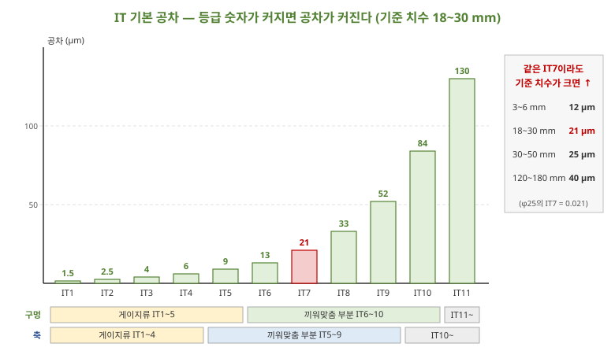

*같은 기준 치수(18~30 mm)에서 등급이 하나 오를 때마다 공차가 약 1.6배씩 커진다. 빨간 막대 IT7 = **21 μm = 0.021 mm**가 교재 예(25 mm의 IT7)다. 오른쪽 상자처럼 **같은 IT7이라도 기준 치수가 클수록** 공차값이 커진다 (φ50이면 0.025 → H7이 $^{+0.025}_{\;\;0}$인 이유). 아래 띠는 구멍과 축의 용도 구간으로, 축이 구멍보다 한 등급 정밀하다.*

### IT 기본 공차 등급의 용도 (대략)

| 용도 | 구멍 | 축 |
| --- | --- | --- |
| 게이지류 | IT1 ~ IT5 | IT1 ~ IT4 |
| 끼워맞춤 부분 | IT6 ~ IT10 | IT5 ~ IT9 |
| 끼워맞춤 외 | IT11 ~ IT18 | IT10 ~ IT18 |

- 같은 등급이라도 **기준 치수가 클수록 공차값이 크다**. 예: 기준 치수 25 mm의 IT7 = **0.021 mm** (교재 CH03 06절).
- 예: $25 \pm 0.05$ → 위 허용차 +0.05, 아래 −0.05, 한계 치수 25.05 / 24.95, 공차 0.10. 보기 중 ±0.01이면 공차 0.02로 가장 작다 (교재 6-1).

> [!tip] 감 잡기
> 축을 구멍보다 한 등급 정밀하게(H7 구멍 + g6·k6·p6 축) 짝짓는 경우가 많다. 축은 선반·연삭으로 바깥을 깎으니 정밀하게 만들기 쉽고, 구멍은 안쪽이라 어렵기 때문이다.

## 3. 공차역의 위치 — 문자는 상자가 "어디에" 있는가

숫자가 상자의 높이라면 **문자는 상자가 기준선의 위·아래 어디에 떠 있는지**를 정한다. 구멍은 A에 가까울수록 크게(위로), 축은 a에 가까울수록 작게(아래로) 만든다. 둘 다 "틈이 많이 남는 쪽"이다. 반대로 Z·z 쪽으로 갈수록 구멍은 작아지고 축은 커져서 꽉 끼게 된다.

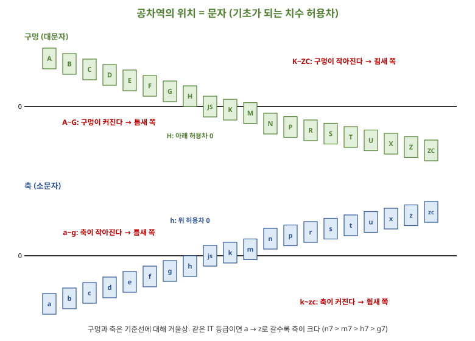

*위가 구멍(대문자), 아래가 축(소문자)이다. 구멍 A~G는 기준선 **위**, H는 기준선에 **아래 끝이 붙고**, JS는 기준선 양쪽 **대칭**, K 이후는 점점 **아래**로 내려간다. 축은 정확히 거울상이라 a~g는 기준선 **아래**, h는 **위 끝이 붙고**, k 이후는 **위**로 올라간다. 그래서 같은 IT 등급이면 알파벳이 뒤일수록 축이 크다.*

### 공차역 위치 한눈에 보기

| 구멍 (대문자) | 축 (소문자) | 위치 |
| --- | --- | --- |
| A ~ G | a ~ g | 구멍은 기준선 **위**(크게), 축은 기준선 **아래**(작게) → 틈새 쪽 |
| H | h | 구멍 아래 허용차 0 / 축 위 허용차 0 |
| JS | js | 기준선 양쪽 대칭 |
| K ~ ZC | k ~ zc | 구멍은 작아지고, 축은 커진다 → 죔새 쪽 |

- 틈새가 가장 큰 조합은 **가장 큰 구멍(A)과 가장 작은 축(a)**.

> [!question] 시험에서는
> "최대 허용 치수가 가장 큰 축"(φ45n7, 2016-1), "위 허용차가 0인 축 기호"(h, 2017-2), "틈새가 가장 큰 짝"(구멍 A·축 a, 2020-1)이 모두 이 그림 한 장으로 풀린다.

## 4. 끼워맞춤의 종류와 틈새·죔새

구멍에 축을 끼울 때 **구멍이 크면 틈새**(손으로 쏙 들어가고 돌아감), **축이 크면 죔새**(망치·프레스로 밀어 넣거나 구멍을 데워서 넣음)가 생긴다. 두 공차역 상자가 **떨어져 있으면** 결과가 하나로 정해지고, **겹치면** 실제 부품을 재 봐야 안다 — 이것이 중간 끼워맞춤이다.

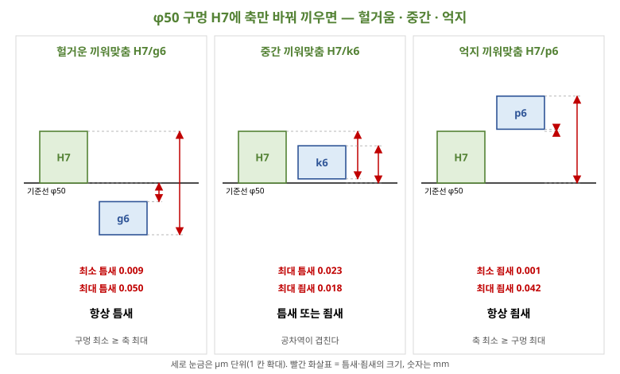

*세 칸 모두 구멍은 같은 H7(0 ~ +0.025)이고 축만 바꿨다. **g6**는 기준선 아래에 있어 상자가 떨어진 채 항상 틈새(최소 0.009, 최대 0.050). **k6**(+0.002 ~ +0.018)는 H7 상자와 높이가 겹쳐 틈새(최대 0.023)도 죔새(최대 0.018)도 생긴다. **p6**(+0.026 ~ +0.042)는 H7 위쪽 끝(+0.025)보다도 높아 항상 죔새(최소 0.001, 최대 0.042). 빨간 화살표의 길이가 곧 틈새·죔새의 크기다.*

$$\text{최대 틈새} = \text{구멍 최대} - \text{축 최소}, \qquad \text{최소 틈새} = \text{구멍 최소} - \text{축 최대}$$

$$\text{최대 죔새} = \text{축 최대} - \text{구멍 최소}, \qquad \text{최소 죔새} = \text{축 최소} - \text{구멍 최대}$$

> [!tip] 감 잡기
> "**최대**"를 구할 때는 둘을 **가장 멀리** 떨어뜨린다. 최대 틈새 = 가장 큰 구멍 + 가장 작은 축, 최대 죔새 = 가장 큰 축 + 가장 작은 구멍. "최소"는 그 반대 짝이다.

### 끼워맞춤 종류

| 종류 | 조건 | 예 (구멍 기준) | 용도 |
| --- | --- | --- | --- |
| 헐거운 끼워맞춤 | 구멍 최소 ≥ 축 최대 | H7/g6, H7/f7, H8/e8 | 미끄럼 베어링, 회전·이동 부품 |
| 중간 끼워맞춤 | 겹침 | H7/js6, H7/k6, H7/m6 | 기어·풀리 고정(키 병용), 베어링 정지 링 |
| 억지 끼워맞춤 | 축 최소 ≥ 구멍 최대 | H7/p6, H7/r6, H7/s6 | 영구 결합, 압입·열박음 |

### 계산 예: φ50 H7/g6

- H7: $^{+0.025}_{\;\;0}$ → 구멍 50.000 ~ 50.025
- g6: $^{-0.009}_{-0.025}$ → 축 49.975 ~ 49.991
- 최대 틈새 = 50.025 − 49.975 = **0.050**
- 최소 틈새 = 50.000 − 49.991 = **0.009** → 항상 틈새 → **헐거운 끼워맞춤**

### 계산 예: 중간 끼워맞춤 판정

- 구멍 $\phi 30^{+0.021}_{\;\;0}$, 축 $\phi 30^{+0.015}_{+0.002}$
  - 최대 틈새 = 30.021 − 30.002 = **0.019**
  - 최대 죔새 = 30.015 − 30.000 = **0.015**
  - 틈새도 죔새도 생길 수 있으므로 **중간 끼워맞춤**

### 실제 끼워맞춤 표

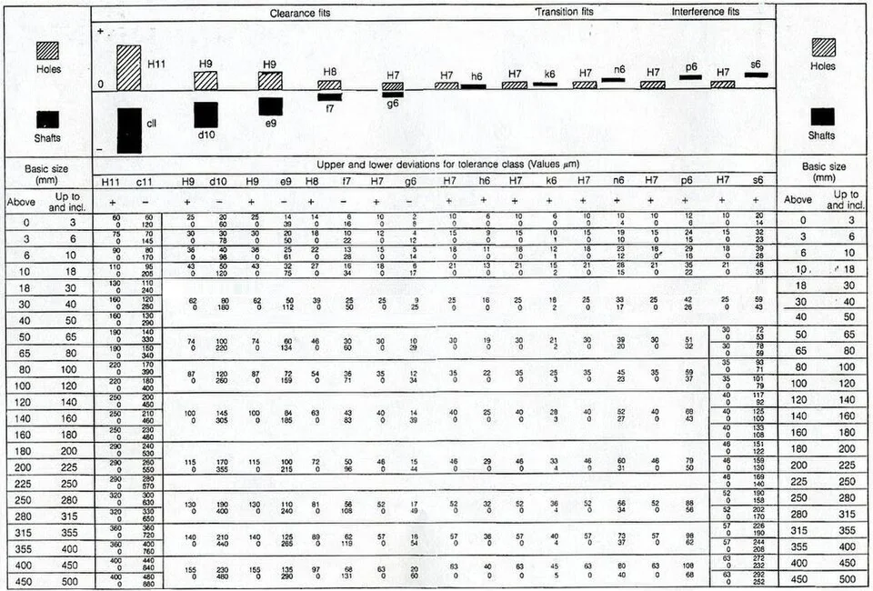

*설계자가 보는 실제 표(영문)다. 위 그림에서 빗금 막대가 구멍, 검은 막대가 축이고, 왼쪽부터 **Clearance**(헐거움: H11/c11, H9/d10, H9/e9, H8/f7, H7/g6, H7/h6) → **Transition**(중간: H7/k6, H7/n6) → **Interference**(억지: H7/p6, H7/s6) 순으로 축 막대가 기준선 0 아래에서 위로 올라간다. 아래 표의 30~50 mm 줄을 보면 H7 = +25/0, g6 = −9/−25, k6 = +18/+2, p6 = +42/+26 μm로 위 3종 그림의 값과 같다. 시험장에서는 이 표가 없으니 문자 순서로 판단한다.*

### 끼워맞춤은 어디에 쓰나 — 베어링 예

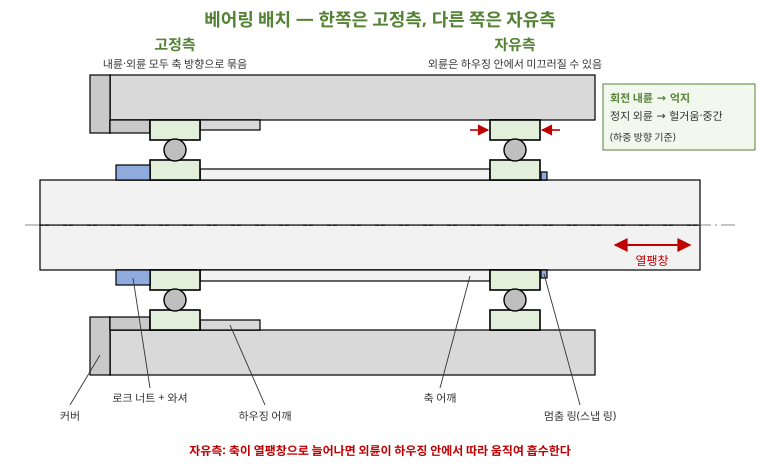

*[베어링](베어링.md) 단원 그림을 다시 썼다. 축과 함께 도는 **내륜은 억지**(또는 중간)로 축에 꽉 끼워 미끄러지지 않게 하고, 하우징에 들어가는 **외륜은 헐거움·중간**으로 두어 자유측 외륜이 열팽창만큼 축 방향으로 움직일 수 있게 한다. 같은 부품 안에서도 기능에 따라 끼워맞춤을 다르게 고른다.*

> [!question] 시험에서는
> H7/g6을 **중간** 끼워맞춤이라고 한 틀린 보기가 반복된다(2015-2, 2019-3). g는 기준선 아래 = 헐거움 쪽이다. H7 구멍에 "억지로 끼워지는 축"을 고르라 하면 p·r·s를 찾는다(2014-2, 2014-3, 2017-1).

## 5. 구멍 기준식과 축 기준식

끼워맞춤은 구멍과 축의 **상대 위치**만 맞으면 되므로, 둘 중 하나를 고정하고 다른 쪽만 바꾸면 종류를 줄일 수 있다. 구멍을 H로 고정하면 **구멍 기준식**, 축을 h로 고정하면 **축 기준식**이다.

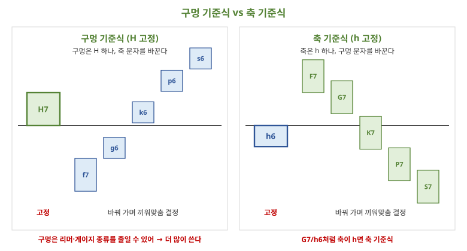

*왼쪽은 구멍 H7(굵은 테두리)을 고정하고 축 f7·g6·k6·p6·s6를 골라 헐거움 → 억지를 만든다. 오른쪽은 축 h6을 고정하고 구멍 F7·G7·K7·P7·S7를 바꾼다. 구멍 쪽 그림이 축 쪽 그림의 거울상이다. **G7/h6**은 축이 h이므로 오른쪽, 즉 축 기준식 헐거운 끼워맞춤이다.*

- 구멍 기준식(H 고정, 축을 바꿈)이 더 많이 쓰인다. 구멍은 리머·드릴·플러그 게이지 같은 **정해진 공구**로 가공·측정하므로, 구멍을 H 하나로 묶으면 공구 종류가 크게 줄어든다. 축은 선반·연삭으로 바깥 지름을 자유롭게 맞추기 쉽다.
- 축 기준식은 긴 인발 봉재(h 공차로 나오는 축)를 그대로 쓰고 여러 부품을 끼울 때 유리하다.

> [!question] 시험에서는
> G7/h6을 주고 "구멍 기준식 헐거운 끼워맞춤"이라는 틀린 보기를 섞는다(2017-3). **h가 있는 쪽이 기준**이다.

## 6. 도면 표시법과 일반 공차

공차는 도면에 기호로 쓰거나, 수치로 쓰거나, 한계 치수 두 개를 직접 쓴다. 공차를 따로 적지 않은 치수는 표제란의 **일반 공차**를 따른다.

### 도면 표시법

| 방법 | 예 |
| --- | --- |
| 공차 기호 | φ50H7, φ50g6 |
| 수치 | $\phi 50^{+0.025}_{\;\;0}$ |
| 조립 표시 | φ50 H7/g6 |
| 한계 치수 | 50.025 / 50.000 |

- 조립 표시 φ50 H7/g6에서 **분자(앞)가 구멍, 분모(뒤)가 축**이다. 대문자·소문자로도 구분된다.

### 일반 공차 (공차 표시 없는 치수)

- KS B ISO 2768-1: 등급 **f(정밀), m(중간), c(거침), v(매우 거침)**.
- 표제란이나 주기에 "일반 공차 KS B ISO 2768-m"처럼 적는다.

## 7. 공차 누적

부품 하나하나가 공차 안에 있어도, 치수를 **이어서** 달면 오차가 한 방향으로 쌓여 끝 위치가 크게 어긋날 수 있다.

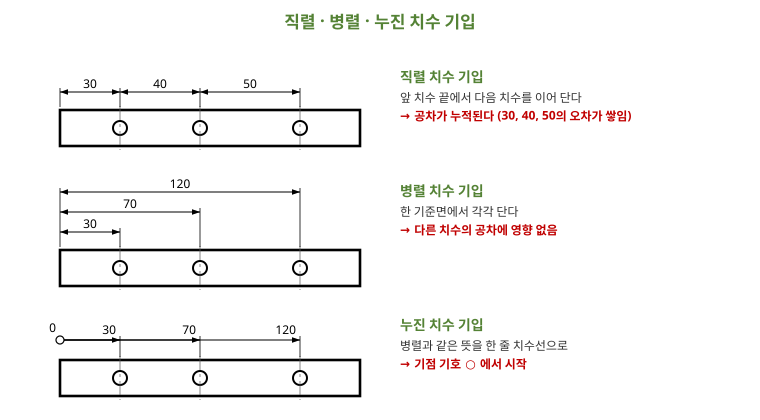

*[도면 양식과 투상법](도면_양식과_투상법.md) 단원 그림을 다시 썼다. 직렬(30·40·50)로 달면 세 번째 구멍 위치에 세 공차가 모두 더해진다. 예를 들어 각 치수가 ±0.1이면 끝 구멍은 최악 ±0.3까지 벗어날 수 있다. 병렬·누진처럼 **한 기준면에서** 각각 달면 구멍마다 ±0.1로 끝난다.*

- 직렬 치수 기입은 공차가 **누적**된다 → 기능상 중요한 치수는 **기준면에서 병렬**로 기입.
- 조립품 틈새 계산: 최악 조건(최대·최소 조합)으로 검토.

## 8. 한계 게이지로 끼워맞춤 검사

현장에서는 H7 구멍을 매번 마이크로미터로 재지 않는다. **최소 허용 치수로 만든 통과측(GO)** 은 들어가고 **최대 허용 치수로 만든 정지측(NOT GO)** 은 안 들어가면 합격이다. 공차를 치수 대신 "들어가나·안 들어가나"로 바꾼 도구다. 자세한 내용은 [기계공작과 측정](기계공작과_측정.md) 단원.

| 구멍 검사 — 플러그 게이지 | 축 검사 — 스냅 게이지 |
| :-: | :-: |
|  | 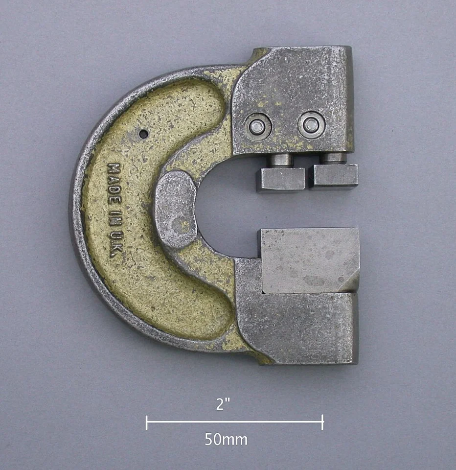 |

*왼쪽: 구멍용 플러그 게이지. 통과측 = 구멍 **최소** 허용 치수(φ50H7이면 50.000), 정지측 = 구멍 **최대** 허용 치수(50.025). 테일러의 원리대로 통과측은 길게, 정지측은 짧게 만든다. 오른쪽: 축용 스냅 게이지. 입구 쪽 통과측 = 축 **최대** 허용 치수, 안쪽 정지측 = 축 **최소** 허용 치수. 구멍과 축에서 GO·NOT GO에 대응하는 한계가 서로 반대인 것은 둘 다 "재료가 가장 많은 상태(최대 실체)는 통과해야 한다"는 같은 규칙이기 때문이다.*

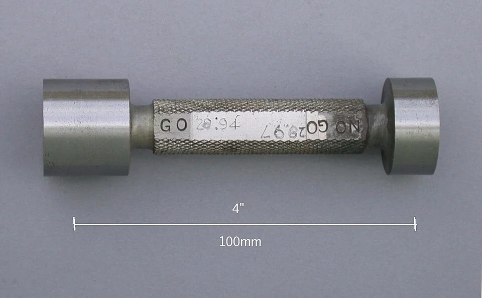

*실물 양구 플러그 게이지(전체 길이 약 100 mm). 손잡이에 **GO 28.94**, **NO GO 28.97**이 새겨져 있다. 즉 이 구멍의 최소 허용 치수 28.94, 최대 허용 치수 28.97, 치수 공차 0.03이다. 왼쪽 통과측이 길고 오른쪽 정지측이 짧아 테일러의 원리와 같다.*

## 그림

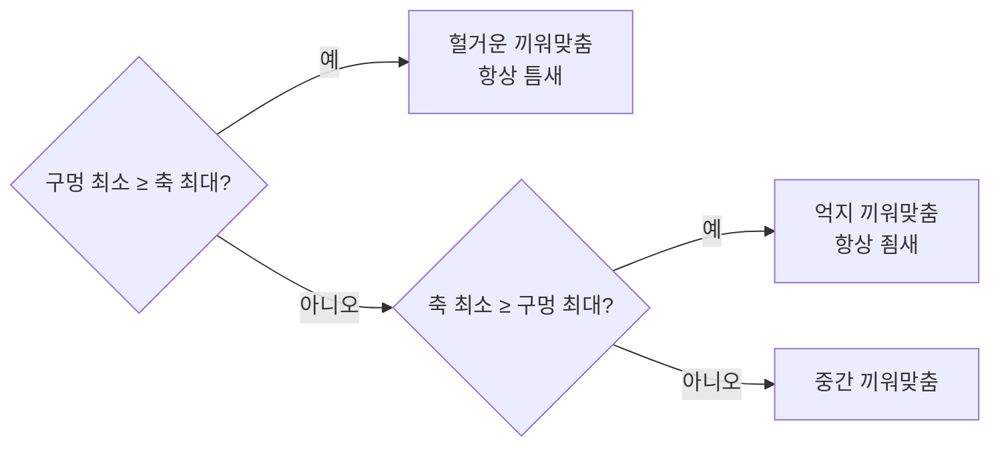

## 기출 포인트

- 끼워맞춤 종류 판정 — **11회**: 수치로 판정 (2014-1, 2014-3), H7 구멍에 억지로 끼워지는 축 기호 고르기 (2014-2, 2014-3, 2017-1), H7/g6 해석 (2015-2, 2019-3), G7/h6 축 기준식 헐거움 (2017-3), 공차역 문자로 최대 허용 치수 비교 (2016-1), 위 허용차가 0인 축 기호 h (2017-2), 틈새가 가장 큰 구멍·축 조합 (2020-1)
- 치수 공차·허용차 계산 — 6회: 공차값 계산 (2014-2, 2016-3, 2018-3, 2020-3), 위·아래 치수 허용차 (2016-2), 치수 공차의 정의 (2017-3)
- 틈새·죔새 계산과 정의 — 5회: 최대 틈새 (2015-1, 2018-2), 최소 틈새 (2019-2), 최대 죔새 정의 (2016-1, 2018-1)
- H7/g6이 **중간** 끼워맞춤이라는 틀린 보기가 두 번(2015-2, 2019-3) 나왔다. g는 헐거움 쪽이다.

**교재 예제 유형** (Win-Q 2025 PART 01 CHAPTER 03, 06절): 공차가 가장 작은 것(±0.01), 위·아래 허용차(+0.011, −0.015), 각도 허용 한계 지시(그림), H7/r6 판정(구멍 기준 억지), 도면 공차로 끼워맞춤 판정(그림, 중간), 용어 정의 중 틀린 것(죔새·틈새), 최대 허용 치수가 가장 큰 축(φ45n7), 구멍·축 공차 기입(그림), 틈새가 가장 큰 짝(구멍 A·축 a). 옛 기출과 거의 같은 문제가 많다.

## 관련 단원

- [기하공차](기하공차.md)
- [도면 양식과 투상법](도면_양식과_투상법.md)
- [베어링](베어링.md)
- [기계공작과 측정](기계공작과_측정.md) — 한계 게이지·테일러의 원리

## 체크리스트

- [ ] 치수 허용차와 치수 공차를 계산한다
- [ ] 구멍·축 기호의 대소문자와 H·h의 의미를 안다
- [ ] 최대 틈새·최대 죔새를 계산한다
- [ ] 끼워맞춤 3종의 예와 용도를 말한다
- [ ] 구멍 기준식이 많이 쓰이는 이유를 안다
- [ ] 일반 공차 등급 f·m·c·v를 안다
- [ ] 최소 틈새·최소 죔새 식을 헷갈리지 않는다
- [ ] 구멍·축 공차역 문자 순서로 헐거움·중간·억지를 판정한다
- [ ] G7/h6 같은 축 기준식 표기를 알아본다
- [ ] 음수 허용차끼리의 치수 공차를 계산한다

## 참고

- [큐넷 자동화설비산업기사 출제기준](https://www.q-net.or.kr/crf005.do?id=crf00503&jmCd=2034)
- KS B ISO 286 (치수 공차와 끼워맞춤)

### 그림 출처

위키미디어 공용(Wikimedia Commons)과 Openverse에서 가져온 공개 라이선스 자료이고, 노트에 맞게 크기를 줄이고 WebP로 변환했다.

| 그림 | 작성자 | 라이선스 | 출처 |
| --- | --- | --- | --- |
| [Limits and Fits](https://commons.wikimedia.org/wiki/File:Limits_and_Fits.jpg) | K-code-g | [CC BY-SA 4.0](https://creativecommons.org/licenses/by-sa/4.0) | Wikimedia Commons |
| [GaugeGapPlainGoNoGo](https://commons.wikimedia.org/wiki/File:GaugeGapPlainGoNoGo.jpg) | Glenn McKechnie | [CC BY-SA 3.0](http://creativecommons.org/licenses/by-sa/3.0/) | Wikimedia Commons |
| [GaugePlugSpecialGoNoGo](https://commons.wikimedia.org/wiki/File:GaugePlugSpecialGoNoGo.jpg) | Glenn McKechnie | [CC BY-SA 3.0](http://creativecommons.org/licenses/by-sa/3.0/) | Wikimedia Commons |

직접 그린 그림(SVG, 이 볼트용으로 새로 작성): 치수공차 용어, IT등급 공차값, 공차역 문자위치, 끼워맞춤 3종 공차역, 구멍기준 축기준, 베어링 고정측 자유측([베어링](베어링.md)에서 재사용), 치수 기입법([도면 양식과 투상법](도면_양식과_투상법.md)에서 재사용), 테일러 한계게이지([기계공작과 측정](기계공작과_측정.md)에서 재사용). 스냅 게이지 사진(GaugeGapPlainGoNoGo)도 [기계공작과 측정](기계공작과_측정.md)에서 재사용했다.

