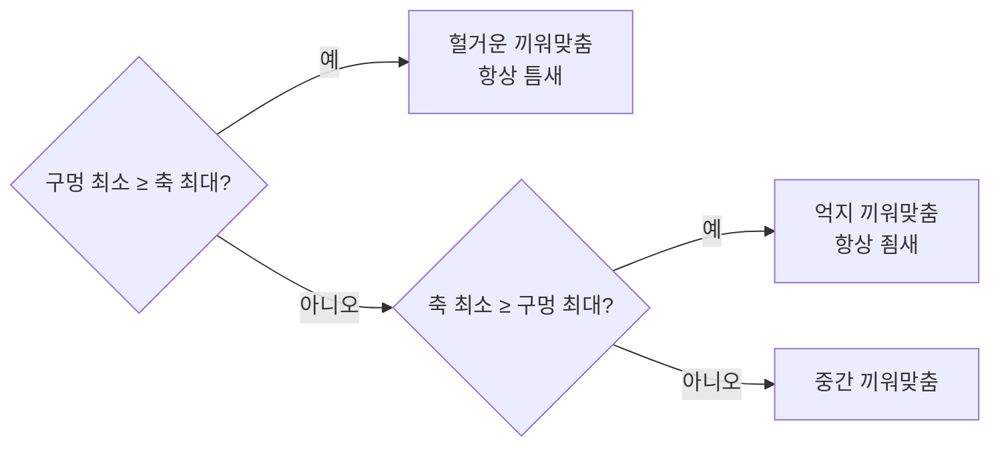

# 치수공차와 끼워맞춤

> [!summary] 핵심 요약
> - **치수 공차** = 최대 허용 치수 − 최소 허용 치수 = 위 치수 허용차 − 아래 치수 허용차.
> - 구멍은 **대문자**(H7), 축은 **소문자**(g6). 문자는 공차역 **위치**, 숫자는 **IT 등급(공차 크기)**.
> - **H 구멍**은 아래 치수 허용차 0, **h 축**은 위 치수 허용차 0.
> - 끼워맞춤: **헐거움**(항상 틈새), **억지**(항상 죔새), **중간**(틈새 또는 죔새).

> [!warning] 자주 틀리는 포인트
> - **최대 틈새** = 구멍 최대 − 축 최소. **최대 죔새** = 축 최대 − 구멍 최소.
> - 구멍 기준식(H 고정, 축을 바꿈)이 **가공·측정이 쉬워 더 많이 쓴다**. 축 기준식은 h 고정.
> - 축 기호 a~h는 헐거움 쪽, js·k·m·n은 중간, p~zc는 억지 쪽 (H 구멍 기준일 때 대략적 경향).
> - IT 등급은 **IT01, IT0, IT1 ~ IT18** (20등급). 숫자가 작을수록 정밀.
> - **최소 틈새** = 구멍 최소 − 축 최대. 최대 틈새와 짝을 바꿔 쓰는 실수가 많다.
> - **G7/h6** 처럼 축이 h면 **축 기준식**이다. 구멍 문자가 G라서 구멍 기준식이라고 착각하지 말 것.
> - 치수 공차는 항상 **양수**(위 − 아래). 위·아래 허용차가 둘 다 음수여도 공차는 그 차이다. 예: $^{-0.012}_{-0.025}$ → 공차 0.013.
> - 같은 IT 등급이면 축 기호가 알파벳 뒤로 갈수록(a → z) 축이 커진다. 그래서 n7 > m7 > h7 > g7 순으로 최대 허용 치수가 크다.
> - 교재 요령: 시험장에서는 끼워맞춤 표를 볼 수 없으니 **문자가 z에 가까울수록 축은 커지고(죔새), A에 가까울수록 구멍은 커진다(틈새)** 로 판단한다. H7/r6 → **구멍 기준식 억지** (교재 CH03 6-4).
> - 축이 구멍보다 클 때 생기는 것은 **죔새**다. "틈새"로 바꾼 정의는 틀림 (교재 6-6).

## 개념 정리

### 용어

| 용어 | 뜻 |
| --- | --- |
| 기준 치수 | 공차의 기준이 되는 치수 (예: φ50) |
| 최대·최소 허용 치수 | 허용되는 한계 치수 |
| 위 치수 허용차 | 최대 허용 치수 − 기준 치수 |
| 아래 치수 허용차 | 최소 허용 치수 − 기준 치수 |
| 치수 공차 | 최대 − 최소 허용 치수 |
| 기초가 되는 치수 허용차 | 기준선에 가까운 쪽 허용차 (공차역 위치를 정함) |

**예**: $\phi 50^{+0.025}_{\;\;0}$ → 최대 50.025, 최소 50.000, 공차 0.025

### IT 기본 공차 등급의 용도 (대략)

| 용도 | 구멍 | 축 |
| --- | --- | --- |
| 게이지류 | IT1 ~ IT5 | IT1 ~ IT4 |
| 끼워맞춤 부분 | IT6 ~ IT10 | IT5 ~ IT9 |
| 끼워맞춤 외 | IT11 ~ IT18 | IT10 ~ IT18 |

- 같은 등급이라도 **기준 치수가 클수록 공차값이 크다**. 예: 기준 치수 25 mm의 IT7 = **0.021 mm** (교재 CH03 06절).
- 예: $25 \pm 0.05$ → 위 허용차 +0.05, 아래 −0.05, 한계 치수 25.05 / 24.95, 공차 0.10. 보기 중 ±0.01이면 공차 0.02로 가장 작다 (교재 6-1).

### 끼워맞춤 종류

| 종류 | 조건 | 예 (구멍 기준) | 용도 |
| --- | --- | --- | --- |
| 헐거운 끼워맞춤 | 구멍 최소 ≥ 축 최대 | H7/g6, H7/f7, H8/e8 | 미끄럼 베어링, 회전·이동 부품 |
| 중간 끼워맞춤 | 겹침 | H7/js6, H7/k6, H7/m6 | 기어·풀리 고정(키 병용), 베어링 정지 링 |
| 억지 끼워맞춤 | 축 최소 ≥ 구멍 최대 | H7/p6, H7/r6, H7/s6 | 영구 결합, 압입·열박음 |

### 계산 예: φ50 H7/g6

- H7: $^{+0.025}_{\;\;0}$ → 구멍 50.000 ~ 50.025
- g6: $^{-0.009}_{-0.025}$ → 축 49.975 ~ 49.991
- 최대 틈새 = 50.025 − 49.975 = **0.050**
- 최소 틈새 = 50.000 − 49.991 = **0.009** → 항상 틈새 → **헐거운 끼워맞춤**

### 계산 예: 허용차 구하기

- 기준 치수 49.000, 최대 49.011, 최소 48.985
  - 위 치수 허용차 = 49.011 − 49.000 = **+0.011**
  - 아래 치수 허용차 = 48.985 − 49.000 = **−0.015**
  - 치수 공차 = 0.011 − (−0.015) = **0.026**

### 계산 예: 중간 끼워맞춤 판정

- 구멍 $\phi 30^{+0.021}_{\;\;0}$, 축 $\phi 30^{+0.015}_{+0.002}$
  - 최대 틈새 = 30.021 − 30.002 = **0.019**
  - 최대 죔새 = 30.015 − 30.000 = **0.015**
  - 틈새도 죔새도 생길 수 있으므로 **중간 끼워맞춤**

### 공차역 위치 한눈에 보기

| 구멍 (대문자) | 축 (소문자) | 위치 |
| --- | --- | --- |
| A ~ G | a ~ g | 구멍은 기준선 **위**(크게), 축은 기준선 **아래**(작게) → 틈새 쪽 |
| H | h | 구멍 아래 허용차 0 / 축 위 허용차 0 |
| JS | js | 기준선 양쪽 대칭 |
| K ~ ZC | k ~ zc | 구멍은 작아지고, 축은 커진다 → 죔새 쪽 |

- 틈새가 가장 큰 조합은 **가장 큰 구멍(A)과 가장 작은 축(a)**.

### 일반 공차 (공차 표시 없는 치수)

- KS B ISO 2768-1: 등급 **f(정밀), m(중간), c(거침), v(매우 거침)**.
- 표제란이나 주기에 "일반 공차 KS B ISO 2768-m"처럼 적는다.

### 도면 표시법

| 방법 | 예 |
| --- | --- |
| 공차 기호 | φ50H7, φ50g6 |
| 수치 | $\phi 50^{+0.025}_{\;\;0}$ |
| 조립 표시 | φ50 H7/g6 |
| 한계 치수 | 50.025 / 50.000 |

### 공차 누적

- 직렬 치수 기입은 공차가 **누적**된다 → 기능상 중요한 치수는 **기준면에서 병렬**로 기입.
- 조립품 틈새 계산: 최악 조건(최대·최소 조합)으로 검토.

## 그림

## 기출 포인트

- 끼워맞춤 종류 판정 — **11회**: 수치로 판정 (2014-1, 2014-3), H7 구멍에 억지로 끼워지는 축 기호 고르기 (2014-2, 2014-3, 2017-1), H7/g6 해석 (2015-2, 2019-3), G7/h6 축 기준식 헐거움 (2017-3), 공차역 문자로 최대 허용 치수 비교 (2016-1), 위 허용차가 0인 축 기호 h (2017-2), 틈새가 가장 큰 구멍·축 조합 (2020-1)
- 치수 공차·허용차 계산 — 6회: 공차값 계산 (2014-2, 2016-3, 2018-3, 2020-3), 위·아래 치수 허용차 (2016-2), 치수 공차의 정의 (2017-3)
- 틈새·죔새 계산과 정의 — 5회: 최대 틈새 (2015-1, 2018-2), 최소 틈새 (2019-2), 최대 죔새 정의 (2016-1, 2018-1)
- H7/g6이 **중간** 끼워맞춤이라는 틀린 보기가 두 번(2015-2, 2019-3) 나왔다. g는 헐거움 쪽이다.

**교재 예제 유형** (Win-Q 2025 PART 01 CHAPTER 03, 06절): 공차가 가장 작은 것(±0.01), 위·아래 허용차(+0.011, −0.015), 각도 허용 한계 지시(그림), H7/r6 판정(구멍 기준 억지), 도면 공차로 끼워맞춤 판정(그림, 중간), 용어 정의 중 틀린 것(죔새·틈새), 최대 허용 치수가 가장 큰 축(φ45n7), 구멍·축 공차 기입(그림), 틈새가 가장 큰 짝(구멍 A·축 a). 옛 기출과 거의 같은 문제가 많다.

## 관련 단원

- [기하공차](기하공차.md)
- [도면 양식과 투상법](도면_양식과_투상법.md)
- [베어링](베어링.md)

## 체크리스트

- [ ] 치수 허용차와 치수 공차를 계산한다
- [ ] 구멍·축 기호의 대소문자와 H·h의 의미를 안다
- [ ] 최대 틈새·최대 죔새를 계산한다
- [ ] 끼워맞춤 3종의 예와 용도를 말한다
- [ ] 구멍 기준식이 많이 쓰이는 이유를 안다
- [ ] 일반 공차 등급 f·m·c·v를 안다
- [ ] 최소 틈새·최소 죔새 식을 헷갈리지 않는다
- [ ] 구멍·축 공차역 문자 순서로 헐거움·중간·억지를 판정한다
- [ ] G7/h6 같은 축 기준식 표기를 알아본다
- [ ] 음수 허용차끼리의 치수 공차를 계산한다

## 참고

- [큐넷 자동화설비산업기사 출제기준](https://www.q-net.or.kr/crf005.do?id=crf00503&jmCd=2034)
- KS B ISO 286 (치수 공차와 끼워맞춤)
