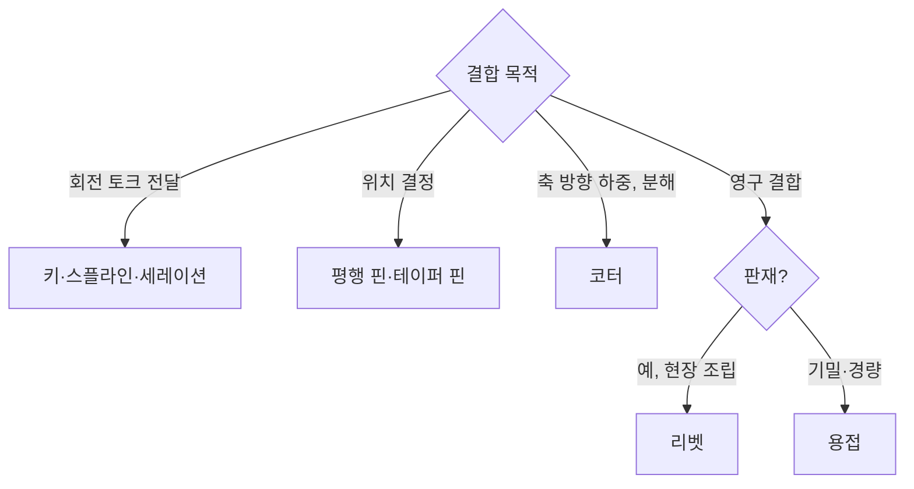

# 키·핀·코터·리벳·용접

> [!summary] 핵심 요약
> - **키**: 축과 보스(기어·풀리)를 결합해 토크 전달. 가장 많이 쓰는 것은 **묻힘 키(성크 키)**.
> - 토크 전달 능력 큰 순: **세레이션 > 스플라인 > 접선 키 > 묻힘 키 > 평 키 > 안장 키**.
> - **핀**: 위치 결정·가벼운 고정. **코터**: 축 방향 결합(분해 가능). **리벳**: 영구 결합(판재). **용접**: 영구 결합, 기밀.
> - 키의 전단 응력 $\tau = \dfrac{2T}{bld}$, 압축 응력 $\sigma_c = \dfrac{4T}{hld}$.

> [!warning] 자주 틀리는 포인트
> - **안장 키(새들 키)** 는 축에 홈을 파지 않는다 → 마찰로만 전달, 작은 토크.
> - **반달 키(우드러프 키)** 는 테이퍼 축에 쓰기 좋지만 키 홈이 깊어 축이 약해진다.
> - **미끄럼 키(페더 키)** 는 보스가 축 방향으로 **움직일 수 있게** 한 키.
> - 테이퍼 핀의 테이퍼는 **1/50**, 호칭 지름은 **작은 쪽** 지름.
> - 필릿 용접의 목 두께 $a = 0.707h$ (h: 다리 길이).
> - 평행 핀 호칭 순서: **명칭 − 호칭 지름 공차 × 호칭 길이 − 재료** (예: `평행 핀 − 6 m6 × 30 − St`). 공차는 지름 바로 뒤에 붙는다.
> - **분할 핀**의 호칭 지름은 **핀 구멍 지름**, 호칭 길이는 머리 아래부터 **짧은 쪽 다리 끝**까지.
> - 용접 기호가 기준선의 **실선 쪽**에 있으면 **화살표 쪽** 용접, **점선 쪽**에 있으면 **화살표 반대쪽** 용접.
> - 필릿 용접 치수 앞 문자: **a = 목 두께**, **z = 목 길이(다리 길이)**. 문자 없이 숫자만 있으면 기출에서는 목 길이로 해석했다.

## 개념 정리

### 키의 종류

| 키 | 특징 |
| --- | --- |
| 묻힘 키 (성크 키) | 축과 보스 양쪽에 홈, 가장 일반적. 평행 키·경사 키(1/100) |
| 평 키 (납작 키) | 축을 평평하게 깎음, 안장 키보다 큰 토크 |
| 안장 키 (새들 키) | 축에 홈 없음, 마찰 전달 |
| 접선 키 | 120° 간격 2쌍, 큰 토크·역회전 |
| 반달 키 (우드러프) | 반달 모양, 자동 조심, 테이퍼 축 |
| 미끄럼 키 (페더 키) | 보스가 축 방향 이동 |
| 둥근 키 (핀 키) | 축과 보스 사이에 핀, 작은 토크 |
| 스플라인 | 축에 여러 개 키를 일체로 깎음, 큰 토크·축 방향 이동 |
| 세레이션 | 작은 삼각 이 다수, 가장 큰 토크, 미세 위치 조정 |
| 원뿔 키 | 홈 없이 원뿔 통을 끼워 마찰로 축의 임의 위치에 고정 |

- 교재(CH03 12절) 보충:
  - **접선 키**: 기울기 1/100 키 2개를 서로 반대로 맞춰 쓰고, 역회전하면 2쌍을 **120°** 로 배치. 정사각 단면 키를 **90°** 로 배치한 것은 **케네디 키** (교재 12절 예제 정답: 접선 키).
  - 안장 키·평 키도 기울기 1/100. 성크 키가 가장 많이 쓰인다.
  - 스플라인은 축 둘레에 같은 피치의 키를 **4~20개** 깎은 것. 세레이션은 같은 지름의 스플라인보다 이가 많아 더 큰 동력을 전하고, 자동차 핸들·전동기·발전기 축에 쓴다.
  - 둥근 키는 토크가 아주 작은 곳, 반달 키는 공작기계 핸들 같은 테이퍼 축.

**키 기호와 호칭 (교재 CH03 16절)**

| 기호 | 키 |
| --- | --- |
| P / PS | 나사용 구멍 없는 / 있는 평행 키 |
| T / TG | 머리 없는 / **머리 있는** 경사 키 |
| WA / WB | 둥근 바닥 / 납작 바닥 반달 키 |

- 호칭 순서: 표준 번호, 종류(기호)와 호칭 치수(폭 × 높이), 길이, 끝 모양, 재료. 예: `KS B 1311 평행 키 10 × 8 × 25 양끝 둥긂 SM45C`, `KS B 1311 TG 20 × 12 × 70` = 머리 있는 경사 키, 폭 20 × 높이 12, 길이 70.

### 키 강도 계산

- 키에 걸리는 접선력 $F = \dfrac{2T}{d}$
- 전단: $\tau = \dfrac{F}{bl} = \dfrac{2T}{bld}$ (b: 키 폭, l: 키 길이)
- 압축(면압): $\sigma_c = \dfrac{F}{(h/2)l} = \dfrac{4T}{hld}$ (h: 키 높이)
- 키 길이는 보통 축 지름의 **1.5배 정도**까지.

### 핀

| 핀 | 용도 |
| --- | --- |
| 평행 핀 | 부품 위치 결정 (다웰 핀) |
| 테이퍼 핀 (1/50) | 위치 결정, 분해 후 재조립 정밀 |
| 분할 핀 | 너트 풀림 방지, 축 빠짐 방지 |
| 스프링 핀 | 탄성으로 구멍에 고정, 가공 간단 |
| 너클 핀 | 두 막대를 회전 가능하게 연결 (링크) |

**핀의 호칭 방법**

| 핀 | 호칭 예 | 순서 |
| --- | --- | --- |
| 평행 핀 | 평행 핀 − 6 m6 × 30 − St | 명칭 − 지름·공차 × 길이 − 재료 |
| 평행 핀 (스테인리스) | 평행 핀 − 5 h7 × 25 − A1 | A1: 오스테나이트계 스테인리스 등급 |
| 분할 핀 | 분할 핀 − 5 × 50 − St | 명칭 − 호칭 지름 × 호칭 길이 − 재료 |

- 분할 핀 호칭 지름은 끼우는 **구멍 지름** 기준이라 실제 핀 소재 지름보다 조금 크다.

**교재(CH03 15절) 호칭 형식**

| 핀 | 순서 | 예 |
| --- | --- | --- |
| 평행 핀 | 표준 번호 또는 명칭, 종류, 형식, 호칭 지름 × 길이, 재료 | m6 A − 6 × 45 SB41 |
| 테이퍼 핀 | 명칭, 등급, 호칭 지름 × 길이, 재료 | 테이퍼 핀 1급 2 × 10 SM50C |
| 분할 테이퍼 핀 (슬롯 테이퍼 핀) | 명칭, 호칭 지름 × 길이, 재료, 지정 사항 | 6 × 70 SM35C 갈라짐 깊이 10 |
| 분할 핀 (KS B ISO 1234) | 표준 번호 또는 명칭, 호칭 지름 × 호칭 길이, 재료 | 분할 핀 KS B ISO 1234 5 × 50 − St |

- 호칭 지름: 테이퍼 핀은 **가는 쪽**, 분할 핀은 **끼우는 구멍** 지름.
- 교재 15-1에는 저자 의견이 붙어 있다. 공단 발표 답은 ③인데 저자는 문제 조건상 ①이 맞다고 보고 ①을 정답으로 적었다. 평행 핀 호칭 문제는 이렇게 판본·규격 개정에 따라 답이 갈릴 수 있으니, 공차(m6·h7)가 지름 바로 옆에 붙는 형식을 기준으로 고른다.
- 스프링 핀은 세로로 쪼개진 관 모양이라 해머로 박으면 탄성으로 고정된다.
- 교재(CH03 12절)는 평행 핀을 "너클 핀이라고도 한다"고 적었다. 일반적으로 너클 핀은 두 막대를 회전 가능하게 잇는 다른 핀이므로, 보기에서 평행 핀 = 위치 결정, 너클 핀 = 링크 연결로 구분한다.

### 코터

- 쐐기 모양 판을 끼워 **축 방향** 하중을 받는 두 부재를 결합 (피스톤 로드–크로스헤드).
- 기울기가 작을수록 잘 빠지지 않는다. 자주 분해하면 기울기를 크게, 반영구적이면 작게.
- 자립 조건: 기울기 각이 마찰각보다 작아야 저절로 빠지지 않는다. 교재(CH03 12절) 기준으로 **한쪽 기울기 α ≤ 2ρ, 양쪽 기울기 α ≤ ρ** (ρ: 마찰각).
- 구성: 로드, 소켓, 코터. 기울기: 자주 분해 **1/5~1/10**, 보통 **1/20**, 반영구 **1/50~1/100**.

### 리벳 이음

- 판재를 겹치거나 맞대어 리벳으로 영구 결합 (보일러, 철골, 항공기).
- 종류: 겹치기 이음, 맞대기 이음(덮개판 1장·2장), 1줄·2줄 리벳.
- **강판 효율** $\eta_t = \dfrac{p - d}{p}$ (p: 리벳 피치, d: 리벳 구멍 지름) → 구멍으로 판이 약해진 비율.
- **리벳 효율** = 리벳 전단 강도 / 구멍 없는 판의 인장 강도.
- 기밀을 위해 **코킹·풀러링**.
- **리벳 전단 응력** (1면 전단): $\tau = \dfrac{P}{\pi d^2 / 4}$
  - **계산 예**: 리벳 지름 2.5 cm, 하중 2200 kgf → $\tau = \dfrac{2200}{\pi \times 2.5^2 / 4} = \dfrac{2200}{4.91} \approx 448$ kgf/cm²
  - 2면 전단(양쪽 덮개판 맞대기)이면 전단 면적이 2배.

### 용접 이음

| 종류 | 강도 계산 |
| --- | --- |
| 맞대기 용접 | $\sigma = \dfrac{P}{tl}$ (t: 판 두께) |
| 필릿 용접 | $\tau = \dfrac{P}{al}$, $a = 0.707h$ (h: 다리 길이) |

- 장점: 기밀·수밀, 무게 감소, 공정 단순. 단점: **잔류 응력·변형**, 검사 어려움, 열 영향부 취화.
- 대책: 예열·후열, 용접 순서 조절, 응력 제거 풀림.
- 맞대기 용접 인장 응력은 하중을 **판 두께 × 용접 길이**로 나눈다. 예: P = 6000 N, t = 10 mm, l = 100 mm → $\sigma = 6000 / 1000 = 6$ MPa.

### 용접 기호 읽기

```text
        a5 ▷ 300          ← 기호·치수가 실선 위 = 화살표 쪽
  ───────────────── 기준선(실선)
  - - - - - - - - - 동일선(점선) ← 이쪽에 있으면 화살표 반대쪽
 ↙ 화살표
```

| 기본 기호 | 용접 |
| --- | --- |
| 직각 삼각형 | 필릿 용접 |
| V, ∨ 반쪽(베벨), I, U, J | 맞대기 용접 (홈 모양별) |
| 직사각형 (ㄷ자를 엎은 모양) | **플러그·슬롯 용접** |
| 원 | 스폿(점) 용접 |
| 원 + 가로 두 줄 | 심 용접 |
| 반원 겹침 | 덧붙임(육성) 용접 |

- 치수 기입: 기호 **왼쪽에 단면 치수**(목 두께 a, 목 길이 z, 지름 d, 슬롯 너비 c), **오른쪽에 길이 방향 치수**(용접 길이 l, 개수 n, 피치 e).
- 예: `z6 ▷ 300` → 목 길이 6 mm, 용접 길이 300 mm인 필릿 용접.
- 깃발(현장 용접), 원(전체 둘레 용접) 같은 보조 기호가 기준선 꺾이는 곳에 붙는다.

## 그림



## 기출 포인트

- 핀 호칭 — 3회: 평행 핀 호칭 순서 (2016-2, 2019-2), 분할 핀 호칭 길이 위치 (2017-3)
- 용접 기호 — 3회: 필릿 용접 기호의 치수·화살표 쪽 해석 (2017-2), 플러그 용접 기본 기호 (2017-3), 플러그 용접 기호 치수 해석 (2018-3)
- 용접·리벳 응력 계산 (기초공학) — 2회: 맞대기 용접 인장 응력 식 (2019-2), 리벳 전단 응력 (2020-1)
- 키 종류·강도 계산은 2014~2020년 2과목에 나오지 않았다. 새 출제기준(체결요소 선정·설계)에 맞춰 기본은 유지한다.

**교재 예제 유형** (Win-Q 2025 PART 01 CHAPTER 03, 09·12절): 플러그 용접 기호 고르기(그림, 덧붙임·스폿·필릿과 구분), 120° 2쌍 배치와 케네디 키 설명에 해당하는 키(접선 키). 15~16절: 평행 핀 호칭(저자 의견 있음), 분할 핀 호칭 지름(구멍 지름), 슬롯 테이퍼 핀 호칭 순서, 테이퍼 핀 호칭 치수(가는 쪽 지름), TG 20×12×70 해석.

## 관련 단원

- [나사와 볼트](나사와_볼트.md)
- [축과 축이음](축과_축이음.md)
- [기계설계 기초와 재료강도](기계설계_기초와_재료강도.md)
- [도면 양식과 투상법](도면_양식과_투상법.md)

## 체크리스트

- [ ] 키 종류별 특징과 전달 토크 순서를 안다
- [ ] 키의 전단·압축 응력을 계산한다
- [ ] 핀 종류별 용도와 테이퍼 핀 규격을 안다
- [ ] 리벳 강판 효율을 계산한다
- [ ] 필릿 용접 목 두께를 계산한다
- [ ] 용접의 장단점과 잔류 응력 대책을 말한다
- [ ] 평행 핀·분할 핀 호칭 방법을 순서대로 쓴다
- [ ] 용접 기호의 실선 쪽·점선 쪽 의미를 안다
- [ ] 필릿·플러그·스폿·심 용접 기본 기호를 구분한다
- [ ] 리벳 전단 응력과 맞대기 용접 인장 응력을 계산한다

## 참고

- [큐넷 자동화설비산업기사 출제기준](https://www.q-net.or.kr/crf005.do?id=crf00503&jmCd=2034)
