# 키·핀·코터·리벳·용접

> [!summary] 핵심 요약
> - **키**: 축과 보스(기어·풀리)를 결합해 토크 전달. 가장 많이 쓰는 것은 **묻힘 키(성크 키)**.
> - 토크 전달 능력 큰 순: **세레이션 > 스플라인 > 접선 키 > 묻힘 키 > 평 키 > 안장 키**.
> - **핀**: 위치 결정·가벼운 고정. **코터**: 축 방향 결합(분해 가능). **리벳**: 영구 결합(판재). **용접**: 영구 결합, 기밀.
> - 키의 전단 응력 $\tau = \dfrac{2T}{bld}$, 압축 응력 $\sigma_c = \dfrac{4T}{hld}$.

> [!warning] 자주 틀리는 포인트
> - **안장 키(새들 키)** 는 축에 홈을 파지 않는다 → 마찰로만 전달, 작은 토크.
> - **반달 키(우드러프 키)** 는 테이퍼 축에 쓰기 좋지만 키 홈이 깊어 축이 약해진다.
> - **미끄럼 키(페더 키)** 는 보스가 축 방향으로 **움직일 수 있게** 한 키.
> - 테이퍼 핀의 테이퍼는 **1/50**, 호칭 지름은 **작은 쪽** 지름.
> - 필릿 용접의 목 두께 $a = 0.707h$ (h: 다리 길이).
> - 평행 핀 호칭 순서: **명칭 − 호칭 지름 공차 × 호칭 길이 − 재료** (예: `평행 핀 − 6 m6 × 30 − St`). 공차는 지름 바로 뒤에 붙는다.
> - **분할 핀**의 호칭 지름은 **핀 구멍 지름**, 호칭 길이는 머리 아래부터 **짧은 쪽 다리 끝**까지.
> - 용접 기호가 기준선의 **실선 쪽**에 있으면 **화살표 쪽** 용접, **점선 쪽**에 있으면 **화살표 반대쪽** 용접.
> - 필릿 용접 치수 앞 문자: **a = 목 두께**, **z = 목 길이(다리 길이)**. 문자 없이 숫자만 있으면 기출에서는 목 길이로 해석했다.

## 학습 목표

이 단원을 마치면 다음을 할 수 있어야 한다.

1. 안장·평·묻힘·접선 키와 스플라인·세레이션을 단면 모양으로 구분하고, 전달 토크 순서를 말한다.
2. 축 지름·토크·키 치수로 키의 접선력, 전단 응력, 압축(면압) 응력을 계산한다.
3. 평행·테이퍼·분할·스프링·너클 핀의 용도를 고르고, 호칭 지름·호칭 길이가 어디인지 짚어 호칭을 순서대로 쓴다.
4. 코터 이음의 구성과 기울기 선택, 자립 조건(α ≤ 2ρ, α ≤ ρ)을 설명한다.
5. 리벳 이음의 1면·2면 전단 응력과 강판 효율 $(p-d)/p$를 계산한다.
6. 맞대기·필릿 용접 강도를 계산하고(a = 0.707h), 용접 기호의 실선 쪽·점선 쪽과 기본 기호를 읽는다.

## 한눈에 보기

```mermaid
flowchart TB
    J[체결 요소] --> R1{무엇을 전달?}
    R1 -- 회전 토크 --> K[키<br/>안장 · 평 · 묻힘 · 접선 · 반달]
    K --> KS[스플라인 · 세레이션<br/>큰 토크, 축 방향 이동]
    K --> KC[강도: τ = 2T/bld<br/>σc = 4T/hld]
    R1 -- 위치 결정 · 가벼운 고정 --> P[핀<br/>평행 · 테이퍼 1/50 · 분할 · 스프링]
    P --> PN[호칭: 지름 · 공차 × 길이 − 재료]
    R1 -- 축 방향 하중, 분해 --> C[코터<br/>기울기 · 자립 α ≤ 2ρ]
    J --> R2{영구 결합}
    R2 -- 판재, 현장 조립 --> RV[리벳<br/>τ = P/(πd²/4), η = (p−d)/p]
    R2 -- 기밀 · 경량 --> W[용접<br/>σ = P/tl, τ = P/al]
    W --> WS[용접 기호<br/>실선 = 화살표 쪽]
```

## 1. 키 — 축과 보스를 함께 돌게 하는 쐐기

축에 기어를 끼워 두기만 하면 축이 돌아도 기어는 미끄러져 헛돈다. 축과 기어 구멍(보스)에 **홈을 파고 그 사이에 막대 하나(키)를 끼우면** 축이 돌 때 키가 기어를 밀어 함께 돌게 된다. 모터 축의 풀리나 감속기 축의 기어가 대부분 이렇게 고정된다. 키의 종류는 결국 "축에 홈을 얼마나 깊게 파느냐"의 차이다 — 홈이 없으면 마찰에만 기대니 약하고, 축과 하나로 깎은 이가 많을수록 강하다.

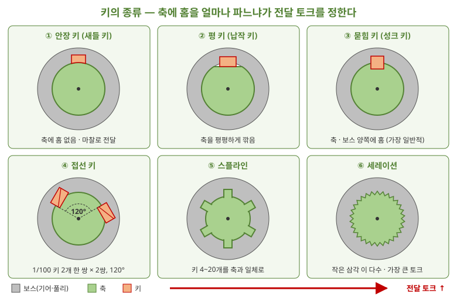

*축(초록)과 보스(회색) 사이의 키(주황)를 축 방향으로 본 단면이다. ① 안장 키는 바닥을 축 곡면에 맞춰 얹기만 해서 보스 쪽에만 홈이 있다. ② 평 키는 축 한쪽을 평평하게 깎아 그 면에 키를 댄다. ③ 묻힘 키는 축과 보스 **양쪽에 홈**을 파서 키가 반씩 묻힌다. ④ 접선 키는 기울기 1/100 키 두 개를 한 쌍으로 박고, 두 쌍을 **120°** 간격으로 둔다. ⑤ 스플라인은 키 여러 개를 축과 일체로 깎았고, ⑥ 세레이션은 작은 삼각 이를 촘촘히 깎았다. 오른쪽으로 갈수록 축과 보스가 맞물리는 면이 늘어 큰 토크를 전한다.*

### 키의 종류

| 키 | 특징 |
| --- | --- |
| 묻힘 키 (성크 키) | 축과 보스 양쪽에 홈, 가장 일반적. 평행 키·경사 키(1/100) |
| 평 키 (납작 키) | 축을 평평하게 깎음, 안장 키보다 큰 토크 |
| 안장 키 (새들 키) | 축에 홈 없음, 마찰 전달 |
| 접선 키 | 120° 간격 2쌍, 큰 토크·역회전 |
| 반달 키 (우드러프) | 반달 모양, 자동 조심, 테이퍼 축 |
| 미끄럼 키 (페더 키) | 보스가 축 방향 이동 |
| 둥근 키 (핀 키) | 축과 보스 사이에 핀, 작은 토크 |
| 스플라인 | 축에 여러 개 키를 일체로 깎음, 큰 토크·축 방향 이동 |
| 세레이션 | 작은 삼각 이 다수, 가장 큰 토크, 미세 위치 조정 |
| 원뿔 키 | 홈 없이 원뿔 통을 끼워 마찰로 축의 임의 위치에 고정 |

- 교재(CH03 12절) 보충:
  - **접선 키**: 기울기 1/100 키 2개를 서로 반대로 맞춰 쓰고, 역회전하면 2쌍을 **120°** 로 배치. 정사각 단면 키를 **90°** 로 배치한 것은 **케네디 키** (교재 12절 예제 정답: 접선 키).
  - 안장 키·평 키도 기울기 1/100. 성크 키가 가장 많이 쓰인다.
  - 스플라인은 축 둘레에 같은 피치의 키를 **4~20개** 깎은 것. 세레이션은 같은 지름의 스플라인보다 이가 많아 더 큰 동력을 전하고, 자동차 핸들·전동기·발전기 축에 쓴다.
  - 둥근 키는 토크가 아주 작은 곳, 반달 키는 공작기계 핸들 같은 테이퍼 축.

### 반달 키와 스플라인 축

| 반달 키 (우드러프 키) | 스플라인 축과 보스 |
| :-: | :-: |
|  | 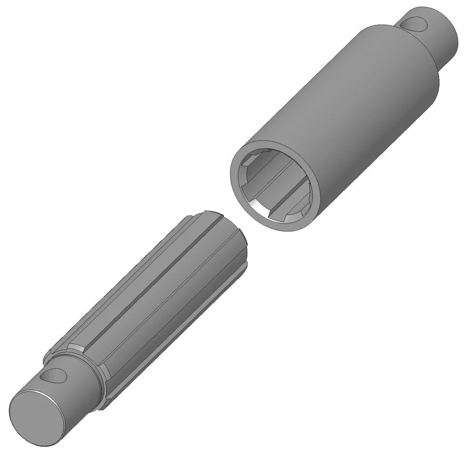 |

*왼쪽: 반달 키는 이름 그대로 원판을 반으로 자른 모양이다. 정면도의 둥근 바닥(지름 d1)이 축에 반달 모양으로 깊게 판 홈에 들어가고, 위쪽 평평한 면(폭 b)만 보스 홈에 걸린다. 홈 안에서 키가 굴러 기울기를 스스로 맞추므로(자동 조심) **테이퍼 축**에 좋지만, 홈이 깊어 축이 약해진다. 오른쪽: 스플라인 축(아래)에는 키 역할을 하는 돌기가 축과 한 몸으로 여러 줄 깎여 있고, 보스(위) 안쪽에는 그 돌기가 들어갈 홈이 있다. 끼운 채로 **축 방향으로 미끄러질 수 있어서** 자동차 변속기·추진축처럼 토크를 전하면서 길이가 변해야 하는 곳에 쓴다.*

> [!tip] 감 잡기 — 미끄럼 키와 스플라인
> 둘 다 "돌리면서 보스를 축 방향으로 옮길 수 있게" 한 것이다. 키 하나로 하면 **미끄럼 키(페더 키)**, 키 여러 개를 축에 일체로 깎으면 **스플라인**이다. 스플라인은 이가 많아 힘을 나눠 받으므로 훨씬 큰 토크를 전한다.

### 키 기호와 호칭

**키 기호와 호칭 (교재 CH03 16절)**

| 기호 | 키 |
| --- | --- |
| P / PS | 나사용 구멍 없는 / 있는 평행 키 |
| T / TG | 머리 없는 / **머리 있는** 경사 키 |
| WA / WB | 둥근 바닥 / 납작 바닥 반달 키 |

- 호칭 순서: 표준 번호, 종류(기호)와 호칭 치수(폭 × 높이), 길이, 끝 모양, 재료. 예: `KS B 1311 평행 키 10 × 8 × 25 양끝 둥긂 SM45C`, `KS B 1311 TG 20 × 12 × 70` = 머리 있는 경사 키, 폭 20 × 높이 12, 길이 70.

> [!question] 시험에서는
> "120° 간격 2쌍, 역회전" → **접선 키**, "90° 정사각 키" → **케네디 키**. "축에 홈을 파지 않는다" → **안장 키**. "보스가 축 방향으로 움직인다" → **미끄럼 키** 또는 **스플라인**. `TG 20 × 12 × 70`은 **머리 있는 경사 키**, 폭 20 × 높이 12, 길이 70으로 읽는다(폭이 먼저).

## 2. 키 강도 계산

토크 $T$는 축 표면에서 키를 옆으로 미는 힘 $F$로 바뀐다. 이 힘이 키를 망가뜨리는 길은 두 가지다. 축과 보스 경계에서 키가 **가로로 싹둑 잘리는 것(전단)**, 그리고 키 옆면이 홈 벽에 **짓눌리는 것(압축·면압)**. 그래서 키는 두 응력을 모두 확인한다.

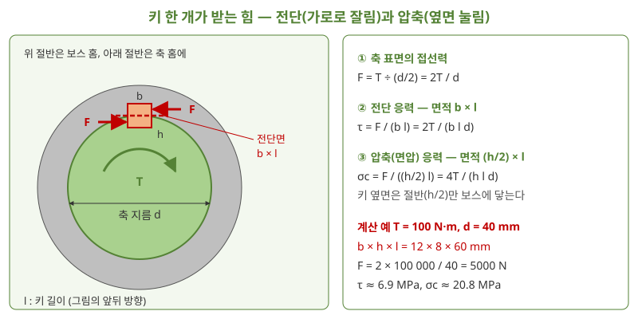

*축이 시계 방향으로 돌면(초록 화살표 T) 축이 키 아래 절반을 오른쪽으로 밀고, 보스는 키 위 절반을 왼쪽으로 받친다(빨간 F 두 개). 두 힘이 어긋나게 걸리는 경계, 곧 축 표면의 빨간 점선이 **전단면**이고 넓이는 키 폭 × 길이 $b \times l$이다. 키 옆면은 높이의 절반($h/2$)만 보스 홈에 닿으므로 압축 면적은 $(h/2) \times l$이다. 오른쪽 계산 예는 T = 100 N·m, d = 40 mm, 12 × 8 × 60 키.*

$$F = \frac{2T}{d}, \qquad \tau = \frac{2T}{bld}, \qquad \sigma_c = \frac{4T}{hld}$$

- 키에 걸리는 접선력 $F = \dfrac{2T}{d}$
- 전단: $\tau = \dfrac{F}{bl} = \dfrac{2T}{bld}$ (b: 키 폭, l: 키 길이)
- 압축(면압): $\sigma_c = \dfrac{F}{(h/2)l} = \dfrac{4T}{hld}$ (h: 키 높이)
- 키 길이는 보통 축 지름의 **1.5배 정도**까지.

### 계산 예: 묻힘 키의 응력

- 조건: $T = 100$ N·m $= 100\,000$ N·mm, $d = 40$ mm, 키 $b \times h \times l = 12 \times 8 \times 60$ mm
- 접선력: $F = \dfrac{2 \times 100\,000}{40} = 5000$ N
- 전단: $\tau = \dfrac{5000}{12 \times 60} \approx 6.9$ MPa
- 압축: $\sigma_c = \dfrac{5000}{(8/2) \times 60} \approx 20.8$ MPa

> [!tip] 감 잡기 — 왜 압축이 더 크게 나오나
> 같은 힘 $F$를 전단은 폭 $b$(12 mm)로, 압축은 높이의 절반 $h/2$(4 mm)로 받는다. 받치는 면이 좁으니 응력이 크다. 보통 키는 $b \ge h/2$라서 **면압 쪽이 먼저 문제가 되기 쉽다.** 식으로도 $\tau$의 분자는 $2T$, $\sigma_c$의 분자는 $4T$다.

## 3. 핀 — 위치를 맞추고 가볍게 고정한다

핀은 두 부품을 꿰는 짧은 막대다. 큰 힘을 전하기보다는 **두 부품의 상대 위치를 정확히 맞추거나**(다웰 핀), 너트·축이 빠지지 않게 **걸쇠 역할**(분할 핀)을 한다. 분해했다가 다시 조립해도 같은 자리에 오게 하는 것이 핀의 주된 일이다.

### 핀

| 핀 | 용도 |
| --- | --- |
| 평행 핀 | 부품 위치 결정 (다웰 핀) |
| 테이퍼 핀 (1/50) | 위치 결정, 분해 후 재조립 정밀 |
| 분할 핀 | 너트 풀림 방지, 축 빠짐 방지 |
| 스프링 핀 | 탄성으로 구멍에 고정, 가공 간단 |
| 너클 핀 | 두 막대를 회전 가능하게 연결 (링크) |

| 평행 핀 (다웰 핀) | 스프링 핀 |
| :-: | :-: |
| 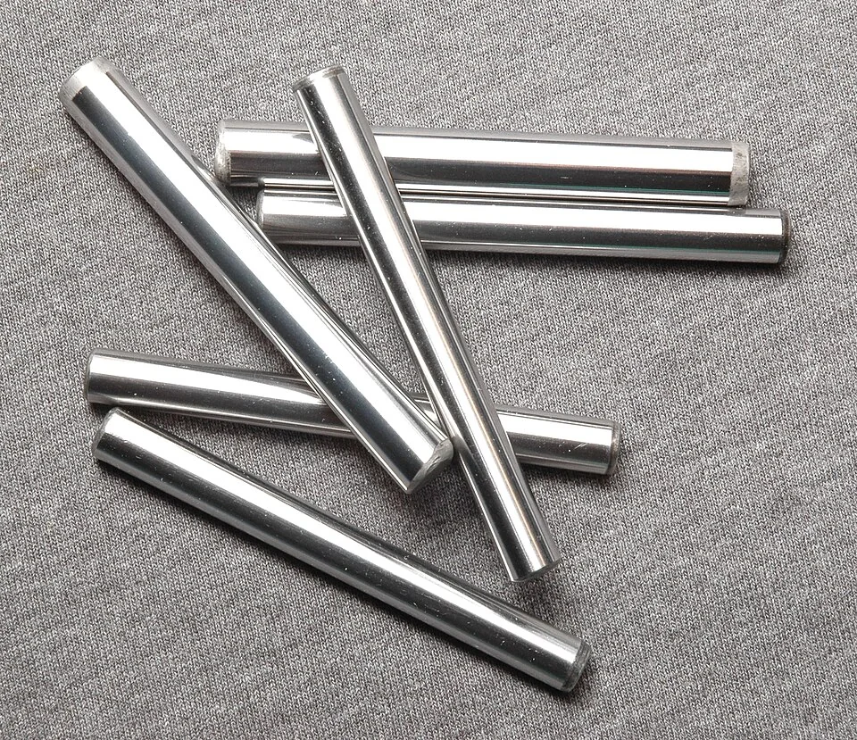 | 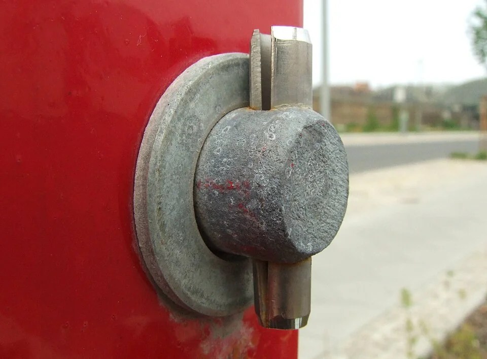 |

*왼쪽: 강철 평행 핀. 지름이 끝까지 같고 표면을 매끈하게 연삭해 m6·h7 같은 공차로 만든다. 두 부품에 함께 뚫은 구멍에 박아 위치를 맞춘다. 오른쪽: 스프링 핀이 둥근 부품을 위아래로 관통해 있다. 핀 위쪽 끝을 보면 세로로 **갈라진 틈**이 보인다. 구멍보다 약간 굵은 관을 해머로 박으면 틈이 오므라들며 그 탄성으로 구멍 벽을 밀어 고정된다. 구멍을 정밀하게 다듬지 않아도 되어 가공이 간단하다.*

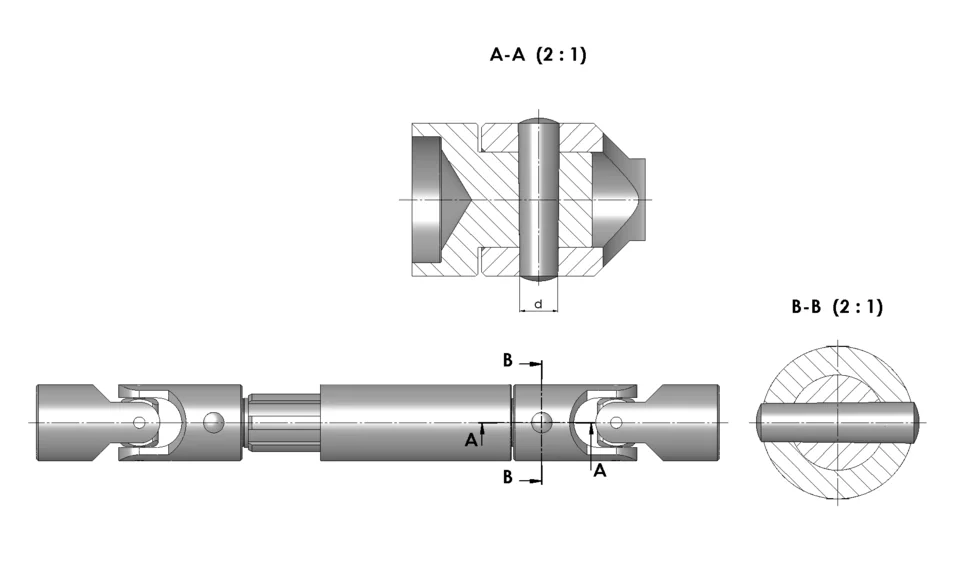

*테이퍼 핀의 사용 예. 아래쪽 유니버설 조인트 축에서 요크(갈래)와 축을 핀 하나가 꿰뚫고 있고, 위 A-A 단면과 오른쪽 B-B 단면에서 핀이 두 부품의 구멍을 동시에 지나는 것이 보인다. 핀이 1/50로 가늘어지기 때문에 박을수록 꽉 끼고, 뽑았다가 다시 박아도 같은 자리에 정확히 돌아온다.*

### 핀의 호칭

호칭 치수에서 가장 많이 틀리는 것은 "**어느 지름을 재느냐**"다. 테이퍼 핀은 가는 쪽, 분할 핀은 핀 자체가 아니라 끼우는 구멍을 잰다.

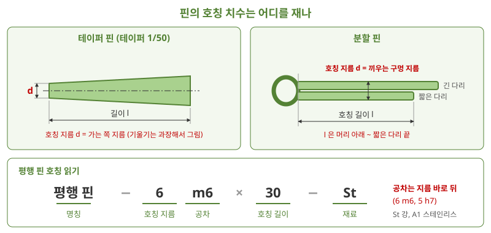

*왼쪽 위: 테이퍼 핀의 호칭 지름 d는 **가는 쪽** 끝의 지름이다(그림은 기울기를 과장했다). 오른쪽 위: 분할 핀은 둥근 머리 아래에서 다리 두 개가 뻗는데 길이가 다르다. 호칭 길이 l은 머리 아래부터 **짧은 다리 끝**까지, 호칭 지름 d는 핀이 들어갈 **구멍 지름**이다. 아래: `평행 핀 − 6 m6 × 30 − St`를 명칭 · 호칭 지름 · 공차 · 호칭 길이 · 재료로 나눈 것. 공차 m6이 지름 6 바로 뒤에 붙는다.*

**핀의 호칭 방법**

| 핀 | 호칭 예 | 순서 |
| --- | --- | --- |
| 평행 핀 | 평행 핀 − 6 m6 × 30 − St | 명칭 − 지름·공차 × 길이 − 재료 |
| 평행 핀 (스테인리스) | 평행 핀 − 5 h7 × 25 − A1 | A1: 오스테나이트계 스테인리스 등급 |
| 분할 핀 | 분할 핀 − 5 × 50 − St | 명칭 − 호칭 지름 × 호칭 길이 − 재료 |

- 분할 핀 호칭 지름은 끼우는 **구멍 지름** 기준이라 실제 핀 소재 지름보다 조금 크다.

**교재(CH03 15절) 호칭 형식**

| 핀 | 순서 | 예 |
| --- | --- | --- |
| 평행 핀 | 표준 번호 또는 명칭, 종류, 형식, 호칭 지름 × 길이, 재료 | m6 A − 6 × 45 SB41 |
| 테이퍼 핀 | 명칭, 등급, 호칭 지름 × 길이, 재료 | 테이퍼 핀 1급 2 × 10 SM50C |
| 분할 테이퍼 핀 (슬롯 테이퍼 핀) | 명칭, 호칭 지름 × 길이, 재료, 지정 사항 | 6 × 70 SM35C 갈라짐 깊이 10 |
| 분할 핀 (KS B ISO 1234) | 표준 번호 또는 명칭, 호칭 지름 × 호칭 길이, 재료 | 분할 핀 KS B ISO 1234 5 × 50 − St |

- 호칭 지름: 테이퍼 핀은 **가는 쪽**, 분할 핀은 **끼우는 구멍** 지름.
- 교재 15-1에는 저자 의견이 붙어 있다. 공단 발표 답은 ③인데 저자는 문제 조건상 ①이 맞다고 보고 ①을 정답으로 적었다. 평행 핀 호칭 문제는 이렇게 판본·규격 개정에 따라 답이 갈릴 수 있으니, 공차(m6·h7)가 지름 바로 옆에 붙는 형식을 기준으로 고른다.
- 스프링 핀은 세로로 쪼개진 관 모양이라 해머로 박으면 탄성으로 고정된다.
- 교재(CH03 12절)는 평행 핀을 "너클 핀이라고도 한다"고 적었다. 일반적으로 너클 핀은 두 막대를 회전 가능하게 잇는 다른 핀이므로, 보기에서 평행 핀 = 위치 결정, 너클 핀 = 링크 연결로 구분한다.

### 분할 핀과 너클 핀

| 분할 핀 | 실제 사용 (홈붙이 너트) | 너클 핀 (링크 연결) |
| :-: | :-: | :-: |
| 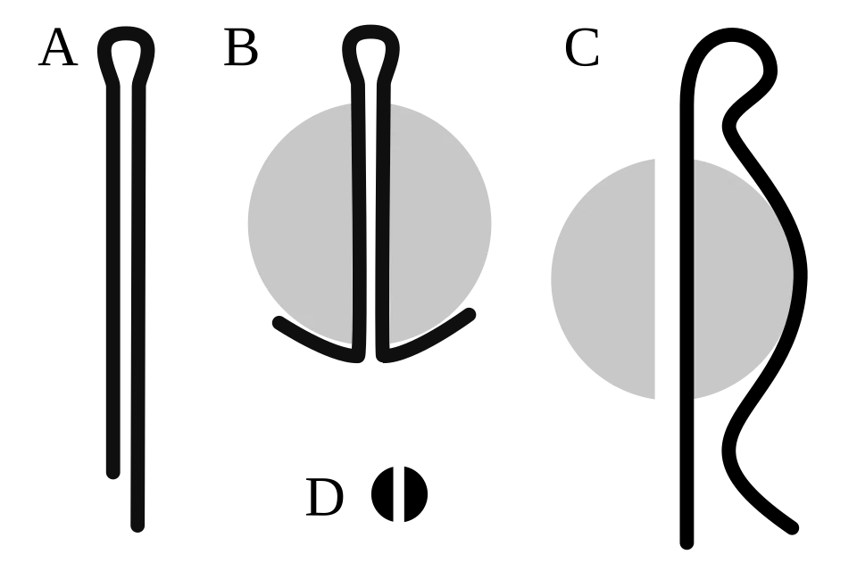 | 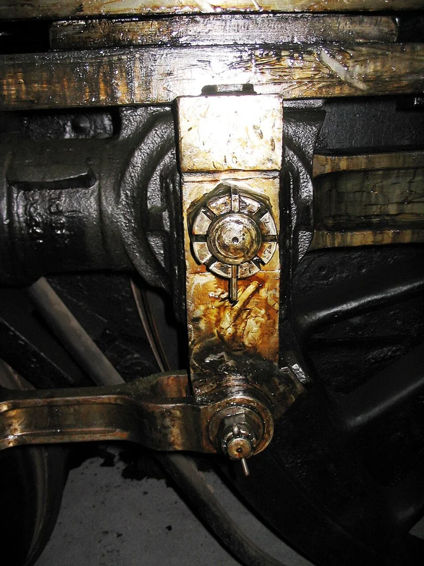 | 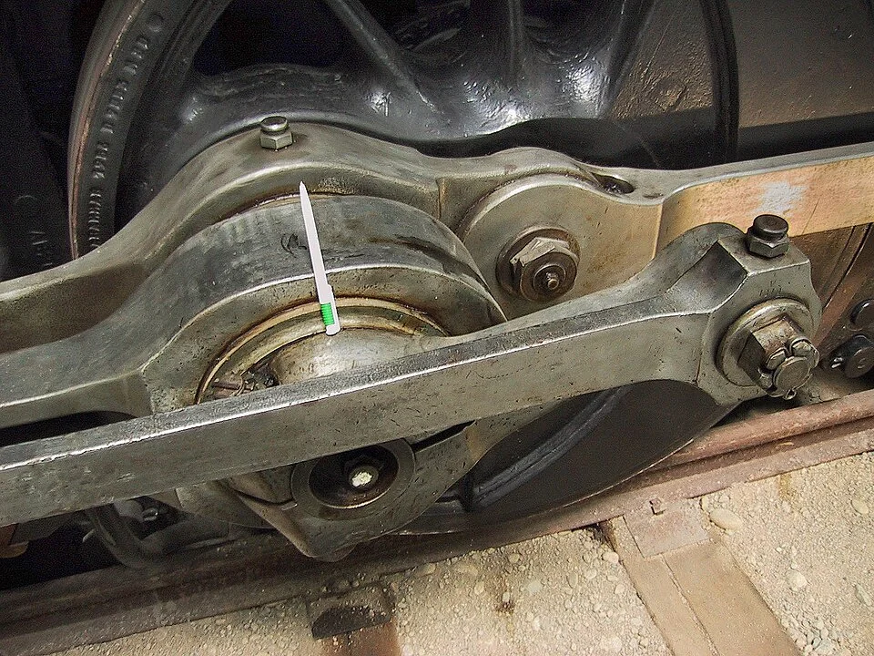 |

*왼쪽: 분할 핀. A는 꽂기 전 모습으로 고리 머리 아래 두 다리의 길이가 다르다. B는 축 구멍(회색)에 꽂은 뒤 다리를 양쪽으로 벌려 빠지지 않게 한 모습, D는 다리 단면으로 반원 두 개가 맞붙어 있다. C는 다시 쓸 수 있는 R자형 핀으로 분할 핀과는 다른 종류다. 가운데: 증기기관차 링크 핀 끝(사진 아래)에서 홈붙이 너트의 홈과 볼트 구멍을 분할 핀이 함께 꿰어 너트 풀림을 막는다. 오른쪽: 증기기관차 바퀴의 연결봉 두 개가 핀 하나(가운데 둥근 보스)로 이어져 있다. 막대끼리 핀을 축으로 **서로 회전**할 수 있게 잇는 이런 이음이 너클 핀 이음이다.*

> [!question] 시험에서는
> 분할 핀 호칭 길이를 "긴 다리 끝까지"로 고른 보기가 함정이다(2017-3). **짧은 다리 끝**까지다. 평행 핀은 `6 m6 × 30`처럼 **지름 바로 뒤에 공차**, 그 다음 × 길이. 테이퍼 핀 호칭 지름을 "굵은 쪽"이라 하면 틀린다.

## 4. 코터 이음

코터는 **쐐기**다. 문이 저절로 닫히지 않게 문 아래에 끼우는 고무 쐐기처럼, 납작한 쐐기를 두 부재를 꿰뚫는 구멍에 때려 박아 서로 당기는 힘을 받게 한다. 키가 회전(토크)을 전한다면 코터는 **축 방향으로 당기거나 미는 힘**을 전한다. 망치로 빼면 분해할 수 있다는 것이 용접·리벳과 다르다.

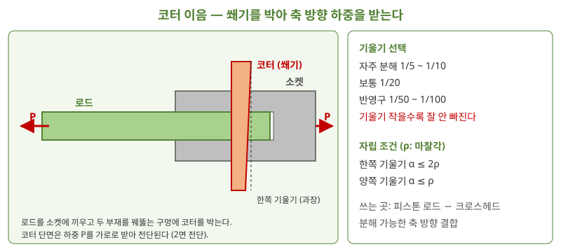

*로드(초록)를 소켓(회색, 단면) 구멍에 끼우고, 둘을 함께 꿰뚫는 구멍에 코터(주황)를 박았다. 로드는 왼쪽, 소켓은 오른쪽으로 당겨지므로(빨간 P) 코터는 로드와 소켓 사이에서 가로로 잘리려는 힘을 받는다. 코터는 한쪽 면만 기울어져 있어서(점선이 수직 기준, 그림은 과장) 깊이 박을수록 로드를 소켓 안으로 당겨 조인다. 오른쪽 표는 기울기 선택과 자립 조건.*

- 쐐기 모양 판을 끼워 **축 방향** 하중을 받는 두 부재를 결합 (피스톤 로드–크로스헤드).
- 기울기가 작을수록 잘 빠지지 않는다. 자주 분해하면 기울기를 크게, 반영구적이면 작게.
- 자립 조건: 기울기 각이 마찰각보다 작아야 저절로 빠지지 않는다. 교재(CH03 12절) 기준으로 **한쪽 기울기 α ≤ 2ρ, 양쪽 기울기 α ≤ ρ** (ρ: 마찰각).
- 구성: 로드, 소켓, 코터. 기울기: 자주 분해 **1/5~1/10**, 보통 **1/20**, 반영구 **1/50~1/100**.

> [!tip] 감 잡기 — 나사의 자립과 같은 이야기
> 코터의 자립은 [나사와 볼트](나사와_볼트.md)의 자립 조건(리드각 ≤ 마찰각)과 같은 원리다. 비탈이 완만할수록 마찰이 이겨서 저절로 미끄러져 나오지 않는다. 대신 너무 완만하면 빼기도 어려우므로 자주 분해하는 곳은 기울기를 크게(1/5~1/10) 준다.

## 5. 리벳 이음

리벳은 **한쪽에 머리가 있는 굵은 못**이다. 판 두 장에 구멍을 뚫어 리벳을 꽂고, 반대쪽 끝을 두드려 머리를 하나 더 만들면 판이 영구히 묶인다. 철교·보일러·항공기 동체처럼 판을 이어 붙이는 곳에 쓴다. 힘이 걸리면 리벳은 판과 판 사이 면에서 **가위로 자르듯** 전단된다.

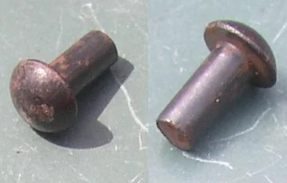

*둥근 머리 리벳. 머리 아래로 같은 굵기의 몸통이 뻗어 있다. 몸통을 판 구멍에 꽂은 뒤 끝을 때려 반대쪽 머리를 만든다.*

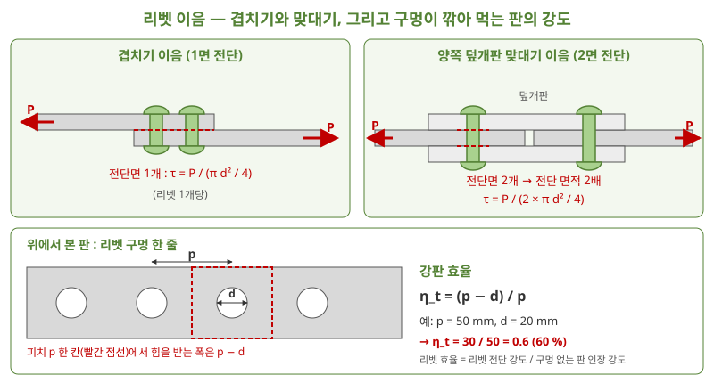

*왼쪽 위: **겹치기 이음**은 판 두 장을 겹쳐 리벳을 박는다. 두 판이 반대로 당겨지면 판이 맞닿은 면(빨간 점선) 한 곳에서 리벳이 잘리려 한다 — **1면 전단**. 오른쪽 위: **양쪽 덮개판 맞대기 이음**은 판 두 장을 맞대고 위아래에 덮개판을 대어 리벳을 박는다. 리벳 하나가 덮개판–본판 경계 두 곳에서 잘려야 끊어지므로 **2면 전단**, 전단 면적이 2배다. 아래: 위에서 본 판. 피치 p 한 칸(빨간 점선) 가운데 지름 d의 구멍이 뚫려 있어 힘을 받는 폭은 $p-d$만 남는다.*

- 판재를 겹치거나 맞대어 리벳으로 영구 결합 (보일러, 철골, 항공기).
- 종류: 겹치기 이음, 맞대기 이음(덮개판 1장·2장), 1줄·2줄 리벳.
- **강판 효율** $\eta_t = \dfrac{p - d}{p}$ (p: 리벳 피치, d: 리벳 구멍 지름) → 구멍으로 판이 약해진 비율.
- **리벳 효율** = 리벳 전단 강도 / 구멍 없는 판의 인장 강도.
- 기밀을 위해 **코킹·풀러링**.
- **리벳 전단 응력** (1면 전단): $\tau = \dfrac{P}{\pi d^2 / 4}$
  - **계산 예**: 리벳 지름 2.5 cm, 하중 2200 kgf → $\tau = \dfrac{2200}{\pi \times 2.5^2 / 4} = \dfrac{2200}{4.91} \approx 448$ kgf/cm²
  - 2면 전단(양쪽 덮개판 맞대기)이면 전단 면적이 2배.

$$\tau_{1면} = \frac{P}{\pi d^2/4}, \qquad \tau_{2면} = \frac{P}{2 \times \pi d^2/4}, \qquad \eta_t = \frac{p-d}{p}$$

### 계산 예: 강판 효율

- 피치 $p = 50$ mm, 리벳 구멍 지름 $d = 20$ mm → $\eta_t = \dfrac{50 - 20}{50} = 0.6$ → 구멍 없는 판 강도의 **60 %** 만 남는다.

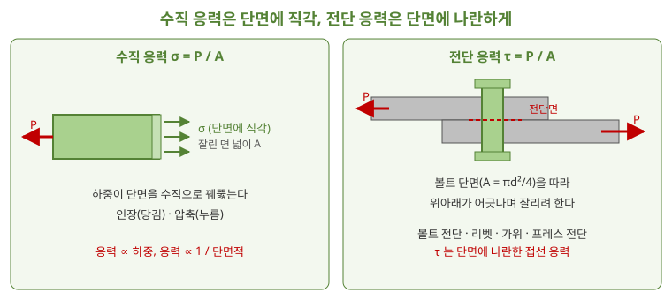

*[기계설계 기초와 재료강도](기계설계_기초와_재료강도.md)에서 본 그림을 다시 썼다. 오른쪽처럼 두 판을 잇는 체결 부품은 빨간 점선(전단면)을 따라 위아래가 어긋나며 잘리려 한다. 리벳도 같다 — 면적은 리벳 단면 $\pi d^2/4$다. 리벳 지름 2.5 cm, 하중 2200 kgf 계산 예가 바로 이 상황이다.*

> [!question] 시험에서는
> 리벳 전단 응력에서 **반지름을 지름처럼 넣는** 실수가 많다. 면적은 $\pi d^2/4$ (d = 2.5 cm → 4.91 cm²). 양쪽 덮개판 맞대기는 **2면 전단**이라 응력이 절반이 된다. 강판 효율은 $(p-d)/p$, 분모가 피치다.

## 6. 용접 이음

용접은 두 금속의 이음매를 **녹여서 한 몸으로** 만드는 것이다. 리벳처럼 구멍을 뚫지 않으니 판이 약해지지 않고 물·기름이 새지 않지만, 한 번 녹였다 굳힌 자리에는 열로 인한 뒤틀림과 내부 응력이 남는다. 강도 계산은 "용접 금속이 끊어지는 가장 얇은 단면이 어디냐"를 찾는 문제다.

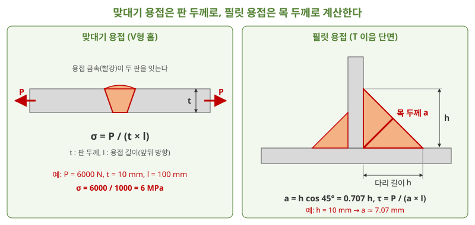

*왼쪽: **맞대기 용접**은 두 판의 끝을 V자로 깎아 맞대고 홈을 용접 금속(주황)으로 채운다. 끊어지는 단면은 판 두께 t × 용접 길이 l이다. 오른쪽: **필릿 용접**은 T자로 놓인 두 판의 모서리에 삼각형 단면의 용접 금속을 붙인다. 삼각형의 두 변이 **다리 길이 h**, 모서리에서 빗변에 내린 수선(빨간 선)이 **목 두께 a**다. 직각이등변삼각형이므로 $a = h\cos 45° = 0.707h$이고, 이 가장 얇은 단면에서 끊어진다.*

| 종류 | 강도 계산 |
| --- | --- |
| 맞대기 용접 | $\sigma = \dfrac{P}{tl}$ (t: 판 두께) |
| 필릿 용접 | $\tau = \dfrac{P}{al}$, $a = 0.707h$ (h: 다리 길이) |

- 맞대기 용접 인장 응력은 하중을 **판 두께 × 용접 길이**로 나눈다. 예: P = 6000 N, t = 10 mm, l = 100 mm → $\sigma = 6000 / 1000 = 6$ MPa.

| 필릿 용접 각부 명칭 | 필릿 용접 실제 비드 |
| :-: | :-: |
| 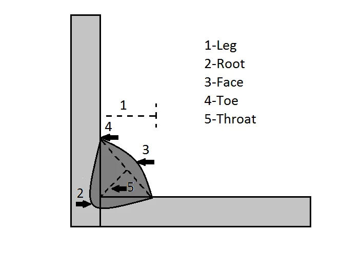 | 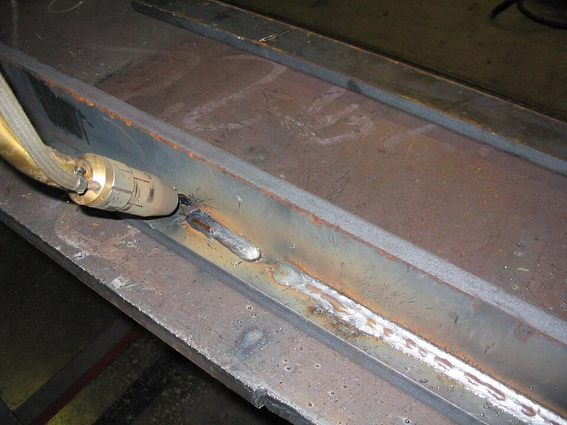 |

*왼쪽: 필릿 용접 단면의 각부 이름(영어). 1 Leg = **다리**(판 표면을 따라 잰 용접 길이 h), 2 Root = **루트**(두 판이 만나는 안쪽 끝), 3 Face = 표면, 4 Toe = 토우(용접 금속과 판 표면의 경계), 5 Throat = **목**(루트에서 표면까지 가장 얇은 두께 a). 오른쪽: 아크 용접 토치가 두 판이 직각으로 만나는 안쪽 모서리를 따라 움직이며 필릿 용접 비드를 놓고 있다. 앞쪽(아래 오른쪽)으로 이미 굳은 비드의 물결무늬가 길게 이어진다.*

### 장단점과 잔류 응력 대책

- 장점: 기밀·수밀, 무게 감소, 공정 단순. 단점: **잔류 응력·변형**, 검사 어려움, 열 영향부 취화.
- 대책: 예열·후열, 용접 순서 조절, 응력 제거 풀림.

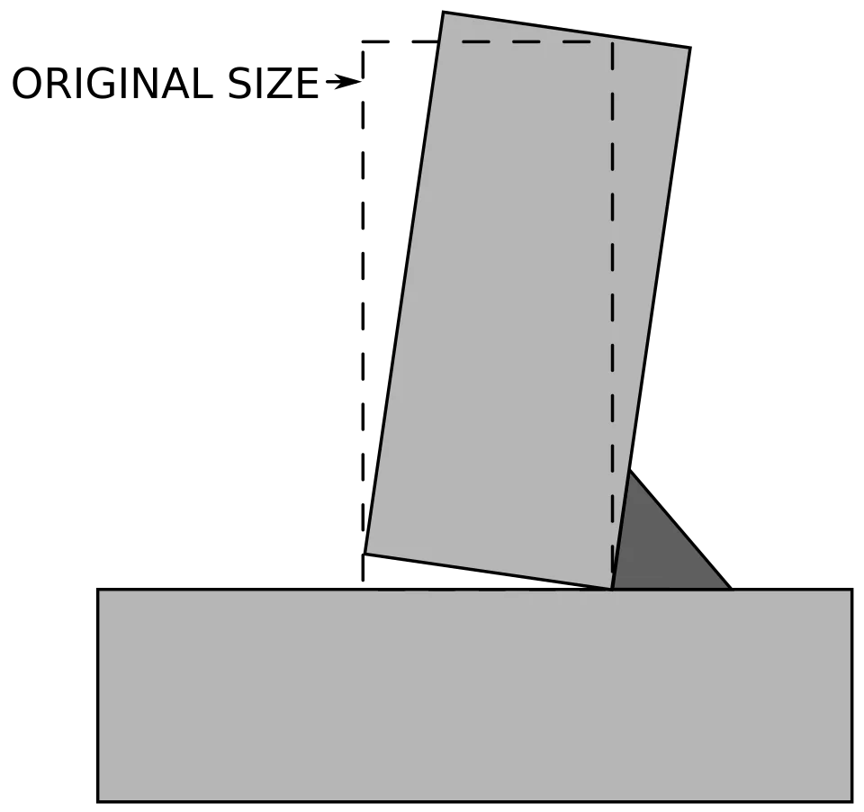

*세로 판의 오른쪽 모서리에만 필릿 용접(진한 회색 삼각형)을 했더니, 굳으며 줄어드는 용접 금속이 판을 끌어당겨 판 전체가 용접 쪽으로 기울었다. 점선(ORIGINAL SIZE)이 원래 위치다. 용접 금속이 식으며 수축하는 것이 변형과 **잔류 응력**의 원인이므로, 예열로 온도 차를 줄이고 양쪽을 번갈아 용접하는 등 순서를 조절하고, 끝나면 풀림으로 응력을 뺀다.*


*자동차 차체 조립 라인. 주황색 산업용 로봇들이 끝에 단 용접 건으로 얇은 강판 차체 골격을 집어 **스폿(점) 용접**한다. 겹친 판을 두 전극으로 눌러 전류를 흘리면 접촉점만 녹아 붙는다. 리벳 대신 용접을 쓰면 구멍이 없고 가벼워서 차체·가전 외판처럼 얇은 판 조립의 표준이 되었다. 자동화설비에서 가장 흔히 보는 용접이다.*

## 7. 용접 기호 읽기

도면의 용접 기호는 "**어디를(화살표) · 어떤 모양으로(기본 기호) · 얼마나(치수)**" 용접하는지를 한 줄에 담는다. 화살표가 가리키는 이음의 **이쪽 면**을 용접할지 **반대쪽 면**을 용접할지는 기호가 기준선(실선)에 붙었는지, 동일선(점선)에 붙었는지로 정한다.

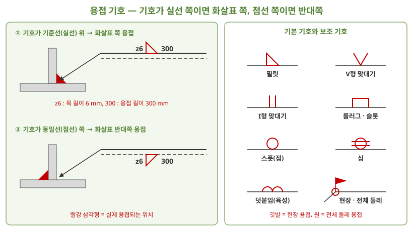

*왼쪽 ①: 필릿 기호(빨간 직각삼각형)가 기준선(실선) 위에 있으면 화살표가 닿은 쪽(T 이음의 오른쪽)을 용접한다. ②: 같은 기호가 동일선(점선) 쪽에 있으면 화살표 **반대쪽**(T 이음의 왼쪽)을 용접한다. 빨간 삼각형이 실제 용접 위치다. `z6 ▷ 300`은 목 길이 6 mm, 용접 길이 300 mm. 오른쪽: 기본 기호. 필릿은 직각삼각형, 플러그·슬롯은 엎은 ㄷ자(직사각형), 스폿은 원, 심은 원에 가로 두 줄, 덧붙임은 반원 두 개. 기준선 꺾이는 곳의 깃발은 현장 용접, 원은 전체 둘레 용접이다.*

### 용접 기호 읽기

```text
        a5 ▷ 300          ← 기호·치수가 실선 위 = 화살표 쪽
  ───────────────── 기준선(실선)
  - - - - - - - - - 동일선(점선) ← 이쪽에 있으면 화살표 반대쪽
 ↙ 화살표
```

| 기본 기호 | 용접 |
| --- | --- |
| 직각 삼각형 | 필릿 용접 |
| V, ∨ 반쪽(베벨), I, U, J | 맞대기 용접 (홈 모양별) |
| 직사각형 (ㄷ자를 엎은 모양) | **플러그·슬롯 용접** |
| 원 | 스폿(점) 용접 |
| 원 + 가로 두 줄 | 심 용접 |
| 반원 겹침 | 덧붙임(육성) 용접 |

- 치수 기입: 기호 **왼쪽에 단면 치수**(목 두께 a, 목 길이 z, 지름 d, 슬롯 너비 c), **오른쪽에 길이 방향 치수**(용접 길이 l, 개수 n, 피치 e).
- 예: `z6 ▷ 300` → 목 길이 6 mm, 용접 길이 300 mm인 필릿 용접.
- 깃발(현장 용접), 원(전체 둘레 용접) 같은 보조 기호가 기준선 꺾이는 곳에 붙는다.

> [!question] 시험에서는
> 플러그 용접 기호를 고르는 문제(2017-3)에서 보기로 덧붙임(반원 두 개)·스폿(원)·필릿(삼각형)이 함께 나온다. **엎은 ㄷ자 = 플러그·슬롯**만 기억하면 된다. `a5`는 목 **두께**, `z6`은 목 **길이(다리 길이)**. 둘 사이는 $a = 0.707z$ 관계다.

## 그림

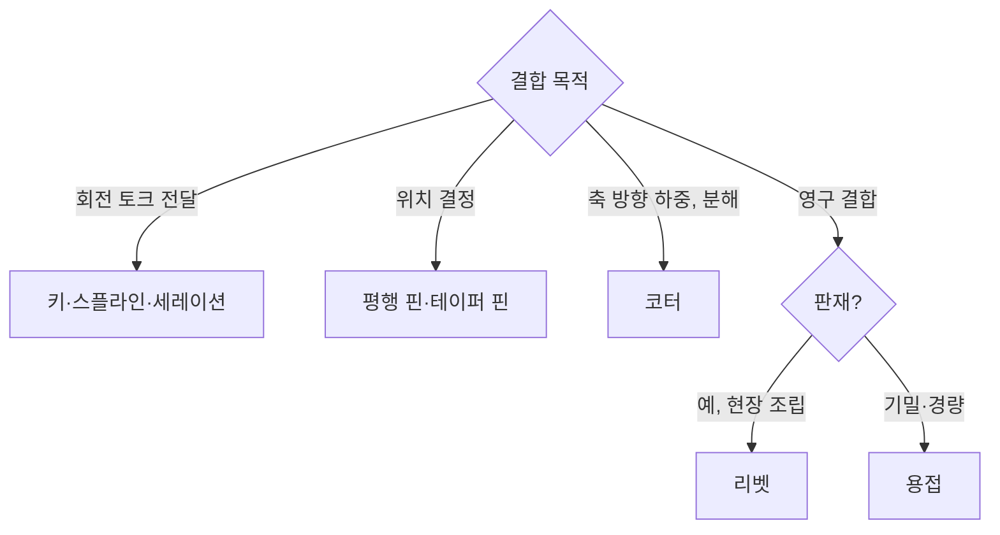

## 기출 포인트

- 핀 호칭 — 3회: 평행 핀 호칭 순서 (2016-2, 2019-2), 분할 핀 호칭 길이 위치 (2017-3)
- 용접 기호 — 3회: 필릿 용접 기호의 치수·화살표 쪽 해석 (2017-2), 플러그 용접 기본 기호 (2017-3), 플러그 용접 기호 치수 해석 (2018-3)
- 용접·리벳 응력 계산 (기초공학) — 2회: 맞대기 용접 인장 응력 식 (2019-2), 리벳 전단 응력 (2020-1)
- 키 종류·강도 계산은 2014~2020년 2과목에 나오지 않았다. 새 출제기준(체결요소 선정·설계)에 맞춰 기본은 유지한다.

**교재 예제 유형** (Win-Q 2025 PART 01 CHAPTER 03, 09·12절): 플러그 용접 기호 고르기(그림, 덧붙임·스폿·필릿과 구분), 120° 2쌍 배치와 케네디 키 설명에 해당하는 키(접선 키). 15~16절: 평행 핀 호칭(저자 의견 있음), 분할 핀 호칭 지름(구멍 지름), 슬롯 테이퍼 핀 호칭 순서, 테이퍼 핀 호칭 치수(가는 쪽 지름), TG 20×12×70 해석.

## 관련 단원

- [나사와 볼트](나사와_볼트.md) — 분할 핀·홈붙이 너트 풀림 방지, 자립 조건
- [축과 축이음](축과_축이음.md) — 키로 고정하는 축, 스플라인 축이음
- [기계설계 기초와 재료강도](기계설계_기초와_재료강도.md) — 수직·전단 응력, 허용 응력
- [도면 양식과 투상법](도면_양식과_투상법.md)

## 체크리스트

- [ ] 키 종류별 특징과 전달 토크 순서를 안다
- [ ] 키의 전단·압축 응력을 계산한다
- [ ] 핀 종류별 용도와 테이퍼 핀 규격을 안다
- [ ] 리벳 강판 효율을 계산한다
- [ ] 필릿 용접 목 두께를 계산한다
- [ ] 용접의 장단점과 잔류 응력 대책을 말한다
- [ ] 평행 핀·분할 핀 호칭 방법을 순서대로 쓴다
- [ ] 용접 기호의 실선 쪽·점선 쪽 의미를 안다
- [ ] 필릿·플러그·스폿·심 용접 기본 기호를 구분한다
- [ ] 리벳 전단 응력과 맞대기 용접 인장 응력을 계산한다

## 참고

- [큐넷 자동화설비산업기사 출제기준](https://www.q-net.or.kr/crf005.do?id=crf00503&jmCd=2034)

### 그림 출처

위키미디어 공용(Wikimedia Commons)과 Openverse에서 가져온 공개 라이선스 자료이고, 노트에 맞게 크기를 줄이고 WebP로 변환했다.

| 그림 | 작성자 | 라이선스 | 출처 |
| --- | --- | --- | --- |
| [Woodruff keys - n](https://commons.wikimedia.org/wiki/File:Woodruff_keys_-_n.svg) | Zielu20 | [CC BY-SA 3.0](https://creativecommons.org/licenses/by-sa/3.0) | Wikimedia Commons |
| [Spline-shaft](https://commons.wikimedia.org/wiki/File:Spline-shaft.png) | Silberwolf | [CC BY-SA 2.5](https://creativecommons.org/licenses/by-sa/2.5) | Wikimedia Commons |
| [Steel-Dowel-Pins](https://commons.wikimedia.org/wiki/File:Steel-Dowel-Pins.jpg) | David J. Fred | [CC BY-SA 2.5](https://creativecommons.org/licenses/by-sa/2.5) | Wikimedia Commons |
| [Spring-type slotted straight pin](https://commons.wikimedia.org/wiki/File:Spring-type_slotted_straight_pin.jpg) | Silberwolf | [CC BY-SA 2.5](https://creativecommons.org/licenses/by-sa/2.5) | Wikimedia Commons |
| [Taper pin ISO2339 application](https://commons.wikimedia.org/wiki/File:Taper_pin_ISO2339_application.png) | Silberwolf (talk) | [CC BY-SA 2.5](https://creativecommons.org/licenses/by-sa/2.5) | Wikimedia Commons |
| [CotterPins](https://commons.wikimedia.org/wiki/File:CotterPins.svg) | Kivaan | 퍼블릭 도메인 | Wikimedia Commons |
| [Castle nut and cotter pin. (55011574)](https://commons.wikimedia.org/wiki/File:Castle_nut_and_cotter_pin._(55011574).jpg) | Robbie Sproule from Montreal, Canada | [CC BY 2.0](https://creativecommons.org/licenses/by/2.0) | Wikimedia Commons |
| [Knuckle joint on locomotive](https://commons.wikimedia.org/wiki/File:Knuckle_joint_on_locomotive.JPG) |  | [CC BY-SA 4.0](https://creativecommons.org/licenses/by-sa/4.0) | Wikimedia Commons |
| [Rivet01](https://commons.wikimedia.org/wiki/File:Rivet01.jpg) | No machine-readable author provided. Miaow Miaow assumed (based on copyright claims). | 퍼블릭 도메인 | Wikimedia Commons |
| [Parts of a fillet weld](https://commons.wikimedia.org/wiki/File:Parts_of_a_fillet_weld.png) | Powerstroker | [CC BY-SA 3.0](https://creativecommons.org/licenses/by-sa/3.0) | Wikimedia Commons |
| [Welded seam by arc welding 001](https://commons.wikimedia.org/wiki/File:Welded_seam_by_arc_welding_001.jpg) | KOMATSU Ltd | [CC BY-SA 2.1 jp](https://creativecommons.org/licenses/by-sa/2.1/jp/deed.en) | Wikimedia Commons |
| [Welding fillet distortion](https://commons.wikimedia.org/wiki/File:Welding_fillet_distortion.svg) | Wizard191 | [CC BY-SA 3.0](https://creativecommons.org/licenses/by-sa/3.0) | Wikimedia Commons |
| [BMW Leipzig MEDIA 050719 Download Karosseriebau max](https://commons.wikimedia.org/wiki/File:BMW_Leipzig_MEDIA_050719_Download_Karosseriebau_max.jpg) | BMW Werk Leipzig | [CC BY-SA 2.0 de](https://creativecommons.org/licenses/by-sa/2.0/de/deed.en) | Wikimedia Commons |

직접 그린 그림(SVG, 이 볼트용으로 새로 작성): 키 종류 단면, 키 전단 압축, 핀 호칭치수, 코터 이음, 리벳 이음 효율, 용접 강도 목두께, 용접기호 읽기. 수직응력 전단응력은 [기계설계 기초와 재료강도](기계설계_기초와_재료강도.md) 노트에서 그린 것을 다시 썼다.

