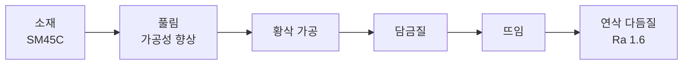

# 표면거칠기·열처리·가공기호

> [!summary] 핵심 요약
> - **Ra**(산술 평균 거칠기)가 가장 많이 쓰는 지표. 값이 작을수록 매끈하다 (단위 μm).
> - 표면 기호: 기본 √, **제거 가공 필요**(√ 아래에 가로선을 붙여 삼각형), **제거 가공 금지**(√ 안에 원).
> - 간략 기호(옛 다듬질 기호 대응): **w ≈ Ra 25, x ≈ Ra 6.3, y ≈ Ra 1.6, z ≈ Ra 0.2**.
> - 열처리 4가지: **담금질**(단단하게), **뜨임**(인성 회복), **풀림**(연하게·응력 제거), **불림**(조직 균일·미세화).

> [!warning] 자주 틀리는 포인트
> - 담금질 후에는 **반드시 뜨임**한다. 담금질만 하면 단단하지만 깨지기 쉽다.
> - **풀림은 노 안에서 천천히(노랭)**, **불림은 공기 중에서(공랭)**, **담금질은 물·기름에 급랭**.
> - 표면 경화 범위는 도면에 **굵은 1점 쇄선**으로 표시.
> - 경도 기호: **HRC**(로크웰 C, 담금질강), **HB**(브리넬, 연한 재료), **HV**(비커스, 얇은 경화층), **HS**(쇼어, 반발).
> - 줄무늬 방향 기호 **=** 는 투상면에 평행, **⊥** 는 직각, **X** 는 교차, **M** 은 여러 방향, **C** 는 동심원, **R** 은 방사상.
> - **C(Circular)는 동심원, R(Radial)은 방사상**. 둘을 바꿔 놓은 보기가 단골 오답이다. M은 Multi-directional(여러 방향).
> - 다듬질 약호 **F**로 시작: **FF 줄, FR 리머, FS 스크레이퍼**. 특수 가공은 **SP**로 시작: **SPED 방전, SPEC 전해, SPU 초음파, SPLB 레이저**. 주조는 **C**(Casting).
> - 표면 결 기호의 기본 평가 길이는 **샘플링 길이 5개**, 기본 판정 규칙은 **16% 규칙**. 파라미터 뒤에 `max`가 붙으면 최대값 규칙.
> - 원 붙은 기호(제거 가공 금지)와 가로선 붙은 기호(제거 가공 필요)를 바꿔 고르지 말 것.

## 개념 정리

### 표면 거칠기 파라미터

| 기호 | 이름 | 뜻 |
| --- | --- | --- |
| Ra | 산술 평균 거칠기 | 평균선에서 벗어난 높이의 절댓값 평균 |
| Rz | 최대 높이 거칠기 | 가장 높은 산 + 가장 깊은 골 (ISO 기준) |
| RzJIS | 10점 평균 거칠기 | 높은 산 5개 + 깊은 골 5개 평균 (옛 기준) |
| Rq | 제곱 평균 제곱근 거칠기 | |
| Rt | 프로파일 전체 높이 | 평가 길이 전체에서 최고 산 ~ 최저 골 |
| Rsm | 요소의 평균 너비 | 요철 한 주기의 평균 간격 |
| Rsk | 비대칭도 (skewness) | 높이 분포가 위·아래 어느 쪽으로 치우쳤나 |
| Rku | 첨도 (kurtosis) | 높이 분포의 뾰족한 정도 |

- 교재(CH03 9-4 해설)는 **Rz를 10점 평균 거칠기**로 설명한다(옛 KS 표기). 현재 ISO에서 Rz는 최대 높이, 10점 평균은 RzJIS다. 시험 보기가 교재 표현으로 나오면 "Rz = 10점 평균, Ra = 산술 평균"으로 읽는다.

**Ra 구분값과 N 번호 (교재 CH03 09절)**

| Ra [μm] | 0.025 | 0.05 | 0.1 | 0.2 | 0.4 | 0.8 | 1.6 | 3.2 | 6.3 | 12.5 | 25 | 50 |
| --- | --- | --- | --- | --- | --- | --- | --- | --- | --- | --- | --- | --- |
| N 번호 | N1 | N2 | N3 | N4 | N5 | N6 | N7 | N8 | N9 | N10 | N11 | N12 |

- 값이 두 배씩 커지고 N 번호는 1씩 오른다. N 번호가 클수록 거칠다.

- 측정: **촉침식 거칠기 측정기**, 광 절단식, 현미 간섭식, 비교용 표준편. 다이얼 게이지는 거칠기 측정법이 아니다.
- 컷오프 값: 거칠기와 굴곡(파상도)을 나누는 기준 길이.
- 선삭 이론 거칠기(최대 높이) $h \approx \dfrac{f^2}{8r}$ (f: 이송, r: 노즈 반지름). 이송을 줄이고 노즈 반지름을 키우면 매끈해진다.

### 표면 기호 읽기

| 기호 | 뜻 |
| --- | --- |
| √ | 가공 방법 상관없음 |
| √ + 가로선 (닫힌 삼각형) | 절삭 등 **제거 가공 필요** |
| √ + 원 | 제거 가공 **하지 않음** (주조·단조면 그대로) |
| 기호 위·옆 숫자 | Ra 값, 가공 방법, 줄무늬 방향 |

### 기호 주변 기입 위치

옛 KS 방식(기출에 많이 나옴)과 ISO 1302 방식이 다르다. 기출 보기는 대부분 옛 방식 문자를 쓴다.

| 위치 | 옛 KS 방식 | ISO 1302 (현행) |
| :-: | --- | --- |
| a | Ra 값 | 첫 번째 표면 결 요구사항 (파라미터·값) |
| b | 가공 방법 | 두 번째 요구사항 |
| c | 컷오프 값 (c′: 평가 길이) | 가공 방법 |
| d | 줄무늬 방향 기호 | 줄무늬 방향 기호 |
| e | 다듬질 여유 | 기계 가공 여유 (mm) |
| f | Ra 이외의 파라미터 값 | – |
| g | 표면 파상도 | – |

- 현행 표기 예: `U Ra 3.2`, `L Ra 0.8` → 위(U)·아래(L) 한계를 둘 다 지정한 **양측 한계**. `Rz max 6.3` → 최대값 규칙.
- 파라미터 뒤 숫자(예: `Rz3`)는 평가 길이에 들어가는 샘플링 길이 개수. 생략하면 5개.

### 줄무늬 방향 기호

| 기호 | 줄무늬 모양 | 대표 가공 |
| :-: | --- | --- |
| = | 기호를 기입한 투상면에 **평행** | 셰이핑, 평면 연삭 |
| ⊥ | 투상면에 **직각** | 선삭·원통 연삭 면을 옆에서 볼 때 |
| X | 투상면에 비스듬히 **두 방향 교차** | 호닝 |
| M | **여러 방향** | 래핑, 슈퍼 피니싱, 정면 밀링 |
| C | 면의 중심에 대해 **동심원** | 정면 선삭 |
| R | 면의 중심에 대해 **방사상** | 단면 연삭 |
| P | 입자 모양, 방향 없음 또는 돌출 | 방전 가공, 쇼트 블라스트 |

### 간략 지시 기호와 옛 다듬질 기호

| 간략 기호 | Ra (μm) | 옛 다듬질 기호 | 가공 정도 |
| :-: | --- | :-: | --- |
| w | 25 | ▽ | 거친 가공 |
| x | 6.3 | ▽▽ | 보통 가공 |
| y | 1.6 | ▽▽▽ | 정밀 가공 (연삭) |
| z | 0.2 | ▽▽▽▽ | 초정밀 (래핑, 호닝) |
| ~ (물결) | – | ~ | 가공하지 않음 |

- 부품 전체에 같은 거칠기면 **표제란 근처에 대표 기호** + 괄호 안에 예외 기호.

### 가공 방법 약호 (KS)

| 약호 | 가공 | 약호 | 가공 |
| :-: | --- | :-: | --- |
| L | 선반 | M | 밀링 |
| D | 드릴 | B | 보링 |
| G | 연삭 | P | 평삭 (플레이너) |
| BR | 브로칭 | FR | 리머 다듬질 |
| GH | 호닝 | C | 주조 |
| SH | 형삭 (셰이핑) | GSP | 슈퍼 피니싱 |
| FF | 줄 다듬질 | FS | 스크레이퍼 다듬질 |
| SPED | 방전 가공 | SPEC | 전해 가공 |
| SPU | 초음파 가공 | SPLB | 레이저 가공 |
| F | 단조 | W | 용접 |

- 외우는 요령: **G = 연삭 계열**, **F + 문자 = 다듬질(Finishing)**, **SP + 문자 = 특수 가공(Special Processing)**.
- 래핑·평면 연삭 등 세부 약호는 판본마다 표기가 달라 헷갈리기 쉽다. 시험에서는 위 표의 약호가 주로 나왔다.

**교재(CH03 09절)에 추가로 나오는 약호**

| 구분 | 약호 |
| --- | --- |
| 절삭 | DR 리밍, DT 태핑, SL 슬로팅, TC 기어 절삭, TCH 호빙 |
| 다듬질 | FL 래핑, FP 폴리싱, FB 브러싱 |
| 특수 가공 | SPEB 전자빔, SB 블라스팅 |
| 용접 | W 용접, WA 가스 용접 |
| 열처리 (H) | HQ 담금질, HT 뜨임(템퍼링), HA 풀림(어닐링), HG 시효, HC 침탄 |
| 표면 처리 (S) | SHS 숏피닝, SA 양극 산화, SCT 피막 코팅 |

- 리밍은 절삭 쪽 DR과 다듬질 쪽 FR이 함께 나온다. 기출 정답은 **FR(리머 다듬질)** 이었다.

### 열처리

| 처리 | 방법 | 목적 |
| --- | --- | --- |
| 담금질 (퀜칭) | 변태점 이상 가열 → 물·기름 급랭 | 경도·강도 증가 (마텐자이트) |
| 뜨임 (템퍼링) | 담금질 후 변태점 이하 재가열 | 인성 회복, 취성·내부 응력 감소 |
| 풀림 (어닐링) | 가열 → 노 안 서랭 | 연화, 가공성 향상, 내부 응력 제거 |
| 불림 (노멀라이징) | 가열 → 공기 중 냉각 | 결정립 미세화, 조직 표준화 |

### 표면 경화법

| 방법 | 원리 | 특징 |
| --- | --- | --- |
| 침탄법 | 저탄소강 표면에 탄소 침투 후 담금질 | 표면 단단, 내부 인성 |
| 질화법 | 질소 침투 | 담금질 불필요, 변형 작음, 처리 시간 김 |
| 고주파 경화 | 유도 가열 후 급랭 | 국부 경화, 빠름 |
| 화염 경화 | 산소-아세틸렌 불꽃 가열 후 급랭 | 대형 부품 |
| 쇼트 피닝 | 작은 강구를 표면에 분사 | 압축 잔류 응력 → 피로 강도 향상 |

### 도면에 열처리 지시

- 주기: "전체 담금질·뜨임 HRC 50~55", "고주파 경화 HRC 55 이상, 경화 깊이 1~2 mm".
- 부분 처리 범위: 해당 면에 **굵은 1점 쇄선**과 범위 치수.

### 경도 시험

| 시험 | 기호 | 방식 | 용도 |
| --- | --- | --- | --- |
| 브리넬 | HB | 강구 압입 자국 지름 | 주철, 연한 재료 |
| 로크웰 | HRC, HRB | 압입 깊이 | 열처리강(C), 연강(B), 빠름 |
| 비커스 | HV | 다이아몬드 사각뿔 자국 대각선 | 얇은 판, 경화층 |
| 쇼어 | HS | 해머 반발 높이 | 큰 부품 현장 측정 |

## 그림

## 기출 포인트

- 줄무늬 방향 기호 — **7회**: 그림과 기호 짝 맞추기·틀린 설명 고르기 (2014-3, 2017-3, 2018-1), M의 뜻 (2016-3, 2018-3), C의 뜻 (2016-2, 2020-1)
- 표면 결 도시 기호 해석 — 6회: 기호 전체 해석에서 틀린 것 (2014-2, 2016-1, 2019-1), 기호 주변 문자 위치 (2015-1), 제거 가공 금지 기호 고르기 (2015-2, 2018-2)
- 가공 방법 약호 — **8회**: 결 기호 속 약호로 가공법 찾기 (2014-1), FS 스크레이퍼 (2015-1, 2017-1), SP 계열 특수 가공 (2015-2), C 주조 (2016-1), FR 리밍 (2017-2), FF 줄 다듬질 (2019-2), BR 브로칭 (2020-3)
- 거칠기 파라미터 (1과목에서 출제) — Ra 기호 (2014-2), Rt·Rsm·Rsk·Ra 정의 (2018-2)
- **열처리·경도 기호는 2014~2020년 2과목에서 직접 출제되지 않았다.** 새 출제기준에 들어 있으니 이 노트의 열처리 표는 기본만 확실히 해 둔다.

**교재 예제 유형** (Win-Q 2025 PART 01 CHAPTER 03, 09절): 줄무늬 기호 빈칸(그림, C 동심원), 표면 결 기호 설명 중 틀린 것(그림, Ra를 10점 평균이라 함), 표면 결 기호 위치 해석(그림, 0.8은 가공 여유 자리가 아님), 스크레이퍼 약호(FS).

## 관련 단원

- [도면 양식과 투상법](도면_양식과_투상법.md)
- [기하공차](기하공차.md)
- [치수공차와 끼워맞춤](치수공차와_끼워맞춤.md)

## 체크리스트

- [ ] Ra와 Rz의 차이를 안다
- [ ] 제거 가공 필요·금지 기호를 구분한다
- [ ] w·x·y·z 간략 기호의 Ra 값을 안다
- [ ] 가공 방법 약호 L·M·D·G를 안다
- [ ] 열처리 4가지의 냉각 방법과 목적을 구분한다
- [ ] 경도 시험 4가지의 기호와 용도를 안다
- [ ] 줄무늬 방향 기호 7가지(= ⊥ X M C R P)를 그림과 연결한다
- [ ] FF·FR·FS·SPED·BR·C 약호를 가공법과 연결한다
- [ ] 표면 결 기호 주변 a~g 위치의 뜻을 안다
- [ ] 16% 규칙·max 규칙과 기본 평가 길이(샘플링 길이 5개)를 안다
- [ ] Rt·Rsm·Rsk·Rku의 뜻을 구분한다

## 참고

- [큐넷 자동화설비산업기사 출제기준](https://www.q-net.or.kr/crf005.do?id=crf00503&jmCd=2034)
- KS A ISO 1302 (제품의 기하학적 특성 – 표면 결 지시 방법)
