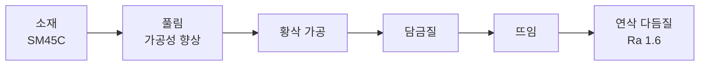

# 표면거칠기·열처리·가공기호

> [!summary] 핵심 요약
> - **Ra**(산술 평균 거칠기)가 가장 많이 쓰는 지표. 값이 작을수록 매끈하다 (단위 μm).
> - 표면 기호: 기본 √, **제거 가공 필요**(√ 아래에 가로선을 붙여 삼각형), **제거 가공 금지**(√ 안에 원).
> - 간략 기호(옛 다듬질 기호 대응): **w ≈ Ra 25, x ≈ Ra 6.3, y ≈ Ra 1.6, z ≈ Ra 0.2**.
> - 열처리 4가지: **담금질**(단단하게), **뜨임**(인성 회복), **풀림**(연하게·응력 제거), **불림**(조직 균일·미세화).

> [!warning] 자주 틀리는 포인트
> - 담금질 후에는 **반드시 뜨임**한다. 담금질만 하면 단단하지만 깨지기 쉽다.
> - **풀림은 노 안에서 천천히(노랭)**, **불림은 공기 중에서(공랭)**, **담금질은 물·기름에 급랭**.
> - 표면 경화 범위는 도면에 **굵은 1점 쇄선**으로 표시.
> - 경도 기호: **HRC**(로크웰 C, 담금질강), **HB**(브리넬, 연한 재료), **HV**(비커스, 얇은 경화층), **HS**(쇼어, 반발).
> - 줄무늬 방향 기호 **=** 는 투상면에 평행, **⊥** 는 직각, **X** 는 교차, **M** 은 여러 방향, **C** 는 동심원, **R** 은 방사상.

## 개념 정리

### 표면 거칠기 파라미터

| 기호 | 이름 | 뜻 |
| --- | --- | --- |
| Ra | 산술 평균 거칠기 | 평균선에서 벗어난 높이의 절댓값 평균 |
| Rz | 최대 높이 거칠기 | 가장 높은 산 + 가장 깊은 골 (ISO 기준) |
| RzJIS | 10점 평균 거칠기 | 높은 산 5개 + 깊은 골 5개 평균 (옛 기준) |
| Rq | 제곱 평균 제곱근 거칠기 | |

- 측정: **촉침식 거칠기 측정기**, 비교용 표준편.
- 컷오프 값: 거칠기와 굴곡(파상도)을 나누는 기준 길이.

### 표면 기호 읽기

| 기호 | 뜻 |
| --- | --- |
| √ | 가공 방법 상관없음 |
| √ + 가로선 (닫힌 삼각형) | 절삭 등 **제거 가공 필요** |
| √ + 원 | 제거 가공 **하지 않음** (주조·단조면 그대로) |
| 기호 위·옆 숫자 | Ra 값, 가공 방법, 줄무늬 방향 |

### 간략 지시 기호와 옛 다듬질 기호

| 간략 기호 | Ra (μm) | 옛 다듬질 기호 | 가공 정도 |
| :-: | --- | :-: | --- |
| w | 25 | ▽ | 거친 가공 |
| x | 6.3 | ▽▽ | 보통 가공 |
| y | 1.6 | ▽▽▽ | 정밀 가공 (연삭) |
| z | 0.2 | ▽▽▽▽ | 초정밀 (래핑, 호닝) |
| ~ (물결) | – | ~ | 가공하지 않음 |

- 부품 전체에 같은 거칠기면 **표제란 근처에 대표 기호** + 괄호 안에 예외 기호.

### 가공 방법 약호 (KS)

| 약호 | 가공 | 약호 | 가공 |
| :-: | --- | :-: | --- |
| L | 선반 | M | 밀링 |
| D | 드릴 | B | 보링 |
| G | 연삭 | P | 평삭 (플레이너) |
| BR | 브로칭 | FR | 리머 다듬질 |
| GH | 호닝 | C | 주조 |

### 열처리

| 처리 | 방법 | 목적 |
| --- | --- | --- |
| 담금질 (퀜칭) | 변태점 이상 가열 → 물·기름 급랭 | 경도·강도 증가 (마텐자이트) |
| 뜨임 (템퍼링) | 담금질 후 변태점 이하 재가열 | 인성 회복, 취성·내부 응력 감소 |
| 풀림 (어닐링) | 가열 → 노 안 서랭 | 연화, 가공성 향상, 내부 응력 제거 |
| 불림 (노멀라이징) | 가열 → 공기 중 냉각 | 결정립 미세화, 조직 표준화 |

### 표면 경화법

| 방법 | 원리 | 특징 |
| --- | --- | --- |
| 침탄법 | 저탄소강 표면에 탄소 침투 후 담금질 | 표면 단단, 내부 인성 |
| 질화법 | 질소 침투 | 담금질 불필요, 변형 작음, 처리 시간 김 |
| 고주파 경화 | 유도 가열 후 급랭 | 국부 경화, 빠름 |
| 화염 경화 | 산소-아세틸렌 불꽃 가열 후 급랭 | 대형 부품 |
| 쇼트 피닝 | 작은 강구를 표면에 분사 | 압축 잔류 응력 → 피로 강도 향상 |

### 도면에 열처리 지시

- 주기: "전체 담금질·뜨임 HRC 50~55", "고주파 경화 HRC 55 이상, 경화 깊이 1~2 mm".
- 부분 처리 범위: 해당 면에 **굵은 1점 쇄선**과 범위 치수.

### 경도 시험

| 시험 | 기호 | 방식 | 용도 |
| --- | --- | --- | --- |
| 브리넬 | HB | 강구 압입 자국 지름 | 주철, 연한 재료 |
| 로크웰 | HRC, HRB | 압입 깊이 | 열처리강(C), 연강(B), 빠름 |
| 비커스 | HV | 다이아몬드 사각뿔 자국 대각선 | 얇은 판, 경화층 |
| 쇼어 | HS | 해머 반발 높이 | 큰 부품 현장 측정 |

## 그림

## 관련 단원

- [도면 양식과 투상법](도면_양식과_투상법.md)
- [기하공차](기하공차.md)
- [치수공차와 끼워맞춤](치수공차와_끼워맞춤.md)

## 체크리스트

- [ ] Ra와 Rz의 차이를 안다
- [ ] 제거 가공 필요·금지 기호를 구분한다
- [ ] w·x·y·z 간략 기호의 Ra 값을 안다
- [ ] 가공 방법 약호 L·M·D·G를 안다
- [ ] 열처리 4가지의 냉각 방법과 목적을 구분한다
- [ ] 경도 시험 4가지의 기호와 용도를 안다

## 참고

- [큐넷 자동화설비산업기사 출제기준](https://www.q-net.or.kr/crf005.do?id=crf00503&jmCd=2034)
- KS A ISO 1302 (제품의 기하학적 특성 – 표면 결 지시 방법)
