# 표면거칠기·열처리·가공기호

> [!summary] 핵심 요약
> - **Ra**(산술 평균 거칠기)가 가장 많이 쓰는 지표. 값이 작을수록 매끈하다 (단위 μm).
> - 표면 기호: 기본 √, **제거 가공 필요**(√ 아래에 가로선을 붙여 삼각형), **제거 가공 금지**(√ 안에 원).
> - 간략 기호(옛 다듬질 기호 대응): **w ≈ Ra 25, x ≈ Ra 6.3, y ≈ Ra 1.6, z ≈ Ra 0.2**.
> - 열처리 4가지: **담금질**(단단하게), **뜨임**(인성 회복), **풀림**(연하게·응력 제거), **불림**(조직 균일·미세화).

> [!warning] 자주 틀리는 포인트
> - 담금질 후에는 **반드시 뜨임**한다. 담금질만 하면 단단하지만 깨지기 쉽다.
> - **풀림은 노 안에서 천천히(노랭)**, **불림은 공기 중에서(공랭)**, **담금질은 물·기름에 급랭**.
> - 표면 경화 범위는 도면에 **굵은 1점 쇄선**으로 표시.
> - 경도 기호: **HRC**(로크웰 C, 담금질강), **HB**(브리넬, 연한 재료), **HV**(비커스, 얇은 경화층), **HS**(쇼어, 반발).
> - 줄무늬 방향 기호 **=** 는 투상면에 평행, **⊥** 는 직각, **X** 는 교차, **M** 은 여러 방향, **C** 는 동심원, **R** 은 방사상.
> - **C(Circular)는 동심원, R(Radial)은 방사상**. 둘을 바꿔 놓은 보기가 단골 오답이다. M은 Multi-directional(여러 방향).
> - 다듬질 약호 **F**로 시작: **FF 줄, FR 리머, FS 스크레이퍼**. 특수 가공은 **SP**로 시작: **SPED 방전, SPEC 전해, SPU 초음파, SPLB 레이저**. 주조는 **C**(Casting).
> - 표면 결 기호의 기본 평가 길이는 **샘플링 길이 5개**, 기본 판정 규칙은 **16% 규칙**. 파라미터 뒤에 `max`가 붙으면 최대값 규칙.
> - 원 붙은 기호(제거 가공 금지)와 가로선 붙은 기호(제거 가공 필요)를 바꿔 고르지 말 것.

## 학습 목표

이 단원을 마치면 다음을 할 수 있어야 한다.

1. 거칠기 곡선에서 **Ra(산술 평균)** 와 **Rz(최대 높이)** 를 구분하고, 교재의 "Rz = 10점 평균" 표현을 RzJIS로 바꿔 읽는다.
2. Ra 구분값·N 번호·간략 기호 w·x·y·z를 서로 바꿔 말하고, 선삭 이론 거칠기 $h \approx f^2/8r$로 이송·노즈 반지름의 영향을 계산한다.
3. 표면 결 기호의 **기본·제거 가공 필요·제거 가공 금지** 3종과 기호 주변 a~g 위치의 뜻을 읽는다.
4. 줄무늬 방향 기호 **= ⊥ X M C R P** 를 그림과 대표 가공에 연결한다.
5. 가공 방법 약호(L·M·D·G, F 계열 다듬질, SP 계열 특수 가공, C 주조)를 가공법과 짝짓는다.
6. 열처리 4가지를 **냉각 방법**으로 구분하고, 표면 경화법·도면 지시·경도 시험 기호(HB·HRC·HV·HS)를 고른다.

## 한눈에 보기

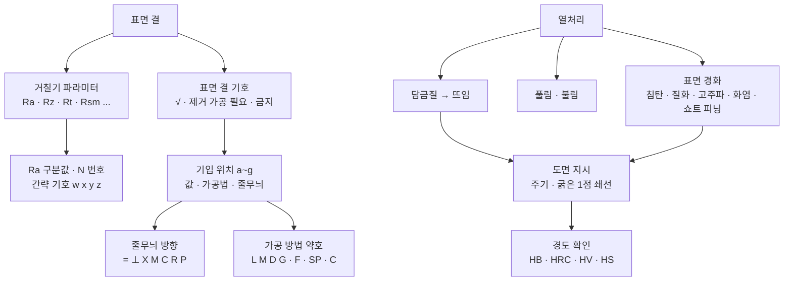

## 1. 표면 거칠기 파라미터 — 표면을 숫자로 말하기

매끈해 보이는 연삭 면도 확대하면 산과 골이 이어진 톱날 모양이다. 이 요철을 **하나의 숫자**로 줄이는 방법이 여럿 있는데, "평균적으로 얼마나 울퉁불퉁한가"를 보면 **Ra**, "가장 높은 산에서 가장 깊은 골까지"를 보면 **Rz**다. 바늘(촉침)로 표면을 긁어 지나가며 기록한 선을 생각하면 된다.

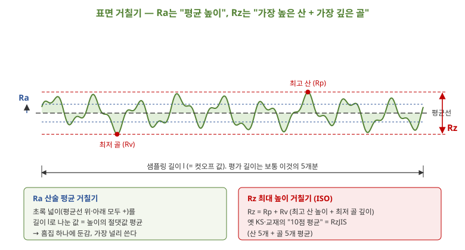

*검은 점선이 **평균선**이다. 평균선 위·아래의 초록 넓이를 모두 더해(절댓값) 길이 l로 나눈 높이가 **Ra**(파란 점선 폭)다. 빨간 점선 두 줄 사이, 즉 **가장 높은 산(Rp) + 가장 깊은 골(Rv)** 이 ISO의 **Rz**다. 흠집 하나가 깊게 파이면 Rz는 크게 변하지만 Ra는 넓이 평균이라 거의 그대로다. 아래 화살표가 **샘플링 길이**(컷오프 값)이고, 평가 길이는 보통 이것 5개분이다.*

$$R_a = \frac{1}{l}\int_0^{l} \lvert y(x) \rvert \, dx, \qquad R_z = R_p + R_v$$

### 표면 거칠기 파라미터

| 기호 | 이름 | 뜻 |
| --- | --- | --- |
| Ra | 산술 평균 거칠기 | 평균선에서 벗어난 높이의 절댓값 평균 |
| Rz | 최대 높이 거칠기 | 가장 높은 산 + 가장 깊은 골 (ISO 기준) |
| RzJIS | 10점 평균 거칠기 | 높은 산 5개 + 깊은 골 5개 평균 (옛 기준) |
| Rq | 제곱 평균 제곱근 거칠기 | |
| Rt | 프로파일 전체 높이 | 평가 길이 전체에서 최고 산 ~ 최저 골 |
| Rsm | 요소의 평균 너비 | 요철 한 주기의 평균 간격 |
| Rsk | 비대칭도 (skewness) | 높이 분포가 위·아래 어느 쪽으로 치우쳤나 |
| Rku | 첨도 (kurtosis) | 높이 분포의 뾰족한 정도 |

- 교재(CH03 9-4 해설)는 **Rz를 10점 평균 거칠기**로 설명한다(옛 KS 표기). 현재 ISO에서 Rz는 최대 높이, 10점 평균은 RzJIS다. 시험 보기가 교재 표현으로 나오면 "Rz = 10점 평균, Ra = 산술 평균"으로 읽는다.

> [!tip] 감 잡기
> **Rz와 Rt의 차이**는 범위다. Rz는 샘플링 길이 **하나** 안에서 산+골, Rt는 평가 길이 **전체**(샘플링 길이 5개)에서 최고 산~최저 골이다. 그래서 같은 표면이면 Rt ≥ Rz. 이름에 "평균"이 들어가면 Ra(산술 평균), "너비"면 Rsm, "치우침"이면 Rsk, "뾰족함"이면 Rku.

> [!question] 시험에서는
> "Ra의 기호"(2014-2), "Rt·Rsm·Rsk·Ra 정의 중 틀린 것"(2018-2)처럼 **파라미터 이름 짝짓기**가 나온다. 교재식 보기 "Ra를 10점 평균이라 한다"는 틀린 설명이다 (Ra는 산술 평균).

## 2. Ra 구분값·N 번호와 거칠기를 만드는 요인

Ra 값은 아무 숫자나 쓰지 않고 **표준 수열**에서 고른다. 0.025에서 시작해 **두 배씩** 커지고, 각 값에 N1~N12 번호가 붙는다. 도면의 w·x·y·z 간략 기호는 이 수열의 대표값 네 개를 짧게 부르는 이름이다.

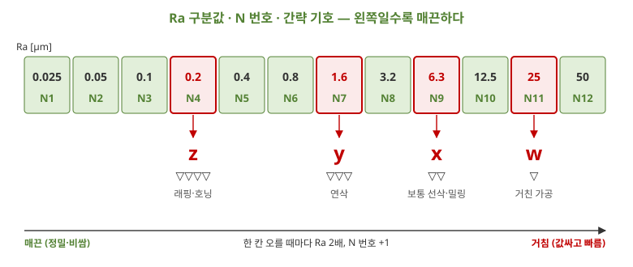

*왼쪽 끝 0.025(N1)가 가장 매끈하고 오른쪽 끝 50(N12)이 가장 거칠다. 빨간 칸 네 개가 간략 기호의 값이다: **z = 0.2(N4)** 래핑·호닝, **y = 1.6(N7)** 연삭, **x = 6.3(N9)** 보통 선삭·밀링, **w = 25(N11)** 거친 가공. 아래 ▽ 개수는 옛 다듬질 기호로, ▽가 많을수록 매끈하다(5절 표).*

**Ra 구분값과 N 번호 (교재 CH03 09절)**

| Ra [μm] | 0.025 | 0.05 | 0.1 | 0.2 | 0.4 | 0.8 | 1.6 | 3.2 | 6.3 | 12.5 | 25 | 50 |
| --- | --- | --- | --- | --- | --- | --- | --- | --- | --- | --- | --- | --- |
| N 번호 | N1 | N2 | N3 | N4 | N5 | N6 | N7 | N8 | N9 | N10 | N11 | N12 |

- 값이 두 배씩 커지고 N 번호는 1씩 오른다. N 번호가 클수록 거칠다.

### 측정과 컷오프

- 측정: **촉침식 거칠기 측정기**, 광 절단식, 현미 간섭식, 비교용 표준편. 다이얼 게이지는 거칠기 측정법이 아니다.
- 컷오프 값: 거칠기와 굴곡(파상도)을 나누는 기준 길이.

> [!tip] 감 잡기
> 표면에는 짧은 주기의 **거칠기**와 긴 주기의 **굴곡(파상도)** 이 겹쳐 있다. 컷오프 값은 "이 길이보다 긴 물결은 거칠기로 치지 않는다"는 체(필터)의 눈금이다. 그래서 1절 그림의 샘플링 길이가 곧 컷오프 값이다.

### 선삭 이론 거칠기

선반 바이트 끝은 뾰족하지 않고 작은 원(노즈 반지름 r)으로 둥글다. 공작물이 한 바퀴 돌 때마다 바이트가 f만큼 옆으로 이동하니, 가공면에는 반지름 r인 원호 자국이 f 간격으로 찍히고 그 사이에 작은 산이 남는다.

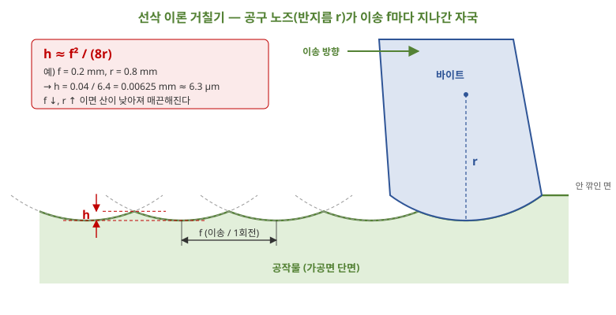

*회색 점선 원호가 앞선 회전에서 바이트 노즈가 지나간 자리이고, 초록 선이 남은 가공면이다. 이웃한 원호가 만나는 곳에 높이 **h**의 산이 생긴다. 원호 간격(이송 f)을 줄이거나 원호를 크게(노즈 반지름 r ↑) 하면 산이 낮아진다. 예: f = 0.2 mm, r = 0.8 mm → h ≈ 6.3 μm.*

- 선삭 이론 거칠기(최대 높이) $h \approx \dfrac{f^2}{8r}$ (f: 이송, r: 노즈 반지름). 이송을 줄이고 노즈 반지름을 키우면 매끈해진다.

$$h = r - \sqrt{r^2 - \left(\tfrac{f}{2}\right)^2} \;\approx\; \frac{f^2}{8r}$$

> [!question] 시험에서는
> "이송을 2배로 하면 이론 거칠기는?" → $f^2$에 비례하므로 **4배**. "노즈 반지름을 2배로 하면?" → **1/2배**. 거칠기 측정법을 고르는 문제에서 **다이얼 게이지**는 오답이다.

## 3. 표면 결 도시 기호 — √ 하나에 담긴 정보

도면의 √ 기호는 "이 면을 이렇게 만들어라"는 작업 지시서다. 기호 모양만으로 **깎아야 하는지, 깎으면 안 되는지**를 말하고, 주변 글자로 거칠기 값·가공법·줄무늬 방향을 덧붙인다.

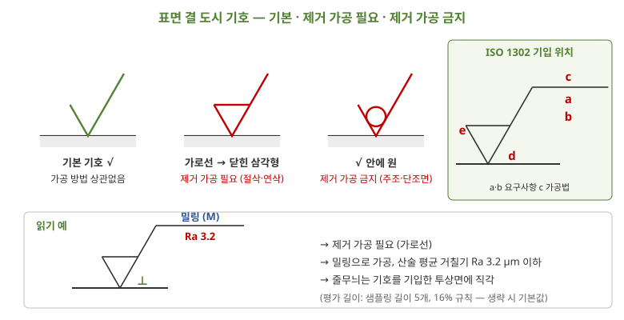

*왼쪽부터 **기본 기호 √**(방법 상관없음), 짧은 다리 끝에 **가로선**을 그어 닫은 삼각형(**제거 가공 필요**), V 안에 **원**(**제거 가공 금지** — 주조·단조면 그대로)이다. 오른쪽 상자는 현행 ISO 1302의 기입 위치로, 긴 다리의 가로선 **아래 a·b**에 요구사항, **위 c**에 가공 방법, V 오른쪽 아래 **d**에 줄무늬 방향, 왼쪽 **e**에 가공 여유를 쓴다. 아래 읽기 예는 "밀링으로 제거 가공, Ra 3.2 μm, 줄무늬는 투상면에 직각"이다.*

### 표면 기호 읽기

| 기호 | 뜻 |
| --- | --- |
| √ | 가공 방법 상관없음 |
| √ + 가로선 (닫힌 삼각형) | 절삭 등 **제거 가공 필요** |
| √ + 원 | 제거 가공 **하지 않음** (주조·단조면 그대로) |
| 기호 위·옆 숫자 | Ra 값, 가공 방법, 줄무늬 방향 |

### 기호 주변 기입 위치

옛 KS 방식(기출에 많이 나옴)과 ISO 1302 방식이 다르다. 기출 보기는 대부분 옛 방식 문자를 쓴다.

| 위치 | 옛 KS 방식 | ISO 1302 (현행) |
| :-: | --- | --- |
| a | Ra 값 | 첫 번째 표면 결 요구사항 (파라미터·값) |
| b | 가공 방법 | 두 번째 요구사항 |
| c | 컷오프 값 (c′: 평가 길이) | 가공 방법 |
| d | 줄무늬 방향 기호 | 줄무늬 방향 기호 |
| e | 다듬질 여유 | 기계 가공 여유 (mm) |
| f | Ra 이외의 파라미터 값 | – |
| g | 표면 파상도 | – |

- 현행 표기 예: `U Ra 3.2`, `L Ra 0.8` → 위(U)·아래(L) 한계를 둘 다 지정한 **양측 한계**. `Rz max 6.3` → 최대값 규칙.
- 파라미터 뒤 숫자(예: `Rz3`)는 평가 길이에 들어가는 샘플링 길이 개수. 생략하면 5개.

> [!tip] 감 잡기
> **16% 규칙**은 "측정한 값 가운데 지정값을 넘는 것이 16% 이하이면 합격", **max 규칙**은 "하나라도 넘으면 불합격"이다. 아무 말 없으면 16% 규칙, `max`가 붙으면 엄격한 쪽이다.

> [!question] 시험에서는
> 기호 그림을 주고 **해석 중 틀린 것**을 고르게 한다(2014-2, 2016-1, 2019-1). 교재 예제는 "0.8이 가공 여유 자리"라는 보기가 오답이었다 — 숫자가 어느 위치에 있는지부터 본다. **제거 가공 금지 기호**(원) 고르기는 2015-2, 2018-2에 나왔다.

## 4. 줄무늬 방향 기호 — 공구 자국이 어느 쪽으로 났나

가공면을 비스듬히 보면 공구가 지나간 자국(줄무늬)이 보인다. 셰이퍼는 한 방향으로 긁으니 나란한 줄, 정면 선삭은 회전하며 깎으니 동심원, 래핑은 사방으로 문지르니 무늬가 뒤섞인다. 이 모양을 한 글자로 적은 것이 줄무늬 방향 기호다.

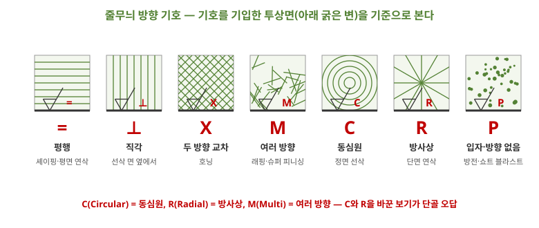

*각 칸 아래의 **굵은 변**이 기호를 기입한 투상면이다. **=** 는 그 변과 나란한 줄, **⊥** 는 직각인 줄, **X** 는 비스듬히 엇갈린 두 방향(호닝의 크로스 해치), **M** 은 방향이 제각각, **C** 는 중심에 대한 동심원, **R** 은 중심에서 뻗는 방사선, **P** 는 방향 없는 입자 모양이다.*

### 줄무늬 방향 기호

| 기호 | 줄무늬 모양 | 대표 가공 |
| :-: | --- | --- |
| = | 기호를 기입한 투상면에 **평행** | 셰이핑, 평면 연삭 |
| ⊥ | 투상면에 **직각** | 선삭·원통 연삭 면을 옆에서 볼 때 |
| X | 투상면에 비스듬히 **두 방향 교차** | 호닝 |
| M | **여러 방향** | 래핑, 슈퍼 피니싱, 정면 밀링 |
| C | 면의 중심에 대해 **동심원** | 정면 선삭 |
| R | 면의 중심에 대해 **방사상** | 단면 연삭 |
| P | 입자 모양, 방향 없음 또는 돌출 | 방전 가공, 쇼트 블라스트 |

> [!question] 시험에서는
> 줄무늬 방향 기호는 이 단원 최다 출제(**7회**)다. 그림과 기호를 짝짓거나(2014-3, 2017-3, 2018-1), **M의 뜻**(2016-3, 2018-3), **C의 뜻**(2016-2, 2020-1)을 묻는다. C ↔ R을 바꿔 놓은 보기를 조심한다.

## 5. 간략 지시 기호와 옛 다듬질 기호

같은 거칠기를 도면 곳곳에 길게 쓰면 복잡하다. 그래서 w·x·y·z 한 글자로 줄여 쓰고, 표제란 근처에 그 뜻을 한 번만 적는다. 옛 도면의 ▽ 개수 표기도 같은 단계와 짝을 이룬다 (2절 그림 참고).

### 간략 지시 기호와 옛 다듬질 기호

| 간략 기호 | Ra (μm) | 옛 다듬질 기호 | 가공 정도 |
| :-: | --- | :-: | --- |
| w | 25 | ▽ | 거친 가공 |
| x | 6.3 | ▽▽ | 보통 가공 |
| y | 1.6 | ▽▽▽ | 정밀 가공 (연삭) |
| z | 0.2 | ▽▽▽▽ | 초정밀 (래핑, 호닝) |
| ~ (물결) | – | ~ | 가공하지 않음 |

- 부품 전체에 같은 거칠기면 **표제란 근처에 대표 기호** + 괄호 안에 예외 기호.

> [!tip] 감 잡기
> 알파벳 순서 w → x → y → z로 갈수록 **매끈**하고, 값은 대략 4배씩 작아진다(25 → 6.3 → 1.6 → 0.2는 마지막만 8배). ▽ 개수도 1 → 4개로 늘어난다.

## 6. 가공 방법 약호 (KS)

표면 결 기호의 가공 방법 자리(옛 KS b, ISO c)에는 "밀링" 대신 **M** 같은 약호를 쓴다. 대부분 영어 머리글자라 영어 이름을 떠올리면 외우기 쉽다 (Lathe, Milling, Drilling, Grinding, Broaching).

| 밀링 (M) | 브로칭 (BR) |
| :-: | :-: |
| 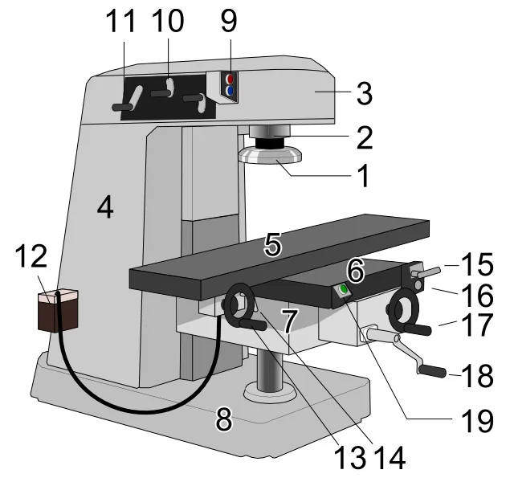 | 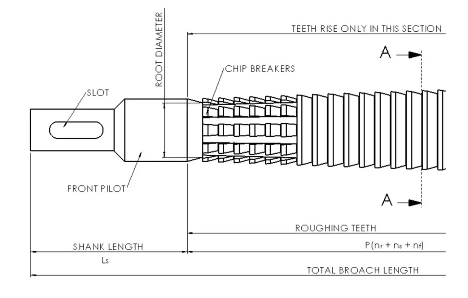 |
| *회전하는 커터 아래로 테이블이 이송되며 평면·홈을 깎는다 ([기계공작과 측정](기계공작과_측정.md)에서 재사용)* | *뒤로 갈수록 날이 조금씩 높아지는 브로치를 한 번 밀거나 당겨 키 홈·스플라인 구멍을 완성한다 (2020-3 BR 출제)* |

### 가공 방법 약호 (KS)

| 약호 | 가공 | 약호 | 가공 |
| :-: | --- | :-: | --- |
| L | 선반 | M | 밀링 |
| D | 드릴 | B | 보링 |
| G | 연삭 | P | 평삭 (플레이너) |
| BR | 브로칭 | FR | 리머 다듬질 |
| GH | 호닝 | C | 주조 |
| SH | 형삭 (셰이핑) | GSP | 슈퍼 피니싱 |
| FF | 줄 다듬질 | FS | 스크레이퍼 다듬질 |
| SPED | 방전 가공 | SPEC | 전해 가공 |
| SPU | 초음파 가공 | SPLB | 레이저 가공 |
| F | 단조 | W | 용접 |

- 외우는 요령: **G = 연삭 계열**, **F + 문자 = 다듬질(Finishing)**, **SP + 문자 = 특수 가공(Special Processing)**.
- 래핑·평면 연삭 등 세부 약호는 판본마다 표기가 달라 헷갈리기 쉽다. 시험에서는 위 표의 약호가 주로 나왔다.

**교재(CH03 09절)에 추가로 나오는 약호**

| 구분 | 약호 |
| --- | --- |
| 절삭 | DR 리밍, DT 태핑, SL 슬로팅, TC 기어 절삭, TCH 호빙 |
| 다듬질 | FL 래핑, FP 폴리싱, FB 브러싱 |
| 특수 가공 | SPEB 전자빔, SB 블라스팅 |
| 용접 | W 용접, WA 가스 용접 |
| 열처리 (H) | HQ 담금질, HT 뜨임(템퍼링), HA 풀림(어닐링), HG 시효, HC 침탄 |
| 표면 처리 (S) | SHS 숏피닝, SA 양극 산화, SCT 피막 코팅 |

- 리밍은 절삭 쪽 DR과 다듬질 쪽 FR이 함께 나온다. 기출 정답은 **FR(리머 다듬질)** 이었다.

> [!question] 시험에서는
> 가공 방법 약호는 **8회** 출제됐다. 결 기호 속 약호로 가공법 찾기(2014-1), **FS 스크레이퍼**(2015-1, 2017-1), **SP 계열 특수 가공**(2015-2), **C 주조**(2016-1), **FR 리밍**(2017-2), **FF 줄 다듬질**(2019-2), **BR 브로칭**(2020-3). "C = 절삭(Cutting)"으로 착각하지 말 것 — **C는 주조(Casting)** 다.

## 7. 열처리 — 가열은 같고, 식히는 법이 다르다

강을 빨갛게(변태점 이상) 달군 뒤 **얼마나 빨리 식히느냐**에 따라 성질이 정반대가 된다. 물에 확 담그면 단단해지고(담금질), 화로 안에서 하루 종일 식히면 말랑해진다(풀림). 공기 중에 두면 그 중간(불림)이고, 담금질로 너무 단단해 깨지기 쉬운 것을 살짝 다시 데워 끈기를 되찾는 것이 뜨임이다.

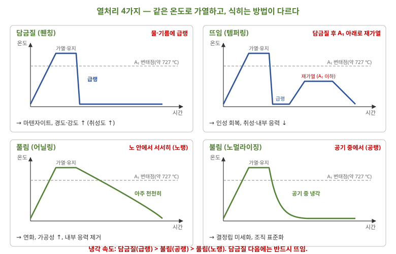

*네 그래프 모두 왼쪽은 같은 **가열·유지**(회색 점선 A₁ 변태점 위)다. 차이는 오른쪽 냉각선의 기울기다. **담금질**은 수직에 가깝게 떨어지고(급랭), **뜨임**은 담금질 뒤 A₁ **아래**로 다시 데웠다 식힌다. **풀림**은 노 안에서 아주 완만하게, **불림**은 공기 중에서 그 중간 속도로 식는다. 냉각 속도 순서: 담금질 > 불림 > 풀림.*

### 열처리

| 처리 | 방법 | 목적 |
| --- | --- | --- |
| 담금질 (퀜칭) | 변태점 이상 가열 → 물·기름 급랭 | 경도·강도 증가 (마텐자이트) |
| 뜨임 (템퍼링) | 담금질 후 변태점 이하 재가열 | 인성 회복, 취성·내부 응력 감소 |
| 풀림 (어닐링) | 가열 → 노 안 서랭 | 연화, 가공성 향상, 내부 응력 제거 |
| 불림 (노멀라이징) | 가열 → 공기 중 냉각 | 결정립 미세화, 조직 표준화 |

> [!tip] 감 잡기
> 이름과 냉각을 한 쌍으로 외운다: **담금질 = 물에 "담근다"(급랭)**, **풀림 = 화로 안에서 "풀어 준다"(노랭)**, **불림 = 바람(공기)에 "불린다"(공랭)**, **뜨임 = 다시 "띄운다"(재가열)**. 약호도 H로 시작한다: HQ 담금질, HT 뜨임, HA 풀림 (6절 교재 약호 표).

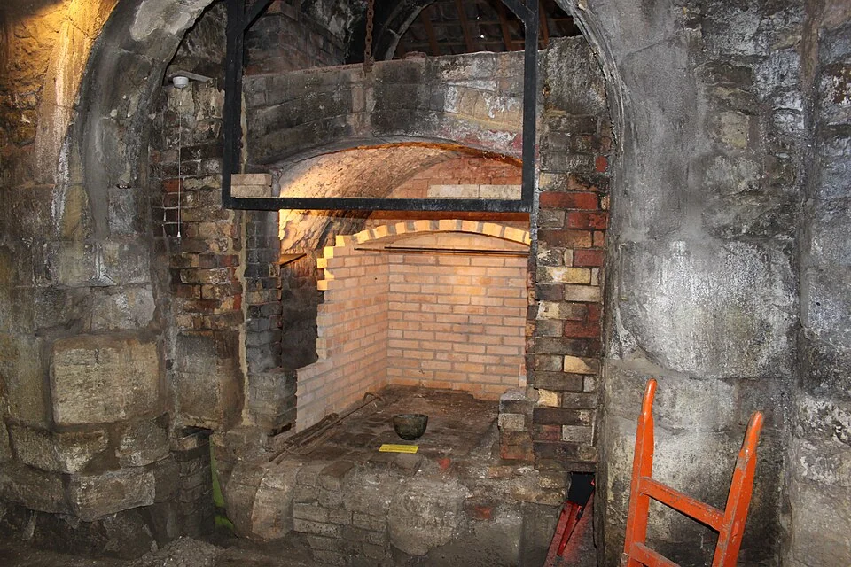

*영국 솔트퍼드 황동 공장에 남아 있는 옛 **풀림로**다. 두꺼운 벽돌 아치 안에 재료를 넣고 가열한 뒤, 불을 끄고 **노 안에 그대로 둔 채** 벽돌의 열이 빠지는 속도로 천천히 식힌다 — 이것이 "노랭"이다. 오늘날 공장의 풀림로는 전기·가스로 온도를 프로그램대로 내리지만 원리는 같다.*

## 8. 표면 경화법 — 겉은 단단하게, 속은 질기게

기어 이나 캠은 표면이 닳지 않아야 하면서도 충격에 부러지면 안 된다. 전체를 담금질하면 단단하지만 깨지기 쉬우니, **표면만** 단단하게 만들고 속은 원래의 인성을 남긴다. 방법은 크게 "성분을 바꾸는 것"(침탄·질화)과 "표면만 빨리 데웠다 식히는 것"(고주파·화염), "두드려서 굳히는 것"(쇼트 피닝)으로 나뉜다.

### 표면 경화법

| 방법 | 원리 | 특징 |
| --- | --- | --- |
| 침탄법 | 저탄소강 표면에 탄소 침투 후 담금질 | 표면 단단, 내부 인성 |
| 질화법 | 질소 침투 | 담금질 불필요, 변형 작음, 처리 시간 김 |
| 고주파 경화 | 유도 가열 후 급랭 | 국부 경화, 빠름 |
| 화염 경화 | 산소-아세틸렌 불꽃 가열 후 급랭 | 대형 부품 |
| 쇼트 피닝 | 작은 강구를 표면에 분사 | 압축 잔류 응력 → 피로 강도 향상 |

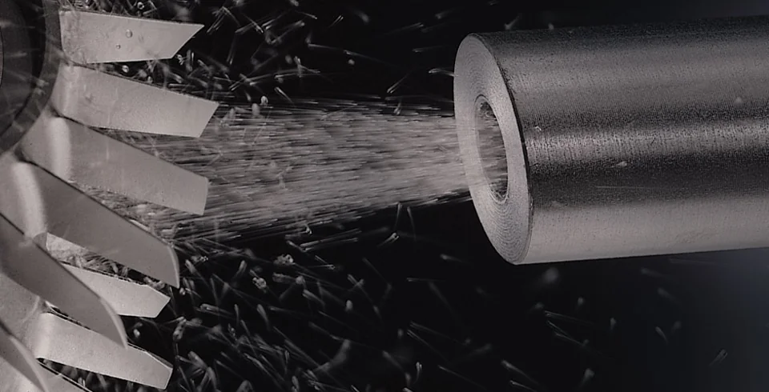

*Wheelabrator 카탈로그의 숏피닝 공정 사진(제조사 사진). 오른쪽 원통형 노즐에서 **작은 알갱이(숏)가 빠른 속도로 분사**되어 왼쪽의 톱니 모양 금속 부품 표면에 부딪힌다. 이 수많은 작은 충격이 표면을 살짝 눌러 **압축 잔류 응력**을 만들고, 그 결과 균열이 잘 생기지 않아 **피로 강도**가 올라간다. 표면을 깎지 않고 두드려 다지는 점이 포인트다.*

> [!question] 시험에서는
> "담금질이 필요 없고 변형이 작은 표면 경화법" → **질화법**. "표면에 압축 잔류 응력을 만들어 피로 강도를 높이는 것" → **쇼트 피닝**. 침탄은 탄소(C), 질화는 질소(N)를 넣는다.

## 9. 도면에 열처리 지시

열처리는 눈에 보이는 모양이 아니라서 도면에는 **글(주기)** 과 **특수 선**으로 지시한다. 전체 처리는 주기 한 줄, 일부 면만 처리할 때는 그 면 바깥에 굵은 1점 쇄선을 긋고 범위를 치수로 준다.

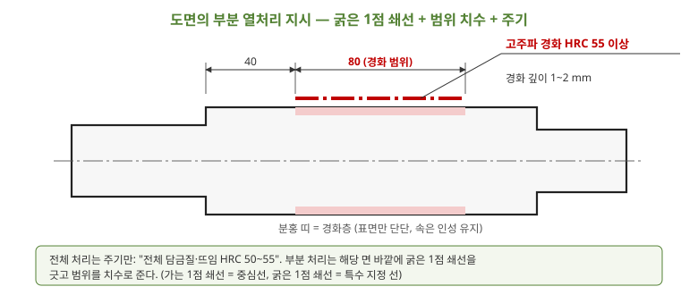

*빨간 **굵은 1점 쇄선**이 외형선 바로 바깥에 나란히 그어져 경화할 구간을 가리키고, 위 치수 40·80으로 시작 위치와 범위를 정한다. 인출선 끝의 주기가 처리 방법·목표 경도·경화 깊이다. 분홍 띠는 실제로 단단해지는 얇은 경화층을 보여 줄 뿐 도면에 그리지는 않는다. 축 가운데 **가는** 1점 쇄선은 중심선이라 굵기로 구분한다.*

- 주기: "전체 담금질·뜨임 HRC 50~55", "고주파 경화 HRC 55 이상, 경화 깊이 1~2 mm".
- 부분 처리 범위: 해당 면에 **굵은 1점 쇄선**과 범위 치수.

## 10. 경도 시험 — 얼마나 단단한가를 숫자로

경도는 "눌렀을 때 얼마나 안 들어가는가"다. 단단한 압입자로 일정한 힘을 주어 누른 뒤 **자국의 크기나 깊이**를 재고(브리넬·로크웰·비커스), 또는 작은 해머를 떨어뜨려 **튀어 오르는 높이**를 잰다(쇼어). 무엇으로 누르고 무엇을 재는지가 시험 이름을 가른다.

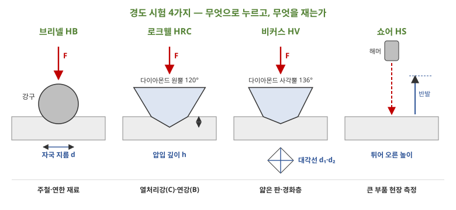

*브리넬은 **강구**로 눌러 **자국 지름 d**, 로크웰 C는 **120° 다이아몬드 원뿔**로 눌러 **깊이 h**, 비커스는 **136° 다이아몬드 사각뿔**로 눌러 마름모 자국의 **대각선 d₁·d₂**, 쇼어는 해머를 떨어뜨려 **반발 높이**를 잰다. 자국이 작고 얕은 비커스는 얇은 판·경화층에, 자국이 큰 브리넬은 조직이 거친 주철에, 들고 다닐 수 있는 쇼어는 큰 부품 현장 측정에 쓴다.*

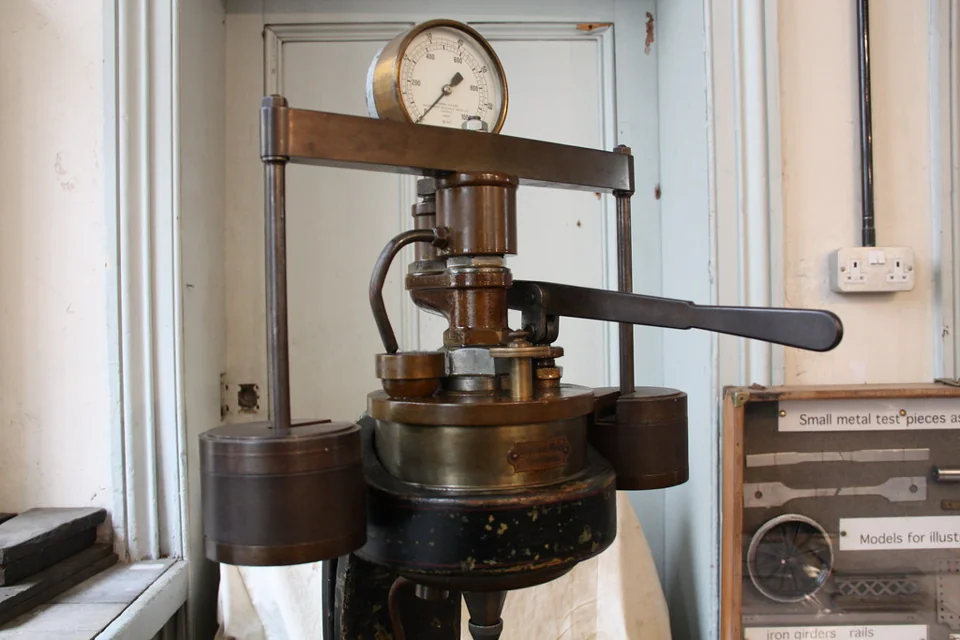

*런던 커컬디 시험 박물관의 옛 유압식 시험기(촬영자가 브리넬 경도로 표시했으나 사진만으로 기종을 확정할 수는 없다). 손잡이로 유압을 올리고 위의 압력계로 힘을 읽으며 양옆 추로 하중을 맞추는 구조로 보인다. 경도 시험의 핵심인 "일정한 힘으로 누른다"를 기계식으로 구현한 예로 볼 수 있다.*

| 로크웰 경도 시험기 | 비커스 압흔 (현미경) |
| :-: | :-: |
| 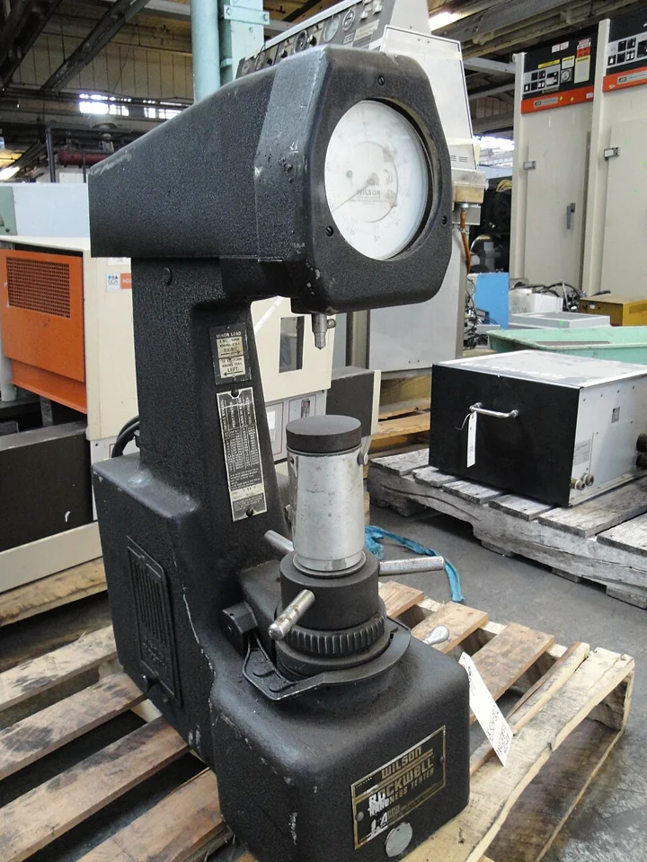 | 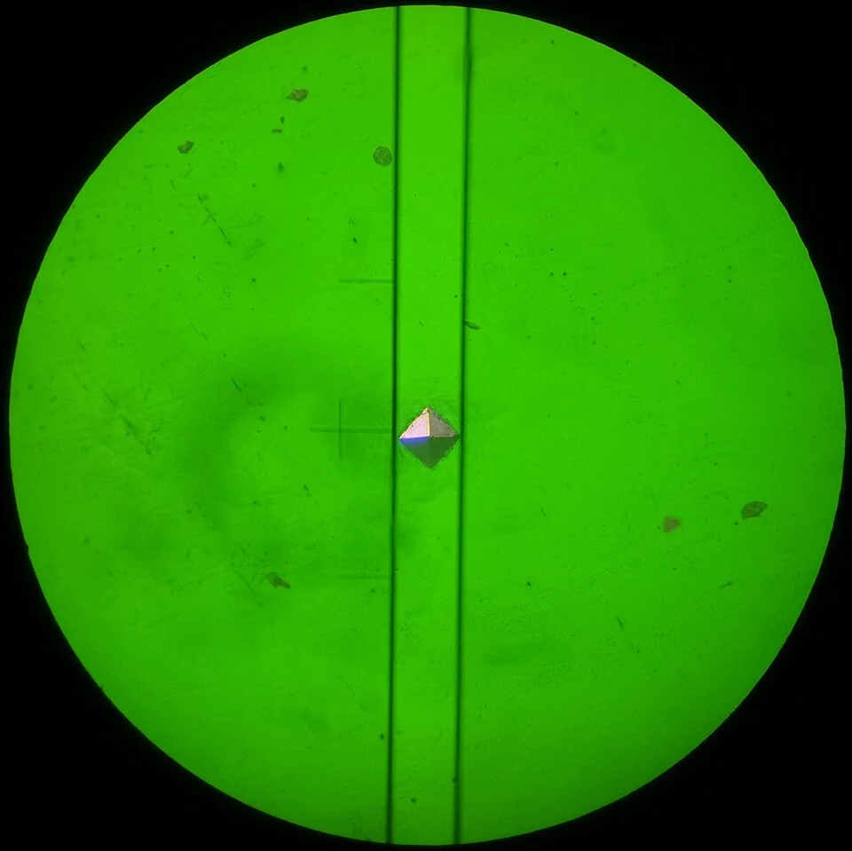 |
| *앞쪽 다이얼이 압입 깊이를 바로 경도값으로 보여 준다. 자국 크기를 따로 잴 필요가 없어 **빠르다** — 열처리 공장에서 HRC를 재는 기본 장비* | *현미경 시야 가운데의 작은 **마름모(사각뿔) 자국**과, 대각선을 재는 두 개의 세로 기준선이 보인다* |

### 경도 시험

| 시험 | 기호 | 방식 | 용도 |
| --- | --- | --- | --- |
| 브리넬 | HB | 강구 압입 자국 지름 | 주철, 연한 재료 |
| 로크웰 | HRC, HRB | 압입 깊이 | 열처리강(C), 연강(B), 빠름 |
| 비커스 | HV | 다이아몬드 사각뿔 자국 대각선 | 얇은 판, 경화층 |
| 쇼어 | HS | 해머 반발 높이 | 큰 부품 현장 측정 |

> [!tip] 감 잡기
> 기호의 두 번째 글자가 시험 이름이다: H**B** = **B**rinell, H**R** = **R**ockwell, H**V** = **V**ickers, H**S** = **S**hore. 로크웰은 압입자·하중 조합에 따라 C 스케일(다이아몬드, 담금질강)과 B 스케일(강구, 연강)로 나뉜다.

## 그림

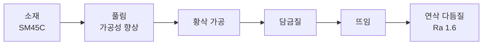

*축 하나를 만드는 순서다. 먼저 **풀림**으로 말랑하게 해서 깎기 쉽게 하고, 거칠게 깎은 뒤 **담금질 → 뜨임**으로 경도와 인성을 맞춘다. 열처리로 생긴 변형·산화 피막은 마지막 **연삭**(간략 기호 y, Ra 1.6)으로 다듬는다.*

## 기출 포인트

- 줄무늬 방향 기호 — **7회**: 그림과 기호 짝 맞추기·틀린 설명 고르기 (2014-3, 2017-3, 2018-1), M의 뜻 (2016-3, 2018-3), C의 뜻 (2016-2, 2020-1)
- 표면 결 도시 기호 해석 — 6회: 기호 전체 해석에서 틀린 것 (2014-2, 2016-1, 2019-1), 기호 주변 문자 위치 (2015-1), 제거 가공 금지 기호 고르기 (2015-2, 2018-2)
- 가공 방법 약호 — **8회**: 결 기호 속 약호로 가공법 찾기 (2014-1), FS 스크레이퍼 (2015-1, 2017-1), SP 계열 특수 가공 (2015-2), C 주조 (2016-1), FR 리밍 (2017-2), FF 줄 다듬질 (2019-2), BR 브로칭 (2020-3)
- 거칠기 파라미터 (1과목에서 출제) — Ra 기호 (2014-2), Rt·Rsm·Rsk·Ra 정의 (2018-2)
- **열처리·경도 기호는 2014~2020년 2과목에서 직접 출제되지 않았다.** 새 출제기준에 들어 있으니 이 노트의 열처리 표는 기본만 확실히 해 둔다.

**교재 예제 유형** (Win-Q 2025 PART 01 CHAPTER 03, 09절): 줄무늬 기호 빈칸(그림, C 동심원), 표면 결 기호 설명 중 틀린 것(그림, Ra를 10점 평균이라 함), 표면 결 기호 위치 해석(그림, 0.8은 가공 여유 자리가 아님), 스크레이퍼 약호(FS).

## 관련 단원

- [도면 양식과 투상법](도면_양식과_투상법.md)
- [기하공차](기하공차.md)
- [치수공차와 끼워맞춤](치수공차와_끼워맞춤.md)
- [기계공작과 측정](기계공작과_측정.md) — 선삭·밀링·연삭·브로칭 등 가공법과 측정기
- [기계설계 기초와 재료강도](기계설계_기초와_재료강도.md) — 응력·피로 강도 (쇼트 피닝의 효과)

## 체크리스트

- [ ] Ra와 Rz의 차이를 안다
- [ ] 제거 가공 필요·금지 기호를 구분한다
- [ ] w·x·y·z 간략 기호의 Ra 값을 안다
- [ ] 가공 방법 약호 L·M·D·G를 안다
- [ ] 열처리 4가지의 냉각 방법과 목적을 구분한다
- [ ] 경도 시험 4가지의 기호와 용도를 안다
- [ ] 줄무늬 방향 기호 7가지(= ⊥ X M C R P)를 그림과 연결한다
- [ ] FF·FR·FS·SPED·BR·C 약호를 가공법과 연결한다
- [ ] 표면 결 기호 주변 a~g 위치의 뜻을 안다
- [ ] 16% 규칙·max 규칙과 기본 평가 길이(샘플링 길이 5개)를 안다
- [ ] Rt·Rsm·Rsk·Rku의 뜻을 구분한다
- [ ] 선삭 이론 거칠기 $f^2/8r$에서 이송·노즈 반지름의 영향을 말한다
- [ ] 표면 경화법 5가지(침탄·질화·고주파·화염·쇼트 피닝)의 특징을 구분한다

## 참고

- [큐넷 자동화설비산업기사 출제기준](https://www.q-net.or.kr/crf005.do?id=crf00503&jmCd=2034)
- KS A ISO 1302 (제품의 기하학적 특성 – 표면 결 지시 방법)

### 그림 출처

위키미디어 공용(Wikimedia Commons)과 Openverse에서 가져온 공개 라이선스 자료이고, 노트에 맞게 크기를 줄이고 WebP로 변환했다.

| 그림 | 작성자 | 라이선스 | 출처 |
| --- | --- | --- | --- |
| [Milling machine (Vertical, Manual) NT](https://commons.wikimedia.org/wiki/File:Milling_machine_(Vertical,_Manual)_NT.PNG) | Tosaka | [CC BY 3.0](https://creativecommons.org/licenses/by/3.0) | Wikimedia Commons |
| [Broaching 01](https://commons.wikimedia.org/wiki/File:Broaching_01.jpg) | Amos1947 | [CC BY-SA 4.0](https://creativecommons.org/licenses/by-sa/4.0) | Wikimedia Commons |
| [Annealing furnace Saltford Brass Mill](https://commons.wikimedia.org/wiki/File:Annealing_furnace_Saltford_Brass_Mill.jpg) | Rodw | [CC BY-SA 3.0](https://creativecommons.org/licenses/by-sa/3.0) | Wikimedia Commons |
| [Wheelabrator 숏피닝 (카탈로그 사진)](https://www.wheelabratorgroup.com/shot-peening-machines/) | Wheelabrator (Norican Group) | 저작권 보유(개인 학습용, 비공개 저장소 한정) | Wheelabrator 카탈로그 |
| [IMG_8158](https://www.flickr.com/photos/30661871@N03/40837838683) | RichardAsh1981 | [CC BY-SA 2.0](https://creativecommons.org/licenses/by-sa/2.0/) | Openverse (flickr) |
| [Rockwell hardness tester 001](https://commons.wikimedia.org/wiki/File:Rockwell_hardness_tester_001.jpg) | Three-quarter-ten | [CC BY-SA 3.0](https://creativecommons.org/licenses/by-sa/3.0) | Wikimedia Commons |
| [Vicker Hardness - Diamond Indentation](https://commons.wikimedia.org/wiki/File:Vicker_Hardness_-_Diamond_Indentation.jpg) | Encik Tekateki | [CC BY-SA 4.0](https://creativecommons.org/licenses/by-sa/4.0) | Wikimedia Commons |

제조사 카탈로그 사진은 저작권이 각 회사에 있으며, 개인 학습용으로 비공개 저장소에서만 쓴다(공개 전에 삭제).

직접 그린 그림(SVG, 이 볼트용으로 새로 작성): 거칠기 Ra Rz, Ra 구분값 간략기호, 선삭 이론거칠기, 표면기호 3종, 줄무늬방향 기호, 열처리 냉각곡선, 부분경화 도시, 경도시험 원리. 밀링 머신·브로치 그림(Milling machine, Broaching 01)은 [기계공작과 측정](기계공작과_측정.md)에서 재사용했다.

