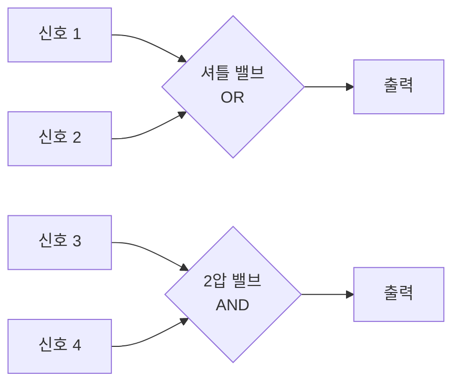

# 공압 밸브

> [!summary] 핵심 요약
> - 밸브 분류: **방향 제어**(흐름 길), **유량 제어**(속도), **압력 제어**(힘), **논리·기타**(셔틀, 2압, 급속 배기, 시간 지연).
> - 방향 제어 밸브 이름 **"포트 수 / 위치 수"**: 5/2 밸브 = 포트 5개, 위치 2개.
> - **셔틀 밸브 = OR**, **2압 밸브 = AND**.
> - 일방향 유량 제어 밸브 = **교축 밸브 + 체크 밸브** → 한쪽 방향만 속도 조절.

> [!warning] 자주 틀리는 포인트
> - ISO 포트 번호: **1 = 공급(P)**, **2·4 = 출력(B·A)**, **3·5 = 배기(R·S)**, **12·14 = 파일럿**(14는 1→4 연결 신호).
> - **편측 솔레노이드(스프링 복귀)**: 신호가 끊기면 원위치. **양측 솔레노이드(더블)**: 신호가 끊겨도 **마지막 위치를 기억**.
> - 3/2 밸브의 **NC(상시 닫힘)** 은 조작 전 1→2 차단, **NO(상시 열림)** 는 조작 전 1→2 연결.
> - **급속 배기 밸브**는 실린더 가까이 달아 배기를 빨리 해 **속도를 높인다**.
> - 밸브 기호의 상자 하나 = 위치 하나. 배관은 **정상 위치(스프링 쪽 상자)** 에 연결해 그린다.
> - 포트 수는 **한 상자에 붙은 연결구 수**로 센다(상자 수 × 포트 아님). 상자 3개·연결구 4개 → **4포트 3위치(4/3)**.
> - "3/2 밸브"의 3은 **포트(연결구) 3개**, 2는 **위치 2개**. "연결구가 2개"라고 하면 틀린다. 3/2 밸브에는 NC·NO형, 솔레노이드 작동·스프링 복귀형이 모두 있다.
> - 구 문자 표기: 공급 **P**, 작업 **A·B·C**, 배기 **R·S·T**, 제어(파일럿) **X·Y·Z**, 누설 **L**. 배기를 I·J·K 등으로 바꾼 보기가 오답.
> - **전자 밸브(솔레노이드 밸브)** = 코일에 전류 → 전자석 힘으로 밸브 전환. 전자력 조작이면 답은 솔레노이드 방식.

## 개념 정리

### 방향 제어 밸브

| 밸브 | 용도 |
| --- | --- |
| 2/2 | 단순 ON/OFF |
| 3/2 | 단동 실린더, 신호용 밸브 |
| 4/2, 5/2 | 복동 실린더 (5/2는 배기 포트가 따로 → 전진·후진 속도 따로 조절) |
| 5/3 | 복동 실린더 중간 정지 |

**5/3 밸브 중립 위치**

| 중립 형식 | 연결 | 동작 |
| --- | --- | --- |
| 올 포트 블록 (클로즈드 센터) | 모든 포트 차단 | 실린더 중간 정지 (공기 압축성으로 약간 움직임) |
| 배기 센터 (A·B → 배기) | 출력 포트가 배기에 연결 | 실린더가 자유롭게 움직임, 잔압 제거 |
| 가압 센터 (P → A·B) | 공급이 양쪽으로 | 양쪽 압력 균형 |

### 조작 방식

| 분류 | 예 |
| --- | --- |
| 인력 | 누름 버튼, 레버, 페달, 토글 |
| 기계 | 롤러, 플런저, **스프링**, 캠, **방향성 롤러(한 방향만 작동)** |
| 공압 | 파일럿 (압력 신호) |
| 전기 | 솔레노이드 (직동형, 파일럿형) |
| 복귀 | 스프링, 공기 스프링 |

- 교재(08절)는 **페달을 인력(수동)**, **스프링을 기계** 조작으로 분류한다 (8-1, 8-3). 기계 조작은 전기 없이 공압만으로 제어할 때 쓰며 고온·다습·폭발성 가스 환경에 맞다.
- **솔레노이드 파일럿 밸브**: 작은 솔레노이드가 파일럿 공기를 움직여 큰 스풀을 전환 → 전력 적음.
- **단동 솔레노이드**: 코일 1개가 한 방향으로만 작용(기호: 직사각형 + 사선 1개). **복동 솔레노이드**: 하나의 조작부에 코일 2개가 서로 반대 방향으로 작용(사선 2개). 밸브 양쪽에 솔레노이드가 따로 달린 "양측(더블) 솔레노이드 밸브"와 용어를 섞지 않는다.

### 포트 표기 대조

| 기능 | ISO 숫자 | 구 문자 |
| --- | --- | --- |
| 공급 | 1 | P |
| 작업(출력) | 2, 4 | A, B, C |
| 배기 | 3, 5 | R, S, T |
| 제어(파일럿) | 12, 14 | X, Y, Z |
| 누설 | – | L |

- 숫자↔문자의 하나하나 대응(예: 12가 X인지 Z인지)은 자료마다 다르게 적혀 있다. 시험은 **기능별 문자 묶음**만 묻는다.
- 교재(CH04 07절)는 4포트 3위치 밸브를 "3Way"라고도 부른다. 일반 표기 "n/m Way"는 **앞이 포트 수, 뒤가 위치 수**이고, 교재 7-1 해설도 3/2Way를 "3포트 2위치"로 푼다. 시험에서는 "포트/위치" 규칙으로 읽는다.
- 밸브 구조: **포핏형**(누설 적음, 응답 빠름, 조작력 큼), **스풀형**(조작력 작음, 다포트 쉬움).

**주 밸브 구조 비교** (교재 CH04 08절)

| 구조 | 움직임 | 장점 | 단점 |
| --- | --- | --- | --- |
| 스풀형 | 슬리브 안 스풀이 축 방향 이동 | 고압에서도 작은 힘으로 전환, 구조 간단, 크기에 비해 유량 큼 | 정밀 가공 필요, 약간 누설, 이물에 약함, 급유 필요 |
| 포핏형 | 밸브 몸체가 시트에 직각으로 이동 | 밀봉 좋음, 개폐 빠름, 이물에 강함, 대부분 무급유 | 압력이 높으면 조작력 커짐, 포트가 많으면 구조 복잡 |
| 슬라이드형 | 슬라이드 면이 고정면 위를 이동 | 큰 유량, 구조 간단, 유량 조정 가능 | 응답 느림, 수명 짧음, 커질수록 조작력 증가, 약간 누설 |

- 포핏형 특징으로 "조작력이 작고 다방향에 단순하다"는 보기는 틀린 것이다 (교재 8-2).

**솔레노이드 AC·DC 비교** (교재 08절)

| 전원 | 장점 | 단점 |
| --- | --- | --- |
| 교류(AC) | 개폐 빠름, 흡인력 큼, 정류기·스파크 억제 불필요 | 기계적 충격, 개폐 횟수 제한, 소음(웅웅거림), 저전압·과부하에 민감(코일 소손), 수명 짧음 |
| 직류(DC) | 동작 안정, 유지·기동 전력 작음, 소음 작고 수명 긺 | 발열, 끌 때 서지 전압 → 스파크 억제 회로 필요, 개폐 느림 |

### 유량 제어 밸브

| 밸브 | 기능 |
| --- | --- |
| 교축 밸브 (니들) | 양방향 유량 조절 |
| 일방향 유량 제어 밸브 (스피드 컨트롤러) | 한 방향만 조절, 반대 방향은 체크 밸브로 자유 흐름 |
| 배기 교축 밸브 | 배기 포트에 달아 배기 유량 조절 + 소음기 |

### 압력 제어 밸브

| 밸브 | 기능 |
| --- | --- |
| 감압 밸브 (레귤레이터) | 2차 압력 일정 |
| 릴리프 밸브 | 설정 압력 초과 시 배출 (안전) |
| 시퀀스 밸브 | 설정 압력이 되면 다음 회로로 신호 |
| 압력 스위치 | 압력 → 전기 신호 |

### 논리·기타 밸브

| 밸브 | 기능 | 논리 |
| --- | --- | --- |
| 셔틀 밸브 | 두 입력 중 하나라도 있으면 출력 (높은 쪽 통과) | OR |
| 2압 밸브 | 두 입력 모두 있어야 출력 (낮은 쪽 통과) | AND |
| 체크 밸브 | 한 방향만 흐름 | |
| 급속 배기 밸브 | 실린더 배기를 바로 대기로 → 고속 | |
| 시간 지연 밸브 | 교축 밸브 + 공기 탱크 + 3/2 밸브 → 일정 시간 후 출력 | 타이머 |
| 소음기 (사일런서) | 배기 소음 감소 | |

## 그림

## 기출 포인트

> 출처: 생산자동화산업기사 필기 2014–2020 (cbtbank.kr). 3과목 자동제어(일부 2과목 기호 문제)에 섞여 나왔다. 공압·유압 공통 문제 포함.

- 솔레노이드(전자) 조작 — 전자석으로 여닫는 밸브 이름, 전자력 조작 방식, 단동 솔레노이드 기호 — 4회 (2014-2, 2016-2, 2017-1, 2019-1)
- 방향 제어 밸브의 포트 수/위치 수 읽기 (4/3 기호 판독, 3/2 밸브 설명) — 3회 (2014-3, 2016-3, 2019-2)
- 밸브 연결구 문자 표시법 (P, A·B·C, R·S·T, X·Y·Z) — 1회 (2020-1)

**교재 예제 유형** (Win-Q 2025 PART 01 CHAPTER 04, 07~08절): 3/2Way 밸브 설명 중 틀린 것(연결구 2개), 기계 조작이 아닌 것(페달), 포핏 밸브 특징이 아닌 것(작은 조작력·다방향 단순), 기계적 작동(스프링), 중립 위치 유로형(그림, 탠덤 센터).

- 관련: 릴리프·유량 제어 밸브 문제는 [유압 밸브](유압_밸브.md)에 정리

## 관련 단원

- [공유압 기호](공유압_기호.md)
- [공압 액추에이터](공압_액추에이터.md)
- [공압 회로](공압_회로.md)
- [논리회로](../10_자동제어/논리회로.md)
- [유압 밸브](유압_밸브.md)

## 체크리스트

- [ ] 포트/위치 표기와 ISO 포트 번호를 읽는다
- [ ] 편측·양측 솔레노이드 밸브의 차이를 안다
- [ ] 5/3 밸브 중립 형식별 동작을 구분한다
- [ ] 셔틀 밸브와 2압 밸브의 논리를 안다
- [ ] 일방향 유량 제어 밸브 구조를 설명한다
- [ ] 급속 배기·시간 지연 밸브의 용도를 안다
- [ ] 밸브 기호 그림만 보고 포트 수와 위치 수를 센다
- [ ] 포트 문자 표기(P, A·B, R·S, X·Y·Z)와 숫자 표기를 대응시킨다
- [ ] 단동·복동 솔레노이드 기호를 구분한다

## 참고

- [큐넷 자동화설비산업기사 출제기준](https://www.q-net.or.kr/crf005.do?id=crf00503&jmCd=2034)
- ISO 1219-1 (유공압 도면 기호)
