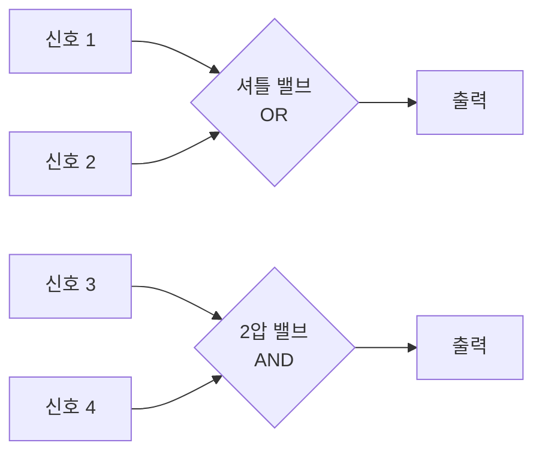

# 공압 밸브

> [!summary] 핵심 요약
> - 밸브 분류: **방향 제어**(흐름 길), **유량 제어**(속도), **압력 제어**(힘), **논리·기타**(셔틀, 2압, 급속 배기, 시간 지연).
> - 방향 제어 밸브 이름 **"포트 수 / 위치 수"**: 5/2 밸브 = 포트 5개, 위치 2개.
> - **셔틀 밸브 = OR**, **2압 밸브 = AND**.
> - 일방향 유량 제어 밸브 = **교축 밸브 + 체크 밸브** → 한쪽 방향만 속도 조절.

> [!warning] 자주 틀리는 포인트
> - ISO 포트 번호: **1 = 공급(P)**, **2·4 = 출력(B·A)**, **3·5 = 배기(R·S)**, **12·14 = 파일럿**(14는 1→4 연결 신호).
> - **편측 솔레노이드(스프링 복귀)**: 신호가 끊기면 원위치. **양측 솔레노이드(더블)**: 신호가 끊겨도 **마지막 위치를 기억**.
> - 3/2 밸브의 **NC(상시 닫힘)** 은 조작 전 1→2 차단, **NO(상시 열림)** 는 조작 전 1→2 연결.
> - **급속 배기 밸브**는 실린더 가까이 달아 배기를 빨리 해 **속도를 높인다**.
> - 밸브 기호의 상자 하나 = 위치 하나. 배관은 **정상 위치(스프링 쪽 상자)** 에 연결해 그린다.

## 개념 정리

### 방향 제어 밸브

| 밸브 | 용도 |
| --- | --- |
| 2/2 | 단순 ON/OFF |
| 3/2 | 단동 실린더, 신호용 밸브 |
| 4/2, 5/2 | 복동 실린더 (5/2는 배기 포트가 따로 → 전진·후진 속도 따로 조절) |
| 5/3 | 복동 실린더 중간 정지 |

**5/3 밸브 중립 위치**

| 중립 형식 | 연결 | 동작 |
| --- | --- | --- |
| 올 포트 블록 (클로즈드 센터) | 모든 포트 차단 | 실린더 중간 정지 (공기 압축성으로 약간 움직임) |
| 배기 센터 (A·B → 배기) | 출력 포트가 배기에 연결 | 실린더가 자유롭게 움직임, 잔압 제거 |
| 가압 센터 (P → A·B) | 공급이 양쪽으로 | 양쪽 압력 균형 |

### 조작 방식

| 분류 | 예 |
| --- | --- |
| 인력 | 누름 버튼, 레버, 페달, 토글 |
| 기계 | 롤러, 플런저, **방향성 롤러(한 방향만 작동)** |
| 공압 | 파일럿 (압력 신호) |
| 전기 | 솔레노이드 (직동형, 파일럿형) |
| 복귀 | 스프링, 공기 스프링 |

- **솔레노이드 파일럿 밸브**: 작은 솔레노이드가 파일럿 공기를 움직여 큰 스풀을 전환 → 전력 적음.
- 밸브 구조: **포핏형**(누설 적음, 응답 빠름, 조작력 큼), **스풀형**(조작력 작음, 다포트 쉬움).

### 유량 제어 밸브

| 밸브 | 기능 |
| --- | --- |
| 교축 밸브 (니들) | 양방향 유량 조절 |
| 일방향 유량 제어 밸브 (스피드 컨트롤러) | 한 방향만 조절, 반대 방향은 체크 밸브로 자유 흐름 |
| 배기 교축 밸브 | 배기 포트에 달아 배기 유량 조절 + 소음기 |

### 압력 제어 밸브

| 밸브 | 기능 |
| --- | --- |
| 감압 밸브 (레귤레이터) | 2차 압력 일정 |
| 릴리프 밸브 | 설정 압력 초과 시 배출 (안전) |
| 시퀀스 밸브 | 설정 압력이 되면 다음 회로로 신호 |
| 압력 스위치 | 압력 → 전기 신호 |

### 논리·기타 밸브

| 밸브 | 기능 | 논리 |
| --- | --- | --- |
| 셔틀 밸브 | 두 입력 중 하나라도 있으면 출력 (높은 쪽 통과) | OR |
| 2압 밸브 | 두 입력 모두 있어야 출력 (낮은 쪽 통과) | AND |
| 체크 밸브 | 한 방향만 흐름 | |
| 급속 배기 밸브 | 실린더 배기를 바로 대기로 → 고속 | |
| 시간 지연 밸브 | 교축 밸브 + 공기 탱크 + 3/2 밸브 → 일정 시간 후 출력 | 타이머 |
| 소음기 (사일런서) | 배기 소음 감소 | |

## 그림

## 관련 단원

- [공압 액추에이터](공압_액추에이터.md)
- [공압 회로](공압_회로.md)
- [논리회로](../10_자동제어/논리회로.md)
- [유압 밸브](유압_밸브.md)

## 체크리스트

- [ ] 포트/위치 표기와 ISO 포트 번호를 읽는다
- [ ] 편측·양측 솔레노이드 밸브의 차이를 안다
- [ ] 5/3 밸브 중립 형식별 동작을 구분한다
- [ ] 셔틀 밸브와 2압 밸브의 논리를 안다
- [ ] 일방향 유량 제어 밸브 구조를 설명한다
- [ ] 급속 배기·시간 지연 밸브의 용도를 안다

## 참고

- [큐넷 자동화설비산업기사 출제기준](https://www.q-net.or.kr/crf005.do?id=crf00503&jmCd=2034)
- ISO 1219-1 (유공압 도면 기호)
