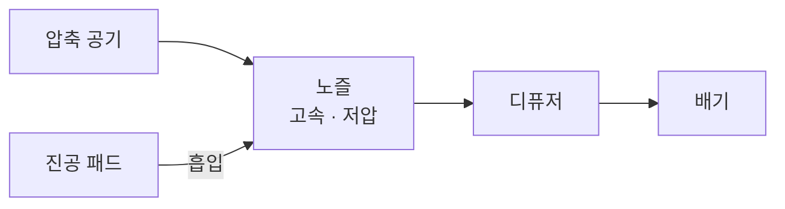

# 공압 액추에이터

> [!summary] 핵심 요약
> - **단동 실린더**: 한쪽만 공기로, 복귀는 스프링. **복동 실린더**: 전진·후진 모두 공기로.
> - 실린더 이론 힘: 전진 $F = P \cdot \dfrac{\pi D^2}{4}$, 후진 $F = P \cdot \dfrac{\pi (D^2 - d^2)}{4}$ (d: 로드 지름). 후진 힘이 더 작다.
> - **쿠션**: 행정 끝에서 배기를 조여 충격을 줄인다.
> - **진공 이젝터**: 압축 공기가 노즐을 빠르게 지나며 압력이 떨어지는 원리(베르누이)로 진공을 만든다.

> [!warning] 자주 틀리는 포인트
> - 실제 힘은 마찰 때문에 이론값의 **약 70~90%** (부하율 고려).
> - 같은 공급 유량이면 **후진이 더 빠르다** (로드 쪽 면적이 작아서).
> - **클레비스형·트러니언형** 지지는 실린더가 **요동**할 때 쓴다. 풋형·플랜지형은 고정.
> - 긴 행정·큰 하중이면 **좌굴**을 검토한다.
> - 진공 패드 흡착력은 패드 면적 × 진공 압력을 **안전율**로 나눠 여유를 둔다 (수평 4 이상, 수직 8 이상이 흔한 기준).

## 개념 정리

### 실린더 종류

| 종류 | 특징 |
| --- | --- |
| 단동 실린더 | 공기 소비 적음, 스프링 때문에 행정 짧음, 클램프 |
| 복동 실린더 | 가장 일반적, 양방향 힘 |
| 양 로드 실린더 | 양쪽으로 로드, 전후진 힘·속도 같음 |
| 텐덤 실린더 | 피스톤 2개 직렬 → 같은 지름으로 **힘 약 2배** |
| 다위치 실린더 | 두 실린더 결합, 3~4 위치 정지 |
| 로드리스 실린더 | 로드 없이 슬라이더 이동 → 설치 길이 짧음 |
| 가이드 실린더 | 가이드 로드로 회전 방지, 횡하중 |
| 충격 실린더 | 순간 고속 → 타격, 성형 |
| 그리퍼 (공압 척) | 물체 잡기 (평행형, 각도형) |
| 스토퍼 실린더 | 컨베이어 위 물체 정지 |

### 실린더 계산

**힘 계산 예**: D = 50 mm, d = 20 mm, P = 0.5 MPa
- 전진 면적 $\pi \times 50^2/4 \approx 1963$ mm² → $F = 0.5 \times 1963 \approx 982$ N
- 후진 면적 $\pi(50^2 - 20^2)/4 \approx 1649$ mm² → $F \approx 825$ N

**공기 소비량**: 1회 왕복 = (전진 체적 + 후진 체적) × 압축비
- 압축비 = $\dfrac{P_{게이지} + P_{대기}}{P_{대기}}$ (예: 0.5 MPa → 약 6배)

### 실린더 구조와 부품

- 구성: 튜브, 피스톤, 피스톤 로드, 헤드·로드 커버, 패킹, 쿠션 장치.
- **자석 내장 피스톤** + **실린더 스위치(리드·전자식)** → 위치 검출.
- 쿠션: 고정 쿠션(고무), 조절식 공기 쿠션(쿠션 니들).

### 지지 형식

| 형식 | 특징 |
| --- | --- |
| 풋형 | 바닥 고정 |
| 플랜지형 (헤드·로드) | 축 방향 하중 |
| 클레비스형 | 끝단 핀으로 요동 |
| 트러니언형 | 중간 축으로 요동 |

- 로드 끝 연결: 로드 엔드 너트, 플로팅 조인트(어긋남 흡수).

### 회전 액추에이터와 공압 모터

| 종류 | 특징 |
| --- | --- |
| 베인형 요동 액추에이터 | 회전 각도 제한(90°, 180°, 270°) |
| 랙·피니언형 요동 액추에이터 | 각도 정확, 토크 큼 |
| 공압 모터 (베인·피스톤·기어) | 연속 회전, 과부하 시 멈출 뿐 안전, 방폭 환경 |

### 진공 기기

| 기기 | 역할 |
| --- | --- |
| 진공 이젝터 | 압축 공기로 진공 발생, 소형·응답 빠름 |
| 진공 펌프 | 큰 유량의 진공, 연속 사용 |
| 진공 패드 | 흡착 (평형, 벨로즈형: 곡면·높이차) |
| 진공 스위치 | 흡착 확인 신호 |
| 진공 필터 | 먼지 흡입 방지 |
| 진공 파괴 밸브 | 물체 이탈을 빠르게 |

- 흡착력 $F = \dfrac{\Delta P \cdot A}{S}$ (ΔP: 진공 압력, A: 패드 면적, S: 안전율).

## 그림

## 관련 단원

- [공압 밸브](공압_밸브.md)
- [공압 회로](공압_회로.md)
- [공유압 기초](공유압_기초.md)
- [근접센서와 광전센서](../10_자동제어/근접센서와_광전센서.md)

## 체크리스트

- [ ] 단동·복동 실린더의 차이를 말한다
- [ ] 실린더 전진·후진 힘을 계산한다
- [ ] 텐덤·로드리스·가이드 실린더의 특징을 안다
- [ ] 실린더 지지 형식과 요동 여부를 구분한다
- [ ] 이젝터의 원리를 베르누이로 설명한다
- [ ] 진공 패드 흡착력을 계산한다

## 참고

- [큐넷 자동화설비산업기사 출제기준](https://www.q-net.or.kr/crf005.do?id=crf00503&jmCd=2034)
