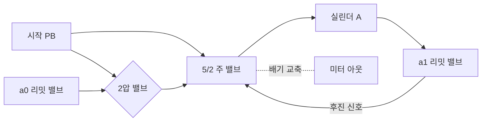

# 공압 회로

> [!summary] 핵심 요약
> - 복동 실린더 속도 제어는 **미터 아웃**(배기 쪽 교축)이 기본. 부하가 변해도 속도가 안정적이다.
> - 단동 실린더는 배기 쪽이 없으므로 **미터 인**(공급 쪽 교축).
> - 시퀀스 표현: **변위 단계 선도**, 약식 표기 **A+ B+ A− B−** (+ 전진, − 후진).
> - 같은 밸브에 양쪽 신호가 동시에 들어가는 **신호 중첩**은 방향성 롤러, **캐스케이드**, 시퀀서, 전기 제어로 푼다.

> [!warning] 자주 틀리는 포인트
> - 미터 인은 공기 압축성 때문에 **속도가 불안정**(스틱슬립)해지기 쉽다.
> - 캐스케이드: 그룹 수가 n이면 **메모리 밸브(5/2 또는 4/2) n−1개** 필요.
> - 전기 공압 회로에서 편측 솔레노이드 밸브를 쓰면 **자기유지 회로**가 필요하다. 양측 솔레노이드면 밸브가 기억한다.
> - **간접 제어**: 신호 밸브가 파일럿으로 주 밸브를 전환 (큰 실린더, 원격). **직접 제어**: 신호 밸브가 실린더를 바로 구동 (소형).
> - 회로도 판별: 교축 밸브가 **공급 쪽**이면 미터 인, **배기 쪽**이면 미터 아웃. 체크 밸브 방향(자유 흐름 방향)을 보고 어느 쪽 흐름이 조여지는지 확인한다.

## 개념 정리

### 기본 회로

| 회로 | 구성 |
| --- | --- |
| 단동 실린더 직접 제어 | 3/2 누름 버튼 밸브 → 단동 실린더 |
| 복동 실린더 직접 제어 | 5/2 누름 버튼 밸브 → 복동 실린더 |
| 간접 제어 | 3/2 신호 밸브 → 5/2 파일럿 밸브 → 실린더 |
| 2개소 제어 (OR) | 신호 밸브 2개 → 셔틀 밸브 → 주 밸브 |
| 안전 양손 조작 (AND) | 신호 밸브 2개 → 2압 밸브 → 주 밸브 |
| 자동 왕복 | 리밋 밸브(전진 끝)로 후진 신호, 시작 밸브로 전진 |
| 시간 지연 | 전진 끝 → 시간 지연 밸브 → 후진 |
| 압력 의존 | 시퀀스 밸브 → 일정 힘이 되면 후진 (프레스, 클램프) |

### 속도 제어

| 방식 | 교축 위치 | 특징 |
| --- | --- | --- |
| 미터 인 | 공급 쪽 | 단동 실린더, 소형 실린더 |
| 미터 아웃 | 배기 쪽 | 복동 실린더 기본, 안정적 |
| 급속 배기 | 급속 배기 밸브 | 속도 증가 |

### 변위 단계 선도

- 가로축: 단계(스텝), 세로축: 각 실린더 위치 (0 = 후진, 1 = 전진).
- 신호 요소(리밋 밸브)는 **a0, a1** (실린더 A 후진 끝, 전진 끝)처럼 이름 붙인다.
- 예: **A+ B+ B− A−**

| 단계 | 동작 | 다음 신호 |
| :-: | --- | --- |
| 1 | A+ | a1 |
| 2 | B+ | b1 |
| 3 | B− | b0 |
| 4 | A− | a0 → 처음 |

### 신호 중첩과 해결

- 예: A+ B+ B− A−에서 a1 신호가 B+를 주는데, B−를 하려 할 때 a1이 여전히 살아 있어 B 밸브 양쪽에 신호 → 동작 불가.
- 해결 방법:
  1. **방향성 롤러 리밋 밸브**: 한 방향으로 지나갈 때만 짧은 신호.
  2. **캐스케이드 방식**: 시퀀스를 그룹(한 그룹 안에 같은 실린더가 두 번 나오지 않게)으로 나누고, 그룹마다 공기 라인 하나만 살림.
     - A+ B+ / B− A− → 2그룹 → 메모리 밸브 1개.
  3. **시퀀서(스텝 모듈)** 방식.
  4. **전기 제어(PLC)**: 가장 유연.

### 전기 공압 제어

- 구성: 누름 버튼·리밋 스위치·센서(입력) → 릴레이·PLC(처리) → 솔레노이드 밸브(출력) → 실린더.
- 실린더 위치: 리드 스위치(실린더 스위치), 근접 센서.
- 래더 예 (편측 솔레노이드, A+ A−): 시작 PB로 릴레이 자기유지 → 솔레노이드 Y1 ON → A 전진 → 전진 끝 스위치로 자기유지 해제 → 스프링 복귀.

### 공압 기호 (ISO 1219)

| 기호 | 뜻 |
| --- | --- |
| 원 + 삼각형 (속 빈) | 공압 원 (속 찬 삼각형은 유압) |
| 사각형 칸 | 밸브 위치 |
| 화살표 | 흐름 방향 |
| T자 | 막힌 포트 |
| 사선 화살표 | 조절 가능 |

## 그림

## 기출 포인트

> 출처: 생산자동화산업기사 필기 2014–2020 (cbtbank.kr).

- 구 시험(생산자동화산업기사)에서는 공압 **제어 회로**(변위 단계 선도, 캐스케이드, 전기 공압) 문제가 직접 나오지 않았다.
- 가까운 출제: 공기압 발생 회로도 기기 순서 1회 (2018-3) → [공기압축기와 공기조정](공기압축기와_공기조정.md), 속도 제어 회로 2회 (2018-3, 2020-3) → [유압 회로](유압_회로.md), 방향 제어 밸브 기호 판독 3회 → [공유압 기호](공유압_기호.md)
- 새 출제기준에는 "회로구성"이 독립 항목이라 신규 출제 가능성이 높다. 미터 인·미터 아웃 판별, OR(셔틀)·AND(2압) 회로, 신호 중첩 해결은 꼭 익힌다.

## 관련 단원

- [공압 밸브](공압_밸브.md)
- [공유압 기호](공유압_기호.md)
- [공압 액추에이터](공압_액추에이터.md)
- [PLC 프로그래밍 언어와 명령어](../10_자동제어/PLC_프로그래밍_언어와_명령어.md)
- [유압 회로](유압_회로.md)

## 체크리스트

- [ ] 직접·간접 제어 회로를 그린다
- [ ] 미터 인·미터 아웃의 차이와 용도를 안다
- [ ] 변위 단계 선도를 그리고 읽는다
- [ ] 신호 중첩을 찾고 해결 방법 4가지를 말한다
- [ ] 캐스케이드 그룹 수와 메모리 밸브 수 관계를 안다
- [ ] 전기 공압 자기유지 회로를 그린다

## 참고

- [큐넷 자동화설비산업기사 출제기준](https://www.q-net.or.kr/crf005.do?id=crf00503&jmCd=2034)
- ISO 1219-1 (유공압 도면 기호)
