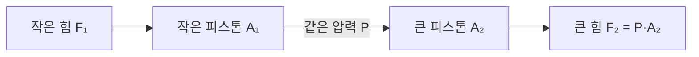

# 공유압 기초

> [!summary] 핵심 요약
> - **파스칼의 원리**: 밀폐된 유체에 가한 압력은 모든 방향으로 같은 크기로 전달 → $\dfrac{F_1}{A_1} = \dfrac{F_2}{A_2}$ (작은 힘으로 큰 힘).
> - **연속의 법칙**: $Q = A_1 v_1 = A_2 v_2$. 관이 좁아지면 유속이 빨라진다.
> - **절대 압력 = 게이지 압력 + 대기압**. 진공은 대기압보다 낮은 압력.
> - 공압은 **빠르고 깨끗하지만 힘이 작고 압축성** 때문에 정밀 속도 제어가 어렵다. 유압은 **큰 힘·정밀 제어**, 대신 누유·온도 관리가 필요하다.

> [!warning] 자주 틀리는 포인트
> - 단위: **1 MPa = 10 bar = 10⁶ Pa**, 1 bar = 0.1 MPa, 1 kgf/cm² ≈ 0.098 MPa, 1 atm ≈ 0.1013 MPa.
> - 보일·샤를 법칙에는 **절대 압력·절대 온도(K)** 를 쓴다. 게이지압·℃를 넣으면 틀린다.
> - 실린더 힘 $F = PA$에서 단위를 맞춘다: MPa × mm² = **N**.
> - 공기를 압축하면 수증기가 응축돼 **드레인(응축수)** 이 생긴다 → 애프터쿨러·드라이어로 제거.
> - 유압 **실린더의 작동 원리는 파스칼의 원리**다. 베르누이 정리(유속↔압력), 보일 법칙(기체 부피), 뉴턴 법칙과 섞어 내는 함정이 반복된다.
> - 파스칼 원리에서 **힘은 피스톤 면적에 비례**한다(압력에 반비례가 아님). 압력은 면에 **수직**, 모든 방향으로 **같은 크기**.
> - 연속의 법칙: 단면적이 바뀌어도 **유량은 일정**, 바뀌는 것은 **유속**. 유량은 '시간당 **부피**'이지 중량이 아니다.
> - 관 지름 $d$가 주어지면 면적은 $\pi d^2/4$. 반지름 공식 $\pi r^2$에 지름을 그대로 넣는 실수가 많다.
> - **게이지 압력 = 절대 압력 − 대기압**. 절대 압력의 기준(0)은 **완전 진공**.
> - 레이놀즈 수 $Re = vd/\nu$: 유속·관경이 크고 **점도가 작을수록 난류**.

## 개념 정리

### 압력과 단위

| 단위 | 환산 |
| --- | --- |
| Pa | N/m² |
| MPa | 1 MPa = 1 N/mm² = 10 bar |
| bar | 1 bar = 10⁵ Pa = 0.1 MPa |
| kgf/cm² | ≈ 0.098 MPa (≈ 0.98 bar) |
| atm (표준 대기압) | 101.325 kPa ≈ 1.013 bar |
| psi | 1 psi ≈ 6.9 kPa |
| 수주·수은주 | 1 atm ≈ 10.33 mH₂O(mAq) = 760 mmHg |

- 1 kgf/cm² = 9.8 N / 10⁻⁴ m² = **9.8×10⁴ Pa** ≈ 0.98 bar.
- **atm과 at를 구분한다** (교재 CH04 03절):
  - 1 atm(표준 기압) = 760 mmHg = 10.33 mAq ≈ 1.033 kgf/cm² ≈ 1.013 bar = 1013 hPa.
  - 1 at(공학 기압) = 1 kgf/cm² = 735.5 mmHg = 10 mAq ≈ 0.98 bar.
- Pa = N/m²는 **SI 유도 단위**. bar, kgf/cm², psi, atm은 SI가 아니다.

- 공압 사용 압력: 보통 **0.4~0.7 MPa**. 유압: **수 MPa ~ 35 MPa** 이상.

### 유체 역학 기본 법칙

| 법칙 | 식 | 의미 |
| --- | --- | --- |
| 파스칼 원리 | $P = F/A$ 일정 | 힘의 확대 (유압 잭, 프레스) |
| 연속의 법칙 | $Q = Av$ | 유량 일정 → 단면 작으면 속도 큼 |
| 베르누이 정리 | $\dfrac{P}{\rho g} + \dfrac{v^2}{2g} + z = $ 일정 | 속도가 빨라지면 압력이 낮아짐 (이젝터, 벤투리) |
| 보일 법칙 | $P_1V_1 = P_2V_2$ (온도 일정) | 압축 공기 부피 |
| 샤를 법칙 | $V_1/T_1 = V_2/T_2$ (압력 일정) | |
| 보일–샤를 | $\dfrac{P_1V_1}{T_1} = \dfrac{P_2V_2}{T_2}$ | |

- 교재(CH04 02절)는 **캐비테이션**을 "고속·저압 지점에서 압력이 포화 증기압 아래로 떨어질 때 생기고 공기 흡입을 동반하는 현상"으로 묶어 설명한다. 펌프를 **정격보다 느리게** 돌리는 것은 원인이 아니다 (교재 2-5). 자세한 원인·대책은 [유압 기초와 작동유](유압_기초와_작동유.md).

**계산 예 (보일)**: 온도가 일정할 때 $P_1V_1 = P_2V_2$ → 부피가 줄어든 비율만큼 압력이 커진다 (교재 2-1, 답 5 atm).

**계산 예 (파스칼)**: 작은 피스톤 면적 10 cm², 큰 피스톤 200 cm², 작은 쪽에 100 N → 큰 쪽 힘 $100 \times 200/10 = 2000$ N.

**계산 예 (연속)**: 유량 20 L/min, 실린더 안지름 50 mm
- $A = \pi \times 50^2/4 \approx 1963$ mm², $Q = 20 \times 10^6 / 60 \approx 333{,}000$ mm³/s
- $v = Q/A \approx 170$ mm/s

**계산 예 (관 유량)**: 안지름 300 mm 관, 평균 유속 3 m/s
- $A = \pi \times 0.3^2/4 \approx 0.0707$ m² → $Q = Av \approx 0.21$ m³/s
- 교재 2-3: 안지름 20 cm, 유속 5 m/s → $A = \pi \times 0.2^2/4 \approx 0.0314$ m², $Q \approx 0.157$ m³/s = **약 157 L/s**.
- 단위 함정: cm²와 m/s를 섞으면 먼저 cm/s로 맞춘다 (30 cm² × 200 cm/s = 6000 cm³/s).

**계산 예 (실린더 압력)**: 200 N을 내야 하고 수압 면적 0.2 m² → $P = F/A = 1000$ Pa.

### 정수압 (수두)

- 깊이 $h$의 게이지 압력 $P = \rho g h = \gamma h$ (γ: 비중량).
- 물의 비중량 $\gamma = \rho g = 1000 \times 9.8 = 9800$ N/m³ (4 ℃, 1 atm 기준).
- **계산 예**: 바닷물(밀도 1030 kg/m³) 10 m → $1030 \times 9.8 \times 10 \approx 101$ kPa (게이지).
- 물은 약 10 m마다 1 atm씩 증가 → 깊이 30 m의 **절대 압력** = 3 atm(게이지) + 1 atm(대기) = **4 atm**.

### 흐름의 종류

- **층류**: 유체가 층을 이루며 질서 있게 흐름. 레이놀즈 수 Re 약 2320 이하.
- **난류**: 불규칙한 흐름, 손실 큼. $Re = \dfrac{vd}{\nu}$.
- 관로 손실: 관 길이·속도² 에 비례, 굽힘·밸브에서 국부 손실.

### 공기의 성질

- **노점(이슬점)**: 공기를 식혀 상대 습도가 100 %가 되는 온도. 교재 예: 포화량 20 g인 공기에 수증기 10 g → 습도 50 %. 냉각해 포화량이 10 g으로 줄어드는 온도가 노점이다.

- **압축성**: 부피가 압력에 따라 크게 변함 → 공압 실린더는 저속에서 **스틱슬립**(끊어지는 움직임).
- **습도**: 공기 중 수증기. 압축·냉각하면 **이슬점(노점)** 에서 물이 맺힌다.
- **표준 공기(ANR)**: 20 ℃, 1 atm, 상대 습도 65%. 압축기 용량은 대기압 상태 공기량으로 표시.

### 공압 vs 유압

| 항목 | 공압 | 유압 |
| --- | --- | --- |
| 매체 | 공기 (압축성) | 기름 (거의 비압축) |
| 압력 | 0.4~0.7 MPa | 수~수십 MPa |
| 출력 | 작음 | 큼 |
| 속도 | 빠름 | 느림~중간 |
| 위치·속도 정밀도 | 낮음 | 높음 |
| 과부하 | 안전 (멈출 뿐) | 릴리프 밸브 필요 |
| 환경 | 깨끗, 배기 소음 | 누유·화재 위험, 온도 영향 |
| 배관 | 귀환 배관 불필요 (대기 배출) | 탱크로 귀환 배관 필요 |
| 에너지 효율 | 낮음 | 비교적 높음 |

- 교재(CH04 01절)의 공압 장점: 에너지원(공기)을 어디서나 얻음, 힘 전달·증폭과 속도·압력·유량 제어가 쉬움, 보수 쉬움, 인화·폭발 위험과 과부하 위험이 작음, 에너지 축적 쉬움, 환경오염 적음, 고속 작동, **먼 거리 이송** 쉬움.
- 공압 단점: 효율이 나쁨, 압축성 때문에 위치 제어·응답 신뢰도가 낮고 **균일한 속도를 얻기 어려움**, 윤활 장치 필요, 배기 소음, 이물질에 약함, 힘이 약함, 출력에 비해 비쌈.
- 교재는 용도를 "공압은 작은 동력을 손쉽게 쓰는 곳, 유압은 큰 동력 전달"로 나눈다.
- **분출류 이용**: 압축 공기를 직접 뿜어 쓰는 경우(에어 블로, 에어 커튼, 부품 이송·분리 등). 버스 출입문처럼 실린더를 움직이는 것은 분출류가 아니다 (교재 1-3).

## 그림

## 기출 포인트

> 출처: 생산자동화산업기사 필기 2014–2020 (cbtbank.kr). 회차 표기는 연도-회. 2과목 기초공학과 3과목 자동제어에 섞여 나왔다.

- 파스칼 원리 (실린더 작동 원리, 원리 설명의 옳고 그름, 두 피스톤 힘 계산) — 7회 (2014-3, 2015-1, 2015-2, 2016-3, 2018-1, 2019-1, 2020-1)
- 연속의 법칙과 유량 계산 $Q = Av$ (관 지름·유속으로 유량, 단면 변화와 유량 일정) — 7회 (2014-3, 2015-2, 2016-1, 2016-2, 2017-1, 2019-1, 2020-3)
- 압력 단위와 환산 (Pa가 SI 기본, bar↔Pa, kgf/cm²↔bar, 1 atm 환산값) — 6회 (2014-1, 2016-1, 2017-2, 2018-1 ×2, 2019-2)
- 절대 압력·게이지 압력 정의와 수압 계산 — 5회 (2014-1, 2014-3, 2018-2, 2018-3 ×2)
- $P = F/A$ 계산 (실린더 필요 압력, 바닥이 받는 압력) — 3회 (2018-1, 2019-3, 2020-1)
- 층류·난류 조건 (레이놀즈 수와 점도) — 1회 (2017-2)
- 물의 비중량 SI 표기 — 1회 (2020-3)
- 공압의 특징 (정확한 위치 결정·중간 정지에 불리) — 1회 (2014-1)

**교재 예제 유형** (CH04 02~03절): 보일 법칙으로 나중 압력(5 atm), 파스칼 원리 설명, 관 유량 157 L/s, 수두 합이 일정한 법칙(베르누이), 캐비테이션 원인이 아닌 것(정격보다 낮은 회전수), 압력계 지시값(게이지 압력), 압력의 SI 단위(Pa), $P = F/A$ (그림, 1000 Pa).

**교재 예제 유형** (Win-Q 2025 PART 01 CHAPTER 04, 01절): 공압 특징 중 틀린 것(균일 속도), 유압유와 비교한 압축 공기 특성 중 틀린 것(먼 거리 이송은 쉬움), 분출류 이용과 거리가 먼 것(버스 출입문).

## 관련 단원

- [공기압축기와 공기조정](공기압축기와_공기조정.md)
- [유압 기초와 작동유](유압_기초와_작동유.md)
- [공유압 기호](공유압_기호.md)
- [공압 액추에이터](공압_액추에이터.md)

## 체크리스트

- [ ] MPa, bar, kgf/cm², atm을 서로 환산한다
- [ ] 절대 압력과 게이지 압력을 구분한다
- [ ] 파스칼 원리로 힘을 계산한다
- [ ] 연속의 법칙으로 실린더 속도를 계산한다
- [ ] 베르누이 정리의 응용(이젝터)을 설명한다
- [ ] 공압과 유압의 장단점을 비교한다
- [ ] 유압 실린더 원리를 파스칼로 답하고 다른 법칙과 구분한다
- [ ] 관 지름·유속으로 유량을 계산한다 (지름 → $\pi d^2/4$)
- [ ] 1 atm, 1 bar, 1 kgf/cm²를 Pa로 바꾼다
- [ ] 깊이로 수압(게이지·절대)을 계산한다
- [ ] 점도가 난류·층류에 주는 영향을 말한다

## 참고

- [큐넷 자동화설비산업기사 출제기준](https://www.q-net.or.kr/crf005.do?id=crf00503&jmCd=2034)
