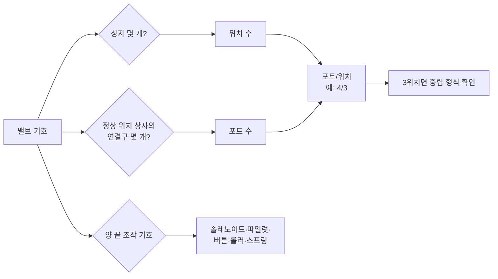

# 공유압 기호

> [!summary] 핵심 요약
> - 유공압 도면 기호는 **ISO 1219-1 (KS B 0054)** 을 따른다. 기호는 기능만 나타내고 실제 구조·크기·배관 위치는 나타내지 않는다.
> - 방향 제어 밸브: **상자 수 = 위치 수**, **한 상자에 붙은 연결구 수 = 포트 수** → "포트/위치"(예: 4/3, 5/2).
> - 에너지원 삼각형: **속 찬(검은) 삼각형 = 유압**, **속 빈(흰) 삼각형 = 공압**. 삼각형이 원 **바깥을 향하면 펌프·압축기**(에너지를 내보냄), **안을 향하면 모터**(에너지를 받음).
> - 포트 표기: 숫자(ISO 5599) **1 공급, 2·4 출력, 3·5 배기, 12·14 파일럿** / 문자 **P 공급, A·B·C 작업, R·S·T 배기, X·Y·Z 제어, L 누설**.

> [!warning] 자주 틀리는 포인트
> - 포트 수를 상자 전체 연결구 합계로 세면 틀린다. **정상 위치 상자 하나**에 붙은 선만 센다.
> - 3/2 밸브의 "3"은 **포트 3개**. "연결구 2개"로 바꾼 설명은 틀린 것.
> - 배기 문자는 **R·S·T**. I·J·K 같은 문자는 쓰지 않는다.
> - 솔레노이드 기호: 직사각형 + **사선 1개 = 단동 솔레노이드**, **사선 2개 = 복동 솔레노이드**(코일 2개가 반대 방향으로 작용). 비례 솔레노이드는 여기에 사선 화살표가 더해진다.
> - **실선 = 주 관로**, **파선 = 파일럿(제어) 관로·드레인**, **1점 쇄선 = 여러 기기를 하나의 유닛으로 묶는 포위선**.
> - 유압 **탱크**는 위가 열린 사각형(대기 개방). **어큐뮬레이터**는 세로로 긴 둥근 캡슐 모양. 공압 **공기 탱크**는 가로로 긴 캡슐.

## 개념 정리

### 기호 표시의 기본 규칙 (KS B 0054, 교재 CH04 11절)

- 기호는 **기능·조작 방법·외부 접속구**를 나타낸다. 실제 구조, 포트의 실제 위치, **압력·유량 같은 수치나 설정값은 나타내지 않는다** (교재 11-4).
- 원칙적으로 **정상(휴지) 상태 또는 기능상 중립 상태**로 그린다. 회로도에서는 예외가 있다.
- 포트는 관로와 기호 요소가 만나는 점으로 표시한다. 기호 안의 문자(숫자 제외)는 기호의 일부다.
- 기호 방향은 자유지만 90° 단위로 돌리는 것이 좋다.
- 두 개 이상의 기호가 한 유닛이면 **1점 쇄선 포위선**으로 묶는다. 같은 기기가 여러 곳에 쓰이면 간단한 기호로 대표하고 부호와 기호표를 붙인다.
- 실린더 기호 종류: 단동(스프링 붙이 포함), 복동(편로드·양로드), 쿠션 붙이, 텔레스코프형, **증압기**(공압을 더 높은 유압으로 바꿈).

### 선과 기본 도형

| 도형 | 의미 |
| --- | --- |
| 실선 | 주 관로 (작동 유체) |
| 파선 | 파일럿 관로, 드레인 관로 |
| 1점 쇄선 | 포위선 (유닛) |
| 큰 원 | 펌프·압축기·모터 |
| 작은 원 | 계측기, 체크 밸브 볼, 롤러 |
| 반원 | 요동형 액추에이터 |
| 직사각형 | 실린더, 밸브의 한 위치 |
| 마름모 | 유체 조정 기기 (필터, 드레인 배출기, 루브리케이터, 냉각기, 가열기) |
| 사선 화살표 (기호 관통) | 가변 (가변 펌프, 가변 교축, 조절 스프링) |
| 지그재그 | 스프링 |
| T자 | 막힌 포트 |

### 에너지 변환 기기

| 기기 | 기호 특징 |
| --- | --- |
| 유압 펌프 | 원 + 바깥 향한 **검은** 삼각형 |
| 공기 압축기 | 원 + 바깥 향한 **흰** 삼각형 |
| 유압 모터 | 원 + 안쪽 향한 검은 삼각형 |
| 공압 모터 | 원 + 안쪽 향한 흰 삼각형 |
| 가변 용량형 | 위에 사선 화살표 추가 |
| 양방향 | 삼각형 2개 (양쪽) |
| 단동 실린더 | 한쪽만 포트, 반대쪽 스프링 또는 대기 |
| 복동 실린더 | 양쪽 포트 |
| 양로드 실린더 | 로드가 양쪽으로 나옴 |
| 쿠션 붙이 | 피스톤 양 끝 작은 사각형, 조절식이면 사선 화살표 |

### 방향 제어 밸브 읽는 법

1. **상자 수**를 센다 → 위치 수 (2위치, 3위치).
2. 배관이 연결된 **정상 위치 상자**(스프링 쪽 또는 3위치면 가운데)에서 **연결구 수**를 센다 → 포트 수.
3. 각 상자 안의 화살표(흐름)와 T자(차단)를 읽는다.
4. 양 끝의 **조작 기호**를 읽는다: 누름 버튼, 레버, 페달, 롤러, 솔레노이드, 파일럿(파선 + 삼각형), 스프링.
5. 3위치 밸브면 가운데 상자에서 **중립 형식**을 확인한다 → [유압 밸브](유압_밸브.md)의 중립 형식 표.

### 조작 방식 기호

| 분류 | 기호 |
| --- | --- |
| 인력 | 누름 버튼, 레버, 페달 |
| 기계 | 플런저, 롤러(원), 방향성 롤러(꺾인 레버 위 원), 스프링 |
| 전기 | 솔레노이드(직사각형 + 사선), 전동기 |
| 압력 | 파일럿 압력(파선 관로 + 삼각형) |
| 복합 | 솔레노이드 파일럿 (솔레노이드 + 파일럿을 함께 그림) |

### 기타 밸브·기기 기호

| 기기 | 기호 특징 |
| --- | --- |
| 체크 밸브 | 원(볼) + V자 시트 |
| 파일럿 조작 체크 | 체크 밸브 + 파선 파일럿 |
| 셔틀 밸브 | 양쪽 시트 사이 볼 하나 |
| 릴리프 밸브 | 상자 하나 + 어긋난 화살표 + 조절 스프링 + 입구 쪽 파선 파일럿 (평소 닫힘) |
| 감압 밸브 | 같은 모양이지만 화살표가 통해 있고(평소 열림) 출구 쪽 파일럿 |
| 교축 밸브 | 관로를 오목하게 좁힌 모양, 가변이면 사선 화살표 |
| 필터 | 마름모 + 안쪽 파선 |
| 루브리케이터 | 마름모 + 세로선 |
| 냉각기 | 마름모 + 바깥 향한 화살표 (가열기는 안쪽) |
| 압력계 | 원 + 바늘 |
| 소음기 | 배기 포트 끝의 직사각형 |

### 포트 표기 대조

| 기능 | 숫자 (ISO 5599) | 문자 |
| --- | --- | --- |
| 공급 | 1 | P |
| 작업 (출력) | 2, 4 | A, B, C |
| 배기 | 3, 5 | R, S, T |
| 제어 (파일럿) | 12, 14 | X, Y, Z |
| 누설 | – | L |

- 파일럿 번호 **14 = 1과 4를 연결하는 신호**, **12 = 1과 2를 연결하는 신호**. 10은 출력 차단 신호.

## 그림

## 기출 포인트

> 출처: 생산자동화산업기사 필기 2014–2020 (cbtbank.kr). 2과목 기계제도(기호)와 3과목 자동제어에 섞여 나왔다.

- 방향 제어 밸브 기호 그림을 보고 포트 수·위치 수 고르기 (4/3) — 2회 (2014-3, 2019-2)
- 3/2 밸브 표기의 뜻 (포트 3, 위치 2, NC·NO형) — 1회 (2016-3)
- 조작 방식 기호 명칭 (단동 솔레노이드) — 1회 (2016-2)
- 밸브 연결구 문자 표시법 (배기 문자 오류 찾기) — 1회 (2020-1)
- 공기압 발생 회로도에서 기호를 읽어 기기 순서 판단 — 1회 (2018-3)

**교재 예제 유형** (Win-Q 2025 PART 01 CHAPTER 04, 11절): 기호 이름 고르기(그림: 릴리프 밸브, 복동 실린더), 클레비스형 지지 기호(CA), 기호 표시 방법 중 틀린 것(수치·설정값 표시).

## 관련 단원

- [공압 밸브](공압_밸브.md)
- [유압 밸브](유압_밸브.md)
- [공압 회로](공압_회로.md)
- [유압 회로](유압_회로.md)
- [공기압축기와 공기조정](공기압축기와_공기조정.md)

## 체크리스트

- [ ] 밸브 기호에서 포트 수와 위치 수를 센다
- [ ] 유압·공압 에너지원 삼각형과 펌프·모터 방향을 구분한다
- [ ] 실선·파선·1점 쇄선의 뜻을 안다
- [ ] 단동·복동 솔레노이드, 파일럿, 롤러 조작 기호를 읽는다
- [ ] 포트 숫자·문자 표기를 서로 바꾼다
- [ ] 릴리프·감압·체크·셔틀 밸브 기호를 구분한다
- [ ] 필터·루브리케이터·냉각기·어큐뮬레이터·탱크 기호를 알아본다

## 참고

- [큐넷 자동화설비산업기사 출제기준](https://www.q-net.or.kr/crf005.do?id=crf00503&jmCd=2034)
- ISO 1219-1 (유공압 도면 기호), KS B 0054
