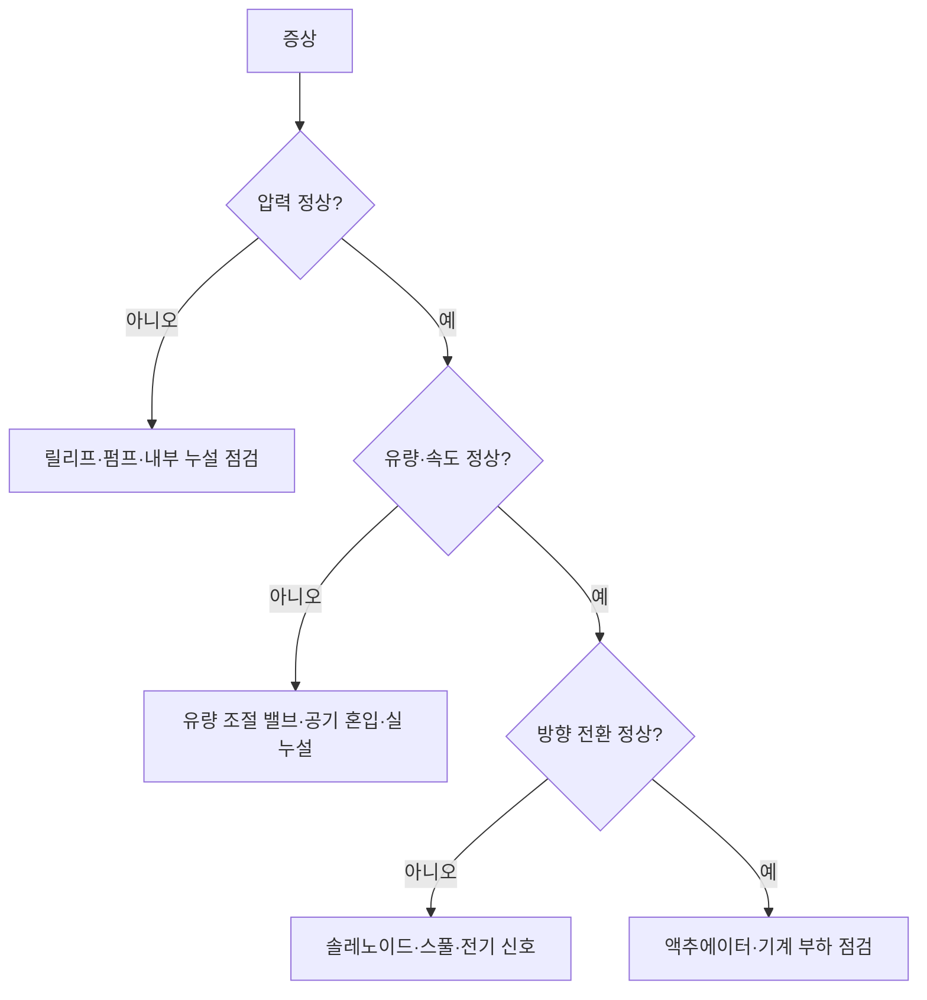

# 공유압 시험운전과 안전

> [!summary] 핵심 요약
> - 유압 시운전 순서: **플러싱 → 작동유 주입 → 펌프 조그 운전(회전 방향) → 무부하 운전 → 공기 빼기 → 릴리프 압력 서서히 설정 → 저속 동작 확인 → 정격 운전**.
> - 공압 시운전: **드레인 배출 → 압력 설정(레귤레이터) → 누설 점검 → 저압·저속으로 동작 확인 → 속도·쿠션 조정**.
> - 고장 진단은 **압력 → 유량 → 방향 → 액추에이터** 순으로 좁힌다.
> - 정비 전에는 **동력 차단 + 잔압 제거**(어큐뮬레이터, 실린더 안 갇힌 압력, 공압 잔압).

> [!warning] 자주 틀리는 포인트
> - **플러싱**: 새로 설치·보수한 배관 안 이물을 작동유로 씻어 내는 작업. 본 운전 전에 한다.
> - 공기 빼기는 회로의 **가장 높은 곳**에서. 공기가 남으면 동작이 끊기고 소음·발열.
> - 릴리프 밸브는 **가장 낮게 풀어 둔 상태에서 시작**해 압력계를 보며 올린다.
> - 고압 기름이 바늘구멍으로 새는 곳을 **손으로 확인하지 않는다** → 피부 관통(주입) 사고. 종이·판지로 확인.
> - 공압 배관을 풀 때도 **잔압 배기 밸브**로 먼저 압력을 뺀다. 튜브가 튀며 다칠 수 있다.
> - 회로의 **안전 밸브 역할은 릴리프 밸브**다. 체크·셔틀·급속 배기 밸브는 안전 장치가 아니다.

## 개념 정리

### 유압 시운전 절차

| 단계 | 내용 |
| --- | --- |
| 1. 설치 확인 | 배관 연결, 볼트 조임, 펌프·모터 축 정렬, 전기 배선 |
| 2. 플러싱 | 플러싱유와 필터로 순환 세척, 오염도 확인 |
| 3. 작동유 주입 | 지정 작동유를 필터 통해 주입, 유면계 확인 |
| 4. 조그 운전 | 모터를 순간 운전해 **회전 방향** 확인 |
| 5. 무부하 운전 | 언로드 상태로 운전, 소음·진동·누설 확인 |
| 6. 공기 빼기 | 실린더 저압 왕복, 에어 벤트 개방 |
| 7. 압력 설정 | 릴리프 → 감압·시퀀스 밸브 순으로 설정 |
| 8. 동작 확인 | 저속 → 정격 속도, 행정 끝 쿠션 조정 |
| 9. 연속 운전 | 유온 상승 추이, 누설, 소음 기록 |

### 공압 시운전 절차

1. 압축기·드라이어 운전, 공기 탱크·필터 **드레인 배출**.
2. 레귤레이터로 **사용 압력 설정** (보통 0.4~0.6 MPa).
3. **누설 점검**: 피팅·튜브에 비눗물, 소리.
4. 수동으로 밸브를 조작해 실린더 방향 확인 (수동 오버라이드 버튼).
5. 스피드 컨트롤러를 조금 열어 **저속**으로 시작 → 원하는 속도로 조정.
6. 쿠션 니들 조정으로 행정 끝 충격 줄이기.
7. 센서(실린더 스위치) 위치 맞추기.

### 고장 진단

**유압**

| 증상 | 원인 |
| --- | --- |
| 압력이 안 오름 | 릴리프 설정 낮음·고착, 펌프 마모, 내부 누설, 방향 밸브 중립 형식 |
| 실린더가 안 움직임 | 압력 부족, 솔레노이드 소손, 스풀 고착, 부하 과대 |
| 속도 느림·불안정 | 유량 부족, 공기 혼입, 유량 조절 밸브 막힘, 실린더 실 누설 |
| 실린더가 저절로 내려옴 | 실 누설, 밸브 내부 누설 → 파일럿 체크·카운터밸런스 |
| 소음·진동 | 캐비테이션, 공기 흡입, 릴리프 채터링, 축 어긋남 |
| 유온 과열 | 릴리프 상시 배출, 쿨러 고장, 유량 부족 |

**공압**

| 증상 | 원인 |
| --- | --- |
| 실린더 동작 안 함 | 공급 압력 없음, 솔레노이드 고장, 배선·신호 문제 |
| 속도 불안정·스틱슬립 | 저속에서 압축성, 윤활 부족, 미터 인 사용 |
| 출력 부족 | 압력 낮음, 실 마모 누설, 배관 압력 강하 |
| 밸브 작동 불량 | 응축수·이물, 윤활유 끈적임 |
| 배기 소음 큼 | 소음기 막힘·누락 |

### 안전

| 항목 | 내용 |
| --- | --- |
| 정비 전 | 동력 차단, 잠금·표지(LOTO), **잔압 제거**, 어큐뮬레이터 방출 |
| 고압 누설 | 손으로 확인 금지, 보안경·장갑 |
| 호스 | 고압 호스 파손 시 휘핑 → 고정 클램프, 보호 슬리브 |
| 수직 부하 | 낙하 방지(카운터밸런스, 기계적 스토퍼, 안전 블록) |
| 화재 | 작동유 누설 + 고온부 주의, 난연성 작동유 |
| 소음 | 공압 배기 소음기, 귀마개 |
| 비상 정지 | 정지 시 실린더 안전 위치 유지 (밸브 중립 형식 선택) |

### 정기 점검

| 대상 | 점검 |
| --- | --- |
| 작동유 | 오염도, 색·냄새, 수분, 점도 → 주기 교체 |
| 필터 | 막힘 표시기, 엘리먼트 교체 |
| 탱크 | 유면, 유온, 침전물 |
| 공압 | 드레인 배출, 필터 교체, 루브리케이터 유량 |
| 실린더 | 로드 흠집·녹, 누설, 쿠션 |
| 호스·배관 | 균열, 팽창, 누설, 피팅 풀림 |
| 어큐뮬레이터 | 질소 봉입 압력 확인 |

## 그림

## 기출 포인트

> 출처: 생산자동화산업기사 필기 2014–2020 (cbtbank.kr).

- 구 시험에서는 시운전 절차·고장 진단을 직접 묻는 문제가 없었다. 새 출제기준에서 생긴 항목이다.
- 연결되는 출제: 릴리프 밸브의 안전 밸브 역할 2회 (2016-2, 2020-1) → [유압 밸브](유압_밸브.md), 서비스 유닛(필터·윤활기) 3회 → [공기압축기와 공기조정](공기압축기와_공기조정.md), 오일 쿨러 1회 (2019-3) → [유압 액추에이터와 부속기기](유압_액추에이터와_부속기기.md)

## 관련 단원

- [유압 기초와 작동유](유압_기초와_작동유.md)
- [공기압축기와 공기조정](공기압축기와_공기조정.md)
- [유압 회로](유압_회로.md)
- [공압 회로](공압_회로.md)
- [전기전자장치 조립과 검사](../10_자동제어/전기전자장치_조립과_검사.md)

## 체크리스트

- [ ] 유압 시운전 순서를 말한다
- [ ] 플러싱과 공기 빼기의 목적을 안다
- [ ] 릴리프 압력 설정 요령을 안다
- [ ] 유압·공압 증상별 원인을 구분한다
- [ ] 정비 전 잔압 제거 대상을 말한다
- [ ] 고압 누설 확인 시 주의를 안다

## 참고

- [큐넷 자동화설비산업기사 출제기준](https://www.q-net.or.kr/crf005.do?id=crf00503&jmCd=2034)
