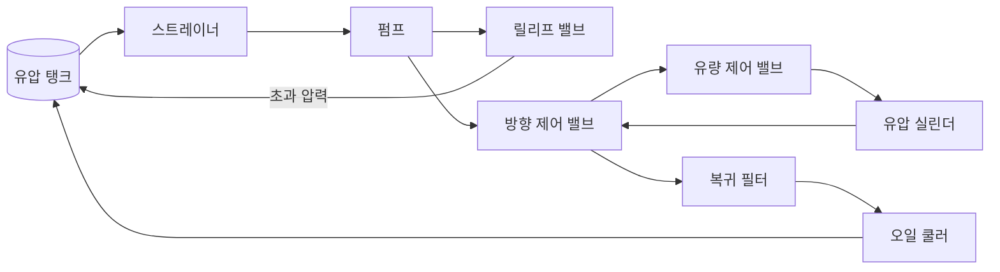

# 유압 기초와 작동유

> [!summary] 핵심 요약
> - 유압 동력 $L = P \times Q$. 실용식 $L[\text{kW}] = \dfrac{P[\text{MPa}] \times Q[\text{L/min}]}{60}$.
> - 유압 장치 구성: **유압 탱크 → 펌프 → 압력·유량·방향 제어 밸브 → 액추에이터 → 탱크 귀환**.
> - 작동유에 중요한 성질은 **점도**. **점도 지수(VI)** 가 높을수록 온도가 변해도 점도 변화가 작다.
> - **캐비테이션**: 압력이 증기압 아래로 떨어져 기포가 생겼다 터지는 현상 → 소음·진동·침식.

> [!warning] 자주 틀리는 포인트
> - 점도가 **너무 높으면** 마찰 손실·동력 손실·캐비테이션·응답 지연. **너무 낮으면** 누설 증가·윤활 불량·마모·용적 효율 저하.
> - 작동유 적정 온도는 대략 **40~60 ℃**. 너무 뜨거우면 산화·열화가 빨라진다.
> - **에어레이션**은 작동유에 공기가 거품으로 섞이는 것, **캐비테이션**은 압력 저하로 기포가 생기는 것. 원인이 다르다.
> - 유압 탱크 용량은 **펌프 1분 토출량의 약 3배 이상**이 흔한 기준. 흡입관과 복귀관 사이에 **격판(배플)**.
> - 난연성 작동유: **물–글리콜계, 인산 에스테르계, W/O 에멀젼** (제철소, 다이캐스팅 등 화재 위험 장소).
> - 작동유는 **비압축성**이어야 한다. "동력을 확실히 전달하려면 압축성"처럼 거꾸로 쓴 보기가 단골 오답이다.
> - 유압은 **무단 변속이 가능**하고, **작은 장치로 큰 힘**을 낸다. 반대로 쓴 보기("무단변속 불가", "큰 출력 불가")가 오답으로 나온다.
> - 유압은 **유온(점도) 영향을 받는다** → 온도가 변하면 속도가 변한다. "유온 영향이 없다"는 틀린 말.
> - 전기식과 비교하면 유압은 **고속 회전을 얻기 어렵고**, 과부하는 릴리프 밸브로 **간단하고 안전하게** 막는다.

## 개념 정리

### 유압의 장단점

| 장점 | 단점 |
| --- | --- |
| 작은 장치로 큰 힘 | 기름 누설, 화재 위험 |
| 무단 변속, 정밀 속도·위치 제어 | 온도에 따라 점도·속도 변화 |
| 과부하 방지 쉬움 (릴리프 밸브) | 배관·탱크 필요, 오염 관리 |
| 원격·자동 제어 쉬움 | 소음, 에너지 손실(열) |
| 윤활·방청 자동 | 공압보다 느림 |
| 입력에 대한 응답 빠름 (비압축성) | 전기식보다 고속 회전 얻기 어려움 |

### 동력 계산

- **계산 예**: P = 7 MPa, Q = 30 L/min → $L = 7 \times 30 / 60 = 3.5$ kW
- 펌프 구동 동력(축동력) = 유압 동력 ÷ 펌프 전효율.
  - 전효율 0.85면 $3.5 / 0.85 \approx 4.1$ kW → 모터 5.5 kW 선정.

### 작동유

| 종류 | 특징 |
| --- | --- |
| 석유계(광유) 작동유 | 가장 일반적, 윤활성·방청성 좋음, 가연성 |
| 물–글리콜계 | 난연성, 고무 실 호환, 윤활성 다소 낮음 |
| 인산 에스테르계 | 난연성, 고온 안정, 일부 실·도료 공격 |
| W/O 에멀젼 (유중수적형) | 난연성, 저렴 |
| 생분해성 작동유 | 환경 민감 지역 |

**작동유가 갖춰야 할 성질**: 적당한 점도와 높은 점도 지수, 비압축성, 윤활성, 산화 안정성, 방청·방식성, 소포성(거품이 빨리 꺼짐), 항유화성(물과 잘 분리), 실 재료와 호환.

**작동유의 역할** (교재 CH04 01절): 힘(동력) 전달, 밸브 등 움직이는 부분의 윤활, 열을 흩어 냉각, 불순물 씻어 내기, 유막으로 녹 방지. 필터 기능은 작동유의 역할이 아니다 (교재 1-5).

**점도 지수 기준** (교재 01절): 온도에 따른 점도 변화가 작은 펜실베이니아계 원유를 **100**, 변화가 큰 걸프코스트계를 **0**으로 잡은 상대 지표다. 수치가 클수록 점도 변화가 작다. 교재는 사계절 기온 차가 큰 우리나라에서 이 값이 중요하다고 설명한다.

**점도 단위**: 동점도 ν [mm²/s = cSt]. ISO VG 32, 46, 68 = 40 ℃에서의 동점도 중심값.

### 이상 현상

| 현상 | 원인 | 대책 |
| --- | --- | --- |
| 캐비테이션 | 흡입 저항 큼 (스트레이너 막힘, 흡입관 가늘거나 김, 흡입 높이 큼, 점도 높음) | 흡입관 굵고 짧게, 스트레이너 청소, 유온·점도 적정 |
| 에어레이션 | 흡입 측 공기 유입, 복귀유가 탱크에서 거품 | 배관 조임, 복귀관 끝을 유면 아래로, 배플 |
| 서지 압력 | 밸브 급전환으로 순간 고압 | 어큐뮬레이터, 전환 속도 완화 |
| 채터링 | 릴리프 밸브 등이 떨며 소음 | 밸브 조정·교체 |
| 유온 상승 | 릴리프로 계속 배출, 내부 누설, 냉각 부족 | 언로드 회로, 오일 쿨러 |

### 유압 탱크

| 구성 | 역할 |
| --- | --- |
| 격판 (배플) | 복귀유와 흡입유 분리 → 기포·이물 분리, 방열 |
| 흡입 스트레이너 | 펌프 흡입 쪽 큰 이물 제거 |
| 주유구 + 에어 브리더 | 급유, 공기 출입 시 먼지 차단 |
| 유면계 | 유량·유온 확인 |
| 드레인 플러그 | 바닥 침전물 배출 (바닥은 경사) |

- 교재(CH04 06절)의 기름 탱크 구비 조건:
  - 돌아오는 기름을 모두 받을 크기. 용량은 고정식이 펌프 분당 토출량의 **3~5배**, 이동식은 115~120 %.
  - 유면은 늘 흡입 라인보다 위, 열 방산과 공기·이물 분리가 가능할 것.
  - 탱크 바닥은 바닥면에서 약 **15 cm** 띄운다.
  - 스트레이너 유량과 에어 브리더 통기 용량은 펌프 토출량의 **2배 이상**. "토출량과 같은 정도"는 틀린 보기 (교재 6-3).
  - 안을 완전히 청소할 수 있는 구조.
- 복귀관 끝은 **유면 아래**, 45° 경사로 잘라 탱크 벽 쪽으로 → 거품 방지.

### 오염 관리

- 고장의 상당 부분이 **작동유 오염**에서 생긴다.
- 오염도 등급: NAS 1638, ISO 4406 (숫자가 작을수록 깨끗).
- 필터: 흡입 스트레이너, 압력 라인 필터, 복귀 라인 필터, 에어 브리더.

## 그림

## 기출 포인트

> 출처: 생산자동화산업기사 필기 2014–2020 (cbtbank.kr). 3과목 자동제어에 섞여 나왔다.

- 유압(제어)의 일반 특징 — 장점과 단점을 뒤바꾼 보기 고르기 (무단 변속, 큰 출력, 응답성, 유온 영향, 전기식 대비 특징) — 4회 (2014-2, 2015-2, 2017-3, 2018-2)
- 작동유 구비 조건 — 압축성을 요구하는 보기가 오답 — 3회 (2014-3, 2016-2, 2019-3)

**교재 예제 유형** (Win-Q 2025 PART 01 CHAPTER 04, 01·06·13절): 온도에 따른 점도 변화를 나타내는 값(점도 지수), 작동유 기능이 아닌 것(필터 기능), 오일 탱크 구비 조건 중 틀린 것(스트레이너 유량 2배 이상), 유압 특징 중 틀린 것(무단 변속 불가), 유압 특징이 아닌 것(유온 영향 없음), 작동유 조건 중 틀린 것(압축성), 전기식 대비 유압 특징이 아닌 것(과부하 시 불안정).
- 13절은 01·06절 내용(작동유 역할·구비 조건, 축압기)을 유압 쪽에서 다시 정리한 절이다. 예제 13-1·13-2·13-4는 위 기출 4회·3회와 같은 유형이다.
- 13-5 해설은 "유압 동력 장치는 안정적이고 과부하를 일으키지 않는다"고 단정한다. 실제로는 릴리프 밸브가 과부하를 막아 주기 때문에 안정적이라는 뜻으로 읽는다.

## 관련 단원

- [공유압 기초](공유압_기초.md)
- [유압 펌프](유압_펌프.md)
- [유압 밸브](유압_밸브.md)
- [공유압 시험운전과 안전](공유압_시험운전과_안전.md)

## 체크리스트

- [ ] 유압 동력과 모터 동력을 계산한다
- [ ] 유압의 장단점을 말한다
- [ ] 점도가 너무 높을 때와 낮을 때의 문제를 구분한다
- [ ] 캐비테이션과 에어레이션의 원인·대책을 안다
- [ ] 난연성 작동유 3종을 말한다
- [ ] 유압 탱크 구성 요소와 역할을 안다
- [ ] 작동유 구비 조건에서 '압축성' 함정을 바로 찾는다
- [ ] 유압 특징 보기에서 장단점이 뒤바뀐 것을 고른다 (무단 변속, 유온 영향, 고속 회전)

## 참고

- [큐넷 자동화설비산업기사 출제기준](https://www.q-net.or.kr/crf005.do?id=crf00503&jmCd=2034)
