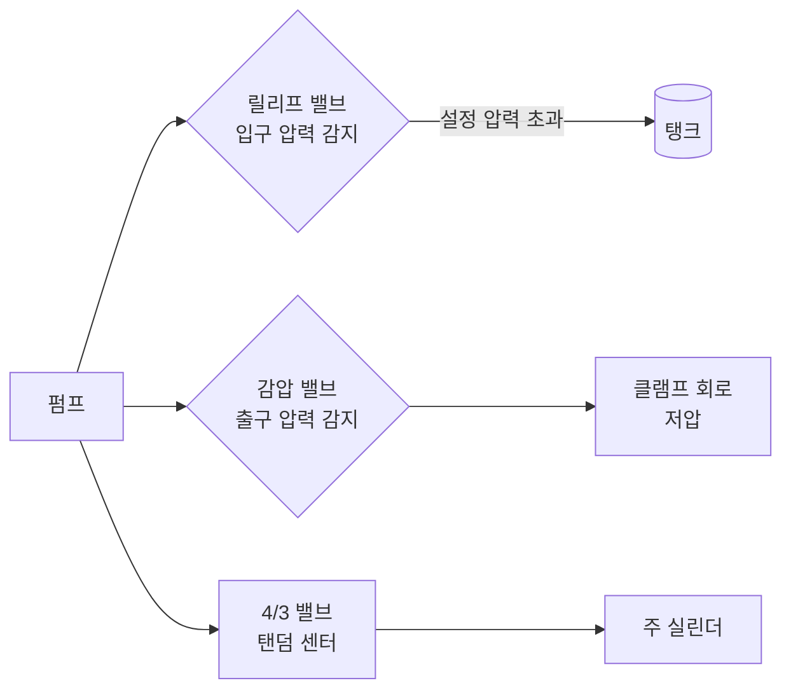

# 유압 밸브

> [!summary] 핵심 요약
> - **압력 제어 밸브**: 릴리프(최고 압력 제한), 감압(분기 회로 압력 낮춤), 시퀀스(순서), 카운터밸런스(낙하 방지), 언로드(펌프 무부하).
> - **유량 제어 밸브**: 교축 밸브, **압력 보상형 유량 조절 밸브**(부하가 변해도 유량 일정).
> - **방향 제어 밸브**: 체크, 파일럿 조작 체크, 방향 전환 밸브(스풀형).
> - 4/3 밸브 **탠덤 센터(PT 접속)**: 중립에서 **펌프 무부하 + 실린더 고정**.

> [!warning] 자주 틀리는 포인트
> - 릴리프 밸브는 **입구(1차) 압력**을 감지하고 평소 닫혀 있다(NC). 감압 밸브는 **출구(2차) 압력**을 감지하고 평소 열려 있다(NO).
> - **크래킹 압력**: 밸브가 열리기 시작하는 압력. **압력 오버라이드**: 전량 배출 압력 − 크래킹 압력 → 평형 피스톤형(파일럿형)이 작다.
> - **카운터밸런스 밸브**는 수직 실린더 하강 쪽(배출 쪽)에 배압을 걸어 **자중 낙하를 막는다**.
> - **파일럿 조작 체크 밸브**는 파일럿 압력이 있을 때만 역방향 흐름 허용 → **로킹 회로**.
> - 오픈 센터는 펌프 무부하지만 실린더가 **자유**, 클로즈드 센터는 실린더 고정이지만 펌프가 **릴리프로 배출**(발열).

## 개념 정리

### 압력 제어 밸브

| 밸브 | 감지 | 정상 상태 | 기능 |
| --- | --- | --- | --- |
| 릴리프 밸브 | 입구 | 닫힘 | 회로 최고 압력 제한, 안전 |
| 감압 밸브 | 출구 | 열림 | 일부 회로 압력을 낮게 유지 |
| 시퀀스 밸브 | 입구 | 닫힘 | 설정 압력 도달 후 다음 회로 작동 |
| 카운터밸런스 밸브 | 입구 | 닫힘 | 배압 유지, 낙하 방지 (체크 밸브 내장) |
| 언로드 밸브 | 외부 파일럿 | 닫힘 | 외부 신호로 펌프 유량을 탱크로 → 동력 절감 |
| 압력 스위치 | – | – | 압력 → 전기 신호 |

**릴리프 밸브 형식**

| 형식 | 특징 |
| --- | --- |
| 직동형 | 스프링이 직접 포핏을 누름, 응답 빠름, 오버라이드 큼, 소용량 |
| 평형 피스톤형 (파일럿형) | 작은 파일럿 밸브가 주 밸브 제어, 오버라이드 작음, 대용량, **원격 압력 조절(벤트 포트)** 가능 |

### 유량 제어 밸브

| 밸브 | 특징 |
| --- | --- |
| 교축 밸브 (니들) | 단순, 부하 압력이 변하면 유량도 변함 |
| 체크 붙이 교축 밸브 | 한 방향만 조절 |
| 압력 보상형 유량 조절 밸브 | 교축 앞뒤 압력차를 일정하게 유지 → 부하 변해도 유량 일정 |
| 온도 보상형 | 온도(점도) 변화 영향까지 보정 |
| 분류 밸브 | 한 유량을 일정 비율로 나눔 (동기 회로) |

### 방향 제어 밸브

| 밸브 | 기능 |
| --- | --- |
| 체크 밸브 | 한 방향 흐름, 역류 방지 |
| 파일럿 조작 체크 밸브 | 파일럿 신호 시 역방향 허용 → 실린더 위치 유지 |
| 셔틀 밸브 | 두 입구 중 높은 압력 쪽 선택 |
| 방향 전환 밸브 (스풀형) | 2위치·3위치, 솔레노이드·파일럿·수동 조작 |
| 감속 밸브 | 캠으로 스풀을 눌러 행정 끝 감속 |

**4/3 방향 전환 밸브 중립 형식**

| 형식 | 중립 연결 | 펌프 | 실린더 |
| --- | --- | --- | --- |
| 올 포트 블록 (클로즈드 센터) | 모두 차단 | 부하 (릴리프로 배출) | 고정 |
| 오픈 센터 (올 포트 오픈) | 모두 연결 | 무부하 | 자유 |
| 탠덤 센터 (PT 접속) | P–T 연결, A·B 차단 | 무부하 | 고정 |
| ABT 접속 (플로트 센터) | A·B–T 연결, P 차단 | 부하 | 자유 |
| PAB 접속 | P–A–B 연결 | – | 차동 회로 |

### 서보·비례 밸브

- **비례 전자 밸브**: 전류 크기에 비례해 압력·유량·방향을 연속 제어 (가감속 부드럽게).
- **서보 밸브**: 토크 모터 + 피드백, 고응답·고정밀. 오염에 매우 민감 → 고급 필터.
- **로직 밸브(카트리지 밸브)**: 포핏 구조, 대유량, 블록에 삽입.

## 그림

## 관련 단원

- [유압 회로](유압_회로.md)
- [유압 펌프](유압_펌프.md)
- [공압 밸브](공압_밸브.md)
- [유압 액추에이터와 부속기기](유압_액추에이터와_부속기기.md)

## 체크리스트

- [ ] 릴리프·감압 밸브의 감지 위치와 정상 상태를 구분한다
- [ ] 크래킹 압력과 압력 오버라이드를 설명한다
- [ ] 시퀀스·카운터밸런스·언로드 밸브 용도를 안다
- [ ] 압력 보상형 유량 조절 밸브의 장점을 안다
- [ ] 4/3 밸브 중립 형식 5가지를 펌프·실린더 상태로 구분한다
- [ ] 파일럿 조작 체크 밸브의 용도를 안다

## 참고

- [큐넷 자동화설비산업기사 출제기준](https://www.q-net.or.kr/crf005.do?id=crf00503&jmCd=2034)
- ISO 1219-1 (유공압 도면 기호)
