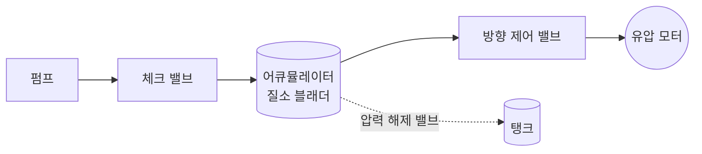

# 유압 액추에이터와 부속기기

> [!summary] 핵심 요약
> - **유압 실린더**: 직선 운동. 속도 $v = Q/A$, 힘 $F = PA$.
> - **유압 모터**: 연속 회전. 토크 $T = \dfrac{Pq}{2\pi}$ (q: 1회전 배제 용적), 회전수 $N = Q/q$.
> - **어큐뮬레이터(축압기)**: 압력 에너지 저장 → 보조 동력, 맥동·서지 흡수, 누설 보충, 비상 동력.
> - 부속기기: 필터, 오일 쿨러·히터, 압력계, 배관·호스, 실(패킹).

> [!warning] 자주 틀리는 포인트
> - 어큐뮬레이터에는 **질소 가스**를 봉입한다. **산소·공기는 폭발 위험**으로 금지.
> - 어큐뮬레이터가 있는 회로는 **펌프를 꺼도 압력이 남는다** → 정비 전 반드시 압력 해제.
> - **차동 실린더**(편로드)는 같은 유량이면 후진이 빠르고, 같은 압력이면 전진 힘이 크다.
> - 고압에서 O링이 틈새로 밀려 나오는 것을 막으려고 **백업 링**을 함께 쓴다.
> - **텔레스코픽 실린더**는 짧은 길이로 긴 행정 (덤프트럭).
> - 어큐뮬레이터 용도에 **기름 속 공기·이물 분리는 없다** (그건 탱크 배플·필터의 일).
> - **요동 모터는 연속 회전 모터가 아니다** (제한 각도 왕복). 연속 회전: 기어·베인·피스톤 모터.
> - 양쪽 수압 면적이 같아 전·후진 **속도와 힘이 같은** 실린더 = **양로드 실린더**. 텐덤은 힘 증대, 다위치는 정지 위치 증가.
> - 냉동식 오일 쿨러는 **냉각수가 필요 없고**, 대기·수온보다 낮게도 식힐 수 있으며 유온 자동 조정에 유리하다.

## 개념 정리

### 유압 실린더

| 종류 | 특징 |
| --- | --- |
| 단동 실린더 | 한 방향만 유압, 복귀는 자중·스프링 (램형) |
| 복동 편로드 (차동) 실린더 | 가장 일반적 |
| 복동 양로드 실린더 | 전후진 속도·힘 같음 |
| 텔레스코픽 실린더 | 다단, 긴 행정 |
| 텐덤 실린더 | 같은 지름으로 큰 힘 |

**계산 예**: D = 80 mm, 7 MPa, Q = 20 L/min
- $A = \pi \times 80^2/4 \approx 5027$ mm² → $F = 7 \times 5027 \approx 35{,}200$ N (약 35 kN)
- $v = \dfrac{20 \times 10^6 / 60}{5027} \approx 66$ mm/s

- **쿠션 장치**: 행정 끝에서 배출 유로를 조여 감속.
- 실린더 부착 시 로드에 **횡하중**이 걸리지 않게(가이드 사용).

### 유압 모터

| 종류 | 특징 |
| --- | --- |
| 기어 모터 | 간단, 고속 |
| 베인 모터 | 토크 맥동 적음 |
| 피스톤 모터 (액시얼·레이디얼) | 고압·고토크, 저속 대토크 |
| 요동 모터 | 제한된 각도 회전 (베인형, 랙·피니언형) |

- **계산 예**: q = 50 cc/rev, P = 10 MPa → $T = \dfrac{10 \times 50{,}000}{2\pi} \approx 79{,}600$ N·mm ≈ **80 N·m** (MPa × mm³ = N·mm).
- 회전수: Q = 30 L/min → $N = 30{,}000 / 50 = 600$ rpm.

### 어큐뮬레이터

| 형식 | 특징 |
| --- | --- |
| 블래더형 | 고무 주머니에 질소, 응답 빠름, 가장 많이 사용 |
| 피스톤형 | 대용량, 고압 |
| 다이어프램형 | 소용량 |
| 중추형·스프링형 | 무게·스프링으로 압력 (드묾) |

**용도**: 에너지 저장(간헐 운전 시 펌프 용량 축소), 서지 압력 흡수, 펌프 맥동 흡수, 누설 보상(압력 유지), 정전 시 비상 동력.

### 부속기기

| 기기 | 역할 |
| --- | --- |
| 흡입 스트레이너 | 펌프 흡입 쪽 큰 이물 |
| 라인 필터 (압력·복귀) | 미세 이물, 막힘 표시기 |
| 오일 쿨러 | 수냉식, 공랭식, 냉동식 → 유온 유지 |
| 히터 | 저온 시동 시 점도 낮춤 |
| 압력계 | 맥동 흡수용 게이지 콕·댐퍼 |
| 고무 호스 | 움직이는 부분 연결, 꼬임·급굽힘 금지 |
| 매니폴드 블록 | 밸브를 블록에 모아 배관 축소 |

### 실(밀봉 요소)

| 종류 | 용도 |
| --- | --- |
| O링 | 가장 범용, 고정·운동용 |
| 백업 링 | O링 밀려남 방지 (고압) |
| U 패킹 | 실린더 피스톤·로드, 한 방향 |
| V 패킹 | 고압, 겹쳐 사용 |
| 더스트 와이퍼 | 로드에 묻은 먼지 제거 |
| 오일 실 | 회전축 |

- 실 손상 원인: 이물, 로드 흠집, 고온, 작동유와 실 재질 불일치.

### 오일 쿨러 비교

| 형식 | 특징 |
| --- | --- |
| 수냉식 | 냉각 능력 큼, 냉각수 배관·수질 관리 필요 |
| 공랭식 | 팬으로 냉각, 물 불필요, 대기 온도 이하로는 못 식힘 |
| 냉동식 | 냉동기 사용, 물 불필요, 대기·수온 이하 냉각 가능, 유온 자동 조정 쉬움, 설비비 큼 |

## 그림

## 기출 포인트

> 출처: 생산자동화산업기사 필기 2014–2020 (cbtbank.kr). 3과목 자동제어에 섞여 나왔다.

- 어큐뮬레이터 용도 중 틀린 것 (공기·이물 분리) — 1회 (2018-2). 공압 구성기기 문제에서 "유압 전용 기기"로도 2회 등장 (2016-3, 2017-1) → [공기압축기와 공기조정](공기압축기와_공기조정.md)
- 연속 회전용 유압 모터가 아닌 것 (요동 모터) — 1회 (2015-1)
- 전·후진 속도가 같은 실린더 (양로드) — 1회 (2019-3)
- 냉동식 오일 쿨러 특징 — 1회 (2019-3)
- 관련: 실린더 필요 압력 $P = F/A$ 계산, 실린더 원리(파스칼)는 [공유압 기초](공유압_기초.md)

## 관련 단원

- [유압 밸브](유압_밸브.md)
- [유압 회로](유압_회로.md)
- [공압 액추에이터](공압_액추에이터.md)
- [공유압 시험운전과 안전](공유압_시험운전과_안전.md)

## 체크리스트

- [ ] 유압 실린더의 힘과 속도를 계산한다
- [ ] 유압 모터의 토크와 회전수를 계산한다
- [ ] 어큐뮬레이터 용도 5가지를 말한다
- [ ] 어큐뮬레이터 봉입 가스와 정비 시 주의를 안다
- [ ] 필터 설치 위치를 구분한다
- [ ] O링·백업 링·와이퍼 역할을 안다
- [ ] 어큐뮬레이터 용도가 아닌 것을 골라낸다
- [ ] 연속 회전 모터와 요동 모터를 구분한다
- [ ] 수냉식·공랭식·냉동식 오일 쿨러를 비교한다

## 참고

- [큐넷 자동화설비산업기사 출제기준](https://www.q-net.or.kr/crf005.do?id=crf00503&jmCd=2034)
