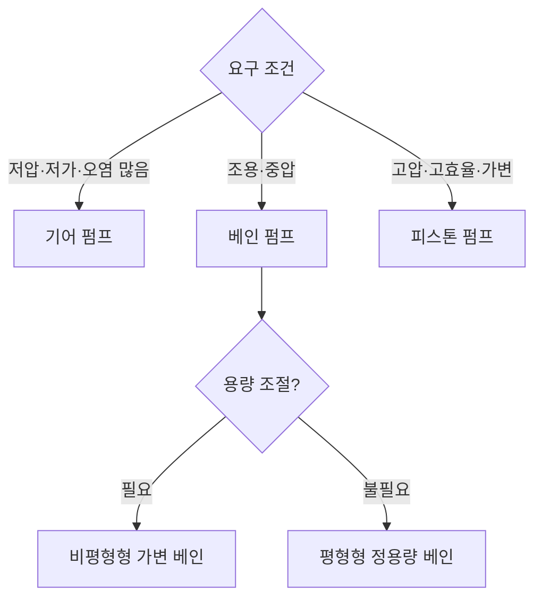

# 유압 펌프

> [!summary] 핵심 요약
> - 유압 펌프는 **용적형**: 밀폐된 공간의 부피 변화로 기름을 밀어낸다 (토출량이 압력에 거의 영향받지 않음).
> - 3대 펌프: **기어**(간단·저렴·오염에 강함), **베인**(조용·맥동 적음), **피스톤**(고압·고효율·가변 용량).
> - 이론 토출량 $Q_{th} = q \times N$ (1회전 배제 용적 × 회전수).
> - **전효율 = 용적 효율 × 기계 효율**. 용적 효율 = 실제 토출량 / 이론 토출량.

> [!warning] 자주 틀리는 포인트
> - **가변 용량형**이 가능한 것: **비평형형 베인 펌프, 피스톤 펌프**. 기어 펌프와 평형형 베인 펌프는 **정용량**.
> - 피스톤 펌프는 성능이 좋지만 **오염에 가장 민감**하고 비싸다.
> - 펌프가 기름을 안 내보내는 흔한 원인: **회전 방향 반대**, 흡입 측 막힘·공기 유입, 유면 너무 낮음, 점도 너무 높음.
> - 펌프는 **유량**을 만들고, **압력은 부하(저항)** 가 만든다.

## 개념 정리

### 펌프 종류 비교

| 종류 | 압력 | 효율 | 소음 | 오염 내성 | 용량 | 비고 |
| --- | --- | --- | --- | --- | --- | --- |
| 외접 기어 | 중 | 중 | 큼 | 강함 | 정용량 | 구조 간단, 저렴 |
| 내접 기어·트로코이드 | 중 | 중 | 작음 | 강함 | 정용량 | 소형, 조용 |
| 평형형 베인 | 중 | 중~높음 | 작음 | 중 | 정용량 | 축 하중 평형 |
| 비평형형 베인 | 중 | 중 | 작음 | 중 | **가변** | 편심량 조절 |
| 액시얼 피스톤 (사판식·사축식) | 고 | 높음 | 중 | 약함 | **가변** | 경사각으로 용량 조절 |
| 레이디얼 피스톤 | 고 | 높음 | 중 | 약함 | 가변 | 대형·고압 |

### 펌프 계산

| 항목 | 식 |
| --- | --- |
| 이론 토출량 | $Q_{th} = q N$ |
| 실제 토출량 | $Q = Q_{th} \eta_v$ |
| 유압 동력 | $L = PQ$ |
| 축동력 | $L_s = \dfrac{PQ}{\eta}$ |
| 전효율 | $\eta = \eta_v \times \eta_m$ |

**계산 예**: q = 20 cc/rev, N = 1500 rpm, 용적 효율 0.9
- $Q_{th} = 20 \times 1500 = 30{,}000$ cc/min = 30 L/min
- 실제 $Q = 27$ L/min

### 가변 용량 펌프 제어

- **압력 보상형**: 설정 압력에 가까워지면 토출량을 자동으로 줄임 → 릴리프 손실·발열 감소.
- 로드 센싱, 정마력 제어 등.

### 펌프 소음·고장

| 증상 | 원인 |
| --- | --- |
| 소음 | 캐비테이션, 공기 흡입, 커플링 어긋남, 회전수 과다 |
| 토출 부족 | 내부 마모(누설), 점도 낮음, 흡입 막힘 |
| 발열 | 내부 누설, 고압 지속 운전 |
| 토출 없음 | 회전 방향 반대, 흡입 쪽 공기 유입, 유면 저하 |

### 설치·운전 요령

- 펌프와 모터 **축 정렬**, 플렉시블 커플링 사용.
- 흡입 쪽: 굵고 짧은 관, 흡입 높이 낮게, 스트레이너.
- 처음 기동 시 펌프 케이싱에 기름 채우기, **조그(촌동) 운전으로 회전 방향 확인**.
- 기동 시 무부하(언로드) 상태로 시작.

## 그림

## 관련 단원

- [유압 기초와 작동유](유압_기초와_작동유.md)
- [유압 밸브](유압_밸브.md)
- [유압 회로](유압_회로.md)

## 체크리스트

- [ ] 기어·베인·피스톤 펌프의 특징을 비교한다
- [ ] 가변 용량이 가능한 펌프를 고른다
- [ ] 배제 용적과 회전수로 토출량을 계산한다
- [ ] 용적·기계·전효율 관계를 안다
- [ ] 펌프가 토출하지 않는 원인을 말한다
- [ ] 압력 보상형 가변 펌프의 장점을 안다

## 참고

- [큐넷 자동화설비산업기사 출제기준](https://www.q-net.or.kr/crf005.do?id=crf00503&jmCd=2034)
