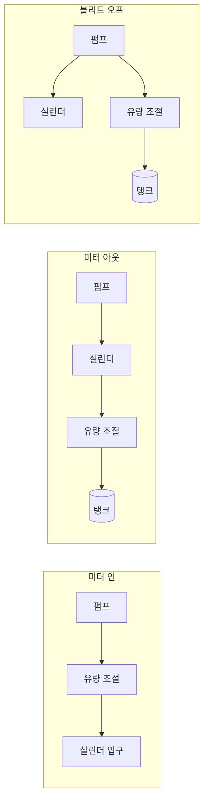

# 유압 회로

> [!summary] 핵심 요약
> - 속도 제어 3가지: **미터 인**(입구 교축), **미터 아웃**(출구 교축), **블리드 오프**(펌프 유량 일부를 탱크로 바이패스).
> - **차동 회로**: 전진할 때 로드 쪽 기름을 헤드 쪽으로 합류 → **빠른 전진, 힘은 로드 단면적 몫으로 감소**.
> - **언로드 회로**: 실린더가 멈춰 있을 때 펌프 유량을 저압으로 탱크에 돌림 → 동력 절감·발열 감소.
> - **카운터밸런스 회로**: 수직 실린더 자중 낙하 방지. **로킹 회로**: 파일럿 체크 밸브로 위치 유지.

> [!warning] 자주 틀리는 포인트
> - **미터 아웃**은 부하가 실린더를 끌고 가는 경우(음의 부하, 드릴 관통)에도 속도가 안정적이다. **미터 인**은 끌려가는 부하에 약하다.
> - 미터 인·미터 아웃은 남는 유량이 **릴리프 밸브로 배출**돼 발열이 크다. **블리드 오프**는 효율이 좋지만 속도 정밀도가 낮다.
> - 차동 회로 전진 속도 $v = \dfrac{Q}{A_{로드}}$ (로드 단면적), 힘 $F = P \cdot A_{로드}$.
> - **시퀀스 회로**의 순서는 압력으로 정해진다: 앞 실린더가 끝까지 가 압력이 오르면 다음 실린더 동작.
> - **속도 제어 회로는 미터 인·미터 아웃·블리드 오프 세 가지뿐**. 로킹·카운터밸런스(위치 유지·낙하 방지), 언로드(동력 절감)는 속도 제어가 아니고, 플립플롭은 유압 회로 이름이 아니라 기억(논리) 회로다.
> - 회로도에서 유량 제어 밸브가 **실린더 입구 쪽**(펌프→실린더 사이)에 있으면 미터 인, **출구 쪽**(실린더→탱크 사이)이면 미터 아웃, 실린더와 **병렬로 탱크에 빠지는 분기**에 있으면 블리드 오프.

## 개념 정리

### 압력 제어 회로

| 회로 | 구성 | 용도 |
| --- | --- | --- |
| 최고 압력 제한 회로 | 펌프 출구 릴리프 밸브 | 안전 |
| 다단 압력 회로 | 주 릴리프 벤트 포트에 원격 릴리프 여러 개 + 전환 밸브 | 공정마다 압력 변경 |
| 감압 회로 | 분기 회로에 감압 밸브 | 클램프는 저압, 주 작업은 고압. 제한하는 것은 감압 밸브 **출구(2차)** 쪽 압력이다 |
| 언로드 회로 | 탠덤 센터 밸브, 언로드 밸브 + 어큐뮬레이터 | 대기 시 펌프 무부하 |
| 카운터밸런스 회로 | 하강 쪽 출구에 카운터밸런스 밸브 | 수직 프레스 낙하 방지 |
| 증압 회로 | 증압기(인텐시파이어) | 펌프 압력보다 높은 압력 |
| 축압 회로 | 어큐뮬레이터 | 보조 동력, 압력 유지 |

### 속도 제어 회로

| 방식 | 유량 조절 위치 | 장점 | 단점 |
| --- | --- | --- | --- |
| 미터 인 | 실린더 입구 | 정부하(밀어내는 부하)에 정밀 | 음의 부하에 약함, 릴리프 발열 |
| 미터 아웃 | 실린더 출구 | 음의 부하에도 안정, 배압 | 로드 쪽 압력 상승, 발열 |
| 블리드 오프 | 펌프–탱크 바이패스 | 효율 좋음 (펌프 압력 = 부하 압력) | 속도 정밀도 낮음 |

- 교재(CH04 12절)는 미터 인을 "구분은 확실하나 작동성이 떨어질 수 있음", 미터 아웃을 "작동성이 확실하고 **가장 많이 사용**", 블리드 오프를 "남는 유량을 탱크로 돌려 밸브 과부하를 막음, 회수 오일 관리 필요"로 정리한다.
- 교재의 회로 분류: 유체를 제어하는 대상은 **경로(방향), 압력 크기, 유량(속도)** 세 가지다.
- **급속 전진 → 저속 이송** 회로: 감속 밸브나 리밋 스위치로 유량 경로 전환 (공작기계 이송).

### 방향·기타 회로

| 회로 | 구성 | 특징 |
| --- | --- | --- |
| 차동 회로 (교재: **재생 회로**) | 전진 시 로드 쪽과 헤드 쪽 연결 (PAB 접속) | 배출유를 전진 쪽에 더해 급속 전진 |
| 로킹 회로 | 파일럿 조작 체크 밸브 2개, 탠덤·ABT 센터 | 정지 위치 유지 |
| 시퀀스 회로 | 시퀀스 밸브 | 클램프 후 가공. 교재는 "한 실린더가 끝난 뒤 배압으로 다음 실린더를 움직인다"고 설명 |
| 동기 회로 | 유량 조절 밸브, 분류 밸브, 직렬 실린더, 기계적 연결, 서보 | 두 실린더 같은 속도 |
| 브레이크 회로 | 유압 모터 출구 릴리프 | 모터 관성 정지 |

**차동 회로 계산 예**: 헤드 쪽 면적 5000 mm², 로드 단면적 2000 mm², Q = 30 L/min (= 500,000 mm³/s)
- 일반 전진 속도 = 500,000 / 5000 = 100 mm/s
- 차동 전진 속도 = 500,000 / 2000 = **250 mm/s** (힘은 2/5로 감소)

### 회로 설계 순서

1. 동작 순서와 요구 조건(힘·속도·행정) 정리.
2. 액추에이터 크기 결정 ($A = F/P$).
3. 필요 유량 계산 ($Q = Av$) → 펌프 선정.
4. 압력·유량·방향 제어 방식 결정 → 회로도 작성.
5. 동력·발열 계산 → 모터, 탱크, 쿨러 선정.

## 그림

## 기출 포인트

> 출처: 생산자동화산업기사 필기 2014–2020 (cbtbank.kr). 3과목 자동제어에 섞여 나왔다.

- 유압 실린더 속도 제어 회로 — 회로도에서 입구 쪽 교축을 보고 미터 인 판별, 속도 제어 회로 세 가지 묶음 고르기 — 2회 (2018-3, 2020-3)
**교재 예제 유형** (Win-Q 2025 PART 01 CHAPTER 04, 12절): 출구 쪽 유량 제어 밸브로 전·후진 속도를 조절하는 회로(미터 아웃), 속도 제어 회로 묶음(미터 인·미터 아웃·블리드 오프). 교재는 플립플롭을 기억용, 로킹 회로를 이동 제한용이라고 구분한다. 회로도 (c)~(h)는 그림이라 교재로 직접 본다.

- 출제 빈도는 낮지만 새 출제기준에 "회로구성"이 독립 항목이므로 언로드·카운터밸런스·시퀀스·차동 회로도 함께 대비한다.

## 관련 단원

- [유압 밸브](유압_밸브.md)
- [공유압 기호](공유압_기호.md)
- [유압 액추에이터와 부속기기](유압_액추에이터와_부속기기.md)
- [공압 회로](공압_회로.md)

## 체크리스트

- [ ] 미터 인·미터 아웃·블리드 오프를 그리고 장단점을 말한다
- [ ] 음의 부하에 맞는 속도 제어 방식을 고른다
- [ ] 차동 회로 속도와 힘을 계산한다
- [ ] 언로드·카운터밸런스·로킹 회로 목적을 안다
- [ ] 감압·시퀀스 회로의 동작 순서를 설명한다
- [ ] 동기 회로 방법을 말한다
- [ ] 회로도에서 유량 제어 밸브 위치로 미터 인·아웃·블리드 오프를 판별한다
- [ ] 속도 제어 회로가 아닌 회로 이름(로킹, 카운터밸런스, 언로드, 플립플롭)을 골라낸다

## 참고

- [큐넷 자동화설비산업기사 출제기준](https://www.q-net.or.kr/crf005.do?id=crf00503&jmCd=2034)
